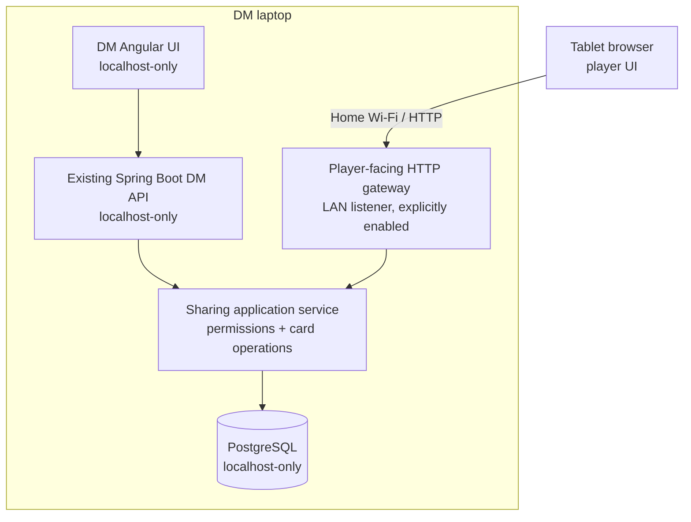

# Future feature proposal — campaign card sharing

**Status:** Deferred product requirements / owner-confirmed direction, 2026-10-24. **Not part of the active implementation scope.** This document is intentionally isolated from the product specification, implementation plan, Play UX design, and harness instructions. It does not authorize architecture, planning, implementation, or verification. Do not pull this feature into an ongoing Codex increment without a new explicit owner request and normal workflow approvals.

## Goal

Let a DM distribute copies of prepared session cards to players' tablets over a local network, without requiring public hosting. Players retain campaign-wide cards and can manage inventory, while the DM can inspect and manage all collections.

## Accepted product direction

- Add a dedicated **Share** tab for the DM, separate from the Play tabletop.
- All prepared cards belonging to the currently selected session are available as sharing sources. Sharing **creates a distinct distributed copy**; it does not remove or relocate the PreparedItem in Preparation or the Play tabletop.
- Collections are **campaign-scoped**, not session-scoped. They persist when the DM changes or finishes sessions.
- A distributed card belongs to either a specific **player** or the **group**. The DM can see and manage all collections; each player sees their own collection and the group collection.
- DM and player can discard inventory cards; the DM can remove distributed cards from a player's collection.
- A player can **claim** a group inventory card, transferring that same distributed instance from group ownership to player ownership (no duplication). Concurrent claims must not create multiple owners.
- The DM can transfer inventory between group and players, including returning a claimed item to the group.
- Use one shared-card mechanism with a lightweight distribution mode:
  - **Handout:** retained, readable reference; DM can remove it. Not claimable.
  - **Inventory:** retained item; claimable from group, discardable by owner and DM.
- The DM selects Handout or Inventory when distributing a card; the source card's authored type does not force the mode.
- Distributed content is a **frozen snapshot** (text and artwork) at sharing time; later edits to the authored/prepared source do not silently change existing copies.
- Tablet experience should reuse existing card geometry, artwork, and document rendering where appropriate; support full document viewing.
- Favor the existing locally running backend and database, with a read-only or narrowly scoped player web interface accessed via local-network link/QR pairing. No mandatory cloud hosting or player accounts. Exact pairing/security and connection design remain to be specified.
- **Initial scope is online-only:** no offline cache, offline reading guarantee, offline discard/claim, or synchronization/conflict resolution. The DM's local application must be running and reachable for players to access or change collections.
- Connected views must reflect authoritative changes; polling or simple refresh is acceptable initially. No real-time transport is required as a product constraint.

## Domain boundaries to preserve

- **Writing** owns authored cards and artwork.
- **Preparation** owns session membership and frozen PreparedItems.
- **Playthroughs** owns DM tabletop placement, active Scene, piles, Used, and PlayNotes.
- A future **Sharing** responsibility would own distributed instances, campaign/player/group ownership, claim/transfer/discard state, and player-facing access.
- A distributed instance is **not** the same identity as a PreparedItem and is **not** constrained by Play's unique-location invariant. Multiple separately shared instances may reference the same source snapshot.
- Group inventory is one shared collection, **not** an automatic copy in every player's personal inventory.
- Sharing must not mutate Play piles or Preparation membership.

## Candidate flows

1. DM opens Share tab, selects a prepared session card, chooses Handout/Inventory and a player or group, then distributes a frozen copy.
2. Player opens their collection on a tablet; DM can inspect the same collection in Workbench.
3. Player discards an owned inventory card; DM can also discard/remove it. Both views subsequently reflect the change.
4. Player claims a group inventory card; backend atomically transfers its owner to the player. Other claims against the former group ownership fail gracefully.
5. DM transfers a card back to the group or another player without duplicating it.

## Deferred decisions for a later requirements/architecture phase

- Player identity, device pairing/reconnection, token revocation, LAN isolation, and secure authorization of player vs DM operations.
- Whether a player may voluntarily remove a Handout, and whether a removed/discarded card remains visible in history.
- Whether individual inventory cards may be shared in multiple quantities, and any future quantity/stacking UX.
- Precise transfer permissions, including player-to-player transfers (not currently approved).
- Campaign player roster lifecycle, group membership, and handling of disconnected devices.
- Whether sharing from the current session alone is sufficient or later requires broader Library sourcing.
- Exact responsiveness, accessibility, and failure/reconnect feedback for tablets.
- Offline access, offline caching, and offline synchronization are **explicitly excluded from the initial feature**, not assumed requirements.

## Workflow / non-interference

This is a parked feature proposal. It must **not** change current task priorities, existing accepted Play UX decisions, current implementation increments, or Codex's active scope. Do not modify existing docs, app code, tests, migrations, or harness files as part of this documentation-only change. When the owner explicitly resumes the feature, reconcile this document with the then-current repository and progress through the required phase gates.

## Network and security architecture refinement (2026-10-24)

**Decision status:** Owner accepted the **trusted home Wi-Fi / local HTTP** deployment assumption. The technical layout below is a proposed design direction requiring subsequent architecture approval and verification against the then-current code; it is not an authorized implementation plan.

### Deployment assumptions and constraints

- The DM runs Campaign Workbench on their laptop. Tablets and laptop connect to the same ordinary home LAN/Wi-Fi with trusted participants.
- No cloud hosting, internet connection, public IP address, router port forwarding, separate tablet installation, or separate database is required.
- **Online-only** remains the initial scope: the laptop and player gateway must be running and reachable. No offline caching, offline operations, or synchronization engine.
- **Local HTTP is accepted for the initial trusted-home-network use case.** HTTPS, certificate management, and stronger network security are potential later improvements, not initial acceptance criteria. HTTP does not encrypt card data or credentials; this trust assumption must be clear in the eventual UX and deployment guidance.
- The sharing service must be explicitly enabled by the DM and disabled by default. Do not automatically expose the DM's existing endpoints on the LAN.

### Observed repository baseline (at refinement time)

- Spring Boot configuration uses `server.address=127.0.0.1`, limiting the existing server to loopback.
- Angular's development server is configured for `127.0.0.1`; it should not be the production tablet-facing server.
- Docker Compose publishes PostgreSQL only to `127.0.0.1`; keep database access local.
- Existing frontend/backend stack: Angular, Kotlin/Spring Boot, PostgreSQL.

### Proposed access boundaries

- Prefer **one Spring Boot application, one PostgreSQL database, and one Angular codebase**, with a dedicated tablet-facing player view and a narrowly scoped player API.
- Investigate a **second LAN-facing HTTP listener in the existing process** as the first option. The DM API must remain unreachable through that listener. A separate allowlisting reverse proxy is an alternative if strict connector/route separation is impractical; it adds runtime infrastructure.
- A separate port **alone is not a security boundary**. The gateway must expose only player-facing routes and enforce authorization server-side. Never forward arbitrary existing DM API requests.
- The player-facing route may serve compiled frontend assets; do not expose the Angular development server.
- Share operations remain owned by the Sharing module. The gateway is transport/access control, not a second implementation of business rules.
- No WebSockets or Kafka requirement: ordinary refresh or revision-based polling is sufficient for initial online-only collection updates.

### Pairing and authorization direction (not yet finalized)

- The DM selects a campaign player and starts a **short-lived, single-use QR pairing flow**.
- The tablet receives a revocable device credential bound to that player/campaign for reconnecting without an external account.
- Player API access is limited to the player's own collection and the campaign's group collection. DM operations use the private DM interface.
- Players may claim active group inventory for themselves and discard their own inventory; they may not manage other players' collections, share cards, or administer pairing.
- DM may distribute cards, manage player/group collections, and revoke device access.
- Validate campaign scope, actor identity, and operation permissions on **every request**; never trust client-supplied player IDs or hide-only UI restrictions.
- Detailed token transport/storage, expiry, CSRF exposure, device revocation semantics, and whether local HTTP is sufficient for the final security model remain open for later architecture review.

### Router and firewall compatibility

- Ordinary home Wi-Fi typically permits local device-to-device connections, including Ethernet-to-Wi-Fi and 2.4 GHz-to-5 GHz clients on the same LAN.
- Guest networks, Wi-Fi/client isolation, segmented VLANs, restrictive mesh setups, and host firewalls can block access. No reliable failure percentage is asserted.
- Prefer an explicit reachable LAN IP address in the QR link over reliance on mDNS or network discovery. DHCP may change the address between sessions.
- Connection UX should distinguish **gateway running locally** from **tablet successfully connected**. A successful server start does not prove LAN reachability.
- When connection fails, guide the DM to check same network, guest/client isolation, and laptop firewall. No hotspot fallback is required initially.
- Do not open or forward router ports to the public internet.

### Remaining architecture questions

1. Verify whether a second Spring Boot listener can securely restrict routes independently of the private DM listener; otherwise assess a small allowlisting proxy.
2. Finalize pairing/device credentials, session persistence, revocation, and threat model under trusted-LAN HTTP.
3. Define player UI asset delivery and packaging for the intended local application runtime.
4. Determine how to select/display a reachable LAN address with multiple interfaces and how to handle network changes.
5. Specify gateway lifecycle, error feedback, collection polling/revisions, and tests demonstrating that DM routes are unreachable from the LAN.

**Non-interference:** This remains a deferred feature on a separate documentation branch. Do not merge into `main`, change active Codex increments, or treat this proposal as permission to implement.
