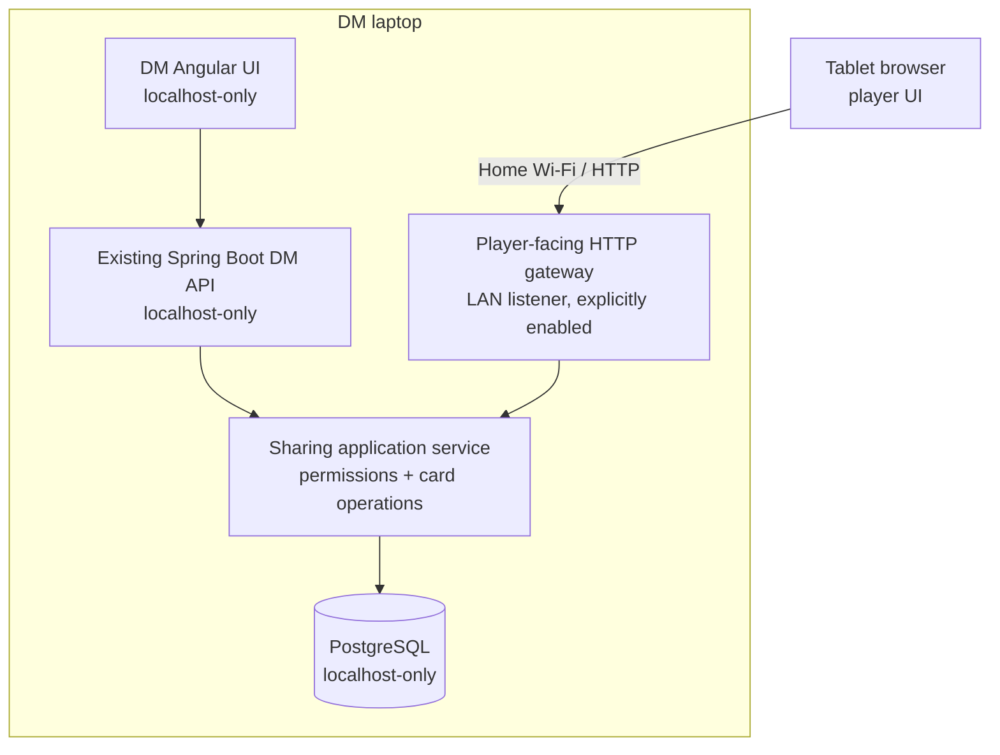
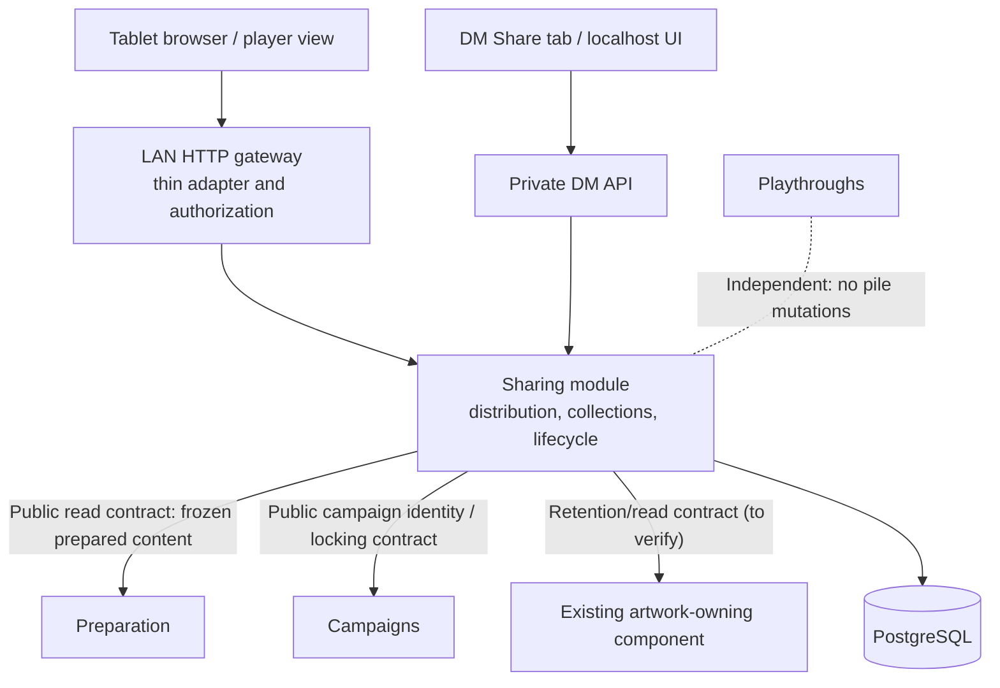
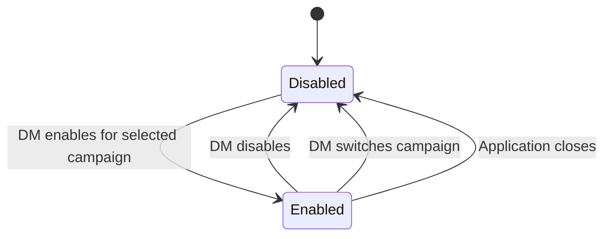

# Future feature proposal — campaign card sharing

**Status:** Deferred product requirements / owner-confirmed direction, 2026-10-24. **Not part of the active implementation scope.** This document is intentionally isolated from the product specification, implementation plan, Play UX design, and harness instructions. It does not authorize architecture, planning, implementation, or verification. Do not pull this feature into an ongoing Codex increment without a new explicit owner request and normal workflow approvals.

## Goal

Let a DM distribute copies of prepared session cards to players' tablets over a local network, without requiring public hosting. Players retain campaign-wide cards and can manage inventory, while the DM can inspect and manage all collections.

## Accepted product direction

- Add a dedicated **Share** tab for the DM, separate from the Play tabletop.
- All prepared cards belonging to the currently selected session are available as sharing sources. Sharing **creates a distinct distributed copy**; it does not remove or relocate the PreparedItem in Preparation or the Play tabletop.
- Collections are **campaign-scoped**, not session-scoped. They persist when the DM changes or finishes sessions.
- A distributed card belongs to either a specific **player** or the **group**. The DM can see and manage all collections; each player sees their own collection and the group collection.
- DM and player can discard inventory cards; the DM can remove distributed cards from a player's collection.
- A player can **claim** a group inventory card, transferring that same distributed instance from group ownership to player ownership (no duplication). Concurrent claims must not create multiple owners.
- The DM can transfer inventory between group and players, including returning a claimed item to the group.
- Use one shared-card mechanism with a lightweight distribution mode:
  - **Handout:** retained, readable reference; DM can remove it. Not claimable.
  - **Inventory:** retained item; claimable from group, discardable by owner and DM.
- The DM selects Handout or Inventory when distributing a card; the source card's authored type does not force the mode.
- Distributed content is a **frozen snapshot** (text and artwork) at sharing time; later edits to the authored/prepared source do not silently change existing copies.
- Tablet experience reuses existing card geometry, artwork, and front/back card rendering. **The player API and tablet UI must not expose full source documents**, per accepted UX Decision 2 and the later [player-card-sharing UX design](player-card-sharing-ux-design.md). Historical proposals for full player document viewing are superseded.
- Favor the existing locally running backend and database, with a read-only or narrowly scoped player web interface accessed via local-network link/QR pairing. No mandatory cloud hosting or player accounts. Exact pairing/security and connection design remain to be specified.
- **Initial scope is online-only:** no offline cache, offline reading guarantee, offline discard/claim, or synchronization/conflict resolution. The DM's local application must be running and reachable for players to access or change collections.
- Connected views must reflect authoritative changes; polling or simple refresh is acceptable initially. No real-time transport is required as a product constraint.

## Domain boundaries to preserve

- **Writing** owns authored cards and artwork.
- **Preparation** owns session membership and frozen PreparedItems.
- **Playthroughs** owns DM tabletop placement, active Scene, piles, Used, and PlayNotes.
- A future **Sharing** responsibility would own distributed instances, campaign/player/group ownership, claim/transfer/discard state, and player-facing access.
- A distributed instance is **not** the same identity as a PreparedItem and is **not** constrained by Play's unique-location invariant. Multiple separately shared instances may reference the same source snapshot.
- Group inventory is one shared collection, **not** an automatic copy in every player's personal inventory.
- Sharing must not mutate Play piles or Preparation membership.

## Candidate flows

1. DM opens Share tab, selects a prepared session card, chooses Handout/Inventory and a player or group, then distributes a frozen copy.
2. Player opens their collection on a tablet; DM can inspect the same collection in Workbench.
3. Player discards an owned inventory card; DM can also discard/remove it. Both views subsequently reflect the change.
4. Player claims a group inventory card; backend atomically transfers its owner to the player. Other claims against the former group ownership fail gracefully.
5. DM transfers a card back to the group or another player without duplicating it.

## Original deferred questions (historical; see accepted decisions below)

- Player identity, device pairing/reconnection, token revocation, LAN isolation, and secure authorization of player vs DM operations.
- Whether a player may voluntarily remove a Handout, and whether a removed/discarded card remains visible in history.
- Whether individual inventory cards may be shared in multiple quantities, and any future quantity/stacking UX.
- Precise transfer permissions, including player-to-player transfers (not currently approved).
- Campaign player roster lifecycle, group membership, and handling of disconnected devices.
- Whether sharing from the current session alone is sufficient or later requires broader Library sourcing.
- Exact responsiveness, accessibility, and failure/reconnect feedback for tablets.
- Offline access, offline caching, and offline synchronization are **explicitly excluded from the initial feature**, not assumed requirements.

## Workflow / non-interference

This is a parked feature proposal. It must **not** change current task priorities, existing accepted Play UX decisions, current implementation increments, or Codex's active scope. Do not modify existing docs, app code, tests, migrations, or harness files as part of this documentation-only change. When the owner explicitly resumes the feature, reconcile this document with the then-current repository and progress through the required phase gates.

## Network and security architecture refinement (2026-10-24)

**Decision status:** Owner accepted the **trusted home Wi-Fi / local HTTP** deployment assumption. The technical layout below is a proposed design direction requiring subsequent architecture approval and verification against the then-current code; it is not an authorized implementation plan.

### Deployment assumptions and constraints

- The DM runs Campaign Workbench on their laptop. Tablets and laptop connect to the same ordinary home LAN/Wi-Fi with trusted participants.
- No cloud hosting, internet connection, public IP address, router port forwarding, separate tablet installation, or separate database is required.
- **Online-only** remains the initial scope: the laptop and player gateway must be running and reachable. No offline caching, offline operations, or synchronization engine.
- **Local HTTP is accepted for the initial trusted-home-network use case.** HTTPS, certificate management, and stronger network security are potential later improvements, not initial acceptance criteria. HTTP does not encrypt card data or credentials; this trust assumption must be clear in the eventual UX and deployment guidance.
- The sharing service must be explicitly enabled by the DM and disabled by default. Do not automatically expose the DM's existing endpoints on the LAN.

### Observed repository baseline (at refinement time)

- Spring Boot configuration uses `server.address=127.0.0.1`, limiting the existing server to loopback.
- Angular's development server is configured for `127.0.0.1`; it should not be the production tablet-facing server.
- Docker Compose publishes PostgreSQL only to `127.0.0.1`; keep database access local.
- Existing frontend/backend stack: Angular, Kotlin/Spring Boot, PostgreSQL.

### Proposed access boundaries

- Prefer **one Spring Boot application, one PostgreSQL database, and one Angular codebase**, with a dedicated tablet-facing player view and a narrowly scoped player API.
- Investigate a **second LAN-facing HTTP listener in the existing process** as the first option. The DM API must remain unreachable through that listener. A separate allowlisting reverse proxy is an alternative if strict connector/route separation is impractical; it adds runtime infrastructure.
- A separate port **alone is not a security boundary**. The gateway must expose only player-facing routes and enforce authorization server-side. Never forward arbitrary existing DM API requests.
- The player-facing route may serve compiled frontend assets; do not expose the Angular development server.
- Share operations remain owned by the Sharing module. The gateway is transport/access control, not a second implementation of business rules.
- No WebSockets or Kafka requirement: ordinary refresh or revision-based polling is sufficient for initial online-only collection updates.

### Pairing and authorization direction (not yet finalized)

- The DM selects a campaign player and starts a **short-lived, single-use QR pairing flow**.
- The tablet receives a revocable device credential bound to that player/campaign for reconnecting without an external account.
- Player API access is limited to the player's own collection and the campaign's group collection. DM operations use the private DM interface.
- Players may claim active group inventory for themselves and discard their own inventory; they may not manage other players' collections, share cards, or administer pairing.
- DM may distribute cards, manage player/group collections, and revoke device access.
- Validate campaign scope, actor identity, and operation permissions on **every request**; never trust client-supplied player IDs or hide-only UI restrictions.
- Detailed token transport/storage, expiry, CSRF exposure, device revocation semantics, and whether local HTTP is sufficient for the final security model remain open for later architecture review.

### Router and firewall compatibility

- Ordinary home Wi-Fi typically permits local device-to-device connections, including Ethernet-to-Wi-Fi and 2.4 GHz-to-5 GHz clients on the same LAN.
- Guest networks, Wi-Fi/client isolation, segmented VLANs, restrictive mesh setups, and host firewalls can block access. No reliable failure percentage is asserted.
- Prefer an explicit reachable LAN IP address in the QR link over reliance on mDNS or network discovery. DHCP may change the address between sessions.
- Connection UX should distinguish **gateway running locally** from **tablet successfully connected**. A successful server start does not prove LAN reachability.
- When connection fails, guide the DM to check same network, guest/client isolation, and laptop firewall. No hotspot fallback is required initially.
- Do not open or forward router ports to the public internet.

### Remaining architecture questions

1. Verify whether a second Spring Boot listener can securely restrict routes independently of the private DM listener; otherwise assess a small allowlisting proxy.
2. Finalize pairing/device credentials, session persistence, revocation, and threat model under trusted-LAN HTTP.
3. Define player UI asset delivery and packaging for the intended local application runtime.
4. Determine how to select/display a reachable LAN address with multiple interfaces and how to handle network changes.
5. Specify gateway lifecycle, error feedback, collection polling/revisions, and tests demonstrating that DM routes are unreachable from the LAN.

**Non-interference:** This remains a deferred feature on a separate documentation branch. Do not merge into `main`, change active Codex increments, or treat this proposal as permission to implement.

## Consolidated sharing architecture — accepted decisions 1–21 (2026-10-24)

**Status:** Owner-accepted conceptual architecture (Decisions 1–21), **deferred feature**. This section supersedes earlier lists of unresolved product choices above where they conflict. Network and persistence mechanisms marked proposed or open below are **not** accepted implementation choices. This branch is isolated from ongoing Codex work; no implementation or merge is authorized.

### Decisions and rationale

| Decision | Accepted | Consequence |
| --- | --- | --- |
| 1 | Trusted home LAN, local HTTP; stronger security later | No cloud, port forwarding, mandatory TLS, offline mode, or separate tablet app in v1; HTTP traffic is unencrypted |
| 2 | Player-specific QR immediately pairs a device | Short-lived one-use pairing token; no secondary DM approval |
| 3 | Inventory soft discard with DM restore | Preserve instance, owner and history; players cannot self-restore |
| 4 | Independent distributed card instances | No stack/quantity semantics; concurrent claims act on one instance |
| 5 | Targeted handouts | Handouts visible to a player or group; recipient/visibility is distinct from inventory ownership |
| 6 | Thin LAN gateway as application-level adapter | Sharing owns rules; gateway owns HTTP transport and access boundary |
| 7 | DM explicitly enables gateway | Disabled on startup; runtime-only availability; stored pairings remain |
| 8 | Campaign-specific pairing | No global account; device can have separate credentials for separate campaigns |
| 9 | Campaign switch disables gateway | Stop accepting requests and safely drain/reject in-flight operations before switching |
| 10 | Campaign roster managed in Share | Persistent campaign participants independent of Playthrough participants |
| 11 | Deactivation preserves inventory and pairing records | Block access for inactive players; reactivation can reuse valid pairings |
| 12 | DM-controlled transfers | Players may claim group inventory and discard own inventory; no player-to-player transfers |
| 13 | Shared content immutable | Corrections require distributing a new instance; never silently refresh |
| 14 | Handouts withdrawable/restorable by DM | Hide from players, retain recipient, snapshot and history; no permanent deletion required |
| 15 | Sharing retains its own immutable artwork | Copy frozen artwork through Preparation public contract into Sharing-owned PostgreSQL storage; deduplicate within Sharing; survive source removal |
| 16 | One application, gateway implementation after feasibility verification | Prefer second embedded Tomcat connector with proven route isolation; fallback to minimal allowlisting gateway/proxy; DM stays localhost-only |
| 17 | Persistent revocable device credentials | Server stores hash; multiple devices per player; scoped to campaign; no access/refresh token rotation infrastructure |
| 18 | Poll complete player collections | No revision protocol or WebSockets; refresh after mutations and on browser resume; polling interval is implementation detail |
| 19 | Sharing excluded from existing archives | Session and Writing archives retain their scope; campaign-wide Sharing backup/export deferred; never export reusable device secrets |
| 20 | Transactionally validate current state | Use existing campaign locking contract; authorize and check owner/status within transaction; no client expected-version requirement; one winning claim |
| 21 | localStorage + Authorization header | Player browser stores persistent credential and sends in Authorization header; no auth cookies; enforce script injection protections |

### Domain and responsibility boundaries

One Spring Boot application, one database and one Angular codebase are preferred. Sharing is a distinct logical backend module following repository conventions, **not** a separate microservice. Distribution, collection and pairing support need not become separate build modules. The player gateway must not expose DM routes. Separate ports alone do not enforce isolation.

Conceptual entities:
- `CampaignPlayer(id, campaignId, displayName, status)`: campaign-local identity; active/inactive.
- `PairedDevice(id, campaignPlayerId, credentialHash, revokedAt, lastSeenAt)`: revocable browser authorization scoped through its player to one campaign; device fingerprinting is unnecessary.
- `SharedCard(id, campaignId, mode, status, immutableSnapshot, sourceProvenance, version, recipientOrOwner)`: each distribution creates a unique instance. **Inventory** has exactly one owner (group or player); **Handout** has a visibility recipient (group or player), not an inventory owner.
- `SharedCardEvent(id, sharedCardId, actor, action, timestamp, ...)`: append-only operation history; current state is stored directly, not event-sourced.
- Snapshot includes explicit frozen player-visible front/back fields and Sharing-owned immutable artwork, with DM-private provenance. The owner-approved 2026-10-26 reconciliation supersedes full-document retention: do not copy the full source document into Sharing without a newly demonstrated DM requirement, and never expose it in player payloads. Preparation supplies frozen artwork through its public contract; Sharing retains its own PostgreSQL image data and deduplicates within Sharing, following the existing Writing/Preparation pattern. The image survives source/prepared-item removal and soft removal/withdrawal, but player access is checked against a currently accessible shared-card instance. No new global Assets module or cross-module reference counting.

Domain operations: distribute inventory/handout; claim active group inventory; DM transfer active inventory; player/DM discard inventory; DM restore inventory to prior owner; DM withdraw/restore handout to prior recipient; manage roster and paired devices. A discarded card cannot be claimed or transferred until restored. Inactive players retain ownership; DM can explicitly transfer their inventory.

Every command checks actor, campaign, mode, current state and ownership within a transaction; all state mutations and corresponding history records commit atomically. Concurrent group claims must yield at most one winner. Follow the existing campaign-row locking/public contract rather than inventing a second concurrency framework. Do not require client-supplied expected versions for ordinary mutations. On a stale or invalid operation, preserve authoritative state and return a conflict/error so the player can refresh.

### Player access and lifecycle

- At most one campaign is available through the gateway. On startup, gateway is disabled regardless of previous runtime state.
- DM chooses a campaign player and generates a short-lived, single-use pairing QR; scan exchanges temporary token for a revocable device credential without a second approval.
- The pairing QR contains a short-lived single-use token; successful exchange yields a high-entropy persistent device credential. Store only its hash server-side. The browser stores the credential in localStorage and sends it in an Authorization header (not URLs or cookies). No refresh-token mechanism is needed. Prevent script injection and sanitize untrusted card Markdown because scripts on the player origin can read localStorage. Trusted-LAN HTTP remains susceptible to credential interception.
- Previously paired active players reconnect when the DM enables the same campaign again. Deactivation blocks all that player's devices without deleting pairings or collections; device revocation blocks only that device.
- Gateway derives campaign/player identity from credential and currently enabled campaign; never trusts tablet-provided IDs. Players see own and group collections only. Group inventory is not duplicated into every player's collection.
- Disable/switch must stop accepting requests, complete or safely reject in-flight operations against their original campaign, then switch. Never rebind an existing request to the newly selected campaign.
- Tablet UI is online-only; periodically poll complete authorized personal/group collections (no collection revision protocol), refresh immediately after claim/discard and when the browser resumes. Stop polling on disabled gateway or rejected authorization; show disconnected/stale-data feedback when unreachable, and never treat stale data as permission. A five-second polling interval is an illustrative default, not a requirement. No WebSockets, offline synchronization, cloud or external accounts required.
- QR should use an explicit reachable LAN IP address. Guest networks/client isolation, VLANs and laptop firewall may block traffic; a running gateway is not proof of tablet reachability.
- HTTP on a trusted LAN is a deliberate first-version tradeoff: credentials and content are not encrypted. Do not claim protection against active local network interception.

### State transitions and permissions

| Operation | Inventory | Handout |
| --- | --- | --- |
| DM distribute | Create active independent instance for group/player | Create active independent instance visible to group/player |
| Player claim | Group active → same instance owned by claiming player, atomic | Forbidden |
| DM transfer | Active instance to group/another player | Not an inventory transfer; visibility target set at distribution |
| Player discard | Own active inventory only | Forbidden |
| DM discard/withdraw | Soft discard; retain owner/history | Withdraw; retain recipient/history |
| DM restore | Restore same instance to previous owner | Restore same instance to previous recipient |
| Source edit/delete | No effect on frozen content | No effect on frozen content |

Permanent deletion, player handout removal, quantity mechanics, and direct player transfers are not part of v1. History is audit information, not the source of current state.

### Proposed API separation (illustrative, not approved endpoint contracts)

- Private DM API: distribute, list all collections and discarded/withdrawn items, transfer, discard, restore, manage roster, create pairing, revoke devices, enable/disable gateway.
- LAN player API: complete pairing, read own/group inventory and targeted handouts, claim group inventory, discard own inventory, report connection/credential errors.
- Both APIs invoke Sharing application use cases; only LAN player routes and required static player UI assets are reachable through the gateway. Server-side authorization is mandatory.

### Open technical questions and verification gates

1. **Artwork integration (verification required):** Decision 15 selects Sharing-owned immutable PostgreSQL artwork, deduplicated within Sharing. Inspect actual Preparation image read contract, immutable SHA/content representation, deletion/garbage-collection paths, and safe snapshot copying to verify this can be implemented with existing conventions. Do not reopen ownership without demonstrated conflict.
2. **Gateway isolation (high priority):** Decision 16 prefers an additional embedded Tomcat LAN listener if strict route isolation is demonstrable, otherwise a minimal allowlisting gateway/proxy. Verify that DM APIs, actuator/admin, OpenAPI/docs, unintended static files and path variants are inaccessible on the LAN. A second port alone is insufficient. Keep DM and PostgreSQL localhost-only.
3. **Credential implementation details:** Decisions 17 and 21 select a persistent revocable credential, server-side hash, browser localStorage and Authorization header. G2 verifies its backend generation/hash/redemption/revocation scope and implements a configurable 300-second invitation default, not a fixed UX duration. Browser storage/Authorization, new player-content handling and trusted-LAN HTTP integration remain later checks. No cookie-based CSRF flow or refresh-token system is selected.
4. **Player UI delivery:** Verify how to build and serve the dedicated player-facing Angular entry/view without exposing the development server or accidentally granting DM API access.
5. **LAN address/lifecycle:** Determine correct IP with multiple adapters/VPNs, changing DHCP addresses, OS firewall prompts, gateway bind/start/stop behavior, in-flight request handling and user-visible connection diagnostics.
6. **Module integration:** Verify the current module/package boundaries, Preparation's frozen snapshot read contract, Campaigns' lock API, and image retention contract. No direct cross-module repository/table access.
7. **Consistency and errors:** Decision 20 requires transactional current-state validation under existing campaign locking and atomic audit history; no client expected versions. Verify lock usage by player requests, one-winner claims, retries/conflict responses and restore edge cases (e.g. inactive owner). Decision 18 requires full-collection polling without revisions.
8. **Archives/backups:** Decision 19 explicitly excludes Sharing from existing session and Writing archives. Future campaign-wide backup/export is out of scope; do not silently attach Sharing to session archives or export reusable authentication credentials. Document that existing archives are not player-collection backups.
9. **Verification:** Demonstrate LAN denial of all DM routes, one-winner concurrent claims, immutable snapshots after source deletion, campaign-switch isolation, revoked/inactive player denial, restoration, and correct access by group/personal recipients.

### Architecture review outcome

**Conceptual architecture is accepted and closed at Decisions 1–21.** Technical feasibility and existing-code integration are not yet verified. Before implementation planning, complete the gateway isolation and image integration investigations, confirm campaign locking and frontend packaging, and resolve any demonstrated technical conflicts through the normal approval workflow. The open items above are verification and design constraints, not permission to silently change accepted decisions. Preserve this as an approved conceptual direction with explicitly open technical questions, not as authorization to implement.

**Non-interference:** Documentation is maintained only on `docs/future-player-card-sharing`; no merge, PR, change to `main`, active Codex work, implementation plan, harness, code, or migrations is authorized.

## Player-facing UX acceptance (2026-10-26)

The owner accepted **UX Decisions 1–20** in [player-card-sharing-ux-design.md](player-card-sharing-ux-design.md). That document is the design reference for Group Cards/My Cards as separate tablet screens; sticky My Cards navigation/claim target; DM-organized group piles versus player-organized personal piles; explicit Unsorted trays; on-card flip and tap-to-expand/tap-to-close behavior; distribution, claim, removal, transfers, restoration, and reconnection UX. Its layout and interaction contracts must be carried into architecture reconciliation and any future G3 plan **before** implementation. The no-player-full-documents requirement modifies the intended player API disclosure boundary; Sharing snapshots, persistent organizational placement and frontend integration need explicit reconciliation, not silent changes to accepted conceptual Decisions 1–21. This link does not authorize implementation, merging, or modifications to other workstreams.

### Approved visual composition and QR/player identity (2026-10-26)

The [accepted UX specification](player-card-sharing-ux-design.md#approved-visual-composition-and-rosterpairing-ux--2026-10-26) is normative for eventual G3 visual composition: one integrated DM Share tab with compact DM-created campaign-player roster (display name, active status and paired-device count, **no user accounts or avatars**), contextual Add/Rename/Deactivate/Pair/Manage devices actions and an expiring player-specific QR pairing overlay; group piles arranged **horizontally** in the same responsive pattern as personal piles, with distinct visible Unsorted **card trays** beneath; two separate tablet screens with sticky combined navigation/Claim target on Group. Mockup-specific portraits, fabricated QR images, example card contents, and extra actions are not requirements. Detailed geometry, touch/drag/drop, security and browser validation remain gates, not completed work. This addition does not alter accepted architecture Decisions 1–21 or authorize implementation.

### Subsequent architecture reconciliation — accepted 2026-10-26

The owner subsequently approved the [reconciled architecture](implementation-plan.md#player-sharing--accepted-architecture-reconciliation--2026-10-26) and authorized planning. It supersedes conflicting earlier source-document retention and immediate-hide-on-unknown-disconnection wording. Sharing owns collection membership, placement, lifecycle transactions and history; server defaults and viewer-local cover browsing are separate. Roster rename/device-count and invitation replacement/status extend G2 additively. Origin changes may require re-pairing. G1 retains explicit enabled admission and a closed listener on disable/switch, so unknown transport failure is stale/read-only until authoritative revalidation or denial.

G1/G2 are implemented and formally assessed; earlier feasibility gates are historical where covered by their [verification evidence](verification.md). Player asset delivery/storage, safe frozen distribution, artwork retention, collection/pile commands and full UI remain future increments. [G3.1 onboarding](implementation-plan.md#g31--accepted-bounded-increment-roster-and-tablet-onboarding) is an approved bounded onboarding increment. Execution permission remains conversational; later increments and merge are not authorized by this documentation.
