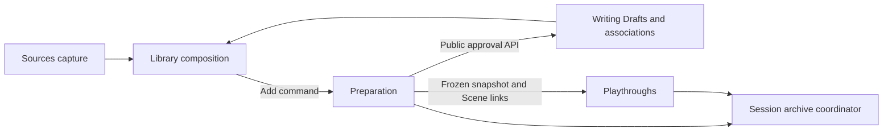
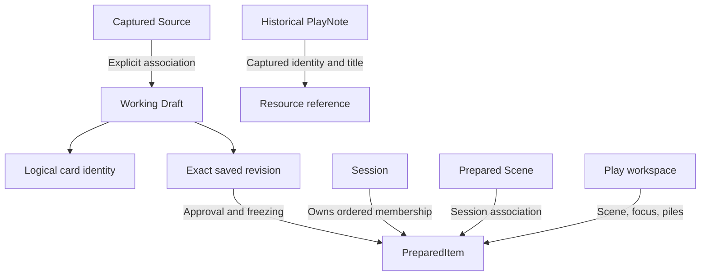
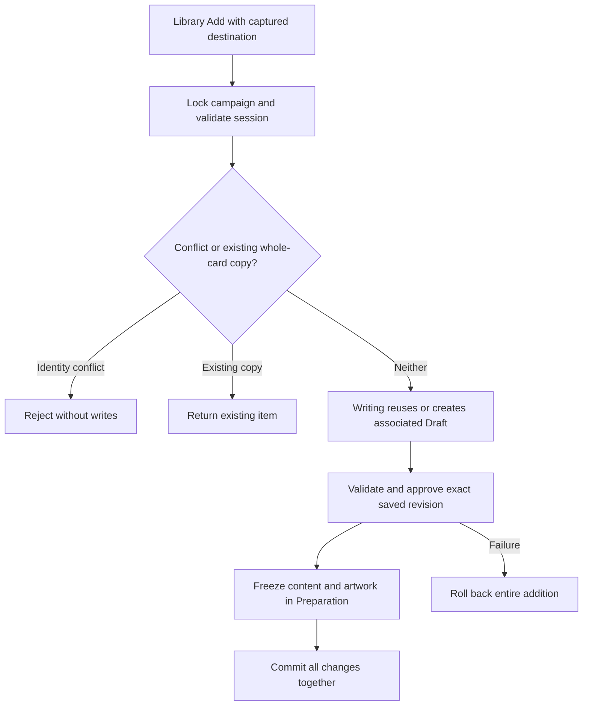
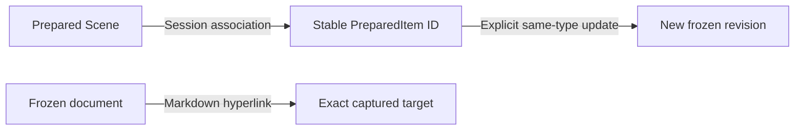

# Implementation plan reading map

This is the current architecture and delivery entry point. Accepted decisions retain their authority; historical statements about future work apply at their recorded date. Repository records never grant conversational execution authorization.

| Need | Read |
| --- | --- |
| Delivered Play behavior and Q10f–Q10x coverage | P8 handover and acceptance map below; [formal verification](verification.md) |
| Runtime placements, Scene commands and consistency | Accepted tabletop architecture below |
| Library identity, atomic Add, frozen preparation and workspace ownership | Accepted unified-workspace architecture below, with [UX-C6/C7 refinements](history/implementation-plan-2026-10-24.md#ux-c6--accepted-architecture--2026-10-24) |
| Exact image storage/rendering decisions | [Accepted per-card image architecture](history/implementation-plan-2026-10-24.md#per-card-images--architecture-decisions--2026-10-21) |
| Technology, module and Arrow conventions | [Accepted direction](history/implementation-plan-2026-10-24.md#current-accepted-direction), [runtime baseline](runtime-baseline.md), [version catalog](versions.toml) |
| Future features, open choices and architecture-health proposal | [Future work](future-work.md) |
| Earlier plans, alternatives and increment boundaries | [Complete pre-cleanup plan](history/implementation-plan-2026-10-24.md), section links at the end of this page |
| Developer evidence | [Implementation history](implementation-history.md); recent P8 handover below |

T1/T2, P5, P6, revised P7 and P8 are delivered and formally assessed. Owner acceptance is separate. The original focus-slot presentation, whole-workspace mutation contract and authored-link-derived Scene suggestions are superseded by accepted tabletop placements/commands and Preparation-owned Scene associations. Session archives are strict v10. Retained approvals and prepared history remain immutable; older archive formats are not supported.

## Documentation cleanup — preservation and navigation — 2026-10-24

Completed the owner-approved documentation-only reorganization. Keep current architecture/delivery at this entry point, current operating guidance in README and the user guide, and open work in the future-work index. Preserve complete pre-cleanup README, plan and verification snapshots under `docs/history/`, with relative Markdown links rebased. Preserve original entry-point anchors as historical-section links, all original requirement text in place, earlier failures/corrections and the existing implementation-history records. AH1–AH5 remains a proposal; no glossary definitions, architecture choices or implementation permission are implied.

Developer checks: exact snapshot-content comparison after link rebasing; all original README/plan/verification heading anchors retained; specification text identical after removal of the added precedence guide; local links/anchors and balanced code fences checked. Only three pre-existing missing generated test artifacts in implementation-history remain unresolved; their original references are preserved. Main entry documents are approximately 81–88% shorter by word count before this small cleanup record. No application tests were necessary for documentation-only changes. See the [separate documentation assessment](verification.md#documentation-cleanup--preservation-and-navigation--2026-10-24). No application, test, configuration, harness-rule or independent campaign edits.

## P8 — accepted bounded implementation plan — 2026-10-24

Consolidate the Q10f–Q10x evidence under the accepted tabletop reconciliation. Reuse current owners and contracts; no new feature, API, dependency, persistence or archive version. Extend existing illustrated recovery and unified workflow browser journeys with PlayNotes preservation/context remapping. Run integrated developer checks, inspect actual Write/Prepare/Play and populated-tabletop screenshots at 1280×800, 1440×900 and 390×844, then separately assess the final candidate with fresh backend tests and integrated browser checks. Correct demonstrated in-scope defects only. Record durable evidence, accepted supersessions and manual/unverified limits; owner functional/visual acceptance remains separate. Expected edits: existing browser tests, this plan, README and verification evidence. Preserve earlier uncommitted P7 work.

### P8 — implementation and developer handover — 2026-10-24

Extended existing browser journeys rather than adding application behavior: the illustrated Write/Prepare/Play recovery journey now creates, edits and pins a PlayNote, then checks its fresh imported identity and preserved resource evidence alongside frozen artwork, Preparation notes and Used placement. The unified author/prepare/play/update/recovery journey now checks captured Scene/resource note context through portable import. Existing tests cover piles, Library Add, history, concurrency, invalid archives, navigation and retries; the acceptance map below identifies their current responsibilities and supersessions.

Final developer run `/tmp/p8-developer.log`: **131 frontend tests in 14 files**, production build, generated-client/version checks, **51/51 Chromium journeys**, and isolated PostgreSQL installation preservation across restart. Backend tasks passed with cached test outputs; fresh execution belongs to the separate formal pass. The first developer run exposed an incorrect new-test assumption that pinning is available before creation; corrected to the existing create/edit/pin flow before the final run. No application defect or application change resulted. Existing initial/style/generator warnings and budgets remain unchanged.

Visually inspected actual Write, Prepare, illustrated Play and populated-tabletop captures at 1280×800, 1440×900 and 390×844. Laptop panels remain readable; narrow workspaces stack vertically and the tabletop retains its horizontal card shelf. Existing browser overflow/scroll/keyboard checks passed. Screenshots are generated under ignored `frontend/test-results/` and are temporary evidence, not durable repository assets. Owner visual acceptance remains separate. Safari/WebKit, exhaustive assistive-technology, maximum-scale performance and every concurrency/forced-termination schedule remain unverified. No campaign source edits, migration, dependency, archive format change, data reset or commit.

The separate [P8 formal assessment](verification.md#p8--integrated-developer-handover--2026-10-24) passes fresh **91 backend tests**, **131 frontend tests**, build/client checks and **51 Chromium journeys**, plus database installation preservation across restart. All 444 compared application/test source files remained unchanged during formal execution. No unresolved P8 defect was identified within assessed scope. This completes the planned integrated handover; owner functional/visual acceptance and subsequent product scope remain separate.

### P8 — reconciled acceptance and evidence map

The accepted 2026-10-24 tabletop reconciliation governs current acceptance; the original Q10 wording remains historical context. A mapping is not a claim that every concurrency schedule or browser has been tested.

| IDs | Current accepted behavior | Evidence owners/journeys |
| --- | --- | --- |
| Q10f | Five disjoint locations, Scene slot, two ordered covered piles, searchable Session Cards/Used; supersedes independent focus slots | PlayWorkspace tests, T1/T2 assessments, `tabletop.spec.ts`, 50-item `workspace.spec.ts` |
| Q10g | Explicit atomic Scene activation/change/deactivation, Keep/customize/cancel; reading never activates | Playthrough integration tests, Scene overview/tabletop journeys |
| Q10h | Server-captured Scene plus optional primary resource; reading does not alter draft context | PlayNotes integration/state tests, `play-notes.spec.ts`, unified workflow |
| Q10i, Q10s | Existing right Document reader and temporary pile overlay replace fourth-card/replacement and expanded-focus UI | Tabletop reader, overlay, cover and panel journeys; shared reader/geometry tests |
| Q10j | Dedicated Library inspection and explicit atomic Add, pinned destination, new Session Card, frozen historical-target safety | Revised P7 assessment; unified Library/workflow and UX-C1/C7 journeys |
| Q10k, Q10l | Independent Markdown PlayNotes record improvisation/outcomes; no automatic resource/world-state changes | P5 tests/assessment, P8 illustrated and unified workflow note round trips |
| Q10m | Exact origin-qualified resource/Scene history across sessions; independent pins and chronology | PlayHistory integration/state tests, `play-history.spec.ts`, P6 assessment |
| Q10n, Q10o | One optional primary resource; explicit pin stays in full chronology | PlayNotes tests/journey; illustrated pinned-note portable recovery |
| Q10p | Existing frozen full-document reader, heading navigation and shared artwork | Reader, artwork, artwork-fit, unified workflow and tabletop journeys |
| Q10q | Existing session navigation plus card history, with unsaved-note guards | P6 history journey, session and recovery journeys |
| Q10r, Q10w | Restore committed Scene, locations, pile names/order/covers through reopen and Prepare visits; temporary panel/overlay/selection need not persist | T1/T2 persistence/archive evidence; tabletop, unified workflow and artwork recovery |
| Q10t | Used means manually set aside; no discovery state | Explicit move commands/tests and Used journeys; accepted exclusions |
| Q10u | Scene overview exposes prepared related cards and their current placement, including Used; inspection never returns/moves them | Scene overview/tabletop and unified workflow; replaces authored-link suggestion completion |
| Q10v | No recent-scene control or transition history | Accepted exclusion; existing Scene selection/overview |
| Q10x | Removal prunes only removed placement, clears removed Scene, advances affected cover, retains notes/other arrangement | PlayWorkspace reconciliation, tabletop Prepare-removal journey, P5/P6 removed-resource tests |

Archive completeness, malformed-import rollback, revision conflicts, concurrent retries, campaign isolation and restart preservation are covered by existing backend integration tests and per-increment formal records. P8 reruns the current suites rather than treating historical green results as fresh evidence. Deferred AI, note-to-resource promotion, discovery/world-state tracking, recent-scenes UI, extra piles and freeform positioning remain excluded.

## Play tabletop — accepted architecture reconciliation — 2026-10-24

**Status: ACCEPTED.** The owner approved the architecture following the [accepted requirements reconciliation](product-specification.md#play-tabletop--accepted-requirements-reconciliation--2026-10-24). T1/T2 and P5–P8 now have delivery and formal evidence; see the P8 handover. This accepted architecture does not grant execution permission.

- **Ownership and representation:** Playthroughs retains one independently revisioned PlayWorkspace per session, lazily initialized from Preparation's ordered public snapshot. Replace overlapping Active/Used/focus authority with ordered Session Cards, ordered Used, exactly two fixed runtime piles and nullable active Scene. Each pile has an optional name, ordered prepared-item IDs and nullable cover item ID. Covers use identity rather than index so unrelated movement cannot silently change the displayed card. One workspace row remains sufficient; no per-card placement repository or new module is needed.
- **Invariants:** The union of the five disjoint locations equals current prepared membership exactly. Scene slot accepts only a valid prepared Scene. Nonempty piles have a cover in their membership; empty piles have no cover. Validation is shared through Playthroughs public/domain boundaries with archive validation; the archive coordinator does not access its repositories.
- **Commands:** Replace unrestricted whole-workspace saving with explicit move, reorder, choose-cover, rename-pile and Scene-transition operations. Ordinary commands cannot move the active Scene or target its reserved slot. The server derives and validates the resulting placement; clients do not submit another independent placement authority. Exact REST names and DTO structure remain routine implementation choices.
- **Scene transition:** One locked transaction activates/deactivates the Scene and applies selected movements. Keep current piles is a transition with no optional movements, retaining the mandatory removal of the incoming Scene from its former location and return of the outgoing Scene to the front of Session Cards. Customize sends only explicit choices; no implicit relationship edits or pile population. Validate related-card choices against Preparation-owned associations. Cancel dispatches no mutation.
- **Concurrency:** Retain Campaigns' existing row lock, acquired before reading Preparation/workspace state in the transaction. Reconcile membership before expected-workspace-revision validation. Scene confirmation also checks the Preparation revision shown in its overview. A changed Preparation revision, including unrelated note changes, conservatively requires explicit refresh; retain local choices for review instead of introducing another revision counter. Invalid/stale commands commit no partial user mutation; explicit reload obtains reconciled state. Notes keep independent revisions and P5's expected-Scene creation check; no workspace revision dependency for unrelated note creation.
- **Reconciliation:** Use Preparation's immutable public snapshot only. Prepend new members in preparation order, prune removed members from their location, clear a removed active Scene and choose the next surviving cover in former pile order with wraparound. Preserve unaffected positions, names, covers and historical notes. If a still-present Scene becomes invalid, clear the slot and return the item to Session Cards, retaining complete membership. Preparation never calls Playthroughs; no events or dual writes.
- **Frontend:** PlayWorkspaceState owns serialized commands, originating campaign/session context and save recovery. Tabletop components render existing PlayingCard/reader assets and emit explicit actions. Keep pending changes on failure; avoid automatic replay/rebase after conflict or uncertain delivery. Scene overview is local until Confirm. Panel mode, selected document and overlays are presentation state. The P5 note draft and explicit association context remain independent of card covers/reader selection; preparation-note editing remains in Prepare.
- **Archives and persistence evolution:** Extend the current coordinator/strict codec with complete placement, pile-name and cover validation/remapping at the same time as persisted state. Preserve null/unopened workspace, frozen content, artwork, Scene associations and later historical notes. Use an additive Flyway migration without editing applied history. Old runtime artifacts may be discarded under the existing policy; any runtime-data disposal must be separately and precisely authorized, with prepared material and notes excluded. No full database/volume reset or compatibility adapter is implied.

**Alternatives and consequences:** Retaining the current whole-state PUT is smaller initially but cannot distinguish an ordinary move from Scene activation and leaves more invariants to clients; explicit commands are accepted instead. Per-placement rows/revisions add coordination without a demonstrated need; one aggregate/revision is accepted. Cover identity avoids index drift. The campaign lock and Preparation revision check favor simple local-app correctness over concurrent editing throughput. P1–P4/UW historical records remain valid evidence of earlier behavior; their conflicting focus-based target is superseded by this section.

## Unified Library / Write / Prepare / Play — accepted architecture reconciliation — 2026-10-23

The implementation baseline and planned sequencing in this decision describe 2026-10-23. Later delivery is established by P8 above; accepted ownership and identity decisions remain applicable.

**Status:** Architecture approved by the owner, followed by authorization to document it. This section records the accepted target design and supersedes conflicting earlier architectural direction. It does not authorize implementation planning, application changes, migrations, resets or commits. Existing increment plans and implementation/verification evidence remain historical records until separately authorized planning reconciles them.

**Requirements and UX:** [Unified requirements](product-specification.md#unified-library-writing-and-preparation--accepted-requirements--2026-10-22) and [accepted workspace UX](unified-workspace-ux-design.md). Retained Playthrough invariants and historical-note contracts are in [Playthrough architecture](playthrough-domain-architecture.md).

### Implementation baseline at the 2026-10-23 architecture decision

**Historical pre-UW baseline (2026-10-23):** The following two paragraphs record the gaps that motivated the accepted design. UW1–UW6 subsequently delivered the integrated workspace; session archives are now v8, and UX-C6 retired separate direct-add endpoints. See the UW6 handover and later UX scopes for delivered behavior.

Sources implements explicit captured-library refresh, classification, search and document navigation. Writing implements revisioned Drafts, source-copy provenance, retained exact-revision approvals, artwork, manual exports and recovery. Preparation implements ordered frozen items, notes and artwork through separate Source and Draft addition paths. Playthroughs implements independently revisioned Active/Used, active Scene and ordered focus, with membership reconciliation. P4R currently derives contextual suggestions from frozen Markdown links. Session archives coordinate these owners through v7 manifests and ID remapping. PlayNotes/history remain approved future P5/P6 behavior, not implemented capabilities.

The frontend has a separate Writing route and combined Prepare/Play workspace, separate Source/Draft selectors, shared card/reader components and save guards. It does not yet implement the accepted dedicated unified Library, explicit shared session selection, Write research-return context or Prepare Scene-planning relationships. Source copying currently creates a fresh card UUID; addition appends a fresh PreparedItem without whole-card deduplication. Explicit prepared revision replacement and persisted session Scene associations are absent.

### Ownership and integration boundaries

| Owner | Accepted responsibility |
| --- | --- |
| Sources | Captured Markdown, explicit refresh, classification, declared identity claims and document navigation |
| Writing | Drafts and revisions, logical card identity, explicit Source association, immutable origin evidence, approval retention, artwork, manual export and recovery |
| Library composition | Unified discovery over public Sources/Writing contracts, Draft precedence, validation/conflict status and session-specific Add status; no persistence ownership |
| Preparation | Session membership, frozen items/artwork, order, preparation notes, Scene associations, atomic Add and explicit revision replacement |
| Playthroughs | Active/Used, active Scene, focus, PlayNotes and historical queries; consumption of Preparation snapshots |
| Session archive coordinator | Consistent cross-module snapshots, strict transfer validation and ID remapping |
| Frontend navigation context | Explicit selected campaign/session across workspaces; content and save lifecycles remain with their existing owners |

Arrows show composition/data flow, not repository access. Preparation has no dependency on Playthroughs. Existing campaign-row locking and public module contracts remain the consistency boundary; no event infrastructure, cross-module table access or new global state framework is introduced.

### Identity, association and refresh

Logical card identity, captured Source identity, Draft ID/revision and PreparedItem ID remain distinct. A Source association is explicit Writing-owned state; immutable provenance records evidence and does not by itself establish a same-card association. Library composes the current capture and Writing state, using Draft content/metadata/artwork for associated entries while exposing the Source and provenance in Details.

- Editing or adding a valid Source with a unique declared UUID preserves that logical UUID in its reusable associated Draft. Independent copying creates a new logical identity. Existing independent copies are not reassociated merely because their origin records mention a Source.
- Editing an untyped Source assigns a new Writing card UUID and records an explicit association to the selected Source separately from immutable origin evidence. Missing essential metadata blocks new preparation, while incomplete Drafts remain editable and saveable.
- Refresh recognizes a Source exported from a Draft by its logical UUID only when campaign identity claims are unambiguous. A Source and its explicitly associated Draft represent one card; competing claims are conflicts. No title/path matching silently merges independent cards or confers canon authority.
- A unique valid UUID reconnects an association across moves/renames. Untyped Sources retain their explicitly recorded campaign-relative path association; changes there are reported for manual review without overwriting the Draft. Moving an untyped Source leaves its original unavailable; title, hash and filename do not infer a new association. A conflicting identity at the associated path is reported rather than silently rebound.
- Missing, moved or excluded originals do not prevent Draft editing, preparation or export. Retain association evidence and provenance. Deleting a working Draft exposes any remaining Source without changing frozen items, retained approval/export history or historical PlayNotes.
- Duplicate/ambiguous claimed identities block affected new preparation until explicitly resolved. Existing snapshots and history retain their identities and content.

Scene links use session item identity; historical resource queries use frozen origin-qualified logical identity. Imported references retain their origin campaign/card identity rather than being rebound to a similarly identified destination card. Sections share parent logical history while retaining distinct prepared identities. Paths and image hashes are not logical resource identities.

### Atomic Library Add

Preparation orchestrates Add through Writing's public contract for associated Draft reuse/creation and exact saved-revision approval. The UI finishes pending saves successfully before Add and captures the destination campaign/session when the operation starts. Later navigation cannot redirect an in-flight mutation. Requests carry revision/capture expectations sufficient to reject stale operations instead of silently freezing different content.

The containing campaign lock covers membership checks, Draft association/reuse/creation, retained approval and independent Preparation artwork/content retention in one transaction. Failure at any stage rolls back all addition writes. Concurrent calls/retries must not create duplicate automatic Drafts or whole-card items. An already-prepared card returns its existing item rather than automatically updating it; historical multiple matches remain explicitly selectable, never arbitrarily merged.

Normal whole-card Library Add allows at most one whole-card copy of a logical card per session. This is a use-case rule, not an unconditional database uniqueness constraint: historical/imported duplicates and section-specific captures remain valid. A section capture does not automatically satisfy whole-card membership. New additions follow the Draft approval path; historical Source snapshots remain independently readable.

Incomplete Sources remain discoverable and direct the user to Write. Failed Add leaves no partial Draft. An explicit Edit-in-Write action may create the reusable incomplete Draft for correction. Add belongs in Library; creation/editing/export belong in Write, as specified by accepted UX.

### Scene associations, replacement and removal

Preparation owns directed Scene→PreparedItem associations as part of the Session aggregate and its existing revision. Both endpoints must belong to that session; the origin must be a valid prepared Scene. Linking never adds Library membership. A prepared item can belong to multiple Scenes. Related items appear in existing preparation order, with no separate Scene ordering.

Play contextual cards come exclusively from these associations, using the exact prepared endpoint and its Used indicator. Preserve explicit focus/free-slot/replacement behavior; suggestions do not reorder piles, return Used cards or activate Scenes. P4R's Markdown-derived suggestion mechanism and its unprepared-target suggestion dependency are superseded as target architecture. Markdown hyperlinks continue to use existing frozen-reader semantics.

**Use latest version** requires valid saved metadata and the same card type. Under the campaign lock and session/Draft revision expectations, replace frozen content, artwork, approval evidence and outgoing Markdown bindings atomically. Preserve PreparedItem ID, preparation order/notes, Scene associations, Active/Used position, focus and active Scene. Reject invalid metadata, type changes or stale expectations without partial mutation or loss of local edits. Never rewrite historical PlayNotes.

Existing outgoing links from other documents retain their exact captured bindings. For example, after B revision 1 is replaced with revision 2, A's frozen Markdown link to B revision 1 becomes unavailable if that exact target is absent. A Scene association to B continues to open its current prepared content. Logical UUID equality never silently substitutes a newer revision for a frozen Markdown target.

Removing a prepared card confirms the affected Scene names in the UI and removes all incoming/outgoing associations atomically with membership removal. Play reconciliation removes the item from piles/focus and clears it if active Scene, preserving remaining arrangement and notes. Preparation does not call Playthroughs in reverse.

The current persistence adapter deletes/reinserts item rows during session saves. Association storage must preserve surviving edges across that operation; item foreign keys cannot be introduced without accounting for row replacement. Physical storage is a bounded later design detail within the approved Session aggregate, not a new persistence-owning module or independently revisioned association collection.

### Frontend composition and save safety

A small shared navigation-context service owns explicit campaign/session selection, reflected in routes. It does not infer selection from the last loaded session and invalidates cross-campaign selections. Library can select a destination before loading Preparation's editor. Writing, Preparation and Play retain independent content, revisions, save queues and conflict/retry behavior.

Each workspace retains its transient presentation context. Write's Library research journey saves successfully before leaving and restores Draft, editing tab, support mode, independent preview mode, reference/search selection and panel state; cursor/scroll restoration is best effort. Failed saving stays in Write with edits intact. Prepare's temporary related-card reader restores Scene planning and predictable Session/Card notes scope on Back to scene. Routing alone is not assumed to retain unsaved text.

Reuse shared cards, readers, artwork and navigation/browser-close guards. Library remains document-first with compact illustrated catalogue rows; Write has one switchable support panel; Prepare retains ordered contents, reader and notes. Existing 243:420/320px card geometry remains. CSS inspection identifies reusable responsive/overflow patterns but is not evidence of accepted 1280×800/1440×900 usability. Browser layout, independent scrolling and accessibility checks remain necessary during authorized implementation; no UX redesign or prototype is authorized here.

### Compatibility, alternatives and remaining gates

Session archives must include Scene associations in a new explicit current-format version, validate same-session endpoints and Scene eligibility, and remap both endpoints alongside fresh session/item IDs. Continue coordinated locked snapshots, complete validation before import writes, atomic restoration, artwork safeguards and bounded staging. Preserve origin resource references and historical note snapshots. Export reconciles workspace state without initializing unopened workspaces. Existing objects/archives are disposable; conversion, old-format compatibility and automatic Markdown-to-Scene-link generation are unnecessary. Database deletion/reset remains separately scoped and authorized.

| Accepted choice | Alternative considered | Rationale / consequence |
| --- | --- | --- |
| Writing association ownership; composed Library | Persistent card-identity registry | Reuses Draft/provenance ownership; untyped Source moves are conservatively unresolved |
| Preparation orchestrates Add | Application-level Add coordinator | Extends existing Preparation→Writing contract; one transaction owns membership validation and freezing |
| Scene associations share Session revision | Separately revisioned association collection | Atomic membership cleanup with one save lifecycle; unrelated session edits may conflict |
| Shared frontend navigation context | Expand Preparation SessionState | Separates selected destination from loaded editing state without a general state framework |
| Explicit association distinct from provenance | Infer association from source-copy origin | Preserves independent derivatives and historical evidence |
| Exact frozen Markdown targets | Follow latest prepared logical identity | Preserves captured-document meaning; old links may become unavailable after replacement |

P1–P4 runtime ownership and accepted behavior remain. P4R implementation/verification records remain accurate historical evidence. Future P5/P6 notes/history must use the reconciled identity boundaries; P7 Library access and P8 integration need separately authorized planning review, particularly because Scene suggestions no longer originate from unprepared Markdown targets. This section supplies architectural constraints, not revised increments, tasks or execution authorization.

Earlier section links (preserved for existing references)

-  [Revised P7 — bounded implementation plan — 2026-10-24](history/implementation-plan-2026-10-24.md#revised-p7--bounded-implementation-plan--2026-10-24)
-  [Revised P7 — implementation and developer handover — 2026-10-24](history/implementation-plan-2026-10-24.md#revised-p7--implementation-and-developer-handover--2026-10-24)
-  [Documentation cleanup — bounded increment — 2026-10-24](history/implementation-plan-2026-10-24.md#documentation-cleanup--bounded-increment--2026-10-24)
-  [P6 — bounded implementation plan — 2026-10-24](history/implementation-plan-2026-10-24.md#p6--bounded-implementation-plan--2026-10-24)
-  [P6 — implementation and developer handover — 2026-10-24](history/implementation-plan-2026-10-24.md#p6--implementation-and-developer-handover--2026-10-24)
-  [P5 — bounded implementation plan — 2026-10-24](history/implementation-plan-2026-10-24.md#p5--bounded-implementation-plan--2026-10-24)
-  [P5 — implementation and developer handover — 2026-10-24](history/implementation-plan-2026-10-24.md#p5--implementation-and-developer-handover--2026-10-24)
-  [Play tabletop — proposed implementation sequence — 2026-10-24](history/implementation-plan-2026-10-24.md#play-tabletop--proposed-implementation-sequence--2026-10-24)
-  [T1 — Backend placement, commands and complete archives](history/implementation-plan-2026-10-24.md#t1--backend-placement-commands-and-complete-archives)
-  [T1 — implementation and developer handover — 2026-10-24](history/implementation-plan-2026-10-24.md#t1--implementation-and-developer-handover--2026-10-24)
-  [T2 — Integrated tabletop UI and runtime save lifecycle](history/implementation-plan-2026-10-24.md#t2--integrated-tabletop-ui-and-runtime-save-lifecycle)
-  [T2 — implementation and developer handover — 2026-10-24](history/implementation-plan-2026-10-24.md#t2--implementation-and-developer-handover--2026-10-24)
-  [Remaining P increments — reconciled handoff](history/implementation-plan-2026-10-24.md#remaining-p-increments--reconciled-handoff)
-  [Card background presentation — accepted increment — 2026-10-23](history/implementation-plan-2026-10-24.md#card-background-presentation--accepted-increment--2026-10-23)
-  [Unified workspace handover and proposed remaining increments — 2026-10-23](history/implementation-plan-2026-10-24.md#unified-workspace-handover-and-proposed-remaining-increments--2026-10-23)
-  [Handover state](history/implementation-plan-2026-10-24.md#handover-state)
-  [Sequence and release boundaries](history/implementation-plan-2026-10-24.md#sequence-and-release-boundaries)
-  [UW2 — accepted backend atomic Add and prepared replacement](history/implementation-plan-2026-10-24.md#uw2--accepted-backend-atomic-add-and-prepared-replacement)
-  [UW2 — implementation and developer evidence — 2026-10-23](history/implementation-plan-2026-10-24.md#uw2--implementation-and-developer-evidence--2026-10-23)
-  [UW3 — accepted session Scene associations and archive integration](history/implementation-plan-2026-10-24.md#uw3--accepted-session-scene-associations-and-archive-integration)
-  [UW3 — implementation and developer evidence — 2026-10-23](history/implementation-plan-2026-10-24.md#uw3--implementation-and-developer-evidence--2026-10-23)
-  [UW4 — accepted Library and shared navigation/session context](history/implementation-plan-2026-10-24.md#uw4--accepted-library-and-shared-navigationsession-context)
-  [UW5 — accepted Write research and Prepare planning UX](history/implementation-plan-2026-10-24.md#uw5--accepted-write-research-and-prepare-planning-ux)
-  [UW6 — accepted integration and final handover](history/implementation-plan-2026-10-24.md#uw6--accepted-integration-and-final-handover)
-  [UW6 reconciliation of historical P7/P8 criteria](history/implementation-plan-2026-10-24.md#uw6-reconciliation-of-historical-p7p8-criteria)
-  [UW6 implementation and developer evidence — 2026-10-23](history/implementation-plan-2026-10-24.md#uw6-implementation-and-developer-evidence--2026-10-23)
-  [Next-session checkpoint](history/implementation-plan-2026-10-24.md#next-session-checkpoint)
-  [UW1 — accepted implementation plan — 2026-10-23](history/implementation-plan-2026-10-24.md#uw1--accepted-implementation-plan--2026-10-23)
-  [UW1 — implementation and developer evidence — 2026-10-23](history/implementation-plan-2026-10-24.md#uw1--implementation-and-developer-evidence--2026-10-23)
-  [UW1 — V-UW1-01 corrective implementation — 2026-10-23](history/implementation-plan-2026-10-24.md#uw1--v-uw1-01-corrective-implementation--2026-10-23)
-  [UW1 — V-UW1-02 corrective implementation — 2026-10-23](history/implementation-plan-2026-10-24.md#uw1--v-uw1-02-corrective-implementation--2026-10-23)
-  [Current implementation and gaps](history/implementation-plan-2026-10-24.md#current-implementation-and-gaps)
-  [Playthrough tabletop domain architecture — accepted 2026-10-22](history/implementation-plan-2026-10-24.md#playthrough-tabletop-domain-architecture--accepted-2026-10-22)
-  [Campaign Workbench — Architecture and implementation plan](history/implementation-plan-2026-10-24.md#campaign-workbench--architecture-and-implementation-plan)
-  [Per-card images — architecture decisions — 2026-10-21](history/implementation-plan-2026-10-24.md#per-card-images--architecture-decisions--2026-10-21)
-  [Accepted architecture — 2026-10-21](history/implementation-plan-2026-10-24.md#accepted-architecture--2026-10-21)
-  [Proposed implementation sequence — Increment 6: per-card images](history/implementation-plan-2026-10-24.md#proposed-implementation-sequence--increment-6-per-card-images)
-  [Accepted bounded implementation increment 6A — 2026-10-21](history/implementation-plan-2026-10-24.md#accepted-bounded-implementation-increment-6a--2026-10-21)
-  [Increment 6A — implementation and developer-check evidence — 2026-10-21](history/implementation-plan-2026-10-24.md#increment-6a--implementation-and-developer-check-evidence--2026-10-21)
-  [Accepted bounded implementation increment 6B — backend artwork lifecycle and portable archives](history/implementation-plan-2026-10-24.md#accepted-bounded-implementation-increment-6b--backend-artwork-lifecycle-and-portable-archives)
-  [Increment 6B — implementation and developer-check evidence — 2026-10-21](history/implementation-plan-2026-10-24.md#increment-6b--implementation-and-developer-check-evidence--2026-10-21)
-  [Accepted bounded implementation increment 6C — artwork UI and portable archive integration](history/implementation-plan-2026-10-24.md#accepted-bounded-implementation-increment-6c--artwork-ui-and-portable-archive-integration)
-  [Increment 6C — implementation and developer-check evidence — 2026-10-21](history/implementation-plan-2026-10-24.md#increment-6c--implementation-and-developer-check-evidence--2026-10-21)
-  [Status and scope](history/implementation-plan-2026-10-24.md#status-and-scope)
-  [Current accepted direction](history/implementation-plan-2026-10-24.md#current-accepted-direction)
-  [Ownership and domain boundaries](history/implementation-plan-2026-10-24.md#ownership-and-domain-boundaries)
-  [Consequences and proposals still to discuss](history/implementation-plan-2026-10-24.md#consequences-and-proposals-still-to-discuss)
-  [Supersession rationale](history/implementation-plan-2026-10-24.md#supersession-rationale)
-  [Increment 1 — Accepted searchable-library architecture](history/implementation-plan-2026-10-24.md#increment-1--accepted-searchable-library-architecture)
-  [Ownership and persistence](history/implementation-plan-2026-10-24.md#ownership-and-persistence)
-  [Refresh and consistency](history/implementation-plan-2026-10-24.md#refresh-and-consistency)
-  [Discovery, search, and interface](history/implementation-plan-2026-10-24.md#discovery-search-and-interface)
-  [Consequences and limits](history/implementation-plan-2026-10-24.md#consequences-and-limits)
-  [Approved implementation plan](history/implementation-plan-2026-10-24.md#approved-implementation-plan)
-  [Developer-check evidence — increment 1](history/implementation-plan-2026-10-24.md#developer-check-evidence--increment-1)
-  [Development startup — accepted design and implementation scope](history/implementation-plan-2026-10-24.md#development-startup--accepted-design-and-implementation-scope)
-  [Developer-check evidence — development startup](history/implementation-plan-2026-10-24.md#developer-check-evidence--development-startup)
-  [Increment 2 — Accepted architecture and visual direction](history/implementation-plan-2026-10-24.md#increment-2--accepted-architecture-and-visual-direction)
-  [Accepted production architecture](history/implementation-plan-2026-10-24.md#accepted-production-architecture)
-  [Accepted implementation plan — increment 2](history/implementation-plan-2026-10-24.md#accepted-implementation-plan--increment-2)
-  [Bounded implementation details](history/implementation-plan-2026-10-24.md#bounded-implementation-details)
-  [Expected file scope](history/implementation-plan-2026-10-24.md#expected-file-scope)
-  [Required evidence and remaining limits](history/implementation-plan-2026-10-24.md#required-evidence-and-remaining-limits)
-  [Increment 2 developer implementation evidence — 2026-10-17](history/implementation-plan-2026-10-24.md#increment-2-developer-implementation-evidence--2026-10-17)
-  [Increment 3 — Accepted typed-card architecture](history/implementation-plan-2026-10-24.md#increment-3--accepted-typed-card-architecture)
-  [Metadata, identity, and authority](history/implementation-plan-2026-10-24.md#metadata-identity-and-authority)
-  [Module responsibilities and capture behavior](history/implementation-plan-2026-10-24.md#module-responsibilities-and-capture-behavior)
-  [Reading and archive compatibility](history/implementation-plan-2026-10-24.md#reading-and-archive-compatibility)
-  [Separate Sea Witch pilot architecture](history/implementation-plan-2026-10-24.md#separate-sea-witch-pilot-architecture)
-  [Increment 3 — Proposed bounded implementation increments](history/implementation-plan-2026-10-24.md#increment-3--proposed-bounded-implementation-increments)
-  [Prerequisites and sequencing](history/implementation-plan-2026-10-24.md#prerequisites-and-sequencing)
-  [Increment 3A — Implementation and developer-check evidence — 2026-10-18](history/implementation-plan-2026-10-24.md#increment-3a--implementation-and-developer-check-evidence--2026-10-18)
-  [Archive-import readiness correction — 2026-10-18](history/implementation-plan-2026-10-24.md#archive-import-readiness-correction--2026-10-18)
-  [Increment 3B — Implementation and developer-check evidence — 2026-10-18](history/implementation-plan-2026-10-24.md#increment-3b--implementation-and-developer-check-evidence--2026-10-18)
-  [Pre-implementation contract review for 3A](history/implementation-plan-2026-10-24.md#pre-implementation-contract-review-for-3a)
-  [Proposed disposable reader study](history/implementation-plan-2026-10-24.md#proposed-disposable-reader-study)
-  [Disposable A/B session-workflow extension — 2026-10-18](history/implementation-plan-2026-10-24.md#disposable-ab-session-workflow-extension--2026-10-18)
-  [Increment 3C — B production implementation plan — 2026-10-18](history/implementation-plan-2026-10-24.md#increment-3c--b-production-implementation-plan--2026-10-18)
-  [Accepted direction and existing implementation](history/implementation-plan-2026-10-24.md#accepted-direction-and-existing-implementation)
-  [Boundaries and contracts for all three increments](history/implementation-plan-2026-10-24.md#boundaries-and-contracts-for-all-three-increments)
-  [Implementation increments](history/implementation-plan-2026-10-24.md#implementation-increments)
-  [Check strategy and approval boundary](history/implementation-plan-2026-10-24.md#check-strategy-and-approval-boundary)
-  [3C.1 — Implementation and developer-check evidence](history/implementation-plan-2026-10-24.md#3c1--implementation-and-developer-check-evidence)
-  [3C.2 — Implementation and developer-check evidence — 2026-10-18](history/implementation-plan-2026-10-24.md#3c2--implementation-and-developer-check-evidence--2026-10-18)
-  [3C.3 — Implementation and integrated developer-check evidence — 2026-10-18](history/implementation-plan-2026-10-24.md#3c3--implementation-and-integrated-developer-check-evidence--2026-10-18)
-  [Expanded Sea Witch migration — accepted architecture and proposed plan — 2026-10-18](history/implementation-plan-2026-10-24.md#expanded-sea-witch-migration--accepted-architecture-and-proposed-plan--2026-10-18)
-  [Accepted architecture](history/implementation-plan-2026-10-24.md#accepted-architecture)
-  [Baseline and editing policy](history/implementation-plan-2026-10-24.md#baseline-and-editing-policy)
-  [Proposed increments — each requires separate implementation authorization](history/implementation-plan-2026-10-24.md#proposed-increments--each-requires-separate-implementation-authorization)
-  [SW-R1 execution and developer checks](history/implementation-plan-2026-10-24.md#sw-r1-execution-and-developer-checks)
-  [SW-R1 implementation and developer-check evidence — 2026-10-18](history/implementation-plan-2026-10-24.md#sw-r1-implementation-and-developer-check-evidence--2026-10-18)
-  [SW-R2 — Bounded continuation — 2026-10-18](history/implementation-plan-2026-10-24.md#sw-r2--bounded-continuation--2026-10-18)
-  [SW-R2 implementation and developer-check evidence — 2026-10-18](history/implementation-plan-2026-10-24.md#sw-r2-implementation-and-developer-check-evidence--2026-10-18)
-  [SW-R3 — Bounded continuation — 2026-10-18](history/implementation-plan-2026-10-24.md#sw-r3--bounded-continuation--2026-10-18)
-  [SW-R3 implementation and developer-check evidence — 2026-10-18](history/implementation-plan-2026-10-24.md#sw-r3-implementation-and-developer-check-evidence--2026-10-18)
-  [Historical proposed separate Sea Witch pilot — SW-P1](history/implementation-plan-2026-10-24.md#historical-proposed-separate-sea-witch-pilot--sw-p1)
-  [Planning exit](history/implementation-plan-2026-10-24.md#planning-exit)
-  [Manual writing and playing cards — accepted architecture and proposed increments — 2026-10-19](history/implementation-plan-2026-10-24.md#manual-writing-and-playing-cards--accepted-architecture-and-proposed-increments--2026-10-19)
-  [Evidence and ownership](history/implementation-plan-2026-10-24.md#evidence-and-ownership)
-  [Draft model, metadata, and export](history/implementation-plan-2026-10-24.md#draft-model-metadata-and-export)
-  [Rendering and playing-card presentation](history/implementation-plan-2026-10-24.md#rendering-and-playing-card-presentation)
-  [Session integration, navigation, and compatibility](history/implementation-plan-2026-10-24.md#session-integration-navigation-and-compatibility)
-  [Alternatives, risks, and exit](history/implementation-plan-2026-10-24.md#alternatives-risks-and-exit)
-  [Proposed increment sequence](history/implementation-plan-2026-10-24.md#proposed-increment-sequence)
-  [MW-4 — detached manual recovery — accepted architecture — 2026-10-20](history/implementation-plan-2026-10-24.md#mw-4--detached-manual-recovery--accepted-architecture--2026-10-20)
-  [MW-4 — portable draft recovery and release walkthrough — accepted plan — 2026-10-20](history/implementation-plan-2026-10-24.md#mw-4--portable-draft-recovery-and-release-walkthrough--accepted-plan--2026-10-20)
-  [Archive and validation contract](history/implementation-plan-2026-10-24.md#archive-and-validation-contract)
-  [Backend and persistence tasks](history/implementation-plan-2026-10-24.md#backend-and-persistence-tasks)
-  [Frontend tasks](history/implementation-plan-2026-10-24.md#frontend-tasks)
-  [Completion criteria and developer checks](history/implementation-plan-2026-10-24.md#completion-criteria-and-developer-checks)
-  [MW-5 — delete a Writing draft — accepted architecture — 2026-10-20](history/implementation-plan-2026-10-24.md#mw-5--delete-a-writing-draft--accepted-architecture--2026-10-20)
-  [MW-5 — delete a Writing draft — accepted bounded plan — 2026-10-20](history/implementation-plan-2026-10-24.md#mw-5--delete-a-writing-draft--accepted-bounded-plan--2026-10-20)
-  [MW-1 — durable manual drafts and playing-card preview — accepted plan](history/implementation-plan-2026-10-24.md#mw-1--durable-manual-drafts-and-playing-card-preview--accepted-plan)
-  [Backend and contracts](history/implementation-plan-2026-10-24.md#backend-and-contracts)
-  [Frontend and card presentation](history/implementation-plan-2026-10-24.md#frontend-and-card-presentation)
-  [Expected file scope](history/implementation-plan-2026-10-24.md#expected-file-scope-1)
-  [Developer checks and completion criteria](history/implementation-plan-2026-10-24.md#developer-checks-and-completion-criteria)
-  [Planning exit](history/implementation-plan-2026-10-24.md#planning-exit-1)
-  [MW-2 — source forks, Markdown export, and link checks — accepted plan — 2026-10-19](history/implementation-plan-2026-10-24.md#mw-2--source-forks-markdown-export-and-link-checks--accepted-plan--2026-10-19)
-  [Existing constraints and design refinements](history/implementation-plan-2026-10-24.md#existing-constraints-and-design-refinements)
-  [Source-copy contract](history/implementation-plan-2026-10-24.md#source-copy-contract)
-  [Export inspection and immutable artifacts](history/implementation-plan-2026-10-24.md#export-inspection-and-immutable-artifacts)
-  [Link report and reading behavior](history/implementation-plan-2026-10-24.md#link-report-and-reading-behavior)
-  [UI, persistence, and scope](history/implementation-plan-2026-10-24.md#ui-persistence-and-scope)
-  [Verification and completion criteria](history/implementation-plan-2026-10-24.md#verification-and-completion-criteria)
-  [Planning exit](history/implementation-plan-2026-10-24.md#planning-exit-2)
-  [MW-3 — exact-revision session approval — accepted plan — 2026-10-19](history/implementation-plan-2026-10-24.md#mw-3--exact-revision-session-approval--accepted-plan--2026-10-19)
-  [MW-1 — implementation and developer-check evidence — 2026-10-19](history/implementation-plan-2026-10-24.md#mw-1--implementation-and-developer-check-evidence--2026-10-19)
-  [MW-2 — implementation and developer-check evidence — 2026-10-19](history/implementation-plan-2026-10-24.md#mw-2--implementation-and-developer-check-evidence--2026-10-19)
-  [MW-2 — V-MW2-01 corrective implementation — 2026-10-19](history/implementation-plan-2026-10-24.md#mw-2--v-mw2-01-corrective-implementation--2026-10-19)
-  [MW-3 — implementation and developer-check evidence — 2026-10-19](history/implementation-plan-2026-10-24.md#mw-3--implementation-and-developer-check-evidence--2026-10-19)
-  [MW-4 — implementation and developer-check evidence — 2026-10-20](history/implementation-plan-2026-10-24.md#mw-4--implementation-and-developer-check-evidence--2026-10-20)
-  [MW-5 — implementation and developer-check evidence — 2026-10-20](history/implementation-plan-2026-10-24.md#mw-5--implementation-and-developer-check-evidence--2026-10-20)
-  [MW-5 — V-MW5-01 corrective implementation — 2026-10-20](history/implementation-plan-2026-10-24.md#mw-5--v-mw5-01-corrective-implementation--2026-10-20)
-  [Creative co-author — accepted architectural direction and open choices — 2026-10-19](history/implementation-plan-2026-10-24.md#creative-co-author--accepted-architectural-direction-and-open-choices--2026-10-19)
-  [Evidence and consequential boundary change](history/implementation-plan-2026-10-24.md#evidence-and-consequential-boundary-change)
-  [Records, authority, and changes](history/implementation-plan-2026-10-24.md#records-authority-and-changes)
-  [Request context and provider execution](history/implementation-plan-2026-10-24.md#request-context-and-provider-execution)
-  [Drafts, preparation, exports, and UI](history/implementation-plan-2026-10-24.md#drafts-preparation-exports-and-ui)
-  [Risks, validation, and decisions before planning](history/implementation-plan-2026-10-24.md#risks-validation-and-decisions-before-planning)
-  [Version baseline proposal — 2026-10-17](history/implementation-plan-2026-10-24.md#version-baseline-proposal--2026-10-17)
-  [Setup increment 0 — accepted plan](history/implementation-plan-2026-10-24.md#setup-increment-0--accepted-plan)
-  [Developer-check evidence](history/implementation-plan-2026-10-24.md#developer-check-evidence)
-  [Historical architecture and plan — superseded](history/implementation-plan-2026-10-24.md#historical-architecture-and-plan--superseded)
-  [Recommended shape](history/implementation-plan-2026-10-24.md#recommended-shape)
-  [Alternatives and trade-offs](history/implementation-plan-2026-10-24.md#alternatives-and-trade-offs)
-  [Responsibilities and boundaries](history/implementation-plan-2026-10-24.md#responsibilities-and-boundaries)
-  [Source import and retrieval](history/implementation-plan-2026-10-24.md#source-import-and-retrieval)
-  [State and version boundaries](history/implementation-plan-2026-10-24.md#state-and-version-boundaries)
-  [Offline persistence and recovery](history/implementation-plan-2026-10-24.md#offline-persistence-and-recovery)
-  [Assisted creation and context handling](history/implementation-plan-2026-10-24.md#assisted-creation-and-context-handling)
-  [AI gateway and spending](history/implementation-plan-2026-10-24.md#ai-gateway-and-spending)
-  [Player output](history/implementation-plan-2026-10-24.md#player-output)
-  [Compatibility evidence and proposed targets](history/implementation-plan-2026-10-24.md#compatibility-evidence-and-proposed-targets)
-  [Requirement coverage and evidence needed](history/implementation-plan-2026-10-24.md#requirement-coverage-and-evidence-needed)
-  [Decisions required before planning affected work](history/implementation-plan-2026-10-24.md#decisions-required-before-planning-affected-work)
-  [Planning: first increment](history/implementation-plan-2026-10-24.md#planning-first-increment)
-  [Increment 1 — Import and use the campaign source library](history/implementation-plan-2026-10-24.md#increment-1--import-and-use-the-campaign-source-library)
-  [Detailed technology proposals](history/implementation-plan-2026-10-24.md#detailed-technology-proposals)
-  [Scope and behavior](history/implementation-plan-2026-10-24.md#scope-and-behavior)
-  [Expected files and ownership](history/implementation-plan-2026-10-24.md#expected-files-and-ownership)
-  [Completion criteria and developer checks](history/implementation-plan-2026-10-24.md#completion-criteria-and-developer-checks-1)
-  [Explicit limits and deferrals](history/implementation-plan-2026-10-24.md#explicit-limits-and-deferrals)
-  [Later work — sequencing only](history/implementation-plan-2026-10-24.md#later-work--sequencing-only)
-  [Increment 5 — Read-session card table](history/implementation-plan-2026-10-24.md#increment-5--read-session-card-table)
-  [Accepted architecture and bounded plan — 2026-10-20](history/implementation-plan-2026-10-24.md#accepted-architecture-and-bounded-plan--2026-10-20)
-  [Implementation and developer-check evidence — 2026-10-20](history/implementation-plan-2026-10-24.md#implementation-and-developer-check-evidence--2026-10-20)
-  [Accepted interaction and Read-header adjustment — 2026-10-20](history/implementation-plan-2026-10-24.md#accepted-interaction-and-read-header-adjustment--2026-10-20)
-  [Interaction/header adjustment — implementation and developer checks — 2026-10-20](history/implementation-plan-2026-10-24.md#interactionheader-adjustment--implementation-and-developer-checks--2026-10-20)
-  [Follow-up sequencing — Play lookup and deferred per-card images — 2026-10-20](history/implementation-plan-2026-10-24.md#follow-up-sequencing--play-lookup-and-deferred-per-card-images--2026-10-20)
-  [Shared Write / Prepare / Play UI — accepted design and bounded increment — 2026-10-20](history/implementation-plan-2026-10-24.md#shared-write--prepare--play-ui--accepted-design-and-bounded-increment--2026-10-20)
-  [Shared mode UI — implementation and developer checks — 2026-10-20](history/implementation-plan-2026-10-24.md#shared-mode-ui--implementation-and-developer-checks--2026-10-20)
-  [P1 — Playthrough workspace and current-format archives — developer evidence — 2026-10-22](history/implementation-plan-2026-10-24.md#p1--playthrough-workspace-and-current-format-archives--developer-evidence--2026-10-22)
-  [Changes and ownership](history/implementation-plan-2026-10-24.md#changes-and-ownership)
-  [Developer checks](history/implementation-plan-2026-10-24.md#developer-checks)
-  [Limits and handover](history/implementation-plan-2026-10-24.md#limits-and-handover)
-  [P2 — Frontend workspace integration — developer evidence — 2026-10-22](history/implementation-plan-2026-10-24.md#p2--frontend-workspace-integration--developer-evidence--2026-10-22)
-  [Changes and ownership](history/implementation-plan-2026-10-24.md#changes-and-ownership-1)
-  [Developer checks and handover limits](history/implementation-plan-2026-10-24.md#developer-checks-and-handover-limits)
-  [P2 corrections — V-P2-01 and V-P2-02 — developer evidence — 2026-10-22](history/implementation-plan-2026-10-24.md#p2-corrections--v-p2-01-and-v-p2-02--developer-evidence--2026-10-22)
-  [P2 correction — V-P2-03 — developer evidence — 2026-10-22](history/implementation-plan-2026-10-24.md#p2-correction--v-p2-03--developer-evidence--2026-10-22)
-  [P2G — Shared card geometry — developer evidence — 2026-10-22](history/implementation-plan-2026-10-24.md#p2g--shared-card-geometry--developer-evidence--2026-10-22)
-  [Changes and ownership](history/implementation-plan-2026-10-24.md#changes-and-ownership-2)
-  [Developer checks and limits](history/implementation-plan-2026-10-24.md#developer-checks-and-limits)
-  [P2A — Full-image card artwork — developer evidence — 2026-10-22](history/implementation-plan-2026-10-24.md#p2a--full-image-card-artwork--developer-evidence--2026-10-22)
-  [Design and changes](history/implementation-plan-2026-10-24.md#design-and-changes)
-  [Developer evidence](history/implementation-plan-2026-10-24.md#developer-evidence)
-  [P3 — Scene and ordered focus state, including archives — developer evidence — 2026-10-22](history/implementation-plan-2026-10-24.md#p3--scene-and-ordered-focus-state-including-archives--developer-evidence--2026-10-22)
-  [Changes and ownership](history/implementation-plan-2026-10-24.md#changes-and-ownership-3)
-  [Developer checks and limits](history/implementation-plan-2026-10-24.md#developer-checks-and-limits-1)
-  [P3 correction — V-P3-01 — developer evidence — 2026-10-22](history/implementation-plan-2026-10-24.md#p3-correction--v-p3-01--developer-evidence--2026-10-22)
-  [P3 acceptance and P4 implementation scope — 2026-10-22](history/implementation-plan-2026-10-24.md#p3-acceptance-and-p4-implementation-scope--2026-10-22)
-  [P4 — Focused tabletop presentation — developer evidence — 2026-10-22](history/implementation-plan-2026-10-24.md#p4--focused-tabletop-presentation--developer-evidence--2026-10-22)
-  [Changes and ownership](history/implementation-plan-2026-10-24.md#changes-and-ownership-4)
-  [Developer checks and visual evidence](history/implementation-plan-2026-10-24.md#developer-checks-and-visual-evidence)
-  [Corrections during implementation and limits](history/implementation-plan-2026-10-24.md#corrections-during-implementation-and-limits)
-  [P4 correction — V-P4-01 — developer evidence — 2026-10-22](history/implementation-plan-2026-10-24.md#p4-correction--v-p4-01--developer-evidence--2026-10-22)
-  [P4 acceptance and P4R implementation scope — 2026-10-23](history/implementation-plan-2026-10-24.md#p4-acceptance-and-p4r-implementation-scope--2026-10-23)
-  [P4R — Contextual relationship suggestions — developer evidence — 2026-10-23](history/implementation-plan-2026-10-24.md#p4r--contextual-relationship-suggestions--developer-evidence--2026-10-23)
-  [Changes and ownership](history/implementation-plan-2026-10-24.md#changes-and-ownership-5)
-  [Developer checks and limits](history/implementation-plan-2026-10-24.md#developer-checks-and-limits-2)
-  [P4R acceptance — 2026-10-23](history/implementation-plan-2026-10-24.md#p4r-acceptance--2026-10-23)
-  [Subsequent unified-workspace UX design — scope notice (2026-10-23)](history/implementation-plan-2026-10-24.md#subsequent-unified-workspace-ux-design--scope-notice-2026-10-23)
-  [Library / Write / Prepare UX cleanup — proposed incremental handoff — 2026-10-23](history/implementation-plan-2026-10-24.md#library--write--prepare-ux-cleanup--proposed-incremental-handoff--2026-10-23)
-  [Candidate UX-C1 — Prepare Add material consolidation (UX-04)](history/implementation-plan-2026-10-24.md#candidate-ux-c1--prepare-add-material-consolidation-ux-04)
-  [UX-C1 — accepted architecture — 2026-10-23](history/implementation-plan-2026-10-24.md#ux-c1--accepted-architecture--2026-10-23)
-  [UX-C1 — approved implementation scope — 2026-10-23](history/implementation-plan-2026-10-24.md#ux-c1--approved-implementation-scope--2026-10-23)
-  [UX-C1 — implementation and developer handover — 2026-10-23](history/implementation-plan-2026-10-24.md#ux-c1--implementation-and-developer-handover--2026-10-23)
-  [Future increments identified during UX-C1 investigation](history/implementation-plan-2026-10-24.md#future-increments-identified-during-ux-c1-investigation)
-  [UX-C6 — accepted architecture — 2026-10-24](history/implementation-plan-2026-10-24.md#ux-c6--accepted-architecture--2026-10-24)
-  [UX-C6 — accepted bounded implementation plan — 2026-10-24](history/implementation-plan-2026-10-24.md#ux-c6--accepted-bounded-implementation-plan--2026-10-24)
-  [UX-C6 — implementation and developer handover — 2026-10-24](history/implementation-plan-2026-10-24.md#ux-c6--implementation-and-developer-handover--2026-10-24)
-  [UX-C7 — accepted architecture — 2026-10-24](history/implementation-plan-2026-10-24.md#ux-c7--accepted-architecture--2026-10-24)
-  [UX-C7 — accepted bounded implementation plan — 2026-10-24](history/implementation-plan-2026-10-24.md#ux-c7--accepted-bounded-implementation-plan--2026-10-24)
-  [UX-C7 — implementation and developer handover — 2026-10-24](history/implementation-plan-2026-10-24.md#ux-c7--implementation-and-developer-handover--2026-10-24)
-  [UX-C7 — V-UXC7-01 late locator conflict correction — 2026-10-24](history/implementation-plan-2026-10-24.md#ux-c7--v-uxc7-01-late-locator-conflict-correction--2026-10-24)
-  [Candidate UX-C2 — Remove Write Copy source expansion (UX-03)](history/implementation-plan-2026-10-24.md#candidate-ux-c2--remove-write-copy-source-expansion-ux-03)
-  [UX-C2 — accepted bounded increment — 2026-10-23](history/implementation-plan-2026-10-24.md#ux-c2--accepted-bounded-increment--2026-10-23)
-  [UX-C2 — implementation and developer handover — 2026-10-23](history/implementation-plan-2026-10-24.md#ux-c2--implementation-and-developer-handover--2026-10-23)
-  [Candidate UX-C3 — Simplify Library search (UX-01)](history/implementation-plan-2026-10-24.md#candidate-ux-c3--simplify-library-search-ux-01)
-  [UX-C3 — accepted bounded increment — 2026-10-23](history/implementation-plan-2026-10-24.md#ux-c3--accepted-bounded-increment--2026-10-23)
-  [UX-C3 — implementation and developer handover — 2026-10-23](history/implementation-plan-2026-10-24.md#ux-c3--implementation-and-developer-handover--2026-10-23)
-  [Candidate UX-C4 — Write support panel refinement (UX-02)](history/implementation-plan-2026-10-24.md#candidate-ux-c4--write-support-panel-refinement-ux-02)
-  [UX-C4 — accepted architecture and bounded implementation plan — 2026-10-23](history/implementation-plan-2026-10-24.md#ux-c4--accepted-architecture-and-bounded-implementation-plan--2026-10-23)
-  [UX-C4 — implementation and developer handover — 2026-10-23](history/implementation-plan-2026-10-24.md#ux-c4--implementation-and-developer-handover--2026-10-23)
-  [Candidate UX-C5 — Cross-workspace visual polish and acceptance (UX-05)](history/implementation-plan-2026-10-24.md#candidate-ux-c5--cross-workspace-visual-polish-and-acceptance-ux-05)
-  [UX-C5 — accepted architecture and bounded implementation plan — 2026-10-23](history/implementation-plan-2026-10-24.md#ux-c5--accepted-architecture-and-bounded-implementation-plan--2026-10-23)
-  [UX-C5 — implementation and developer handover — 2026-10-23](history/implementation-plan-2026-10-24.md#ux-c5--implementation-and-developer-handover--2026-10-23)
-  [Dependency and phase handoff](history/implementation-plan-2026-10-24.md#dependency-and-phase-handoff)

