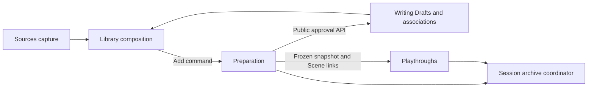
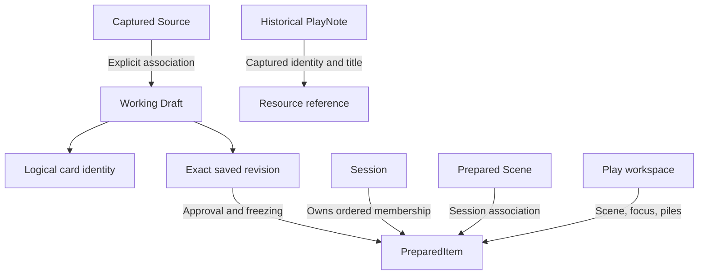
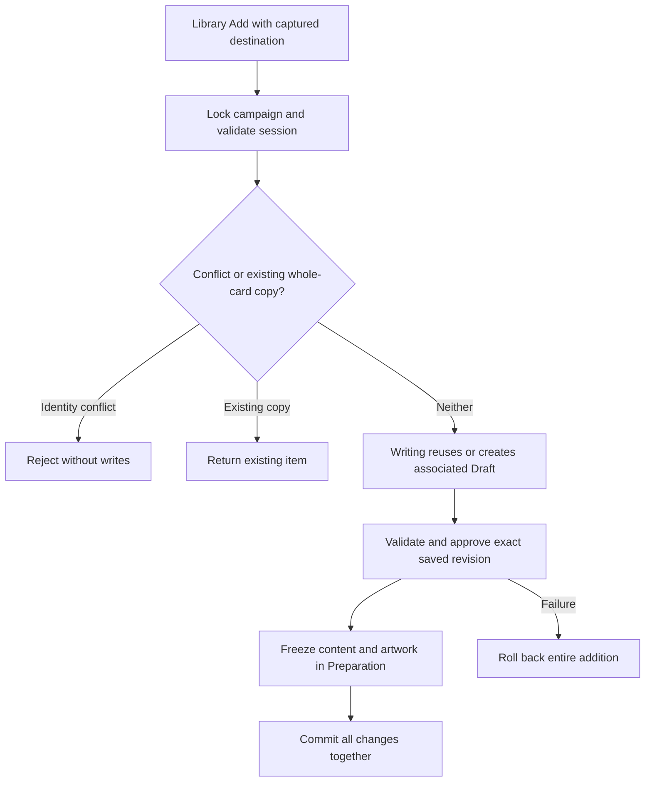
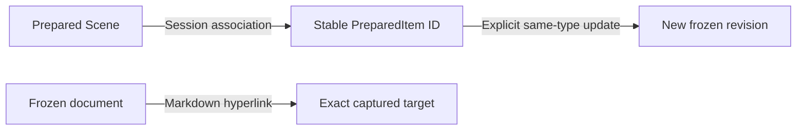

# Implementation plan reading map

## Player sharing — accepted architecture reconciliation — 2026-10-26

The owner approved the reconciliation of the [accepted sharing UX](player-card-sharing-ux-design.md) with G1/G2 and authorized planning. This section supersedes conflicting earlier snapshot/document and connectivity proposals. G1/G2 remain delivered foundations; no G3 implementation is authorized by this record. Responsibilities remain hexagonal: Sharing owns domain rules and application use cases; Gateway owns listener/admission/HTTP and player-asset transport; Preparation owns frozen prepared content; frontend components own presentation. Campaigns does not depend on Sharing or Gateway.

### Accepted decisions

1. **Limited frozen snapshot.** Sharing retains explicit player-visible front/back fields, Sharing-owned immutable artwork and DM-private provenance. Do not copy the full source document into Sharing without a newly demonstrated DM requirement. Never return a PreparedItem/Session DTO to players or rely on hiding fields in the UI. Image/side-reading access must check the currently authorized shared-card instance; an image hash is not an access credential. Distribution confirms the exact visible snapshot previewed by the DM; changed source requires re-review. A distribution operation ID prevents duplicate copies from uncertain retries.
2. **Membership and placement.** A SharedCard is a distinct instance with mode, owner/recipient and lifecycle state. A collection belongs to campaign Group or one campaign player. Within that collection, each active card has exactly one placement: ordered Unsorted or one ordered named pile. Unsorted is implicit and cannot be renamed/deleted. A pile has name/order/default cover; removed cards retain their owner/recipient and immutable content but have no active placement. Sharing owns these structures; do not reuse Play persistence or scene/table state.
3. **Atomic commands and history.** Claim/transfer/removal/restoration update ownership/recipient as applicable, placement, affected covers and append-only card lifecycle history in one transaction. Delete-pile preserves cards in the same collection's Unsorted in deterministic relative order. Group organization is DM-owned; personal organization is player-owned across devices. Commands express intent against current authoritative state rather than replacing collection arrays. Reuse the public campaign lock and transaction convention, with conflicts for stale/invalid targets and no new collection revision protocol or generic concurrency framework.
4. **Cover versus browsing.** Persist an owner-controlled default cover. DM controls Group defaults; player controls personal defaults. Group viewers cycle a local browsing position without changing DM organization. Preserve a viewer's current accessible card on polling; repair defaults/positions when cards disappear. This distinction prevents group browsing from becoming an unauthorized organization mutation.
5. **Per-operation access.** Resolve device identity/activity/revocation and operation permissions within the same transaction as each authorized collection read/command. A successful earlier `/me` response is not an authorization lease. Gateway passes its admitted campaign/activation; player IDs are never accepted as identity. Return Group and personal collection state from a complete consistent authorized read; load artwork separately with card-level access checks.
6. **Presentation integration.** Reuse PlayingCard, artwork loading and geometry behind a document-free capability and replaceable layout-client contract. Preserve existing DM behavior by default. Player UI receives only safe fields and uses the same public layout calculator through a player adapter. Add the previously accepted HTTP-compatible font-hash fallback in the bounded card-rendering increment. Do not inject PlayWorkspaceState into Sharing UI. Persistent organization/default covers belong to the server; face/expanded identity, scrolling, drag and arrival indicators are frontend in-memory state. Transport loss disables mutations, not local flipping/reading.
7. **Onboarding extensions.** Rename stable player IDs without re-pairing. Display unrevoked-device count independently of player activity; retain revoked devices in management history. Add non-secret invitation identity/status. Regenerate replaces only the displayed unused invitation, atomically with new issuance; it never revokes an already paired device or unrelated invitation. The pairing link carries its temporary token in the fragment, removed by bootstrap before exchange. Device credentials remain per-campaign/per-origin localStorage entries and are sent only to same-origin player APIs. No accounts, avatars, cookies or refresh-token system.
8. **Address and connectivity contract.** Gateway reports candidate LAN addresses for DM selection; detection is not proof of tablet reachability. A changed IP/port changes browser origin and can require re-pairing, rather than adding hostname discovery/credential-export infrastructure. Preserve G1's closed listener on disable/switch. Hide collections on authoritative denial or a known campaign/access change; unexplained transport failure keeps an in-memory stale read-only view. Reauthenticate and fetch complete state before re-enabling mutations. The client cannot reliably distinguish a disabled listener from Wi-Fi loss; this explicitly refines the earlier immediate-hide-on-any-disable wording.

Keep one Sharing module with cohesive identity, distribution and collection use cases; do not introduce a service per entity or a generic authentication/asset/tabletop framework. Application/domain rules depend on owned ports and existing public module contracts, not web adapters. Prefer a narrow read-only prepared-card/artwork contract over giving distribution access to Preparation transfer/import internals. The existing campaign-wide lock is a deliberate correctness-first tradeoff; finer locking needs measured contention.

## G3.2–G3.5 — accepted architecture refinements — 2026-10-27

**Status: ACCEPTED.** These refinements implement the direction of the [accepted staged requirements](product-specification.md#g32g35--accepted-sharing-requirements-and-staged-delivery-boundaries--2026-10-27) within the reconciliation above. They establish architectural constraints, not detailed implementation plans or execution authorization.

- **Preparation boundary:** add a narrow, consumer-focused public read contract for the frozen card fields and artwork required by distribution. Keep DM-private provenance separate from player-visible content. Sharing must not depend on Preparation transfer/import internals or expose PreparedItem/Session DTOs to players.
- **Sharing persistence:** separate immutable card content/artwork from mutable ownership/recipient, lifecycle and placement. Shared copies are independent of source retention. Removed instances retain content/artwork for restoration. Artwork copying deliberately trades storage for independent lifetime.
- **Confirmed distribution:** preview supplies a server-computed fingerprint of the exact visible snapshot. Confirmation supplies fingerprint, destination, mode and operation ID. Under the campaign lock, recover an existing successful operation before validating the source; return its original instance even if the source subsequently disappears. Reject operation-ID reuse with different parameters. For a new operation, re-read and validate the fingerprint, then atomically retain the frozen copy, initial distribution event and operation result. Changed source requires re-review. Prefer fingerprint validation over persisted temporary previews to avoid preview lifecycle/cleanup infrastructure.
- **Access and transport:** Gateway owns explicit route admission and admitted campaign/activation context. Sharing resolves credentials, player activity/revocation and operation permissions within the same transaction as the read or mutation. Sharing application code accepts explicit application inputs through public contracts; it does not inspect servlet requests or invoke controllers. Player DTOs are explicit safe projections. Artwork reads authorize the requested card instance, not an image hash.
- **Commands and consistency:** Claim, Transfer, Remove, Restore and later Move express intent against current authoritative state. Ownership/recipient, placement, affected covers and append-only lifecycle history change atomically. Keep the existing campaign-wide lock and bounded transactions; this deliberately serializes unrelated campaign work in exchange for straightforward correctness. Do not add a collection revision protocol, event bus or generic concurrency framework without demonstrated need.
- **Cohesion:** retain one Sharing module with cohesive identity, distribution and collection application components where needed; do not concentrate all behavior in one oversized SharingService or create a service per entity. Domain/application rules depend on owned ports and public module contracts, with persistence and HTTP as adapters.
- **Presentation:** PlayingCard depends on a small injected layout-client interface; DM and player applications provide their own adapters, preserving existing DM behavior by default. The player endpoint invokes the existing public layout calculator under player authorization. The shared component knows nothing of credentials, Gateway or collection state. Include the accepted HTTP-compatible font-hash fallback with shared-card rendering. Artwork transport remains feature-owned through the existing presentation contract.
- **Frontend state:** Sharing coordinates its own collections independently of Play. Complete, consistent Group/personal refreshes reconcile by stable instance identity, preserving accessible local reading state. Persistent organization/default covers remain server-owned; Group viewer browsing stays local. Unknown transport loss retains stale reading and disables mutations; authoritative denial hides content. Reauthenticate and obtain complete state before mutations resume.
- **Staging:** G3.2 establishes snapshots, retry records, Unsorted placement and initial distribution history. G3.3 adds lifecycle transitions; G3.4 adds piles with membership restricted to the authoritative collection. G3.5 routes gestures through the same commands as contextual actions rather than adding a second mutation path. Do not implement later-increment commands early merely to establish this foundation.

Alternatives considered: live references to prepared content undermine frozen lifetime; persisted temporary previews add retention/cleanup obligations; replacing collection arrays weakens command authorization and concurrency semantics; finer locks and incremental synchronization add complexity without measured need. Retain complete polling and the modular monolith. Separate modules/frameworks are not justified by this scope.

## G3.5 — accepted architecture refinements — 2026-10-27

**Status: ACCEPTED.** Owner approved skipping requirements because the accepted staged requirements and sharing UX already define G3.5 behavior, then approved the architecture below and authorized planning. Implementation and formal verification require separate authorization.

- **Existing mutation path:** gestures invoke the same application commands and frontend operation handlers as contextual actions: confirmed distribution, same-instance transfer/claim, organization and removal/withdrawal. No new persistence, API or dependency is expected. Preserve distribution fingerprint review and uncertain-delivery retry identity; a dropped prepared source is never silently distributed.
- **DM destinations:** replace the collection dropdown with responsive selectable Group/player destination controls. Source drops open existing distribution review with destination preselected and mode explicitly chosen. Inventory drops onto another collection transfer immediately; personal delivery/transfer always targets Unsorted. Selected Group piles and Unsorted accept permitted distribution/organization drops. DM inspection of personal organization remains read-only.
- **Collection presentation:** the shared tray owns individual-card movement and anchored ordering, pile/Unsorted targets, Show all and reading state. Group organization belongs to DM; personal organization belongs to the player. Shared presentation emits intents without credentials, HTTP access or Play workspace state.
- **Modal interaction:** Show all contains its own permitted destinations during eligible dragging, including conditional Claim, organization destinations, DM transfer destinations and Remove/Withdraw. Keep drag previews within the modal top layer. The sticky tablet My Cards control claims without navigation; the modal equivalent does not rely on the obscured header. Removal/withdrawal always enters existing confirmation.
- **Transient coordination:** Sharing-owned gesture state records source identity/location and permitted destinations, scoped to the current workspace/collection rather than a global drag framework. Cancel on Escape, touch cancellation, invalid release, navigation, connectivity loss or authoritative source change. Recheck current eligibility before dispatch; retain existing server authorization/conflict handling and complete refreshes. No offline queue or client-only persistent movement.
- **Input and reading:** reuse Angular CDK with the existing 8px threshold and 180ms touch delay as initial values, subject to execution evidence. Direct card drag must coexist with swipe scrolling, tap expansion and on-card controls. Protect menus/flip/side readers from drag initiation, suppress post-drag activation and preserve accessible reader identity, face, scroll and focus. Contextual keyboard alternatives remain available.

Tradeoff: duplicate relevant destination presentation inside Show all to respect native modal interaction boundaries. Reuse installed CDK and existing command boundaries rather than introducing a gesture library or coupling Sharing to Play. Physical-tablet/Safari behavior requires separate device evidence; emulation is not device acceptance.

## G3.5 — approved bounded implementation plan — 2026-10-27

**Status: APPROVED.** Owner approved this bounded plan and authorized implementation, developer checks and in-scope corrections in the conversation. Deliver the accepted direct-manipulation behavior as one reviewable increment, preserving G3.1–G3.4. Formal verification and owner acceptance are separate from developer checks.

### Scope and affected components

1. Add narrowly scoped Sharing gesture coordination and typed source/destination intents beside `frontend/src/app/sharing/shared-card-tray.ts`. Reuse installed CDK, current intent commands and complete authoritative refreshes. Keep credentials and mutation execution in the DM/player owners.
2. In `share-workspace.ts`, `.html` and `.css`, add direct prepared-card dragging and selectable Group/player collection targets. Route source drops through existing preview/confirmation/retry handling, including existing/new Group piles; route inventory transfers through the existing immediate command path shared with contextual Transfer. Maintain card identity, quiet destination indicators and personal-pile ownership restrictions.
3. Extend the shared tray with individual-card drag from covers, Unsorted and Show all, movement between owned locations and anchored reorder in Unsorted/Show all. Present only eligible targets, including contextual Remove/Withdraw with confirmation. Within Show all, provide relevant destination targets and a visible preview without relying on elements behind the modal.
4. In `frontend/player/main.ts`, connect the sticky My Cards claim target and conditional modal equivalent to the existing Claim handler, without navigating. Connect personal organization/removal gestures to existing handlers. Retain connected/busy guards, local Group browsing and stale local reading.
5. Handle cancellation and reconciliation across navigation, overlay closure, Escape/touchcancel, access/connectivity loss, source disappearance or source-location change. Keep unrelated polling updates from cancelling a valid drag or resetting reading. Protect card controls and focus/scroll return. Changes to shared PlayingCard are limited to demonstrated gesture integration needs and must preserve its DM/Play behavior.
6. Add focused gesture/state and real-browser checks in Sharing test files, extending existing distribution/lifecycle/organization journeys where useful. Update delivery evidence here and user-facing guidance in README/user guide/future-work only after implementation reflects the behavior.

Expected production changes are limited to Sharing presentation/coordinator files, the player root and narrowly necessary shared-card event handling. No database migration, new dependency, campaign-source edit, development-data reset, Play-state refactor, offline support or backup work. If a backend/API change or consequential design conflict proves necessary, stop and return for scope/design approval rather than silently expanding the increment.

### Execution and developer checks

- First complete and inspect the destination/overlay composition at DM 1280×800 and 1440×900 and tablet portrait/landscape/narrow widths, retaining actual card proportions and long-name wrapping. Then integrate gestures through existing handlers. Keep each test run's sources stable.
- Focused checks establish source drop opens review without mutation, explicit mode/confirmation and cancellation, new/existing Group pile delivery, uncertain retry identity, immediate same-instance transfer, claim without navigation, permission-filtered targets and confirmed/cancelled removal. Assert backend-visible identity/placement and source/Play preservation rather than visual movement alone.
- Exercise cover/Unsorted/Show all movement and anchored reorder, empty destinations, modal-local Claim and cross-location targets, and multi-device reconciliation. Include concurrent claim/stale organization, source removal/movement during drag, unrelated polling during drag/expanded reading, disconnect/denial/reconnect and no queued mutation.
- Check actual mouse movement and touch input, swipe-before-hold versus hold-drag, valid/invalid release, Escape and touch cancellation, auto-scroll as needed, protected flip/menu/side-reader controls and no post-drag expansion. Check contextual keyboard equivalence, modal layering, focus return, face/expanded identity and scroll retention. Chromium touch emulation is developer evidence only; report unavailable physical-device/Safari checks explicitly.
- Run focused frontend and sharing browser tests before the stable candidate's version check, full frontend unit suite, DM and player production builds, and complete isolated Chromium suite. Generate the client from live Spring as needed by the existing harness. Run backend tests/bootJar as the integration baseline; do not add backend tests merely to mirror unchanged behavior. If shared PlayingCard changes, include affected Play/card-reading regressions. Broaden/repeat checks only where changes or failures invalidate evidence.

### Completion and boundaries

All accepted G3.5 gesture paths have contextual equivalents and verified command effects; role/ownership boundaries, frozen content, retry semantics and G3.1–G3.4 behavior remain intact. Cover all ten accepted sharing end-to-end scenarios through focused plus regression developer evidence, explicitly identifying device-only or otherwise unverified areas. Record checks, failures/corrections, deviations and remaining risks here. Successful developer checks do not constitute formal verification, owner visual/functional acceptance or physical-tablet/Safari acceptance, and do not authorize another increment.

### G3.5 implementation and developer evidence

Implemented selectable Group/player destinations, prepared-source drop into reviewed distribution, immediate same-instance Inventory transfer (including Group piles from personal inspection), individual-card movement and anchored reordering, sticky tablet Claim and conditional modal Claim, and confirmed Remove/Withdraw drop destinations. Modal organization/transfer/removal targets remain within Show all; personal organization remains player-owned. Contextual operations and gestures share existing mutation handlers. No backend/API/schema/dependency change, development reset or campaign-source edit was needed; shared PlayingCard and Play production code were unchanged.

A workspace-scoped Sharing coordinator retains typed transient source/target intents. Installed CDK owns pointer thresholds, delayed touch initiation and previews; visible hit-tested targets dispatch current intent commands without replacing collection arrays. Native-modal hit testing excludes obscured background targets; modal previews stay in their top layer. Scroll containers register with CDK. Source disappearance/location changes, disabled access/connectivity, overlay/navigation changes, Escape, touch cancellation and invalid release prevent dispatch. A fresh pointer clears release-click suppression so flipping/reading remains usable immediately after dragging. Full polling, server authority, retry identity and collection-level reading reconciliation remain intact.

Developer baseline: live isolated Spring OpenAPI regenerated the client (`/tmp/g35-client.log`); version checks passed (`/tmp/g35-versions.log`). Backend `test bootJar` passed 155 tests across 35 suites (`/tmp/g35-backend.log`), with unchanged backend sources. Final frontend run passed all 136 tests (`/tmp/g35-unit-final.log`); DM and separately compiled player production builds passed (`/tmp/g35-build-final.log`, `/tmp/g35-player-final.log`). Existing DM bundle/CSS and QR CommonJS warnings remain.

Three new Chromium gesture journeys assert server-visible identity/placement/order for source review, same-instance transfer, Group-pile placement, cover/Unsorted/Show all movement, modal and sticky claims, removal confirmation/cancellation, anchored reorder and preserved cover identity. They use real mouse movement and Chromium touch input to check swipe scrolling versus delayed hold-drag, Escape/touchcancel/invalid release, source disappearance and transport loss during dragging, continued local flipping, reconnect/denial, unrelated polling during a held drag, protected controls, no post-drag expansion, Handout restrictions and unchanged prepared-session state. Existing sharing journeys cover reviewed artwork/uncertain retry, concurrent claim and focus fallback, private payload/access boundaries, recovery, multi-device organization and stable expanded reading. The complete isolated Chromium suite passed all 84 journeys (`/tmp/g35-browser-all.log`). After that run, narrow source-button, keyboard-click and gesture focus corrections and extended personal-drag/touch-flip assertions passed all 12 sharing journeys (`/tmp/g35-sharing-final.log`); the other 72 journeys exercise unchanged paths. A final screenshot-driven Material outline correction then passed all three gesture journeys, including an explicit visible sticky-target hover assertion (`/tmp/g35-gestures-final.log`). The full 84-journey suite was not repeated after those bounded corrections; final unit/build results above include them. Together the full and focused runs cover all 84 distinct journeys.

Corrections and execution limits: initial builds were invoked twice from the repository root and did not run; the initial sandboxed Angular process aborted and Gradle could not access its cache, so approved escalated runs supplied the reported evidence. Early gesture checks found release-click suppression swallowing a fresh flip tap, a touch fixture failing to select its campaign, and a duplicate Group-pile target selector; corrections passed focused checks. A broader sharing run was stopped after five passes to correct screenshot-observed duplicate nonmodal Claim presentation and scope drag-preview styles to Sharing. Stable destination accessible names also preserve selection when arrival markers change; contextual lifecycle checks then passed. A final visual-state check reproduced Material button styles overriding the sticky target outline (`/tmp/g35-target-visual.log`); giving Sharing target outlines explicit priority restored the visible hovered state, and the final gesture run passed. Direct source action buttons also stop drag initiation, and sticky claims/DM transfers now use the same collection focus recovery as contextual actions without scrolling. Aborted/failed runs are not counted as complete passes. Composition screenshots were reviewed alongside focused gesture integration rather than in a separate pre-integration browser checkpoint; this is a sequencing deviation from the plan, with no accepted design/scope change.

Browser composition checks exercise DM 1440/1280 widths and tablet portrait/landscape/narrow widths, including retained G3.4 long-pile-name checks at 390px. Reviewed gesture screenshots include DM destination composition, bounded Show all cards, narrow Handouts and the highlighted sticky Claim destination during touch dragging; the automated hover assertion checks its actual outline as well as the hover state.

Formal verification, owner functional/visual acceptance and physical-tablet/Safari compatibility remain unperformed for G3.5. Automated scenarios establish behavior classes from the accepted end-to-end scenarios, not literal owner playthrough acceptance. Virtual-keyboard ergonomics, real tablet long-press/browser behavior and device-specific scrolling remain outside Chromium evidence. Sharing state/artwork remains excluded from session/Writing archives, and trusted-LAN HTTP limitations are unchanged.

## G3.4 — approved bounded implementation plan — 2026-10-27

Owner approved the bounded increment and authorized implementation, developer checks and in-scope corrections in the conversation. Deliver additive pile/membership persistence, ownership-enforced organization commands, anchored order and cover repair; atomic existing/new Group pile distribution with retry safety; lifecycle integration; shared responsive DM/tablet pile and Unsorted presentation, Show all and contextual accessible organization controls with stable reading/polling. Affected components: Sharing API/application/JDBC/web/configuration and migration, explicit Gateway routes, generated client, Share workspace, player application, focused tests and delivery documentation. No gestures, backups, new dependencies or formal verification.

Completion: all accepted G3.4 behavior with G3.1–G3.3 preserved. Developer checks cover migration of existing data; permission/stale-command/deletion races; distribution retry, rollback and restart; cross-device organization; keyboard/focus, covers, overlays and disconnect. Focused checks precede stable backend/frontend suites, both builds and isolated browser checks. Formal verification remains separately authorized.

### G3.4 implementation and developer evidence

Implemented Sharing-owned organization with additive V26 piles, card membership, ordered locations and default covers. Deferred PostgreSQL constraints enforce campaign/recipient membership and valid active cover references at commit. Existing active/removed cards, order and retry records remain retained without resetting development data. One OrganizationService exposes intent commands through a private Group endpoint and an explicitly admitted, per-operation authenticated personal endpoint. Source/anchor validation, deterministic pile deletion and cover repair use the existing campaign lock and transactions; no Play state, revision protocol or new dependency was introduced.

Distribution supports existing/new Group piles, with new-pile creation and frozen-card insertion in one retry-safe transaction. Successful retry recovery precedes current destination/source checks, including deleted destinations. DM transfer accepts Group piles; departures repair the prior cover and clear prior membership, while Claim/Restore/personal delivery preserve Unsorted semantics. Complete collection reads include safe pile/placement projections. The shared card tray now presents horizontal responsive piles, Unsorted, keyboard-accessible contextual organization, empty/count/cover states and bounded Show all. A collection-level expanded reader retains accessible identity/face through movement. Owner arrows persist covers; viewer browsing, fallback positions and arrival markers remain in memory. Stale/denied behavior follows G3.2/G3.3.

Developer checks: the complete backend run passed 154 tests in 35 suites plus bootJar (`/tmp/g34-backend-all.log`). A subsequently added transfer/retained-organization restart case passed with the focused Sharing and V25→V26 migration suites: 22 tests (`/tmp/g34-piles-final.log`). Together these cover 155 distinct backend tests; the complete suite was not rerun after that test-only addition. Focused cases cover ownership/campaign/credential denial, stale source/anchor rejection, competing moves, nonempty confirmation, deterministic deletion order, cover wrap/repair, atomic new-pile rollback, retry after deletion/restart, cross-device organization and intact organization after restart. Live Spring OpenAPI generated the Angular client; version checks passed.

Final frontend evidence: DM/player builds passed (`/tmp/g34-dm-cover-final.log`, `/tmp/g34-player-cover-final.log`) and all 136 frontend tests passed (`/tmp/g34-frontend-cover-final.log`). The complete Chromium run passed 79 of 81 journeys (`/tmp/g34-browser-all.log`): same-origin reconnect failed under a diagnostic dynamic player port, and the G3.4 test selected another open pile's Delete action. Restoring the stable player port and scoping that selector resolved both. All nine sharing journeys passed after final corrections (`/tmp/g34-sharing-cover-final.log`), alongside the 72 unchanged unrelated journeys from the complete run, covering all 81 journeys across full and focused runs. Application sources stayed fixed during each reported run. Screenshots reviewed at DM 1280/1440 widths and tablet portrait/narrow widths include a 179-character pile name at 390px with no horizontal overflow. The new journey checks keyboard rename, pile ordering, owner versus viewer covers, multi-device personal organization, confirmed/nonconfirmed deletion, Show all layering/body scroll and preservation of expanded back-face reading across movement.

Failed/aborted runs are not counted as passes. The initial sandboxed Angular build aborted; escalated builds passed. Early browser diagnostics corrected a card selector and closed-dialog duplicate card controls; the first closed-dialog template correction failed compilation before being fixed. Port-4200 checks encountered an unrelated campaign-selection request outside the test trace that closed the gateway; final checks used frontend port 4201. Source review then identified an initial viewer-cover jump on DM default change; the focused regression reproduced it (`/tmp/g34-cover-regression.log`) before the final fix initialized persistent-in-memory browsing positions. The passing journey waits for an authoritative pile rename before asserting the viewer's cover remains unchanged, avoiding a pre-refresh assertion.

No accepted scope/design deviation, new dependency, development-data reset or campaign-source edit. Existing DM bundle/CSS and QR CommonJS warnings remain. Sharing remains excluded from session/Writing archives. Formal verification, physical-tablet/Safari and owner functional/visual acceptance have not been performed for G3.4; G3.5 delivery is recorded separately above.

## G3.4 — accepted architecture refinements — 2026-10-27

**Status: ACCEPTED.** Owner approved these refinements and authorized planning in the conversation. Requirements work was explicitly skipped because the accepted G3.4 requirements already cover the intended behavior. Implementation and formal verification require separate authorization; this section does not grant either.

- **Persistence and ownership:** add Sharing-owned piles with collection owner, name, order and default-cover identity, plus nullable pile membership for active cards through an additive migration. Existing cards remain Unsorted. Persistence constraints and command validation enforce campaign/collection membership. Unsorted remains implicit. DM organizes Group; authenticated players organize their own collection across devices. DM inspects personal organization without reorganizing it.
- **Commands and ordering:** one cohesive organization service handles pile creation, rename, deletion, movement/order and cover changes. Move/reorder commands carry expected source location and destination anchor, not replacement arrays. Validate current source and target under the existing campaign lock and transaction; stale/missing targets conflict and refresh. No collection revision protocol or generic concurrency framework. Delete-pile appends cards to the same collection's Unsorted in existing pile order; reject unconfirmed deletion if an apparently empty pile has become nonempty.
- **Covers:** organizer arrows persist default-cover identity; viewer arrows browse locally. Reorder preserves a surviving cover. When a cover leaves, choose the next surviving card in prior order with wraparound; empty piles have no cover. Arrivals preserve existing covers.
- **Distribution and lifecycle:** confirmed distribution accepts Group Unsorted, an existing Group pile or a new pile name. New-pile creation and frozen distribution commit atomically. Destination participates in retry parameters; recover a successful operation before validating current source/destination, preventing duplicate piles/cards. Claim and restore keep their accepted Unsorted destinations. DM transfer accepts Group piles or recipient Unsorted. Every departure clears old membership and repairs covers atomically with the existing lifecycle transition/history.
- **Presentation:** a shared collection presentation component owns piles, Unsorted and Show all without Play-state coupling. Expanded identity and face belong at collection level so movement between locations preserves accessible reading. Complete polling reconciles stable identities and retains local Group browsing. Contextual keyboard-accessible organization controls deliver G3.4; gestures remain G3.5.

Tradeoff: retain campaign-wide serialization and complete refreshes for straightforward consistency; stale commands can require a retry after refresh. Alternatives rejected: replacing whole collection arrays, client-only organization, separate Play persistence/state reuse, and creating a new pile outside the confirmed distribution transaction.

## G3.3 — approved bounded implementation plan — 2026-10-27

Owner approved planning and authorized implementation, formal verification, Docker/sandbox checks and in-scope fixes in the current conversation. Deliver contextual same-instance Claim, player-owned inventory removal, DM inventory transfer/removal and handout withdrawal, and one DM-only recovery view restoring the previous recipient's Unsorted, including inactive players. Persist recipient/state/placement/history atomically under the existing campaign lock. Reuse V25 lifecycle persistence; no piles, drag/drop, player-to-player commands or backup work.

Affected components: Sharing API/application/store/JDBC/web/configuration, explicit Gateway routes, Share workspace, shared card tray, player application, focused backend/browser checks and delivery documentation. Preserve distribution retry recovery across lifecycle changes. Completion checks cover claim concurrency, mode/role/state/campaign authorization, revocation races, rollback/history, restore/restart, keyboard confirmations/focus, disappearance during reading, quiet arrivals and stale/reconnect behavior. Run focused checks first, then stable backend/frontend builds/tests and isolated browser checks. Formal assessment is separately reported in verification.md; no next-increment authorization is implied.

### G3.3 implementation and developer evidence

Implemented one cohesive CardLifecycleService with explicit player Claim/Remove contracts and private DM Transfer/Remove/Restore/removed-list endpoints. Reused V25 recipient, lifecycle state, position and append-only events; no migration or reset. Active reads filter lifecycle state, so discarded/withdrawn instances have no active placement or player artwork/layout access. Commands reauthorize and validate current state under the existing campaign lock, then update recipient/state/Unsorted order/history in one transaction. Immutable content/artwork and previous recipient remain retained. Distribution retry recovery now reads retained instances, including removed cards, without reactivating or duplicating them.

The shared tray has presentation-only contextual action inputs/outputs and keyboard focus fallback after disappearance. Player Claim stays on Group, uses quiet arrival indicators and handles a competing winner; own Inventory removal confirms. DM has a destination picker, confirmed removal/withdrawal and one secondary recovery view, including inactive recipients. Polling reconciles complete authoritative state; command generations reject older reads, unknown failure disables mutations and reconnect restores authoritative state. Recovery polling and focus after restoration remain within the existing Share workspace. No Play-state coupling, piles, gestures or new dependency was introduced.

Developer evidence: focused SharingDistributionIntegrationTest passed 16 tests, including six new lifecycle cases for claim concurrency, role/mode/state/campaign/credential restrictions, inactive restoration, rollback, revocation ordering, explicit HTTP admission/media type and restart/history/artwork/retry persistence (`/tmp/g33-focused-backend.log`). The complete isolated setup passed 149 backend tests in 34 suites, bootJar, live Spring client generation, version checks, 136 frontend tests, DM/player production builds, 80 Chromium journeys and PostgreSQL installation-state restart persistence (`/tmp/g33-full-setup.log`). Smoke/Testcontainers databases and temporary campaign fixtures were used; development data was not reset.

The sandboxed Angular builds aborted without diagnostics; approved escalated builds succeeded. A focused browser run exposed missing Content-Type on generated bodyless mutations; the existing onboarding header convention corrected it. Source review also found an invalidated-poll flag that could block reconnect after interrupted commands. The real interruption/competing-claim journey passes. After the complete suite, keyboard review added tray/recovery focus fallbacks and suppressed Transfer when no destination exists. The recovery focus assertion exposed a Material directive/DOM-query mismatch; its first correction failed compilation, and the corrected Angular query overload now passes the DM build (`/tmp/g33-dm-build-focus-final.log`) and all eight sharing journeys (`/tmp/g33-final-sharing-fixed.log`). The final player build passed (`/tmp/g33-player-build-final.log`); frontend unit evidence is in `/tmp/g33-frontend-final.log`. Failed/aborted runs are not counted as passing evidence. Application sources stayed stable during each reported run; unchanged backend and unrelated browser evidence from the complete run remains applicable after these frontend corrections.

Formal verification was authorized in the conversation and is recorded in verification.md. Physical-tablet/Safari and owner functional/visual acceptance remain separate. Existing DM bundle/CSS and QR CommonJS warnings remain. Sharing is still excluded from session/Writing archives; G3.4/G3.5 delivery is recorded separately above.

## G3.2 — approved bounded implementation plan — 2026-10-27

Deliver confirmed frozen distribution to Group/player Unsorted and authorized tablet reading. Scope: narrow Preparation card/artwork API; Sharing-owned immutable snapshots/artwork, instances, Unsorted placement, initial lifecycle event and retry-result persistence through additive V25; private preview/confirm/collection endpoints; explicitly admitted player collection/artwork/layout endpoints; injected PlayingCard layout transport and HTTP-compatible font validation; contextual DM distribution and real DM/player collection views with stable reading, arrival indicators and access/connectivity handling. Preserve G1/G2/G3.1 and existing DM cards. No lifecycle commands, named piles, drag/drop, new runtime framework or Play-state coupling.

Completion: exact reviewed preview and explicit mode/recipient; changed content conflicts; uncertain/concurrent retries return one instance and changed retry parameters conflict; rollback leaves no partial state; copies survive source removal and restart; every player operation reauthorizes; safe payloads exclude documents/notes/provenance; ordinary HTTP rendering, side reading, expansion, denial/stale/reconnect and responsive keyboard-accessible presentation work. Expected components: Preparation API/application/configuration; Sharing API/domain/application/JDBC/web/configuration and V25; Gateway routes/controllers; shared PlayingCard/font renderer, Share workspace and player application; focused backend/frontend/browser tests and documentation. Generate clients from live Spring.

Developer checks: focused transaction/retry/authorization races first; early populated laptop/tablet composition; focused frontend/real-backend journeys; stable-candidate backend tests/bootJar, frontend version/unit checks, DM/player builds and complete isolated setup checks. Formal verification follows implementation using the separately authorized verification scope; report its evidence in verification.md. Implementation authorization, in-scope corrections and formal verification were explicitly given in the conversation; this record grants no subsequent-increment permission.

### G3.2 implementation and developer evidence

Implemented the approved frozen distribution/reading increment. Preparation exposes PreparedCards with explicit visible fields, artwork and restricted identity/hash provenance; authored originals, source bodies, notes and document links do not cross that boundary. Sharing has cohesive DistributionService and CollectionService application components, a separate JDBC port/adapter and additive V25 persistence for immutable content/artwork, instances, ordered Unsorted, initial events and distribution retry records. Preview fingerprints cover the player-visible text/artwork; private provenance-only changes do not change that visible preview. Confirmation validates current content under the campaign lock, while successful operation recovery precedes source lookup. Atomic rollback and concurrent retries are covered by integration tests.

Gateway admits only explicit collection/card-artwork/card-layout routes in addition to G3.1. Every player use case revalidates identity and permissions inside the same transaction as the read. Collection DTOs contain only safe fields. Shared PlayingCard depends on a pure injected layout-client port; the DM adapter is supplied by DM application configuration, while the player supplies its own authorized adapter. The compiled player bundle excludes DM campaign/layout endpoints. Player fonts/placeholders resolve beneath its asset boundary, and SHA-256 font identity validation has a tested HTTP-compatible fallback.

DM Share now previews and confirms explicit mode/recipient, blocks confirmation until preview artwork loads, retains uncertain retry identity in the current workspace across dialog dismissal, and displays real collections. Shared trays support keyboard expansion, flip/complete-side reading, focus return and background scroll locking. Player polling preserves accessible reading identity/face/scroll, marks unseen personal/group arrivals, hides content on denial and retains stale local reading on unknown transport loss. A bounded cache of 16 recently loaded immutable artwork blobs supports local flipping/expansion without redownloading; it is pruned to accessible instances and cleared on access/context loss, with generation guards against late responses. No browser-persistent content cache or mutation queue was added. Lifecycle commands, piles and drag/drop remain deferred.

Developer evidence: **143 backend tests in 34 suites**, production bootJar, live Spring client generation, **136 frontend tests**, version checks, DM/player production builds, **78 Chromium journeys** and PostgreSQL restart persistence passed through the complete isolated setup check (`/tmp/g32-full-setup-final.log`). The focused final Preparation/privacy and transaction/authorization tests passed (`/tmp/g32-boundary-check.log`); eight focused DM artwork/geometry/sharing regressions passed (`/tmp/g32-regressions.log`). The later player-only stale-artwork correction has a demonstrated failing/passing browser regression (`/tmp/g32-stale-art-red.log`, `/tmp/g32-stale-art-green.log`) and a successful final player build (`/tmp/g32-stale-art-build.log`); the unchanged backend/DM broad evidence remains applicable. Formal verification records the final sharing/layout checks separately.

Corrections during implementation: preserve the established DM placeholder path while resolving player assets relative to the player base; move the default layout transport out of the shared port into DM configuration; restrict provenance to avoid retaining authored original documents; preserve already-loaded artwork during stale flips. No approved scope or architectural deviation. One interrupted test run used a JAR overwritten by a rebuild; the isolated follow-up server used a stable copied artifact. An oversized browser fixture was rejected correctly by Preparation's fit gate; historical oversized-field retention is covered by backend integration and existing complete-side renderer tests, while the real browser journey checks complete reading during layout-service loss. Physical-tablet/owner acceptance remains unverified.

## G3.1 — accepted bounded increment: roster and tablet onboarding

**Status: ACCEPTED.** The owner approved this bounded increment, implementation, formal verification and in-scope fixes in the conversation. Execution authorization remains conversational. Concrete outcome: DM opens Share, creates/selects a campaign player, explicitly enables sharing, displays a real expiring QR, and a tablet opens the separate Group Cards shell under that identity. A previously paired browser reconnects at the same origin. This increment does not distribute or persist cards/piles.

### Scope and boundaries

- **Sharing backend:** add player rename and an unrevoked-device count projection; add non-secret invitation IDs/status and atomic replacement of a pending invitation. Preserve existing G2 callers/credentials, consumed invitations and devices. Use an additive migration (next available version, currently V24), not edits to V23. Concurrent redeem/replace must either pair the old code before replacement or invalidate it before redemption; never revoke the resulting device as a side effect.
- **Gateway:** privately report candidate LAN IPv4 addresses and use the actual bound port. Keep explicit enable/disable and no automatic enable when adding/pairing a player. Serve only the dedicated compiled player output and known player entry paths; no arbitrary SPA fallback, source maps, DM build/root, directory listing, private APIs or permissive servlet forward. Preserve connector/dispatch identity checks and synchronous admission. DM QR display requires an enabled gateway for the selected campaign, selected address and ready player assets; preserve G2's low-level pairing API compatibility and keep asset readiness outside Sharing rules.
- **DM UI:** add Share to existing navigation and guards without losing dirty Write/Prepare state or campaign/session context. Use existing styling and one integrated screen with compact roster/status, real read-only prepared-source cards for the selected session, and a collection-shell region. Add/Rename/Deactivate/Reactivate, Manage devices/revoke and Pair device are contextual. QR overlay shows selected player, server-provided expiry/status, regenerate and matching copyable link; closing makes no success claim. Add the small approved PlayingCard document-action capability, default enabled for existing callers, and hide that action on Share's source cards; front/back and complete card-side reading remain available. Do not show unimplemented distribution/pile/recovery actions or seed fake shared cards. Collection operations and complete populated-layout acceptance remain later increments.
- **Player UI:** separate Angular entry/build/configuration, independent of DM app configuration/routes/state. Pair from a fragment, strip it before exchange, save the returned credential by campaign at that origin and open Group Cards; My Cards is a separate shell with mirrored sticky navigation. Show plain identity and connection status. No camera/browser-crypto requirement for onboarding, account selector or offline card storage. Without a fragment, try the last successful then other stored campaign credentials once to find the enabled campaign; never discard a different campaign's credential solely because it returns 401. Hide prior identity/collections before attempting a different context. Rejected access stops collection polling; explicit retry/resume may revalidate.
- **Build/runtime integration:** add a dedicated player build output (for example `frontend/dist/player/browser`) and a narrow resource adapter. Normal dev startup remains backend build/start -> live client generation -> compiled player build -> DM Angular startup -> Ready. The backend can run before assets exist, but pairing UI must not advertise readiness prematurely. Extend startup failure/cancellation checks for the new build step. Formal setup follows the same order. Serving compiled files through Spring is included; bundling a complete session-use distribution or exposing Angular's dev server is excluded.
- **Dependencies:** propose lazy browser QR encoding with pinned `qrcode` 1.5.4 and matching pinned development typings; use test-only `jsqr` 1.4.0 to independently decode rendered pixels. Upstream browser/API/license/version metadata checked at [node-qrcode](https://github.com/soldair/node-qrcode), [encoder manifest](https://raw.githubusercontent.com/soldair/node-qrcode/master/package.json), [typings](https://github.com/DefinitelyTyped/DefinitelyTyped/tree/master/types/qrcode) and [decoder manifest](https://raw.githubusercontent.com/cozmo/jsQR/master/package.json). Verify published package metadata/lockfile when installing; do not treat DefinitelyTyped's development `1.5.9999` marker as a released version. No backend/QR service framework. Font hashing/layout transport changes wait for the card-rendering increment.

### Completion criteria and checks

1. Add/rename/deactivate/revoke correctly reflects authoritative roster/device state without changing credentials or auto-enabling Gateway. Invitation expiry/replacement/status is accurate; obsolete async responses cannot display a QR for another player/campaign.
2. Independently decode rendered QR pixels and assert the actual selected LAN address/port, player entry destination and fragment token match the textual link. Verify no token reaches URLs sent to HTTP endpoints/logs, no permanent credential appears in the DM modal, and expiration/replay/replacement races preserve single-use semantics.
3. Real browser pairing opens Group Cards under the correct player; same-origin reload reconnects; wrong campaign/inactive/revoked/expired/used and unreachable cases recover correctly. Browser storage/Authorization attach only the intended same-origin player credential. No queued mutations, account UI or fabricated collections.
4. Check compact Share composition at 1280x800/1440x900 and player portrait/landscape; long names, 0/many players/devices, modal focus/return, keyboard controls and sticky headers. Capture the composition before broad UI wiring; populated pile/drag/card-reading acceptance belongs to later increments.
5. Exercise asset traversal/encoding aliases/redispatch, absent/partial assets and every private OpenAPI operation over the LAN. Normal dev startup, client generation, player build, cancellation and failure cleanup work with isolated state. Preserve G1/G2 tests and navigation/save guards; run affected backend/frontend/browser checks and a production player build, then existing broad checks on a stable candidate. Separate formal verification and owner tablet-camera acceptance require their respective authorization.

Expected components: Sharing API/application/store/migration/tests; Gateway status/address/resource/route adapters and tests; frontend Share/player features, small shared PlayingCard document-action capability, routes/header/navigation handlers, Angular build/config, packages/catalog and tests; dev launcher/startup checks, setup script and documentation. No Play persistence/application-state refactor, shared-card schema, distribution, lifecycle commands, named piles, player card rendering or font-hash fallback. Approval of G3.1 must identify this bounded scope; it does not authorize subsequent increments.

### G3.1 implementation and developer evidence

Owner-reported QR follow-up (2026-10-26): the running development build exposed the dynamically imported CommonJS encoder as a default-only module, so the named `toDataURL` call failed. Normalize the import through its default export with namespace fallback. The bounded correction changes only encoder loading; invitation issuance and Sharing/Gateway boundaries are unchanged. Actual development and compiled-production browser checks both render a QR whose independently decoded pixels match the pairing link; see the formal follow-up in `verification.md`.

Delivered the bounded roster/onboarding flow, V24 backfill/replacement state, private address/readiness metadata, completed-build asset manifest and strict resource adapter, genuine DM source preview and separate player bootstrap/shell. QR generation uses the pinned encoder; tests independently decode rendered pixels. Player transport imports only its generated service/types, not the API barrel/DM clients. Existing G2 credentials and pending invitations survive migration. JSON Accept/Content-Type are explicit at feature callers; invitation and modal responses are guarded against stale context/address changes. Player retry keeps a temporary invitation only in memory, while authoritative access denial invalidates in-flight results and stops normal polling.

Developer evidence: **133 backend tests in 33 suites**, production bootJar and `checkDevStartup` passed (`/tmp/g31-developer-backend.log`); startup includes two launches/cancellation, occupied-port ownership, client-generation and player-build failure cleanup, and database retention. **135 frontend tests**, DM/player production builds and four focused onboarding journeys passed; see `/tmp/g31-frontend-unit.log`, `/tmp/g31-player-build.log`, `/tmp/g31-dm-build.log`, `/tmp/g31-browser.log`. Actual layouts were inspected at laptop and tablet sizes. Initial checks found and corrected generated clients' default Problem Details Accept selection, unwanted DM client inclusion through the generated API barrel, retry generation handling and stale QR destinations. No new runtime framework, card/collection schema or Play state coupling.

Separate formal verification found a modal focus-return defect in the supplementary many-player/device matrix. The authorized in-scope correction captures the invoker and restores focus after controls render enabled, with a safe heading fallback; a persistent onboarding regression assertion and the supplementary matrix pass on that correction. Backend/startup inputs are unchanged by this frontend-only fix. Final formal integration evidence is recorded separately in `verification.md`; owner tablet-camera/visual acceptance remains separate. No development database reset, independent campaign edit, commit or merge.

## Sharing gateway — accepted architecture refinement — 2026-10-26

The owner accepted the refinements below following the isolated LAN and Spring/Tomcat feasibility experiments. These decisions refine the conceptual direction in `future-campaign-card-sharing.md`; they do not make the complete Sharing feature delivered. The bounded G1 increment below was subsequently approved. Execution authorization remains conversational.

### G1 — accepted bounded increment

Deliver a `gateway` module with listener lifecycle, synchronous request admission and a campaign-selection application coordinator. Campaigns exposes a public selection contract; the existing selection HTTP URL/operation ID/response moves to the coordinator's web adapter. Campaigns has no dependency on Gateway or Sharing.

The private listener stays on `127.0.0.1`. The LAN listener starts disabled; private JSON-only enable/disable and status endpoints control it. Only an unauthenticated, content-free readiness GET is public in G1. Unknown routes, private APIs/docs/assets, path aliases, unsupported methods and servlet redispatches must not reach private handlers. Serialize lifecycle/selection controls; freeze each admitted operation's campaign and activation identity, reject newcomers on disable/switch, and drain before selection's write transaction. Drain/cleanup failure prevents selection and leaves admission closed. Selecting the same campaign preserves an enabled activation.

Expected changes: backend Gateway module/configuration, Campaigns public selection contract/controller wiring, focused lifecycle/listener/module tests and documentation. No migrations, player UI, pairing/credentials, Sharing persistence, distribution, artwork copying or hash dependency. Developer checks cover real listener isolation, dispatch/header/path/method attacks, occupied-port cleanup, repeated lifecycle operations, concurrent controls, draining/timeout and selection regression. Run broad backend checks on the stable candidate. Formal verification and in-scope fixes are separately authorized in the conversation and will be reported separately.

### G2 — accepted pairing backend increment — 2026-10-26

The owner approved the bounded backend identity/pairing scope and its hexagonal refinement, then authorized implementation. Sharing owns campaign players, expiring one-use invitations, persistent revocable devices, identity validation and activation/revocation rules. Private DM HTTP and LAN player HTTP are inbound adapters; persistence, time and credential generation/hashing are outbound ports. Gateway extracts headers and uses the campaign/activation captured at admission; Sharing remains independent of Tomcat, HTTP and browser storage. Invitation consumption and device creation commit atomically using the existing campaign lock/public transaction convention.

Deliver roster list/create/activation controls, invitation issuance, device listing/revocation, token redemption and authenticated identity lookup. Use opaque high-entropy credentials with hash-only storage and no-store secret responses. Default invitation lifetime is five minutes, configurable; persistent devices survive restart and gateway disable but are blocked by revocation, player inactivity or a different enabled campaign. Add the Sharing migration, focused expiry/concurrency/revocation/isolation/restart tests and preserve G1 route/dispatch isolation and generated-client compatibility. No new runtime dependency, Share tab, QR rendering, player UI, collection/card operations, artwork storage or font-hash fallback. Developer checks are part of implementation; the owner's approval also covers the proposed formal verification and in-scope fixes.

G2 developer evidence: **27 focused tests passed**, including 12 new real-database/HTTP pairing tests and the existing Gateway/module suites. The full backend suite passed **128 tests in 32 suites**, zero failures/errors/skips, and built bootJar (`/tmp/g2-developer-backend.log`). Evidence covers V22-to-V23 upgrade, hash-only storage, exact expiry, concurrent one-winner redemption, atomic rollback after device insertion failure, activity/revocation/campaign checks, persistent devices after restart and real authenticated transaction drain during selection. G1 isolation now denies all **79 private OpenAPI operations** on the LAN. No development database or campaign source was changed; no new runtime dependency. The [separate formal assessment](verification.md#g2--player-identity-and-pairing-backend-formal-assessment--2026-10-26) passes the unchanged candidate with fresh backend checks, live client generation, frontend tests/build, 72 browser journeys and isolated database restart. Owner acceptance remains separate.

### Accepted architecture and feasibility evidence

G1 developer checks: the focused 15-test run passed lifecycle concurrency, real Tomcat isolation (all 73 private operations enumerated from live OpenAPI), path/method/header denials, servlet forward/include/error/async denial, repeated start/stop, occupied-port recovery and successful/timed-out draining. The full backend suite passed 116 tests in 31 suites and built bootJar (`/tmp/g1-developer-backend.log`). Tests used isolated Testcontainers databases; no development database or campaign source was changed. Initial checks found and corrected a connector port receiver reference and a missing HTTP 415 mapping for unsupported content types. Review subsequently retained the original selection endpoint's documented 500 response. Formal integration then exposed a generated-client grouping regression; the in-scope fix preserves the original OpenAPI tag and adds a contract assertion. Seven targeted HTTP integration tests passed afterward (`/tmp/g1-contract-fix.log`). The [separate final formal assessment](verification.md#g1--gateway-foundation-formal-assessment--2026-10-26) passes on the corrected candidate. Owner later reported successful integrated tablet readiness and DM-route denial; manual switching was unavailable with one campaign and remains covered by automated tests.

- Keep one application/database, a localhost DM listener, and an explicitly enabled second Tomcat LAN listener. Gateway transport owns listener lifecycle, route restrictions and request admission. Sharing owns player/campaign authorization and business rules independently of transport checks. Restrict dispatches and static assets as well as initial requests; connector identity, not client headers, determines the access boundary.
- Use a small application coordinator to combine campaign selection with gateway lifecycle through public ports. Campaigns must not depend on Sharing or Tomcat. Reject new player operations, drain admitted operations before opening the selection database transaction, then select; admitted operations retain their original campaign and activation identity through transaction completion. On drain failure/timeout, fail selection and keep admission closed. An asynchronous after-selection event is insufficient. The earlier proposed Campaigns-owned callback boundary is superseded by this coordinator direction.
- Build a dedicated player Angular entry/output within the existing codebase and serve only its explicit assets through the gateway. Shared PlayingCard depends on a small layout-client contract with separate DM/player transport implementations; both backend adapters reuse the public Sources layout calculator. Existing ArtworkSource already separates image transport from presentation.
- Retain trusted-LAN HTTP and actual font-byte verification. The current shared font renderer uses secure-context-only Web Crypto; add an established SHA-256 implementation as a fallback when Web Crypto is unavailable rather than disabling verification. The exact dependency/version remains to be selected and checked in its bounded increment. Browser platform references: https://www.w3.org/TR/webcrypto/#crypto-interface and https://www.w3.org/TR/secure-contexts/#is-origin-trustworthy.
- Sharing copies frozen text and original artwork through Preparation's public contracts into Sharing-owned immutable storage. Preparation prunes unreferenced artwork. Reuse the existing campaign-row locking/transaction convention for atomic Sharing commands and history, without direct access to other modules' repositories.

Feasibility evidence is developer/owner POC evidence, not formal production verification: owner reported successful tablet connectivity/reconnection against a disposable Python server and successful tablet access against an isolated Spring Boot 4.1.1/Tomcat 11.0.24 two-listener POC. Its 52 developer checks covered default-disabled startup, private binding, selected route/path/method/header denials and three disable/re-enable cycles. Experiments live under `/tmp`; both servers were stopped. Full production dispatch isolation, real player assets, credentials and in-flight campaign-switch semantics remain unverified. Repository inspection found the public Preparation image read contract and existing campaign pessimistic locking compatible with this direction; existing tests were inspected, not rerun.

This is the current architecture and delivery entry point. Accepted decisions retain their authority; historical statements about future work apply at their recorded date. Repository records never grant conversational execution authorization.

| Need | Read |
| --- | --- |
| Delivered Play behavior and Q10f–Q10x coverage | P8 handover and acceptance map below; [formal verification](verification.md) |
| Runtime placements, Scene commands and consistency | Accepted tabletop architecture below |
| Library identity, atomic Add, frozen preparation and workspace ownership | Accepted unified-workspace architecture below, with [UX-C6/C7 refinements](history/implementation-plan-2026-10-24.md#ux-c6--accepted-architecture--2026-10-24) |
| Exact image storage/rendering decisions | [Accepted per-card image architecture](history/implementation-plan-2026-10-24.md#per-card-images--architecture-decisions--2026-10-21) |
| Technology, module and Arrow conventions | [Accepted direction](history/implementation-plan-2026-10-24.md#current-accepted-direction), [runtime baseline](runtime-baseline.md), [version catalog](versions.toml) |
| Future features, open choices and architecture-health proposal | [Future work](future-work.md) |
| Earlier plans, alternatives and increment boundaries | [Complete pre-cleanup plan](history/implementation-plan-2026-10-24.md), section links at the end of this page |
| Developer evidence | [Implementation history](implementation-history.md); recent P8 handover below |

T1/T2, P5, P6, revised P7 and P8 are delivered and formally assessed. Owner acceptance is separate. The original focus-slot presentation, whole-workspace mutation contract and authored-link-derived Scene suggestions are superseded by accepted tabletop placements/commands and Preparation-owned Scene associations. FC1 is accepted. FC2 changes session exports to strict v11 with an explicit v10 reader, and Writing JSON/illustrated manifests to v5/v6 with explicit v3/v4 readers. Retained approvals and prepared history remain immutable; still older retired formats remain unsupported. FC2 developer evidence and its separate formal-verification status are recorded below.

## FC2 acceptance and FC3 — accepted bounded plan — 2026-10-25

The owner accepted FC2 after passing re-verification and approved FC3 planning, then approved this scope and contract addition. Implementation, separate formal verification and in-scope corrections are authorized in the conversation.

Deliver canonical front/back rendering in shared PlayingCard and six callers: Library, contextual references, Write, detached recovery, Prepare and Play in every location. Preserve artwork, bottom front panel, 243:420 geometry and 320px default. Explicit flips animate around the vertical axis for 200–250 ms; reduced motion and automatic resets are immediate. Local orientation resets on content/identity/revision, selection, reopen and Play-location changes, while unrelated saves/filter/workspace updates preserve retained views. Inactive faces cannot receive focus or interaction.

**Accepted contract addition:** a stateless Sources endpoint calculates supplied displayed text through the existing public calculator and generated DTOs. It never resolves live content or stores layouts, avoiding presentation geometry in frozen/archive records and supporting historical/recovered content independently of live Drafts. Stale layout responses cannot validate new content. No persistence/archive-format/module changes.

PlayingCard owns a shared external reading dialog exposing complete title/type/summary/tags or back text on canonical non-fit, browser overflow or unavailable fonts/layout. Both sides remain scroll-free, with flipping and full-document access preserved. Callers provide stable identity/revision/location context. Play retains drag handles, menus, selection, Scene commands and note ownership. Existing static authoring fit preview remains.

Expected changes: Sources web adapter/HTTP test; generated client; shared PlayingCard/template/styles/unit tests; six caller bindings; focused browser journeys and updated geometry regression; user guide and evidence. No campaign-source edits, development database reset, dependency or framework additions.

Completion checks cover six views/all Play locations, reset/preservation, animation/reduced motion, keyboard focus, complete historical/working/recovery overflow reading, failed fonts/layout and stale responses, document/menu/drag/Scene/note regression. Run affected backend tests, frontend tests/build, real-engine layout fixture and focused browser checks before broad stable-candidate checks. Separate formal assessment goes in verification.md; owner visual acceptance remains separate.

## FC3 — implementation and developer handover — 2026-10-25

Delivered the stateless Sources `/api/card-layout` HTTP adapter through `CardLayoutCalculator`, with generated Angular service/DTOs and an HTTP regression comparing the response with the real engine. No live campaign lookup or persistence is involved. Shared PlayingCard now renders canonical text over the illustrated front and plain back, uses a 230 ms vertical flip with a midpoint face swap, honors reduced motion, and holds only local orientation. Only the active side exists in the DOM; controls remain independent of read/select/move actions.

All six callers supply back text and stable content context. Prepared/Play rendering uses frozen metadata/content hashes; detached recovery uses its own snapshot. Pile-content reopen generations reset that view and recalculate geometry; matching filters, note saves and unrelated workspace commands preserve retained card orientation. Artwork identity/local preview changes reset orientation, while equivalent loader objects do not. Layout subscriptions cancel on changed content/context and teardown. Backend non-fit, unavailable layouts/fonts and browser overflow expose full escaped side text through a shared external dialog; the front includes title/type/summary/all tags. Neither card side scrolls. Existing static Write fit preview is retained. Updated the user guide and geometry/artwork tests for canonical SVG and external reading.

Developer evidence: **103 backend tests in 29 suites**, zero failures/errors/skips (`/tmp/fc3-backend-all.log`, fresh XML counted); focused HTTP/module checks passed (`/tmp/fc3-backend-focused.log`). **134 frontend tests in 15 files** passed on corrected sources (`/tmp/fc3-unit-final.log`), including stale-request cancellation, reset/preservation and stable-versus-changed artwork identity. Production build passed (`/tmp/fc3-build-final.log`) with existing bundle/style warnings. Real-engine layout fixture **4/4** passed (`/tmp/fc3-layout.log`). Six focused corrected browser journeys passed (`/tmp/fc3-corrections.log`); earlier targeted all-location Play/geometry checks passed. The broad developer run passed 53/55 and exposed two integration defects: the text SVG intercepted artwork Retry clicks, and a decorative arrow changed the document button's accessible name. Corrected pointer hit-testing and hid the decorative arrow from accessibility; both failing journeys passed in the focused rerun. No claim that the full broad suite was green before formal verification.

Reviewed actual portrait-artwork and pile-back screenshots; image cropping, bottom text panel, card geometry and explicit controls remain intact. Test timing also exposed a pile-reopen readiness race in a new test; it now waits for the front layout before flipping. Developer servers/isolated `campaign-workbench-fc3` database containers/network were stopped, retaining its test volume. No development database operation, campaign-source edit, archive-format change, dependency addition or commit. Formal assessment follows under separate conversational authorization; owner visual acceptance remains separate.

## FC3 — formal handover — 2026-10-25

The separately authorized [formal assessment](verification.md#fc3--flippable-full-card-rollout--2026-10-25) passes: fresh 103 backend tests, 134 frontend tests, 55 Chromium journeys and four real-engine layout journeys. All 346 candidate files stayed unchanged during assessment; the isolated PostgreSQL restart check and cleanup passed. No formal correction was needed. FC3 implementation is complete; owner functional/visual acceptance remains separate. No later increment is authorized by this record.

## Flippable cards — accepted architecture — 2026-10-24

**Status: ACCEPTED.** Implements the accepted flippable-card requirements in the product specification, including scroll-free fronts and backs, separate plain-text back content, overflow fallback and brief flip animation. This records design approval, not implementation authorization.

- **Content ownership:** Writing owns optional revisioned `backText`, persisted with the Draft using an additive migration and empty defaults for existing cards. Sources owns its Markdown representation as optional `workbench.backText` front matter, preserving line breaks independently of summary and body. Preparation freezes it through existing approval/freeze operations; explicit replacement updates it atomically. No new persistence-owning module or persistent Play orientation is needed.
- **Canonical layout and fit:** Use bundled fonts and one versioned card profile defining geometry, typography, wrapping, spacing and reserved control areas. The backend calculates both sides' line layout and fit; the frontend renders those lines and positions. Scale the complete profile proportionally across card sizes rather than independently clamping fonts. Proportional scaling is responsive presentation, not shrinking text to accommodate additional content. Preserve 243:420 geometry, 320px default, artwork and bottom front-panel composition.
- **Approval:** Backend fit checks cover new preparation and explicit replacement, including Library additions and direct Draft paths. Library readiness uses the same calculation. Saving/exporting oversized working content remains possible with visible feedback. Existing membership/retries remain accessible, and historical imports/readability are not subjected to a new-content approval gate. An old retained approval must not bypass fit validation when adding its content to a new session.
- **Shared rendering:** PlayingCard receives content identity, content revision and location context, owns temporary orientation and the 200–250 ms vertical-axis flip, and resets on the agreed context changes. Reduced motion and automatic resets switch immediately. Inactive content must not accept focus or interaction. Keep menus, drag handles, click-to-read, note context and Scene activation independent of flipping.
- **Overflow and safety:** Detect unexpected browser overflow as well as canonical non-fit. Show the agreed non-fitting-side state and provide all affected fields outside the card; do not clip or introduce internal scrolling. Preserve stored text and frozen history. Font loading failure must not silently substitute a font and claim a valid fit. Oversized working, Source and recovery views use the same fallback with existing authority restrictions.
- **Persistence evolution:** Extend strict session and Writing recovery formats explicitly for new content. Preserve existing frozen Markdown/hashes and retained approval/export records; never regenerate historical content with a changed encoder as an implicit migration. Absence of back text in existing persisted records means an empty back. Archive version/reader changes must be scoped explicitly when planning content integration; no database reset or data disposal is authorized.

**Rationale and alternatives:** Existing Georgia/system fonts and independent CSS font clamps do not provide consistent capacity. Bundled fonts and backend-owned layout introduce font assets and layout code, but allow the same fit decision across all approval paths. Browser-only measurement cannot enforce backend approval. Character limits alone cannot account for wrapping, tags or line breaks. Font coverage, runtime availability and agreement between backend measurement and browser rendering remain implementation risks requiring evidence before content integration.

## FC1 — accepted bounded implementation increment — canonical card layout

**Status: ACCEPTED; implementation completed with developer evidence below.** Prove and deliver the reusable layout foundation before changing existing card behavior or persisted content. Subsequent content integration and UI rollout require their own bounded plans and approval. Repository status does not grant execution permission.

### Scope and ownership

- Add a versioned layout profile for the existing front composition and a full-text back. Inputs include title, type, summary, ordered tags and plain back text; outputs include positioned text lines/tag geometry, per-side fit status and actionable reasons. Blank back text is valid. Reserve consistent space for full-document, flip and contextual action controls.
- Bundle suitably licensed font assets and their notices for backend measurement and frontend rendering. Select the concrete fonts during implementation, preserving the existing serif-title/body hierarchy. Define explicit unsupported-glyph and font-unavailable results rather than accepting measurements made with silent fallback fonts. Do not silently remove or replace authored characters.
- Keep generic font measurement with platform infrastructure and card-specific composition/policy with Sources, using existing dependency direction. Use the available JVM text APIs if adequate; a new runtime library or a materially different layout approach requires architecture review. Do not add a backend module, persistence store, public HTTP endpoint or speculative framework.
- Add a shared frontend layout renderer consuming the backend output and bundled fonts. It must render escaped plain text, preserve line breaks, scale proportionally and expose unexpected overflow. Do not switch current PlayingCard callers to it in FC1.
- Exercise the production renderer in a developer/browser test fixture using output generated by the actual backend layout implementation. The fixture is verification infrastructure, not a shipped product route or a replacement/mock API contract.

### Expected components

Backend platform font infrastructure and resources; Sources layout/profile implementation and public in-process DTOs as needed; shared frontend card-layout renderer/font styles and assets; backend layout tests; frontend renderer tests; focused browser layout fixture/journey; this plan's developer evidence. Existing Writing/Preparation persistence, API generation contracts, archive codecs and PlayingCard behavior are outside FC1.

### Completion and developer checks

- Backend boundary cases: exact fit and one-line overflow on both sides; title/type/summary/tag competition; empty and multiline backs; long unbroken text; Unicode combining characters and unsupported glyph feedback; explicit line breaks; stable output for repeated inputs and font/profile identity. Bound pathological input and layout work without truncating stored content.
- Compare browser rendering with actual backend-produced layouts at existing full-card widths and layouts within 1280×800, 1440×900 and 390×844 viewports. Check line placement, bounds, reserved control regions, font readiness/failure, escaped markup and absence of scrollable card text. Include near-capacity fixtures that expose metric disagreement, plus readable short examples. Record tested character coverage rather than claiming universal Unicode support.
- Run affected backend tests, frontend unit tests/build and the focused Chromium journey; inspect representative actual screenshots. Run existing card-geometry regression checks to establish current card behavior remains unchanged. Formal verification requires separate authorization.
- FC1 succeeds only if shared fonts and layout reliably produce the tested capacity in the browser without dynamic font shrinking or clipping. If backend/browser agreement cannot be demonstrated, stop and return to architecture rather than substituting browser-only approval. Record runtime/font limitations and evidence here.

### Follow-on boundaries, not authorized increments

1. Plan back-text editing/storage, Markdown capture/export, immutable revision handling, canonical fit contracts and backend approval/readiness, with session/recovery format evolution and historical regressions included together.
2. Plan shared PlayingCard rollout to all six full-card integration points, animated flipping/resets, both-side overflow fallback and accessibility/Play interaction checks. Coordinate activation of strict fit gates with visible feedback so an intermediate release cannot silently block preparation without explanation.

FC1 includes no production card behavior change, data migration, campaign-content edit, reset, commit or formal verification.

### FC1 — implementation and developer handover — 2026-10-24

Delivered `CardLayouts` in Sources with generic JVM font measurements in Platform and an independent shared Angular `CardLayoutRenderer`. Profile `physical-card-1` retains 243:420 geometry, the bottom front panel, fixed control regions, positioned title/type/summary/tag text and a full-text back. Wrapping preserves authored characters, explicit blank lines and grapheme clusters, with CRLF interpreted as a line break. Non-fitting sides return field/reason feedback without partial text geometry. Layout work is bounded to 16,384 UTF-16 input units and 128 tags; this is a processing safeguard, not the physical capacity rule. The back accommodates 26 explicit lines at the selected typography; actual wrapping determines capacity for paragraphs.

Bundled unmodified PT Sans Regular and PT Serif Regular under their complete SIL Open Font License notices, with matching frontend/backend SHA-256 identities documented in `frontend/public/fonts/README.md`. Backend and renderer reject missing or changed font bytes rather than silently using system fallback. The renderer independently checks SVG text metrics/bounds before showing a side, resets inherited typography and reports unexpected overflow. It exposes a text description and status output for subsequent integration. No new runtime dependency, backend module or public HTTP endpoint. The frontend layout DTO is in-process fixture/renderer data; replace its transport use with generated DTOs when a real API is introduced.

The isolated `card-layout` Angular build and `frontend/layout-fixture` Chromium configuration consume JSON generated by the actual backend test engine, staged into ignored `.angular/` because Angular cannot serve assets outside its workspace. Staging avoids rewriting identical bytes to prevent development-server reload races. Its entry point is separate from the product build. Production JavaScript inspection found neither the fixture label nor layout profile; font assets/notices are included as static resources. Existing PlayingCard callers and their scrolling behavior are unchanged in FC1.

Developer evidence on the stable candidate:

- `./gradlew test --tests workbench.CardLayoutTest --tests workbench.ArchitectureTest bootJar`: **8 tests passed**, production jar built. Covered front/back fit boundaries, competing title/summary/tags, empty/multiline text, spaces, CRLF, unbroken text, combining accents, unsupported characters, missing/malformed fonts, processing limits and deterministic geometry. The backend emits 11 real layout cases for the browser fixture.
- Packaged `CardLayoutPackagedProbe` through Spring Boot PropertiesLauncher with `-Djava.awt.headless=true`: passed against bootJar resources, outside the Gradle application classpath.
- `npm test`: **134 tests in 15 files passed**, including renderer markup escaping, profile rejection, non-fit visibility and late font failure after a side change. `npm run build` passed with the existing initial-bundle/component-style warnings. One combined test/build invocation aborted at build startup with exit 134 and no diagnostic; an immediate standalone build succeeded with unchanged sources.
- `npx playwright test --config layout-fixture/playwright.config.ts`: **4/4 Chromium journeys passed**. Compared actual backend geometry at 320px, 243px and 200px card widths within 1280×800, 1440×900 and 390×844 viewports; covered near-capacity fronts/backs, tag rows, Unicode, whitespace, empty/oversized content, markup, inherited font styling, unavailable/wrong font bytes and deliberately unexpected geometry. Advance/ink comparison tolerance is 0.75 canonical units, with card-edge tolerance 0.25; no content-driven font reduction or internal text scrolling. Visually inspected the generated full-page layout capture, including the short, dense and failure examples; screenshots are temporary ignored artifacts, not owner visual acceptance.
- Existing `card-geometry.spec.ts`: **1/1 journey passed** against bootJar, isolated PostgreSQL project `campaign-workbench-fc1` on port 55434 and owned backend/frontend servers on 18080/4201; retained existing scrolling/keyboard behavior and portrait geometry. `/tmp/fc1-geometry.log` records the run. Owned processes, container and network were stopped; the isolated test volume remains. Development PostgreSQL and campaign files were untouched.

Corrected in-scope defects found during development: empty SVG lines incorrectly triggered overflow; formatted interpolation introduced extra spaces into positioned text; repeated fixture staging caused reload races. Final checks use corrected stable sources. Tested character coverage includes Latin accents, combining acute accents and Cyrillic; unsupported emoji/control characters report non-fit. Safari/Firefox, other operating systems, exhaustive script/shaping coverage, maximum-scale performance and assistive-technology acceptance remain unverified. Formal verification and the following increments remain separately authorized work.

## FC1 — owner acceptance — 2026-10-24

The owner accepted FC1 after its [formal assessment](verification.md#fc1--canonical-card-layout-foundation--2026-10-24). This accepts the layout foundation within its assessed limits, not the full flippable-card feature. Follow-on implementation remains separately scoped and authorized.

## FC2 — accepted bounded implementation increment — back text and fit integration

**Status: ACCEPTED.** Deliver revisioned back-text authoring and preservation through the existing content lifecycle, with canonical fit feedback and backend session-use gates activated together. FC1 is accepted. The animated PlayingCard rollout across workspaces remains a subsequent increment. This records scope approval; execution permission remains conversational.

### Content, contracts and authoring

- Add `backText` to Writing's working Draft, public fields and immutable snapshots, with an additive next-numbered Flyway migration and empty defaults for existing working records. Preserve existing save/revision, autosave failure, navigation and campaign-isolation safeguards. Do not rewrite retained approval/export JSON or frozen Markdown merely to insert an empty field.
- Sources decodes/encodes optional plain-text `workbench.backText` separately from body/summary, preserving line breaks and treating markup literally. Missing text means an empty back. Omit an empty field in newly encoded Markdown so ordinary old encodings remain byte-stable; explicitly handle retained-envelope collisions rather than silently dropping an older unknown field. Existing working-text and front-matter safety limits still apply; physical non-fit alone must not prevent save/export.
- Expose the FC1 calculation through Sources' public API and existing module configuration; Writing must not import Sources application/adapter classes. Add generated layout/fit DTOs to the actual OpenAPI contract and regenerate the Angular client. Replace the renderer's temporary handwritten transport-shaped DTOs where integrated with that contract; retain the real-engine developer fixture.
- Add a separately labelled plain-text back editor in Write, with accessible fit feedback identifying the affected side/field. Supply a static canonical front/back fit preview using the FC1 renderer so the user can inspect the capacity being enforced. This is a fit preview, not animated flipping or replacement of the existing PlayingCard callers. Preserve the current support-panel, Card/Document and save/navigation behavior without a workspace redesign.
- Treat fit as its own presentation/session-readiness result, separate from metadata classification and export validity. Preview responses must correspond to the current editor generation; a late response cannot validate newer text or another Draft. Preview transport failure means unavailable feedback, not a successful fit.

### Approval, Library and frozen preparation

- Compute fit on the effective saved content with exact revision checks; never trust a frontend pass flag or stale preview. Integrate both-side fit into new session addition and explicit revision replacement. An already-retained historical approval must still be checked before new session use without mutating that retained record.
- Library effective Draft/Source selection, readiness and blocked reasons use the same policy. Cover dedicated/contextual Library, Source-only automatic Draft creation, Adventure/Scene assembly and direct Draft preparation paths. Supply visible user-facing reasons alongside activation of the backend gate; preserve atomicity, duplicate prevention and partial-failure semantics already established for those paths.
- An existing whole-card membership/retry remains available even if today's Draft does not fit. A no-op replacement with the exact already-frozen version remains a no-op. A genuinely new revision must fit before replacement. Fit failure must leave session revision/content, notes, Scene relationships, runtime placement and PlayNotes unchanged.
- Freeze authored back text with the exact approved Markdown and captured metadata. Carry it through Preparation's domain/API/persistence mappings, including related captured classifications where needed. Read historical frozen content without live Source/Draft lookups; absence means empty text. Import/readability of oversized historical content must not invoke new-content approval gates.
- FC2 provides complete read-only back text through prepared/recovery details outside the card, so the new field remains inspectable before FC3. The existing front's scrolling and PlayingCard appearance remain until FC3; no claim that the final physical-card UI is delivered by FC2.

### Accepted FC2 compatibility policy

- Write new session manifests as **v11**, Writing JSON recovery as **v5**, and illustrated Writing manifests as **v6**. Keep portable image validation, strict unknown/missing-field checks, duplicate/coercion rejection, reference remapping and complete validation before writes. Do not serialize derived layout geometry as authoritative history.
- Retain explicit readers for the immediately preceding session **v10** and Writing **v3/v4** formats, mapping absent back text to empty only in their version-specific decoding. No support for older retired formats and no silent downgrade of nonempty back text. Existing database sessions, retained revisions and recovery workspaces remain readable without a reset. The owner approved this bounded compatibility addition with FC2.
- Preserve historical Markdown bytes, hashes, original Source raw text/envelopes, frozen links and approval/export evidence. Historical validation must use its recorded metadata interpretation, including cases where `backText` used to be an unknown Workbench key. Introduce an explicit interpretation distinction for newly recognized metadata where necessary, retaining the old decoder for historical evidence. Do not bypass validation, reinterpret old captured metadata as new authorship or broadly relax strict schemas.
- Re-export old recovery workspaces into the new wire format while preserving their original per-record evidence and interpretation. New saved/approved content uses current encoding. Exercise this distinction with literal historical fixtures rather than regenerating all fixtures with the new codec.

### Expected components and completion evidence

Expected changes: Writing domain/API/services/persistence/configuration and a new migration; Sources metadata/authoring/public layout contracts/configuration; Preparation captured metadata/mappings/validation and approval orchestration; session/recovery codecs/coordinators; generated Angular client; Write editor/state/static fit preview; Library readiness/reasons and prepared/recovery details; focused backend/frontend/browser tests; product operating guidance and developer evidence in this plan. No Play placement/note storage changes, campaign-source edits, data reset, new runtime dependency or additional backend module.

- Codec and migration tests: existing working records default to empty; nonempty back text and line breaks round-trip; malformed metadata remains diagnosable; literal markup stays text; empty-back encoding and retained historical hashes stay unchanged. Include formerly unknown `backText` envelope keys and stale captures.
- Save/revision tests: saving/exporting physically oversized text remains possible within existing safety limits; delayed save/preview and campaign/Draft switching preserve edits and reject stale results; backend approval rejects non-fit even without the UI and when an older approval already exists.
- Freeze/replacement tests: back text is frozen independently in multiple sessions, later edits do not change them, explicit valid replacement preserves identity/context, and rejected replacement has no partial side effects. Check existing membership/no-op behavior separately from new addition.
- Archive/recovery tests: strict new-format round trips and immediate-predecessor readers; historical empty backs, oversized content, artwork, duplicate/section items, Scene links, placement and PlayNotes remain valid. Validate imported references/rollback and re-export with original bytes/hashes retained. No live campaign is needed for restored reading.
- Browser checks: edit back text; inspect canonical front/back fit previews; see actionable non-fit feedback and continue saving/exporting; correct overflow and add/replace; inspect frozen/prepared/recovered text; verify reload/recovery and navigation failure handling. Check keyboard and 1280×800, 1440×900 and narrow layouts. Update existing oversized fixtures deliberately rather than weakening the fit gate or losing historical-content coverage.
- Run affected focused checks first, then backend tests/bootJar, live client generation, frontend tests/build/version checks and relevant browser journeys on a stable candidate. Record developer results and deviations here; formal verification remains separately authorized. If interpretation/version preservation cannot be achieved within these boundaries, return to architecture rather than discarding historical records or changing the compatibility promise silently.

FC2 completion does not authorize FC3. FC3 will separately plan the shared card rollout, animated flipping, reset contexts, both-side overflow fallback, accessible controls and Play interaction preservation.

### FC2 — implementation and developer handover — 2026-10-24

**Implementation complete; formal verification not yet authorized.** Added the separately authored `backText` working field, plain-text editor, static canonical front/back preview and visible fit feedback. Preview feedback is invalidated immediately on editing and generation checks prevent late results from validating newer text. Existing full PlayingCard faces and their presentation remain for FC3. Library, Prepare details and detached Writing recovery expose back text outside the card; no animation or runtime orientation state was introduced.

Migration **V22** adds `back_text` and an encoding discriminator to working Draft rows, defaulting pre-existing content to empty back/encoding 1. New and edited Drafts use encoding 2. Original-source interpretation is independently recorded: old origins keep interpretation 1, newly decoded origins use 2. This separates validation of historical bytes/envelopes from current authoring without bulk rewriting retained JSON or frozen Markdown. A pre-V22 row seeded in the legacy migration test is checked after upgrade for the exact empty/default values. No applied migration was edited.

Sources exposes the existing layout calculation through its public API and owns optional `workbench.backText` encoding/decoding. Empty current backs are omitted from Markdown; explicit line breaks and literal markup are preserved. Current encoding rejects a historical retained-envelope key collision rather than overwriting it. The canonical fit input uses the same normalized metadata that Preparation freezes, avoiding drift from title/tag normalization. Writing preview/layout results and Library fit reasons are exposed through the live OpenAPI contract; the renderer now imports generated DTOs rather than a handwritten transport contract.

Both-side fit is enforced before returning a retained approval for new session use, before new additions and before actual revision replacement. It is independent of metadata/export validity: oversized working content remains saveable/exportable within existing safety limits. Existing whole-card membership/retries and exact-version no-op replacement remain available. Failure does not partially mutate preparation, artwork, relationships, runtime placements or notes. Back text is frozen with exact saved content and metadata; later working edits do not alter other sessions. Sources/associated Draft identity and the existing transactional boundaries remain intact.

Session manifests now write **v11**, with a strict **v10** reader. Writing JSON writes **v5** and illustrated manifests **v6**, retaining strict **v3/v4** readers. Predecessor-only normalization inserts empty back/encoding defaults for all current/approved/exported snapshots before canonical shape comparison; it does not relax unknown-field, coercion, duplicate-key or current-format missing-field rejection. Literal old fixtures exercise retained unknown `backText` metadata, approvals, exports, hashes and re-export, plus a literal v10 session. Historical validation uses each snapshot's encoding and each origin's recorded interpretation, preserving old bytes/hashes and independently readable recovery workspaces.

**Developer evidence:** final integrated `/tmp/fc2-developer.log` (`WORKBENCH_CHECK_FRONTEND_PORT=4201 ./scripts/check-setup.sh`) passed **101 backend tests in 29 suites, zero failures/errors/skips**, module checks, bootJar, live OpenAPI/client generation, version checks, **134 frontend tests in 15 files**, production build and **52/52 Chromium journeys**. The isolated smoke database's installation record survived restart; this harness check alone does not prove every record's persistence. Lifecycle tests and archive/recovery journeys provide the content-specific evidence. **337 source/test/asset/configuration files** remained unchanged during that integrated run against `/tmp/fc2-developer-hashes.json`; generated client and documentation were excluded.

Screenshot review then prompted a small correction limited to two new presentation components: use the existing Material button styling and replace implementation-oriented preview wording. After that correction, **134 frontend tests**, production build, and **3/3** affected browser journeys (back-text authoring/recovery, Write support layout and keyboard/contrast styling) passed again: `/tmp/fc2-final-frontend.log`, `/tmp/fc2-final-build.log`, `/tmp/fc2-final-browser.log`. The standalone real-engine layout fixture also passed **4/4** journeys with the generated FC2 DTOs (`/tmp/fc2-layout.log`). Backend sources and the remaining integrated candidate files were unchanged by this presentation correction. Existing initial-bundle/component-style and generator warnings remain; budgets were not raised.

Visually inspected the back-text editor and fit preview at laptop/narrow layouts, including final `/tmp/fc2-final-browser-artifacts/card-back-authors-a-separa-3a731-s-frozen-and-recovered-text/back-fit-1280.png` and the preceding 390px capture. Final captures also cover 1440px and 390px. Text is escaped, card dimensions remain proportional and narrow workspaces stack using the existing layout. These are temporary local artifacts, not owner visual acceptance.

In-scope corrections found during developer checks included the new migration-number collision (corrected to V22), the artwork multipart path's separate strict field list, and predecessor normalization initially omitting retained snapshots. Current-version assertions and duplicate-key mutations were updated deliberately; the dense-card geometry journey now imports its oversized historical fixtures instead of bypassing new-addition checks. The legacy Play history migration test bootstraps its old schema without current Hibernate validation, seeds real historical data, then starts the normal current application to verify V21/V22 migration. Production schema validation remains unchanged.

Owned FC2 and smoke backend/frontend processes, containers and networks were stopped; isolated test volumes remain. No development database reset/migration, independent campaign edit, runtime dependency, extra module, commit or formal verification. Remaining limits include Chromium-only browser evidence, no exhaustive assistive-technology or Unicode/shaping assessment, unbenchmarked maximum-scale layout performance and no complete interleaving proof. FC3 remains unimplemented; formal FC2 verification is the next approval boundary.

### FC2-V1 — targeted corrective implementation — 2026-10-25

**Scope accepted; implementation and developer checks complete. Formal re-verification remains separate.** The owner approved correction of the stale no-op replacement finding and an HTTP regression test. The no-op branch now returns the established `Failure.Conflict("writing.stale-revision", ...)` for mismatched Draft identity/revision, giving HTTP 409 instead of 400. It still returns the unchanged session for an exact no-op and does not apply the readiness gate to already-prepared content. No other application behavior or contract shape changed.

Added a SessionLibrary HTTP regression covering stale Draft revision and incorrect Draft ID in this branch, asserting 409/`writing.stale-revision`, unchanged session content/revision and unchanged persistence counts. The same test checks correct no-op success and uses a blocked-readiness catalogue to ensure the existing-content exemption survives. The test failed against the prior implementation with the expected 400-versus-409 mismatch (`/tmp/fc2-v1-red.log`).

After correction, `./gradlew test --tests workbench.SessionLibraryIntegrationTest --tests workbench.CardBackIntegrationTest --tests workbench.CardLibraryIntegrationTest bootJar` passed **21 tests across 3 suites, zero failures/errors/skips**, and built bootJar (`/tmp/fc2-v1-developer.log`). `git diff --check` passed. No frontend, migration, archive format, dependency, campaign-source or development database change; only the Preparation branch, its integration test and this handover changed for the correction. The preceding formal FC2 assessment remains preserved and is not superseded by developer evidence. No formal re-verification or FC3 work was performed.

## Documentation cleanup — preservation and navigation — 2026-10-24

Completed the owner-approved documentation-only reorganization. Keep current architecture/delivery at this entry point, current operating guidance in README and the user guide, and open work in the future-work index. Preserve complete pre-cleanup README, plan and verification snapshots under `docs/history/`, with relative Markdown links rebased. Preserve original entry-point anchors as historical-section links, all original requirement text in place, earlier failures/corrections and the existing implementation-history records. AH1–AH5 remains a proposal; no glossary definitions, architecture choices or implementation permission are implied.

Developer checks: exact snapshot-content comparison after link rebasing; all original README/plan/verification heading anchors retained; specification text identical after removal of the added precedence guide; local links/anchors and balanced code fences checked. Only three pre-existing missing generated test artifacts in implementation-history remain unresolved; their original references are preserved. Main entry documents are approximately 81–88% shorter by word count before this small cleanup record. No application tests were necessary for documentation-only changes. See the [separate documentation assessment](verification.md#documentation-cleanup--preservation-and-navigation--2026-10-24). No application, test, configuration, harness-rule or independent campaign edits.

## P8 — accepted bounded implementation plan — 2026-10-24

Consolidate the Q10f–Q10x evidence under the accepted tabletop reconciliation. Reuse current owners and contracts; no new feature, API, dependency, persistence or archive version. Extend existing illustrated recovery and unified workflow browser journeys with PlayNotes preservation/context remapping. Run integrated developer checks, inspect actual Write/Prepare/Play and populated-tabletop screenshots at 1280×800, 1440×900 and 390×844, then separately assess the final candidate with fresh backend tests and integrated browser checks. Correct demonstrated in-scope defects only. Record durable evidence, accepted supersessions and manual/unverified limits; owner functional/visual acceptance remains separate. Expected edits: existing browser tests, this plan, README and verification evidence. Preserve earlier uncommitted P7 work.

### P8 — implementation and developer handover — 2026-10-24

Extended existing browser journeys rather than adding application behavior: the illustrated Write/Prepare/Play recovery journey now creates, edits and pins a PlayNote, then checks its fresh imported identity and preserved resource evidence alongside frozen artwork, Preparation notes and Used placement. The unified author/prepare/play/update/recovery journey now checks captured Scene/resource note context through portable import. Existing tests cover piles, Library Add, history, concurrency, invalid archives, navigation and retries; the acceptance map below identifies their current responsibilities and supersessions.

Final developer run `/tmp/p8-developer.log`: **131 frontend tests in 14 files**, production build, generated-client/version checks, **51/51 Chromium journeys**, and isolated PostgreSQL installation preservation across restart. Backend tasks passed with cached test outputs; fresh execution belongs to the separate formal pass. The first developer run exposed an incorrect new-test assumption that pinning is available before creation; corrected to the existing create/edit/pin flow before the final run. No application defect or application change resulted. Existing initial/style/generator warnings and budgets remain unchanged.

Visually inspected actual Write, Prepare, illustrated Play and populated-tabletop captures at 1280×800, 1440×900 and 390×844. Laptop panels remain readable; narrow workspaces stack vertically and the tabletop retains its horizontal card shelf. Existing browser overflow/scroll/keyboard checks passed. Screenshots are generated under ignored `frontend/test-results/` and are temporary evidence, not durable repository assets. Owner visual acceptance remains separate. Safari/WebKit, exhaustive assistive-technology, maximum-scale performance and every concurrency/forced-termination schedule remain unverified. No campaign source edits, migration, dependency, archive format change, data reset or commit.

The separate [P8 formal assessment](verification.md#p8--integrated-developer-handover--2026-10-24) passes fresh **91 backend tests**, **131 frontend tests**, build/client checks and **51 Chromium journeys**, plus database installation preservation across restart. All 444 compared application/test source files remained unchanged during formal execution. No unresolved P8 defect was identified within assessed scope. This completes the planned integrated handover; owner functional/visual acceptance and subsequent product scope remain separate.

### P8 — reconciled acceptance and evidence map

The accepted 2026-10-24 tabletop reconciliation governs current acceptance; the original Q10 wording remains historical context. A mapping is not a claim that every concurrency schedule or browser has been tested.

| IDs | Current accepted behavior | Evidence owners/journeys |
| --- | --- | --- |
| Q10f | Five disjoint locations, Scene slot, two ordered covered piles, searchable Session Cards/Used; supersedes independent focus slots | PlayWorkspace tests, T1/T2 assessments, `tabletop.spec.ts`, 50-item `workspace.spec.ts` |
| Q10g | Explicit atomic Scene activation/change/deactivation, Keep/customize/cancel; reading never activates | Playthrough integration tests, Scene overview/tabletop journeys |
| Q10h | Server-captured Scene plus optional primary resource; reading does not alter draft context | PlayNotes integration/state tests, `play-notes.spec.ts`, unified workflow |
| Q10i, Q10s | Existing right Document reader and temporary pile overlay replace fourth-card/replacement and expanded-focus UI | Tabletop reader, overlay, cover and panel journeys; shared reader/geometry tests |
| Q10j | Dedicated Library inspection and explicit atomic Add, pinned destination, new Session Card, frozen historical-target safety | Revised P7 assessment; unified Library/workflow and UX-C1/C7 journeys |
| Q10k, Q10l | Independent Markdown PlayNotes record improvisation/outcomes; no automatic resource/world-state changes | P5 tests/assessment, P8 illustrated and unified workflow note round trips |
| Q10m | Exact origin-qualified resource/Scene history across sessions; independent pins and chronology | PlayHistory integration/state tests, `play-history.spec.ts`, P6 assessment |
| Q10n, Q10o | One optional primary resource; explicit pin stays in full chronology | PlayNotes tests/journey; illustrated pinned-note portable recovery |
| Q10p | Existing frozen full-document reader, heading navigation and shared artwork | Reader, artwork, artwork-fit, unified workflow and tabletop journeys |
| Q10q | Existing session navigation plus card history, with unsaved-note guards | P6 history journey, session and recovery journeys |
| Q10r, Q10w | Restore committed Scene, locations, pile names/order/covers through reopen and Prepare visits; temporary panel/overlay/selection need not persist | T1/T2 persistence/archive evidence; tabletop, unified workflow and artwork recovery |
| Q10t | Used means manually set aside; no discovery state | Explicit move commands/tests and Used journeys; accepted exclusions |
| Q10u | Scene overview exposes prepared related cards and their current placement, including Used; inspection never returns/moves them | Scene overview/tabletop and unified workflow; replaces authored-link suggestion completion |
| Q10v | No recent-scene control or transition history | Accepted exclusion; existing Scene selection/overview |
| Q10x | Removal prunes only removed placement, clears removed Scene, advances affected cover, retains notes/other arrangement | PlayWorkspace reconciliation, tabletop Prepare-removal journey, P5/P6 removed-resource tests |

Archive completeness, malformed-import rollback, revision conflicts, concurrent retries, campaign isolation and restart preservation are covered by existing backend integration tests and per-increment formal records. P8 reruns the current suites rather than treating historical green results as fresh evidence. Deferred AI, note-to-resource promotion, discovery/world-state tracking, recent-scenes UI, extra piles and freeform positioning remain excluded.

## Play tabletop — accepted architecture reconciliation — 2026-10-24

**Status: ACCEPTED.** The owner approved the architecture following the [accepted requirements reconciliation](product-specification.md#play-tabletop--accepted-requirements-reconciliation--2026-10-24). T1/T2 and P5–P8 now have delivery and formal evidence; see the P8 handover. This accepted architecture does not grant execution permission.

- **Ownership and representation:** Playthroughs retains one independently revisioned PlayWorkspace per session, lazily initialized from Preparation's ordered public snapshot. Replace overlapping Active/Used/focus authority with ordered Session Cards, ordered Used, exactly two fixed runtime piles and nullable active Scene. Each pile has an optional name, ordered prepared-item IDs and nullable cover item ID. Covers use identity rather than index so unrelated movement cannot silently change the displayed card. One workspace row remains sufficient; no per-card placement repository or new module is needed.
- **Invariants:** The union of the five disjoint locations equals current prepared membership exactly. Scene slot accepts only a valid prepared Scene. Nonempty piles have a cover in their membership; empty piles have no cover. Validation is shared through Playthroughs public/domain boundaries with archive validation; the archive coordinator does not access its repositories.
- **Commands:** Replace unrestricted whole-workspace saving with explicit move, reorder, choose-cover, rename-pile and Scene-transition operations. Ordinary commands cannot move the active Scene or target its reserved slot. The server derives and validates the resulting placement; clients do not submit another independent placement authority. Exact REST names and DTO structure remain routine implementation choices.
- **Scene transition:** One locked transaction activates/deactivates the Scene and applies selected movements. Keep current piles is a transition with no optional movements, retaining the mandatory removal of the incoming Scene from its former location and return of the outgoing Scene to the front of Session Cards. Customize sends only explicit choices; no implicit relationship edits or pile population. Validate related-card choices against Preparation-owned associations. Cancel dispatches no mutation.
- **Concurrency:** Retain Campaigns' existing row lock, acquired before reading Preparation/workspace state in the transaction. Reconcile membership before expected-workspace-revision validation. Scene confirmation also checks the Preparation revision shown in its overview. A changed Preparation revision, including unrelated note changes, conservatively requires explicit refresh; retain local choices for review instead of introducing another revision counter. Invalid/stale commands commit no partial user mutation; explicit reload obtains reconciled state. Notes keep independent revisions and P5's expected-Scene creation check; no workspace revision dependency for unrelated note creation.
- **Reconciliation:** Use Preparation's immutable public snapshot only. Prepend new members in preparation order, prune removed members from their location, clear a removed active Scene and choose the next surviving cover in former pile order with wraparound. Preserve unaffected positions, names, covers and historical notes. If a still-present Scene becomes invalid, clear the slot and return the item to Session Cards, retaining complete membership. Preparation never calls Playthroughs; no events or dual writes.
- **Frontend:** PlayWorkspaceState owns serialized commands, originating campaign/session context and save recovery. Tabletop components render existing PlayingCard/reader assets and emit explicit actions. Keep pending changes on failure; avoid automatic replay/rebase after conflict or uncertain delivery. Scene overview is local until Confirm. Panel mode, selected document and overlays are presentation state. The P5 note draft and explicit association context remain independent of card covers/reader selection; preparation-note editing remains in Prepare.
- **Archives and persistence evolution:** Extend the current coordinator/strict codec with complete placement, pile-name and cover validation/remapping at the same time as persisted state. Preserve null/unopened workspace, frozen content, artwork, Scene associations and later historical notes. Use an additive Flyway migration without editing applied history. Old runtime artifacts may be discarded under the existing policy; any runtime-data disposal must be separately and precisely authorized, with prepared material and notes excluded. No full database/volume reset or compatibility adapter is implied.

**Alternatives and consequences:** Retaining the current whole-state PUT is smaller initially but cannot distinguish an ordinary move from Scene activation and leaves more invariants to clients; explicit commands are accepted instead. Per-placement rows/revisions add coordination without a demonstrated need; one aggregate/revision is accepted. Cover identity avoids index drift. The campaign lock and Preparation revision check favor simple local-app correctness over concurrent editing throughput. P1–P4/UW historical records remain valid evidence of earlier behavior; their conflicting focus-based target is superseded by this section.

## Unified Library / Write / Prepare / Play — accepted architecture reconciliation — 2026-10-23

The implementation baseline and planned sequencing in this decision describe 2026-10-23. Later delivery is established by P8 above; accepted ownership and identity decisions remain applicable.

**Status:** Architecture approved by the owner, followed by authorization to document it. This section records the accepted target design and supersedes conflicting earlier architectural direction. It does not authorize implementation planning, application changes, migrations, resets or commits. Existing increment plans and implementation/verification evidence remain historical records until separately authorized planning reconciles them.

**Requirements and UX:** [Unified requirements](product-specification.md#unified-library-writing-and-preparation--accepted-requirements--2026-10-22) and [accepted workspace UX](unified-workspace-ux-design.md). Retained Playthrough invariants and historical-note contracts are in [Playthrough architecture](playthrough-domain-architecture.md).

### Implementation baseline at the 2026-10-23 architecture decision

**Historical pre-UW baseline (2026-10-23):** The following two paragraphs record the gaps that motivated the accepted design. UW1–UW6 subsequently delivered the integrated workspace; session archives are now v8, and UX-C6 retired separate direct-add endpoints. See the UW6 handover and later UX scopes for delivered behavior.

Sources implements explicit captured-library refresh, classification, search and document navigation. Writing implements revisioned Drafts, source-copy provenance, retained exact-revision approvals, artwork, manual exports and recovery. Preparation implements ordered frozen items, notes and artwork through separate Source and Draft addition paths. Playthroughs implements independently revisioned Active/Used, active Scene and ordered focus, with membership reconciliation. P4R currently derives contextual suggestions from frozen Markdown links. Session archives coordinate these owners through v7 manifests and ID remapping. PlayNotes/history remain approved future P5/P6 behavior, not implemented capabilities.

The frontend has a separate Writing route and combined Prepare/Play workspace, separate Source/Draft selectors, shared card/reader components and save guards. It does not yet implement the accepted dedicated unified Library, explicit shared session selection, Write research-return context or Prepare Scene-planning relationships. Source copying currently creates a fresh card UUID; addition appends a fresh PreparedItem without whole-card deduplication. Explicit prepared revision replacement and persisted session Scene associations are absent.

### Ownership and integration boundaries

| Owner | Accepted responsibility |
| --- | --- |
| Sources | Captured Markdown, explicit refresh, classification, declared identity claims and document navigation |
| Writing | Drafts and revisions, logical card identity, explicit Source association, immutable origin evidence, approval retention, artwork, manual export and recovery |
| Library composition | Unified discovery over public Sources/Writing contracts, Draft precedence, validation/conflict status and session-specific Add status; no persistence ownership |
| Preparation | Session membership, frozen items/artwork, order, preparation notes, Scene associations, atomic Add and explicit revision replacement |
| Playthroughs | Active/Used, active Scene, focus, PlayNotes and historical queries; consumption of Preparation snapshots |
| Session archive coordinator | Consistent cross-module snapshots, strict transfer validation and ID remapping |
| Frontend navigation context | Explicit selected campaign/session across workspaces; content and save lifecycles remain with their existing owners |

Arrows show composition/data flow, not repository access. Preparation has no dependency on Playthroughs. Existing campaign-row locking and public module contracts remain the consistency boundary; no event infrastructure, cross-module table access or new global state framework is introduced.

### Identity, association and refresh

Logical card identity, captured Source identity, Draft ID/revision and PreparedItem ID remain distinct. A Source association is explicit Writing-owned state; immutable provenance records evidence and does not by itself establish a same-card association. Library composes the current capture and Writing state, using Draft content/metadata/artwork for associated entries while exposing the Source and provenance in Details.

- Editing or adding a valid Source with a unique declared UUID preserves that logical UUID in its reusable associated Draft. Independent copying creates a new logical identity. Existing independent copies are not reassociated merely because their origin records mention a Source.
- Editing an untyped Source assigns a new Writing card UUID and records an explicit association to the selected Source separately from immutable origin evidence. Missing essential metadata blocks new preparation, while incomplete Drafts remain editable and saveable.
- Refresh recognizes a Source exported from a Draft by its logical UUID only when campaign identity claims are unambiguous. A Source and its explicitly associated Draft represent one card; competing claims are conflicts. No title/path matching silently merges independent cards or confers canon authority.
- A unique valid UUID reconnects an association across moves/renames. Untyped Sources retain their explicitly recorded campaign-relative path association; changes there are reported for manual review without overwriting the Draft. Moving an untyped Source leaves its original unavailable; title, hash and filename do not infer a new association. A conflicting identity at the associated path is reported rather than silently rebound.
- Missing, moved or excluded originals do not prevent Draft editing, preparation or export. Retain association evidence and provenance. Deleting a working Draft exposes any remaining Source without changing frozen items, retained approval/export history or historical PlayNotes.
- Duplicate/ambiguous claimed identities block affected new preparation until explicitly resolved. Existing snapshots and history retain their identities and content.

Scene links use session item identity; historical resource queries use frozen origin-qualified logical identity. Imported references retain their origin campaign/card identity rather than being rebound to a similarly identified destination card. Sections share parent logical history while retaining distinct prepared identities. Paths and image hashes are not logical resource identities.

### Atomic Library Add

Preparation orchestrates Add through Writing's public contract for associated Draft reuse/creation and exact saved-revision approval. The UI finishes pending saves successfully before Add and captures the destination campaign/session when the operation starts. Later navigation cannot redirect an in-flight mutation. Requests carry revision/capture expectations sufficient to reject stale operations instead of silently freezing different content.

The containing campaign lock covers membership checks, Draft association/reuse/creation, retained approval and independent Preparation artwork/content retention in one transaction. Failure at any stage rolls back all addition writes. Concurrent calls/retries must not create duplicate automatic Drafts or whole-card items. An already-prepared card returns its existing item rather than automatically updating it; historical multiple matches remain explicitly selectable, never arbitrarily merged.

Normal whole-card Library Add allows at most one whole-card copy of a logical card per session. This is a use-case rule, not an unconditional database uniqueness constraint: historical/imported duplicates and section-specific captures remain valid. A section capture does not automatically satisfy whole-card membership. New additions follow the Draft approval path; historical Source snapshots remain independently readable.

Incomplete Sources remain discoverable and direct the user to Write. Failed Add leaves no partial Draft. An explicit Edit-in-Write action may create the reusable incomplete Draft for correction. Add belongs in Library; creation/editing/export belong in Write, as specified by accepted UX.

### Scene associations, replacement and removal

Preparation owns directed Scene→PreparedItem associations as part of the Session aggregate and its existing revision. Both endpoints must belong to that session; the origin must be a valid prepared Scene. Linking never adds Library membership. A prepared item can belong to multiple Scenes. Related items appear in existing preparation order, with no separate Scene ordering.

Play contextual cards come exclusively from these associations, using the exact prepared endpoint and its Used indicator. Preserve explicit focus/free-slot/replacement behavior; suggestions do not reorder piles, return Used cards or activate Scenes. P4R's Markdown-derived suggestion mechanism and its unprepared-target suggestion dependency are superseded as target architecture. Markdown hyperlinks continue to use existing frozen-reader semantics.

**Use latest version** requires valid saved metadata and the same card type. Under the campaign lock and session/Draft revision expectations, replace frozen content, artwork, approval evidence and outgoing Markdown bindings atomically. Preserve PreparedItem ID, preparation order/notes, Scene associations, Active/Used position, focus and active Scene. Reject invalid metadata, type changes or stale expectations without partial mutation or loss of local edits. Never rewrite historical PlayNotes.

Existing outgoing links from other documents retain their exact captured bindings. For example, after B revision 1 is replaced with revision 2, A's frozen Markdown link to B revision 1 becomes unavailable if that exact target is absent. A Scene association to B continues to open its current prepared content. Logical UUID equality never silently substitutes a newer revision for a frozen Markdown target.

Removing a prepared card confirms the affected Scene names in the UI and removes all incoming/outgoing associations atomically with membership removal. Play reconciliation removes the item from piles/focus and clears it if active Scene, preserving remaining arrangement and notes. Preparation does not call Playthroughs in reverse.

The current persistence adapter deletes/reinserts item rows during session saves. Association storage must preserve surviving edges across that operation; item foreign keys cannot be introduced without accounting for row replacement. Physical storage is a bounded later design detail within the approved Session aggregate, not a new persistence-owning module or independently revisioned association collection.

### Frontend composition and save safety

A small shared navigation-context service owns explicit campaign/session selection, reflected in routes. It does not infer selection from the last loaded session and invalidates cross-campaign selections. Library can select a destination before loading Preparation's editor. Writing, Preparation and Play retain independent content, revisions, save queues and conflict/retry behavior.

Each workspace retains its transient presentation context. Write's Library research journey saves successfully before leaving and restores Draft, editing tab, support mode, independent preview mode, reference/search selection and panel state; cursor/scroll restoration is best effort. Failed saving stays in Write with edits intact. Prepare's temporary related-card reader restores Scene planning and predictable Session/Card notes scope on Back to scene. Routing alone is not assumed to retain unsaved text.

Reuse shared cards, readers, artwork and navigation/browser-close guards. Library remains document-first with compact illustrated catalogue rows; Write has one switchable support panel; Prepare retains ordered contents, reader and notes. Existing 243:420/320px card geometry remains. CSS inspection identifies reusable responsive/overflow patterns but is not evidence of accepted 1280×800/1440×900 usability. Browser layout, independent scrolling and accessibility checks remain necessary during authorized implementation; no UX redesign or prototype is authorized here.

### Compatibility, alternatives and remaining gates

Session archives must include Scene associations in a new explicit current-format version, validate same-session endpoints and Scene eligibility, and remap both endpoints alongside fresh session/item IDs. Continue coordinated locked snapshots, complete validation before import writes, atomic restoration, artwork safeguards and bounded staging. Preserve origin resource references and historical note snapshots. Export reconciles workspace state without initializing unopened workspaces. Existing objects/archives are disposable; conversion, old-format compatibility and automatic Markdown-to-Scene-link generation are unnecessary. Database deletion/reset remains separately scoped and authorized.

| Accepted choice | Alternative considered | Rationale / consequence |
| --- | --- | --- |
| Writing association ownership; composed Library | Persistent card-identity registry | Reuses Draft/provenance ownership; untyped Source moves are conservatively unresolved |
| Preparation orchestrates Add | Application-level Add coordinator | Extends existing Preparation→Writing contract; one transaction owns membership validation and freezing |
| Scene associations share Session revision | Separately revisioned association collection | Atomic membership cleanup with one save lifecycle; unrelated session edits may conflict |
| Shared frontend navigation context | Expand Preparation SessionState | Separates selected destination from loaded editing state without a general state framework |
| Explicit association distinct from provenance | Infer association from source-copy origin | Preserves independent derivatives and historical evidence |
| Exact frozen Markdown targets | Follow latest prepared logical identity | Preserves captured-document meaning; old links may become unavailable after replacement |

P1–P4 runtime ownership and accepted behavior remain. P4R implementation/verification records remain accurate historical evidence. Future P5/P6 notes/history must use the reconciled identity boundaries; P7 Library access and P8 integration need separately authorized planning review, particularly because Scene suggestions no longer originate from unprepared Markdown targets. This section supplies architectural constraints, not revised increments, tasks or execution authorization.

Earlier section links (preserved for existing references)

-  [Revised P7 — bounded implementation plan — 2026-10-24](history/implementation-plan-2026-10-24.md#revised-p7--bounded-implementation-plan--2026-10-24)
-  [Revised P7 — implementation and developer handover — 2026-10-24](history/implementation-plan-2026-10-24.md#revised-p7--implementation-and-developer-handover--2026-10-24)
-  [Documentation cleanup — bounded increment — 2026-10-24](history/implementation-plan-2026-10-24.md#documentation-cleanup--bounded-increment--2026-10-24)
-  [P6 — bounded implementation plan — 2026-10-24](history/implementation-plan-2026-10-24.md#p6--bounded-implementation-plan--2026-10-24)
-  [P6 — implementation and developer handover — 2026-10-24](history/implementation-plan-2026-10-24.md#p6--implementation-and-developer-handover--2026-10-24)
-  [P5 — bounded implementation plan — 2026-10-24](history/implementation-plan-2026-10-24.md#p5--bounded-implementation-plan--2026-10-24)
-  [P5 — implementation and developer handover — 2026-10-24](history/implementation-plan-2026-10-24.md#p5--implementation-and-developer-handover--2026-10-24)
-  [Play tabletop — proposed implementation sequence — 2026-10-24](history/implementation-plan-2026-10-24.md#play-tabletop--proposed-implementation-sequence--2026-10-24)
-  [T1 — Backend placement, commands and complete archives](history/implementation-plan-2026-10-24.md#t1--backend-placement-commands-and-complete-archives)
-  [T1 — implementation and developer handover — 2026-10-24](history/implementation-plan-2026-10-24.md#t1--implementation-and-developer-handover--2026-10-24)
-  [T2 — Integrated tabletop UI and runtime save lifecycle](history/implementation-plan-2026-10-24.md#t2--integrated-tabletop-ui-and-runtime-save-lifecycle)
-  [T2 — implementation and developer handover — 2026-10-24](history/implementation-plan-2026-10-24.md#t2--implementation-and-developer-handover--2026-10-24)
-  [Remaining P increments — reconciled handoff](history/implementation-plan-2026-10-24.md#remaining-p-increments--reconciled-handoff)
-  [Card background presentation — accepted increment — 2026-10-23](history/implementation-plan-2026-10-24.md#card-background-presentation--accepted-increment--2026-10-23)
-  [Unified workspace handover and proposed remaining increments — 2026-10-23](history/implementation-plan-2026-10-24.md#unified-workspace-handover-and-proposed-remaining-increments--2026-10-23)
-  [Handover state](history/implementation-plan-2026-10-24.md#handover-state)
-  [Sequence and release boundaries](history/implementation-plan-2026-10-24.md#sequence-and-release-boundaries)
-  [UW2 — accepted backend atomic Add and prepared replacement](history/implementation-plan-2026-10-24.md#uw2--accepted-backend-atomic-add-and-prepared-replacement)
-  [UW2 — implementation and developer evidence — 2026-10-23](history/implementation-plan-2026-10-24.md#uw2--implementation-and-developer-evidence--2026-10-23)
-  [UW3 — accepted session Scene associations and archive integration](history/implementation-plan-2026-10-24.md#uw3--accepted-session-scene-associations-and-archive-integration)
-  [UW3 — implementation and developer evidence — 2026-10-23](history/implementation-plan-2026-10-24.md#uw3--implementation-and-developer-evidence--2026-10-23)
-  [UW4 — accepted Library and shared navigation/session context](history/implementation-plan-2026-10-24.md#uw4--accepted-library-and-shared-navigationsession-context)
-  [UW5 — accepted Write research and Prepare planning UX](history/implementation-plan-2026-10-24.md#uw5--accepted-write-research-and-prepare-planning-ux)
-  [UW6 — accepted integration and final handover](history/implementation-plan-2026-10-24.md#uw6--accepted-integration-and-final-handover)
-  [UW6 reconciliation of historical P7/P8 criteria](history/implementation-plan-2026-10-24.md#uw6-reconciliation-of-historical-p7p8-criteria)
-  [UW6 implementation and developer evidence — 2026-10-23](history/implementation-plan-2026-10-24.md#uw6-implementation-and-developer-evidence--2026-10-23)
-  [Next-session checkpoint](history/implementation-plan-2026-10-24.md#next-session-checkpoint)
-  [UW1 — accepted implementation plan — 2026-10-23](history/implementation-plan-2026-10-24.md#uw1--accepted-implementation-plan--2026-10-23)
-  [UW1 — implementation and developer evidence — 2026-10-23](history/implementation-plan-2026-10-24.md#uw1--implementation-and-developer-evidence--2026-10-23)
-  [UW1 — V-UW1-01 corrective implementation — 2026-10-23](history/implementation-plan-2026-10-24.md#uw1--v-uw1-01-corrective-implementation--2026-10-23)
-  [UW1 — V-UW1-02 corrective implementation — 2026-10-23](history/implementation-plan-2026-10-24.md#uw1--v-uw1-02-corrective-implementation--2026-10-23)
-  [Current implementation and gaps](history/implementation-plan-2026-10-24.md#current-implementation-and-gaps)
-  [Playthrough tabletop domain architecture — accepted 2026-10-22](history/implementation-plan-2026-10-24.md#playthrough-tabletop-domain-architecture--accepted-2026-10-22)
-  [Campaign Workbench — Architecture and implementation plan](history/implementation-plan-2026-10-24.md#campaign-workbench--architecture-and-implementation-plan)
-  [Per-card images — architecture decisions — 2026-10-21](history/implementation-plan-2026-10-24.md#per-card-images--architecture-decisions--2026-10-21)
-  [Accepted architecture — 2026-10-21](history/implementation-plan-2026-10-24.md#accepted-architecture--2026-10-21)
-  [Proposed implementation sequence — Increment 6: per-card images](history/implementation-plan-2026-10-24.md#proposed-implementation-sequence--increment-6-per-card-images)
-  [Accepted bounded implementation increment 6A — 2026-10-21](history/implementation-plan-2026-10-24.md#accepted-bounded-implementation-increment-6a--2026-10-21)
-  [Increment 6A — implementation and developer-check evidence — 2026-10-21](history/implementation-plan-2026-10-24.md#increment-6a--implementation-and-developer-check-evidence--2026-10-21)
-  [Accepted bounded implementation increment 6B — backend artwork lifecycle and portable archives](history/implementation-plan-2026-10-24.md#accepted-bounded-implementation-increment-6b--backend-artwork-lifecycle-and-portable-archives)
-  [Increment 6B — implementation and developer-check evidence — 2026-10-21](history/implementation-plan-2026-10-24.md#increment-6b--implementation-and-developer-check-evidence--2026-10-21)
-  [Accepted bounded implementation increment 6C — artwork UI and portable archive integration](history/implementation-plan-2026-10-24.md#accepted-bounded-implementation-increment-6c--artwork-ui-and-portable-archive-integration)
-  [Increment 6C — implementation and developer-check evidence — 2026-10-21](history/implementation-plan-2026-10-24.md#increment-6c--implementation-and-developer-check-evidence--2026-10-21)
-  [Status and scope](history/implementation-plan-2026-10-24.md#status-and-scope)
-  [Current accepted direction](history/implementation-plan-2026-10-24.md#current-accepted-direction)
-  [Ownership and domain boundaries](history/implementation-plan-2026-10-24.md#ownership-and-domain-boundaries)
-  [Consequences and proposals still to discuss](history/implementation-plan-2026-10-24.md#consequences-and-proposals-still-to-discuss)
-  [Supersession rationale](history/implementation-plan-2026-10-24.md#supersession-rationale)
-  [Increment 1 — Accepted searchable-library architecture](history/implementation-plan-2026-10-24.md#increment-1--accepted-searchable-library-architecture)
-  [Ownership and persistence](history/implementation-plan-2026-10-24.md#ownership-and-persistence)
-  [Refresh and consistency](history/implementation-plan-2026-10-24.md#refresh-and-consistency)
-  [Discovery, search, and interface](history/implementation-plan-2026-10-24.md#discovery-search-and-interface)
-  [Consequences and limits](history/implementation-plan-2026-10-24.md#consequences-and-limits)
-  [Approved implementation plan](history/implementation-plan-2026-10-24.md#approved-implementation-plan)
-  [Developer-check evidence — increment 1](history/implementation-plan-2026-10-24.md#developer-check-evidence--increment-1)
-  [Development startup — accepted design and implementation scope](history/implementation-plan-2026-10-24.md#development-startup--accepted-design-and-implementation-scope)
-  [Developer-check evidence — development startup](history/implementation-plan-2026-10-24.md#developer-check-evidence--development-startup)
-  [Increment 2 — Accepted architecture and visual direction](history/implementation-plan-2026-10-24.md#increment-2--accepted-architecture-and-visual-direction)
-  [Accepted production architecture](history/implementation-plan-2026-10-24.md#accepted-production-architecture)
-  [Accepted implementation plan — increment 2](history/implementation-plan-2026-10-24.md#accepted-implementation-plan--increment-2)
-  [Bounded implementation details](history/implementation-plan-2026-10-24.md#bounded-implementation-details)
-  [Expected file scope](history/implementation-plan-2026-10-24.md#expected-file-scope)
-  [Required evidence and remaining limits](history/implementation-plan-2026-10-24.md#required-evidence-and-remaining-limits)
-  [Increment 2 developer implementation evidence — 2026-10-17](history/implementation-plan-2026-10-24.md#increment-2-developer-implementation-evidence--2026-10-17)
-  [Increment 3 — Accepted typed-card architecture](history/implementation-plan-2026-10-24.md#increment-3--accepted-typed-card-architecture)
-  [Metadata, identity, and authority](history/implementation-plan-2026-10-24.md#metadata-identity-and-authority)
-  [Module responsibilities and capture behavior](history/implementation-plan-2026-10-24.md#module-responsibilities-and-capture-behavior)
-  [Reading and archive compatibility](history/implementation-plan-2026-10-24.md#reading-and-archive-compatibility)
-  [Separate Sea Witch pilot architecture](history/implementation-plan-2026-10-24.md#separate-sea-witch-pilot-architecture)
-  [Increment 3 — Proposed bounded implementation increments](history/implementation-plan-2026-10-24.md#increment-3--proposed-bounded-implementation-increments)
-  [Prerequisites and sequencing](history/implementation-plan-2026-10-24.md#prerequisites-and-sequencing)
-  [Increment 3A — Implementation and developer-check evidence — 2026-10-18](history/implementation-plan-2026-10-24.md#increment-3a--implementation-and-developer-check-evidence--2026-10-18)
-  [Archive-import readiness correction — 2026-10-18](history/implementation-plan-2026-10-24.md#archive-import-readiness-correction--2026-10-18)
-  [Increment 3B — Implementation and developer-check evidence — 2026-10-18](history/implementation-plan-2026-10-24.md#increment-3b--implementation-and-developer-check-evidence--2026-10-18)
-  [Pre-implementation contract review for 3A](history/implementation-plan-2026-10-24.md#pre-implementation-contract-review-for-3a)
-  [Proposed disposable reader study](history/implementation-plan-2026-10-24.md#proposed-disposable-reader-study)
-  [Disposable A/B session-workflow extension — 2026-10-18](history/implementation-plan-2026-10-24.md#disposable-ab-session-workflow-extension--2026-10-18)
-  [Increment 3C — B production implementation plan — 2026-10-18](history/implementation-plan-2026-10-24.md#increment-3c--b-production-implementation-plan--2026-10-18)
-  [Accepted direction and existing implementation](history/implementation-plan-2026-10-24.md#accepted-direction-and-existing-implementation)
-  [Boundaries and contracts for all three increments](history/implementation-plan-2026-10-24.md#boundaries-and-contracts-for-all-three-increments)
-  [Implementation increments](history/implementation-plan-2026-10-24.md#implementation-increments)
-  [Check strategy and approval boundary](history/implementation-plan-2026-10-24.md#check-strategy-and-approval-boundary)
-  [3C.1 — Implementation and developer-check evidence](history/implementation-plan-2026-10-24.md#3c1--implementation-and-developer-check-evidence)
-  [3C.2 — Implementation and developer-check evidence — 2026-10-18](history/implementation-plan-2026-10-24.md#3c2--implementation-and-developer-check-evidence--2026-10-18)
-  [3C.3 — Implementation and integrated developer-check evidence — 2026-10-18](history/implementation-plan-2026-10-24.md#3c3--implementation-and-integrated-developer-check-evidence--2026-10-18)
-  [Expanded Sea Witch migration — accepted architecture and proposed plan — 2026-10-18](history/implementation-plan-2026-10-24.md#expanded-sea-witch-migration--accepted-architecture-and-proposed-plan--2026-10-18)
-  [Accepted architecture](history/implementation-plan-2026-10-24.md#accepted-architecture)
-  [Baseline and editing policy](history/implementation-plan-2026-10-24.md#baseline-and-editing-policy)
-  [Proposed increments — each requires separate implementation authorization](history/implementation-plan-2026-10-24.md#proposed-increments--each-requires-separate-implementation-authorization)
-  [SW-R1 execution and developer checks](history/implementation-plan-2026-10-24.md#sw-r1-execution-and-developer-checks)
-  [SW-R1 implementation and developer-check evidence — 2026-10-18](history/implementation-plan-2026-10-24.md#sw-r1-implementation-and-developer-check-evidence--2026-10-18)
-  [SW-R2 — Bounded continuation — 2026-10-18](history/implementation-plan-2026-10-24.md#sw-r2--bounded-continuation--2026-10-18)
-  [SW-R2 implementation and developer-check evidence — 2026-10-18](history/implementation-plan-2026-10-24.md#sw-r2-implementation-and-developer-check-evidence--2026-10-18)
-  [SW-R3 — Bounded continuation — 2026-10-18](history/implementation-plan-2026-10-24.md#sw-r3--bounded-continuation--2026-10-18)
-  [SW-R3 implementation and developer-check evidence — 2026-10-18](history/implementation-plan-2026-10-24.md#sw-r3-implementation-and-developer-check-evidence--2026-10-18)
-  [Historical proposed separate Sea Witch pilot — SW-P1](history/implementation-plan-2026-10-24.md#historical-proposed-separate-sea-witch-pilot--sw-p1)
-  [Planning exit](history/implementation-plan-2026-10-24.md#planning-exit)
-  [Manual writing and playing cards — accepted architecture and proposed increments — 2026-10-19](history/implementation-plan-2026-10-24.md#manual-writing-and-playing-cards--accepted-architecture-and-proposed-increments--2026-10-19)
-  [Evidence and ownership](history/implementation-plan-2026-10-24.md#evidence-and-ownership)
-  [Draft model, metadata, and export](history/implementation-plan-2026-10-24.md#draft-model-metadata-and-export)
-  [Rendering and playing-card presentation](history/implementation-plan-2026-10-24.md#rendering-and-playing-card-presentation)
-  [Session integration, navigation, and compatibility](history/implementation-plan-2026-10-24.md#session-integration-navigation-and-compatibility)
-  [Alternatives, risks, and exit](history/implementation-plan-2026-10-24.md#alternatives-risks-and-exit)
-  [Proposed increment sequence](history/implementation-plan-2026-10-24.md#proposed-increment-sequence)
-  [MW-4 — detached manual recovery — accepted architecture — 2026-10-20](history/implementation-plan-2026-10-24.md#mw-4--detached-manual-recovery--accepted-architecture--2026-10-20)
-  [MW-4 — portable draft recovery and release walkthrough — accepted plan — 2026-10-20](history/implementation-plan-2026-10-24.md#mw-4--portable-draft-recovery-and-release-walkthrough--accepted-plan--2026-10-20)
-  [Archive and validation contract](history/implementation-plan-2026-10-24.md#archive-and-validation-contract)
-  [Backend and persistence tasks](history/implementation-plan-2026-10-24.md#backend-and-persistence-tasks)
-  [Frontend tasks](history/implementation-plan-2026-10-24.md#frontend-tasks)
-  [Completion criteria and developer checks](history/implementation-plan-2026-10-24.md#completion-criteria-and-developer-checks)
-  [MW-5 — delete a Writing draft — accepted architecture — 2026-10-20](history/implementation-plan-2026-10-24.md#mw-5--delete-a-writing-draft--accepted-architecture--2026-10-20)
-  [MW-5 — delete a Writing draft — accepted bounded plan — 2026-10-20](history/implementation-plan-2026-10-24.md#mw-5--delete-a-writing-draft--accepted-bounded-plan--2026-10-20)
-  [MW-1 — durable manual drafts and playing-card preview — accepted plan](history/implementation-plan-2026-10-24.md#mw-1--durable-manual-drafts-and-playing-card-preview--accepted-plan)
-  [Backend and contracts](history/implementation-plan-2026-10-24.md#backend-and-contracts)
-  [Frontend and card presentation](history/implementation-plan-2026-10-24.md#frontend-and-card-presentation)
-  [Expected file scope](history/implementation-plan-2026-10-24.md#expected-file-scope-1)
-  [Developer checks and completion criteria](history/implementation-plan-2026-10-24.md#developer-checks-and-completion-criteria)
-  [Planning exit](history/implementation-plan-2026-10-24.md#planning-exit-1)
-  [MW-2 — source forks, Markdown export, and link checks — accepted plan — 2026-10-19](history/implementation-plan-2026-10-24.md#mw-2--source-forks-markdown-export-and-link-checks--accepted-plan--2026-10-19)
-  [Existing constraints and design refinements](history/implementation-plan-2026-10-24.md#existing-constraints-and-design-refinements)
-  [Source-copy contract](history/implementation-plan-2026-10-24.md#source-copy-contract)
-  [Export inspection and immutable artifacts](history/implementation-plan-2026-10-24.md#export-inspection-and-immutable-artifacts)
-  [Link report and reading behavior](history/implementation-plan-2026-10-24.md#link-report-and-reading-behavior)
-  [UI, persistence, and scope](history/implementation-plan-2026-10-24.md#ui-persistence-and-scope)
-  [Verification and completion criteria](history/implementation-plan-2026-10-24.md#verification-and-completion-criteria)
-  [Planning exit](history/implementation-plan-2026-10-24.md#planning-exit-2)
-  [MW-3 — exact-revision session approval — accepted plan — 2026-10-19](history/implementation-plan-2026-10-24.md#mw-3--exact-revision-session-approval--accepted-plan--2026-10-19)
-  [MW-1 — implementation and developer-check evidence — 2026-10-19](history/implementation-plan-2026-10-24.md#mw-1--implementation-and-developer-check-evidence--2026-10-19)
-  [MW-2 — implementation and developer-check evidence — 2026-10-19](history/implementation-plan-2026-10-24.md#mw-2--implementation-and-developer-check-evidence--2026-10-19)
-  [MW-2 — V-MW2-01 corrective implementation — 2026-10-19](history/implementation-plan-2026-10-24.md#mw-2--v-mw2-01-corrective-implementation--2026-10-19)
-  [MW-3 — implementation and developer-check evidence — 2026-10-19](history/implementation-plan-2026-10-24.md#mw-3--implementation-and-developer-check-evidence--2026-10-19)
-  [MW-4 — implementation and developer-check evidence — 2026-10-20](history/implementation-plan-2026-10-24.md#mw-4--implementation-and-developer-check-evidence--2026-10-20)
-  [MW-5 — implementation and developer-check evidence — 2026-10-20](history/implementation-plan-2026-10-24.md#mw-5--implementation-and-developer-check-evidence--2026-10-20)
-  [MW-5 — V-MW5-01 corrective implementation — 2026-10-20](history/implementation-plan-2026-10-24.md#mw-5--v-mw5-01-corrective-implementation--2026-10-20)
-  [Creative co-author — accepted architectural direction and open choices — 2026-10-19](history/implementation-plan-2026-10-24.md#creative-co-author--accepted-architectural-direction-and-open-choices--2026-10-19)
-  [Evidence and consequential boundary change](history/implementation-plan-2026-10-24.md#evidence-and-consequential-boundary-change)
-  [Records, authority, and changes](history/implementation-plan-2026-10-24.md#records-authority-and-changes)
-  [Request context and provider execution](history/implementation-plan-2026-10-24.md#request-context-and-provider-execution)
-  [Drafts, preparation, exports, and UI](history/implementation-plan-2026-10-24.md#drafts-preparation-exports-and-ui)
-  [Risks, validation, and decisions before planning](history/implementation-plan-2026-10-24.md#risks-validation-and-decisions-before-planning)
-  [Version baseline proposal — 2026-10-17](history/implementation-plan-2026-10-24.md#version-baseline-proposal--2026-10-17)
-  [Setup increment 0 — accepted plan](history/implementation-plan-2026-10-24.md#setup-increment-0--accepted-plan)
-  [Developer-check evidence](history/implementation-plan-2026-10-24.md#developer-check-evidence)
-  [Historical architecture and plan — superseded](history/implementation-plan-2026-10-24.md#historical-architecture-and-plan--superseded)
-  [Recommended shape](history/implementation-plan-2026-10-24.md#recommended-shape)
-  [Alternatives and trade-offs](history/implementation-plan-2026-10-24.md#alternatives-and-trade-offs)
-  [Responsibilities and boundaries](history/implementation-plan-2026-10-24.md#responsibilities-and-boundaries)
-  [Source import and retrieval](history/implementation-plan-2026-10-24.md#source-import-and-retrieval)
-  [State and version boundaries](history/implementation-plan-2026-10-24.md#state-and-version-boundaries)
-  [Offline persistence and recovery](history/implementation-plan-2026-10-24.md#offline-persistence-and-recovery)
-  [Assisted creation and context handling](history/implementation-plan-2026-10-24.md#assisted-creation-and-context-handling)
-  [AI gateway and spending](history/implementation-plan-2026-10-24.md#ai-gateway-and-spending)
-  [Player output](history/implementation-plan-2026-10-24.md#player-output)
-  [Compatibility evidence and proposed targets](history/implementation-plan-2026-10-24.md#compatibility-evidence-and-proposed-targets)
-  [Requirement coverage and evidence needed](history/implementation-plan-2026-10-24.md#requirement-coverage-and-evidence-needed)
-  [Decisions required before planning affected work](history/implementation-plan-2026-10-24.md#decisions-required-before-planning-affected-work)
-  [Planning: first increment](history/implementation-plan-2026-10-24.md#planning-first-increment)
-  [Increment 1 — Import and use the campaign source library](history/implementation-plan-2026-10-24.md#increment-1--import-and-use-the-campaign-source-library)
-  [Detailed technology proposals](history/implementation-plan-2026-10-24.md#detailed-technology-proposals)
-  [Scope and behavior](history/implementation-plan-2026-10-24.md#scope-and-behavior)
-  [Expected files and ownership](history/implementation-plan-2026-10-24.md#expected-files-and-ownership)
-  [Completion criteria and developer checks](history/implementation-plan-2026-10-24.md#completion-criteria-and-developer-checks-1)
-  [Explicit limits and deferrals](history/implementation-plan-2026-10-24.md#explicit-limits-and-deferrals)
-  [Later work — sequencing only](history/implementation-plan-2026-10-24.md#later-work--sequencing-only)
-  [Increment 5 — Read-session card table](history/implementation-plan-2026-10-24.md#increment-5--read-session-card-table)
-  [Accepted architecture and bounded plan — 2026-10-20](history/implementation-plan-2026-10-24.md#accepted-architecture-and-bounded-plan--2026-10-20)
-  [Implementation and developer-check evidence — 2026-10-20](history/implementation-plan-2026-10-24.md#implementation-and-developer-check-evidence--2026-10-20)
-  [Accepted interaction and Read-header adjustment — 2026-10-20](history/implementation-plan-2026-10-24.md#accepted-interaction-and-read-header-adjustment--2026-10-20)
-  [Interaction/header adjustment — implementation and developer checks — 2026-10-20](history/implementation-plan-2026-10-24.md#interactionheader-adjustment--implementation-and-developer-checks--2026-10-20)
-  [Follow-up sequencing — Play lookup and deferred per-card images — 2026-10-20](history/implementation-plan-2026-10-24.md#follow-up-sequencing--play-lookup-and-deferred-per-card-images--2026-10-20)
-  [Shared Write / Prepare / Play UI — accepted design and bounded increment — 2026-10-20](history/implementation-plan-2026-10-24.md#shared-write--prepare--play-ui--accepted-design-and-bounded-increment--2026-10-20)
-  [Shared mode UI — implementation and developer checks — 2026-10-20](history/implementation-plan-2026-10-24.md#shared-mode-ui--implementation-and-developer-checks--2026-10-20)
-  [P1 — Playthrough workspace and current-format archives — developer evidence — 2026-10-22](history/implementation-plan-2026-10-24.md#p1--playthrough-workspace-and-current-format-archives--developer-evidence--2026-10-22)
-  [Changes and ownership](history/implementation-plan-2026-10-24.md#changes-and-ownership)
-  [Developer checks](history/implementation-plan-2026-10-24.md#developer-checks)
-  [Limits and handover](history/implementation-plan-2026-10-24.md#limits-and-handover)
-  [P2 — Frontend workspace integration — developer evidence — 2026-10-22](history/implementation-plan-2026-10-24.md#p2--frontend-workspace-integration--developer-evidence--2026-10-22)
-  [Changes and ownership](history/implementation-plan-2026-10-24.md#changes-and-ownership-1)
-  [Developer checks and handover limits](history/implementation-plan-2026-10-24.md#developer-checks-and-handover-limits)
-  [P2 corrections — V-P2-01 and V-P2-02 — developer evidence — 2026-10-22](history/implementation-plan-2026-10-24.md#p2-corrections--v-p2-01-and-v-p2-02--developer-evidence--2026-10-22)
-  [P2 correction — V-P2-03 — developer evidence — 2026-10-22](history/implementation-plan-2026-10-24.md#p2-correction--v-p2-03--developer-evidence--2026-10-22)
-  [P2G — Shared card geometry — developer evidence — 2026-10-22](history/implementation-plan-2026-10-24.md#p2g--shared-card-geometry--developer-evidence--2026-10-22)
-  [Changes and ownership](history/implementation-plan-2026-10-24.md#changes-and-ownership-2)
-  [Developer checks and limits](history/implementation-plan-2026-10-24.md#developer-checks-and-limits)
-  [P2A — Full-image card artwork — developer evidence — 2026-10-22](history/implementation-plan-2026-10-24.md#p2a--full-image-card-artwork--developer-evidence--2026-10-22)
-  [Design and changes](history/implementation-plan-2026-10-24.md#design-and-changes)
-  [Developer evidence](history/implementation-plan-2026-10-24.md#developer-evidence)
-  [P3 — Scene and ordered focus state, including archives — developer evidence — 2026-10-22](history/implementation-plan-2026-10-24.md#p3--scene-and-ordered-focus-state-including-archives--developer-evidence--2026-10-22)
-  [Changes and ownership](history/implementation-plan-2026-10-24.md#changes-and-ownership-3)
-  [Developer checks and limits](history/implementation-plan-2026-10-24.md#developer-checks-and-limits-1)
-  [P3 correction — V-P3-01 — developer evidence — 2026-10-22](history/implementation-plan-2026-10-24.md#p3-correction--v-p3-01--developer-evidence--2026-10-22)
-  [P3 acceptance and P4 implementation scope — 2026-10-22](history/implementation-plan-2026-10-24.md#p3-acceptance-and-p4-implementation-scope--2026-10-22)
-  [P4 — Focused tabletop presentation — developer evidence — 2026-10-22](history/implementation-plan-2026-10-24.md#p4--focused-tabletop-presentation--developer-evidence--2026-10-22)
-  [Changes and ownership](history/implementation-plan-2026-10-24.md#changes-and-ownership-4)
-  [Developer checks and visual evidence](history/implementation-plan-2026-10-24.md#developer-checks-and-visual-evidence)
-  [Corrections during implementation and limits](history/implementation-plan-2026-10-24.md#corrections-during-implementation-and-limits)
-  [P4 correction — V-P4-01 — developer evidence — 2026-10-22](history/implementation-plan-2026-10-24.md#p4-correction--v-p4-01--developer-evidence--2026-10-22)
-  [P4 acceptance and P4R implementation scope — 2026-10-23](history/implementation-plan-2026-10-24.md#p4-acceptance-and-p4r-implementation-scope--2026-10-23)
-  [P4R — Contextual relationship suggestions — developer evidence — 2026-10-23](history/implementation-plan-2026-10-24.md#p4r--contextual-relationship-suggestions--developer-evidence--2026-10-23)
-  [Changes and ownership](history/implementation-plan-2026-10-24.md#changes-and-ownership-5)
-  [Developer checks and limits](history/implementation-plan-2026-10-24.md#developer-checks-and-limits-2)
-  [P4R acceptance — 2026-10-23](history/implementation-plan-2026-10-24.md#p4r-acceptance--2026-10-23)
-  [Subsequent unified-workspace UX design — scope notice (2026-10-23)](history/implementation-plan-2026-10-24.md#subsequent-unified-workspace-ux-design--scope-notice-2026-10-23)
-  [Library / Write / Prepare UX cleanup — proposed incremental handoff — 2026-10-23](history/implementation-plan-2026-10-24.md#library--write--prepare-ux-cleanup--proposed-incremental-handoff--2026-10-23)
-  [Candidate UX-C1 — Prepare Add material consolidation (UX-04)](history/implementation-plan-2026-10-24.md#candidate-ux-c1--prepare-add-material-consolidation-ux-04)
-  [UX-C1 — accepted architecture — 2026-10-23](history/implementation-plan-2026-10-24.md#ux-c1--accepted-architecture--2026-10-23)
-  [UX-C1 — approved implementation scope — 2026-10-23](history/implementation-plan-2026-10-24.md#ux-c1--approved-implementation-scope--2026-10-23)
-  [UX-C1 — implementation and developer handover — 2026-10-23](history/implementation-plan-2026-10-24.md#ux-c1--implementation-and-developer-handover--2026-10-23)
-  [Future increments identified during UX-C1 investigation](history/implementation-plan-2026-10-24.md#future-increments-identified-during-ux-c1-investigation)
-  [UX-C6 — accepted architecture — 2026-10-24](history/implementation-plan-2026-10-24.md#ux-c6--accepted-architecture--2026-10-24)
-  [UX-C6 — accepted bounded implementation plan — 2026-10-24](history/implementation-plan-2026-10-24.md#ux-c6--accepted-bounded-implementation-plan--2026-10-24)
-  [UX-C6 — implementation and developer handover — 2026-10-24](history/implementation-plan-2026-10-24.md#ux-c6--implementation-and-developer-handover--2026-10-24)
-  [UX-C7 — accepted architecture — 2026-10-24](history/implementation-plan-2026-10-24.md#ux-c7--accepted-architecture--2026-10-24)
-  [UX-C7 — accepted bounded implementation plan — 2026-10-24](history/implementation-plan-2026-10-24.md#ux-c7--accepted-bounded-implementation-plan--2026-10-24)
-  [UX-C7 — implementation and developer handover — 2026-10-24](history/implementation-plan-2026-10-24.md#ux-c7--implementation-and-developer-handover--2026-10-24)
-  [UX-C7 — V-UXC7-01 late locator conflict correction — 2026-10-24](history/implementation-plan-2026-10-24.md#ux-c7--v-uxc7-01-late-locator-conflict-correction--2026-10-24)
-  [Candidate UX-C2 — Remove Write Copy source expansion (UX-03)](history/implementation-plan-2026-10-24.md#candidate-ux-c2--remove-write-copy-source-expansion-ux-03)
-  [UX-C2 — accepted bounded increment — 2026-10-23](history/implementation-plan-2026-10-24.md#ux-c2--accepted-bounded-increment--2026-10-23)
-  [UX-C2 — implementation and developer handover — 2026-10-23](history/implementation-plan-2026-10-24.md#ux-c2--implementation-and-developer-handover--2026-10-23)
-  [Candidate UX-C3 — Simplify Library search (UX-01)](history/implementation-plan-2026-10-24.md#candidate-ux-c3--simplify-library-search-ux-01)
-  [UX-C3 — accepted bounded increment — 2026-10-23](history/implementation-plan-2026-10-24.md#ux-c3--accepted-bounded-increment--2026-10-23)
-  [UX-C3 — implementation and developer handover — 2026-10-23](history/implementation-plan-2026-10-24.md#ux-c3--implementation-and-developer-handover--2026-10-23)
-  [Candidate UX-C4 — Write support panel refinement (UX-02)](history/implementation-plan-2026-10-24.md#candidate-ux-c4--write-support-panel-refinement-ux-02)
-  [UX-C4 — accepted architecture and bounded implementation plan — 2026-10-23](history/implementation-plan-2026-10-24.md#ux-c4--accepted-architecture-and-bounded-implementation-plan--2026-10-23)
-  [UX-C4 — implementation and developer handover — 2026-10-23](history/implementation-plan-2026-10-24.md#ux-c4--implementation-and-developer-handover--2026-10-23)
-  [Candidate UX-C5 — Cross-workspace visual polish and acceptance (UX-05)](history/implementation-plan-2026-10-24.md#candidate-ux-c5--cross-workspace-visual-polish-and-acceptance-ux-05)
-  [UX-C5 — accepted architecture and bounded implementation plan — 2026-10-23](history/implementation-plan-2026-10-24.md#ux-c5--accepted-architecture-and-bounded-implementation-plan--2026-10-23)
-  [UX-C5 — implementation and developer handover — 2026-10-23](history/implementation-plan-2026-10-24.md#ux-c5--implementation-and-developer-handover--2026-10-23)
-  [Dependency and phase handoff](history/implementation-plan-2026-10-24.md#dependency-and-phase-handoff)

## Play UX polish implementation sequence — 2026-10-25

**Status:** The owner-approved UX requirements are in [the Play UX refinement](play-tabletop-ux-design.md#owner-approved-play-interaction-refinement--2026-10-25). PUX-1 is an accepted bounded implementation plan; PUX-2 is also an accepted bounded increment; PUX-3 is also an accepted bounded increment. Each increment retains its own execution gate under `AGENTS.md` and `.agents/development-workflow.md`. Reuse the reconciled Play placement/command architecture and prior T1/T2 verification baseline; do not replace the workspace service or note stores for presentation concerns.

### PUX-1 — Direct card gestures (accepted bounded increment)
- **Targets:** `frontend/src/app/playthroughs/tabletop.html`, `tabletop.ts`, `tabletop.css`, shared `playing-card` only if interaction event ownership demands it; Play E2E tests.
- Remove visible external CDK handles; make movable card surface draggable; keep nested flip/menu/read actions operable, apply sensible drag thresholds, accessible keyboard move/reorder alternatives, and clear valid/invalid drop affordances. Confirm drag previews do not clip or alter card dimensions.
- **Completion evidence:** click/read vs pointer-drag vs flip/menu E2E checks; movable card routes and protected active Scene; cancelled/invalid drops, filter-disabled drag, saving/locked states and keyboard alternative. Inspect hover and touch behavior. No new placement or persistence API.

### PUX-2 — Focus piles and Show all tray (accepted bounded increment)
- **Targets:** Play tabletop template/styles/component and targeted browser tests.
- Compact focus headers; rename, card count, Show all and decorative stacked-card layers; embedded side arrows. Render Show all as a responsive wrapped card grid with bounded scrolling, accessible header **Other pile / Session Cards / Used cards** drop targets and Close. Remove obsolete overlay form, list rows and cover-selection controls. Reuse `PlayWorkspaceState` move/reorder/cover operations.
- **Critical investigation before implementation:** establish how Angular CDK `cdkDropList` works with the native modal dialog, wrapped grid and connected outside locations. Map card index from actual two-dimensional drop order; ensure overlay targets work while modal is open. No simulated or duplicate cards.
- **Completion evidence:** 0/1/2/10+ cards, two-row desktop layouts, narrow viewport scroll, precise reorder, every destination, displayed-card retention and removal fallback, failure/retry, focus return and keyboard move. Manual inspect 1280×800 and 1440×900 plus narrower width.

### PUX-3 — Notes panel information architecture (accepted bounded increment)
- **Targets:** `frontend/src/app/playthroughs/play-notes.ts`, `play-notes-state.ts` only if state retention reveals a genuine gap, `frontend/src/app/preparation/workspace.html` and associated styles; existing `play-history` component and focused PlayNotes E2E tests.
- Present Live notes, read-only Preparation and History as subviews **inside** Notes. Keep Notes/Document at its current workspace ownership boundary. Avoid duplicating preparation editor or the full Markdown reader. Keep the live composer and compact recent notes together; relocate complete chronology, pins, resource history and recovery tools to History without deleting functionality.
- **Completion evidence:** drafts across all mode transitions, captured Scene/resource association, document reader selection, note edit/retry/context-conflict/uncertain-delivery behavior, history chronology and pin access, read-only preparation references, accessibility and responsive overflow.

### Dependencies, exclusions and approval gate
- Implementation order: **PUX-1 → PUX-2 → PUX-3**. Validate CDK gesture integration before reworking drag/drop geometry. Run relevant unit and Playwright checks at each increment; formally verify only under separate authorization.
- Preserve the placement and ordering invariants, Scene activation, frozen card metadata and 243:420 rendering, archive compatibility, existing save/retry semantics and the current Notes/Document state ownership.
- Exclude backend schema/API changes, new note persistence, new pile domains, general component refactoring, or changes to Preparation authoring behavior unless an investigated blocker is presented for separate approval.
- **Gate:** PUX-1 scope is accepted. PUX-2 scope is accepted; PUX-3 scope is accepted; formal verification and owner visual acceptance remain separate.

## PUX-1 — implementation and developer handover — 2026-10-25

Delivered direct surface dragging for movable Session Cards, pile covers, Used cards and Show all cards. The PlayingCard host is the CDK handle; the four external Move/Reorder handles are removed. The existing drag roots, connected drop lists and `PlayWorkspaceState` move/reorder commands retain placement ownership. A tabletop-scoped CDK configuration uses an 8px start threshold and a 180ms touch hold. Active Scene protection, filtered collection locks and saving/failure locks remain in place. Receiving destinations have green outlines, the current drag container has a gold outline, and Scene/disabled destinations have red outlines during a drag.

Shared PlayingCard owns propagation guards for its projected action controls and complete-side reader button, matching its existing flip/document guards. Controls remain operable without starting a surface drag. Removed the forced 220px preview width so CDK preserves source geometry, including the existing parent-contained preview in the native pile dialog. Existing keyboard/menu movement and pile ordering controls remain; Used now also exposes Move earlier/Move later in its card menu. Updated the user guide. No new API, schema, archive format, dependency or workspace/note store.

Developer checks:

- Version/catalog checks, **134 frontend unit tests in 15 files**, production build and **58/58 Chromium browser journeys** passed (`/tmp/pux1-all.log`). The build retains existing bundle/stylesheet budget warnings.
- After removing redundant cursor CSS, the production build passed again (`/tmp/pux1-build-final.log`) and all **10/10 tabletop journeys** passed on the final sources (`/tmp/pux1-browser.log`).
- Gesture coverage includes click with small pointer jitter, nested flip/menu/document controls, dragging from a back, movement through both piles/Used/Session Cards, unchanged read-panel mode after dragging, protected active Scene, outside/invalid drops, filter/save/failure locks, keyboard Used ordering, precise Show all reorder with displayed-cover retention, and preview dimensions in both the tabletop and modal. Existing save/conflict/navigation and flip/note regressions also pass.
- Chromium touch emulation distinguishes tap, immediate swipe and held drag. A new regression first reproduced CDK committing a move on `touchcancel`; the tabletop drop handler now ignores that event. The corrected journey confirms cancellation preserves the committed workspace.
- Inspected desktop and narrow screenshots generated at 1280×800, 1440×900 and 390×844, plus the active drag preview. Card proportions and controls remain intact without external drag buttons. Browser services used the existing backend artifact and isolated smoke database; backend tests and the unchanged layout-engine fixture were not rerun.

Limits and handoff: physical touch hardware and owner visual acceptance remain unverified; formal verification requires separate authorization. Existing CDK placeholder relocation can move destination regions during dragging, so pointer checks follow their live bounds. PUX-2 retains the planned responsibility for focus-pile/tray geometry and native-modal destination integration; PUX-3 remains proposed. No later increment was implemented.

## V-PUX1-01 — accepted correction and developer handover — 2026-10-25

Accepted corrective scope: isolate the complete-side reader's drag-start events within shared PlayingCard, preserving native text selection, scrolling, closing and focus restoration. Add mouse/touch browser regressions showing reader interaction leaves the workspace unchanged and ordinary surface dragging still works. Existing product requirements and placement/persistence architecture remain authoritative; no PUX-2 work is included.

The reader dialog now stops propagation of `pointerdown`, `mousedown` and `touchstart`, matching the card's existing control isolation. It does not call `preventDefault`, so native reader interactions remain available. Only the shared template and tabletop browser tests changed among application/test/configuration files compared with the PUX-1 verification candidate. The fixture accepts optional back text so the touch journey can open an actual oversized historical back rather than substituting a mock layout contract.

Developer evidence for the correction:

- Both new reader journeys first failed against the uncorrected implementation, each observing an unexpected card drag preview (`/tmp/pux1-v1-red.log`).
- Both focused journeys pass with the dialog guards (`/tmp/pux1-v1-focused.log`). Mouse selection produces selected text; movement within Close does not drag; pointer and keyboard close restore flip-button focus; workspace state stays unchanged. A subsequent deliberate surface drag moves the card normally.
- The touch journey uses a historical back containing 100 lines. Held-touch scrolling increases the native dialog scroll position, retains the complete text, creates no drag preview and leaves the workspace unchanged. Held movement within Close also stays outside CDK dragging, and tapping Close retains focus restoration. Touch-session cleanup only cancels an active touch.
- Final stable-candidate developer checks passed version/catalog checks, **134 unit tests in 15 files**, the production build and **60/60 Chromium journeys**, including **12/12 tabletop journeys** (`/tmp/pux1-v1-all.log`). Existing bundle/stylesheet budget warnings remain. The previously intermittent UW5 research-return journey passes in this run; its earlier observation and unestablished cause are not erased.
- No backend contract, layout engine or rendering geometry changed, so backend tests and the standalone layout-engine fixture were not rerun for this correction. Owned test services were stopped and isolated test data retained. `git diff --check` passed.

**Handoff:** V-PUX1-01 is corrected at the implementation/developer-check level. The original failed formal assessment remains preserved in `docs/verification.md`; formal re-verification requires separate authorization. Physical touch hardware and owner visual acceptance remain unverified. No unrelated reliability fix or later PUX increment was implemented.

## PUX-2 — accepted implementation approach — 2026-10-25

Retain the native pile dialog, with a local CDK drop-list group containing the actual card grid and three header destinations. Use the installed CDK mixed-orientation sorting strategy for wrapped DOM order; feed its actual item index into the existing workspace movement command. Keep previews inside the modal and validate grid sorting/header transfers before broad presentation checks. Use a native per-card action popover inside the modal for keyboard move/reorder alternatives, avoiding a body-level menu behind the modal. Preserve the V-PUX1-01 reader event guards.

Move rename into an inline editor opened from the focus header. Keep card count and Show all in that header, with decorative stack layers and side Previous/Next controls. The bounded scrolling tray has no renaming, count or cover-selection controls. Existing move/reorder/cover/rename commands retain all persistence and conflict responsibilities. Expected edits are the tabletop component/template/styles, browser tests, user guide and implementation/verification evidence. Test 0/1/2/10+ cards, wrapped ordering and all destinations, displayed-cover retention/removal fallback, keyboard and focus return, failed command/retry, touch and laptop/narrow layouts. PUX-3 remains outside scope.

## PUX-2 — implementation and developer handover — 2026-10-25

Delivered compact focus headers with inline rename, counts and Show all; side cover arrows and decorative non-card stack layers. The Scene/pile card areas align. Closed-pile drop lists now belong to their fixed card frames and their drag placeholders are positioned within those frames, removing the prior placeholder-driven movement of surrounding destinations.

Show all is a bounded, independently scrolling responsive grid, with Other pile / Session Cards / Used cards drop targets beside Close (wrapping at narrow widths). A local CDK group keeps modal targets connected within the native dialog; installed mixed-orientation sorting supplies the actual DOM index to the existing move command. Previews remain in the modal. Native per-card popovers provide keyboard ordering/movement, with no displayed cover selector, rename form, overlay count or permanent per-card management rows. Existing failed-action retry/reload controls remain available within the modal. Close/Escape restores Show all focus. No backend/API/schema/store/dependency changes; PUX-3 remains outside scope.

Developer checks: the first modal integration journey passed cross-row reorder, all three destinations, retained cover and keyboard popover interaction (`/tmp/pux2-integration.log`). Final **17/17 tabletop journeys** passed (`/tmp/pux2-tabletop.log`), covering 0/1/2/12 cards, desktop/narrow bounded scrolling, rename/cancel, cover cycling/fallback, pointer and touch transfer/reorder/cancel, keyboard movement, retained failures/retry, read/flip/Scene/note regressions and focus return. One initial failure was a test locator matching the new hidden tray's Used target; it was scoped to the main collection heading, with no application change needed for that failure.

Version checks passed (`/tmp/pux2-versions.log`), **134 frontend tests in 15 files** passed (`/tmp/pux2-unit.log`) and the production build passed (`/tmp/pux2-build-final.log`). Existing bundle/stylesheet warnings remain, and the expanded tabletop stylesheet now also exceeds the 4 kB component-style warning budget; budgets were not relaxed. Inspected focus-pile and tray captures at 1280×800, 1440×900 and 390×844, including two desktop rows of five cards and bounded phone scrolling. Touch coverage uses Chromium emulation; physical hardware and owner visual acceptance remain unverified. Formal verification is recorded separately.

### PUX-2 in-scope focus corrections after initial formal checks

Supplemental formal checks found V-PUX2-01 (reading after a closed tray scrolled back to its retained opener) and V-PUX2-02 (a successful keyboard reorder lost focus when its trigger was disabled during saving). The corrections remain owned by Tabletop: `closePile` restores its opener only for an open dialog, and tray ordering holds focus on Close during saving, then restores the retained card's action trigger after Angular's next render if the dialog/card still exist and are unlocked. Existing workspace reorder commands and error retention are unchanged.

Both new persistent regressions pass in focused developer execution (`/tmp/pux2-focus-corrections.log`): page position stays fixed while the document receives focus, and repeated earlier/later commands retain action focus and cover identity. No backend, persistence or product-scope change accompanied these fixes. Formal re-assessment follows separately within the authorized PUX-2 verification.

### PUX-2 fitting-back correction and final developer checks

The last visual regression exposed V-PUX2-03: side arrows overlapped four lines of a canonically fitting back. Scene/pile regions now reserve small equal side gutters, and arrow offsets scale with the card width so controls stay outside the printed text bounds. This preserves Scene/pile alignment and the 243:420 renderer; no authored text, font metrics or fit profile changed.

All **8 affected PUX-2 journeys** passed after the gutter correction (`/tmp/pux2-final-developer.log`); **134 unit tests** and production build passed again (`/tmp/pux2-final-unit.log`, `/tmp/pux2-final-build.log`). The settled-flip text/control-intersection check additionally passes at 1280×800, 1440×900, 1024×768, 800×900 and 390×844 (`/tmp/pux2-arrow-text.log`). Formal re-assessment uses the final corrected sources and is recorded separately.

### PUX-2 final formal handover

The corrected candidate passes the [PUX-2 formal assessment and PUX-1 re-verification](verification.md#pux-2--corrected-formal-assessment-and-pux-1-re-verification--2026-10-25). V-PUX2-01/02/03 and the earlier V-PUX1-01 are resolved within the assessed scope. Evidence includes the fresh unchanged-backend **103 tests**, final **134 frontend tests**, production build, **68 browser journeys**, **4 supplemental probes** and **4 layout-fixture journeys**, plus isolated database restart preservation. The complete final run retained all 374 snapshotted source/test/configuration/asset files unchanged. The new 5.99 kB tabletop stylesheet warning is nonblocking and its budget remains unchanged. Physical touch hardware and owner visual acceptance remain separate.

## PUX-3 — accepted implementation approach — 2026-10-25

PlayNotesPanel owns transient Live notes / Preparation / History navigation inside the workspace-owned Notes mode. Keep its composer and existing PlayHistory component mounted while hidden, so subview/Document changes retain draft/edit state and cross-session history. Use the existing PlayNotesState and PlayHistoryState without new persistence; reset only local subview/pagination on a different session identity.

Project the workspace's existing Preparation notes template into the Preparation subview and reuse that template for ordinary Prepare authoring, preserving rendering/editor ownership and read-only Play behavior. Live notes shows the composer, contextual errors/retry/Scene recovery and five compact recent notes. History keeps complete chronology, pins, cross-session resource/Scene queries, history reload and saved-revision recovery. Explicit Edit returns to the composer only after the existing selection guard accepts it; subview changes alone never invoke save/discard or alter associations.

Expected changes: PlayNotesPanel, workspace template/imports and any necessary styles, focused PlayNotes/History and affected integration journeys, user guide and developer/formal evidence. Existing stores change only if a demonstrated retention gap requires it. Check view/draft/edit/document/context retention, guarded history selection, pending/failed/uncertain saves, explicit Scene conflict and stale-revision recovery, chronological/pinned/history access, keyboard focus and responsive scrolling. No new backend/API/schema/store, Preparation-authoring behavior or unrelated refactoring.

## PUX-3 — implementation and developer handover — 2026-10-25

Delivered Live notes / Preparation / History navigation inside the existing Notes mode. The composer, history component and provider stay mounted across subviews and Notes/Document transitions. Local navigation/pagination resets only for a different campaign/session identity. Live notes holds the composer, contextual recovery and five compact recent-note entries; History retains full chronology, pins, cross-session browsing, reload and saved-revision recovery. Explicit Edit honors the existing unsaved-edit guard before opening/focusing the composer. Late history responses cannot scroll a different subview, session or target. Resource-only drafts now display their captured Scene rather than a subsequently changed active Scene.

The workspace's existing Preparation template is projected into the Preparation view and reused in ordinary Prepare mode. No preparation editor or Markdown reader was duplicated. PlayNotesState, PlayHistoryState and persistence/API/schema remain unchanged. Shared error feedback remains visible across subviews, with a route back to Live notes for failed/uncertain captures. Existing integration journeys now explicitly select History or Preparation where those capabilities moved.

Developer checks: **6/6 focused Notes/History journeys** pass (`/tmp/pux3-notes.log`), including four new PUX-3 cases covering mounted-view draft/resource/document retention, read-only preparation/unchanged session data, seven-entry full history/five recent entries, pinned access, resource-only captured Scene and explicit conflict recovery, lost-response exact-operation retry, guarded edit cancellation, stale revision review with local text/pin preservation, delayed history/focus safety and responsive/keyboard behavior. Existing cross-session history and archive/idempotency journeys also pass. Two initial failures were corrected test expectations (snapshot fields and a combined save-status label that correctly remained unsaved for a pending note), not product defects.

Version checks (`/tmp/pux3-versions.log`), **134 frontend unit tests in 15 files** (`/tmp/pux3-unit.log`) and production build (`/tmp/pux3-build-final.log`) pass with the existing bundle/style warnings. No new warning budget was relaxed. Formal verification follows separately within the authorized scope.

### PUX-3 integration correction and final formal handover

The initial formal run passed all new PUX-3 journeys but exposed an outdated authored-preparation test path: it tried to select the inner Preparation view after card reading had selected outer Document. The test now explicitly selects Notes → Preparation and checks visible read-only references. Both affected integration journeys passed as developer checks (`/tmp/pux3-affected.log`); application source needed no correction.

The [PUX-3 formal assessment](verification.md#pux-3--notes-subviews-formal-assessment--2026-10-25) passes on the final candidate: fresh unchanged-backend **103 tests in 29 suites**, final **134 frontend tests in 15 files**, live client generation/version checks, production build, **72/72 browser journeys**, **4/4 layout-fixture journeys** and isolated database installation preservation across restart. All 375 snapshotted source/test/configuration/asset files stayed unchanged during the final full execution. The initial 71/72 run and test correction remain recorded. Existing build warnings remain; no new persistence/API/store or later increment was introduced. Owner functional/visual acceptance, other browsers and physical touch hardware remain separate.
