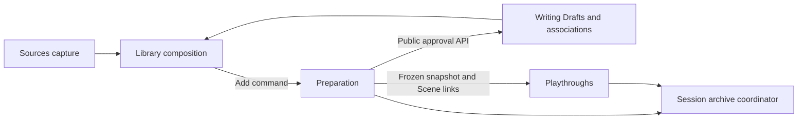
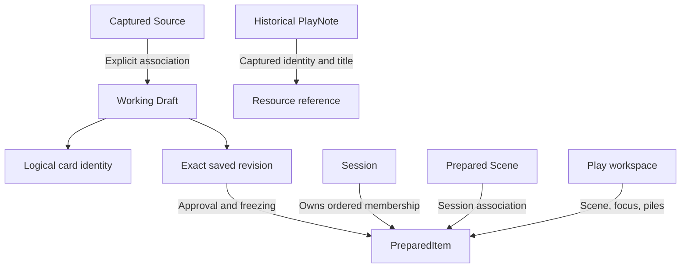
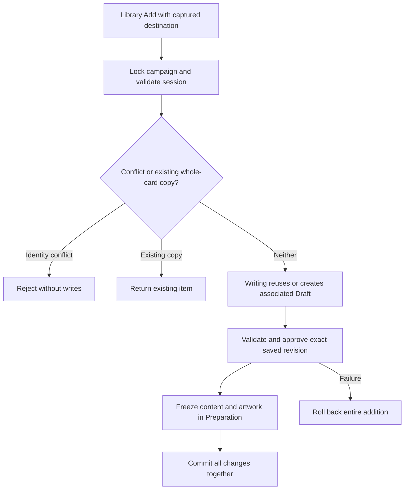
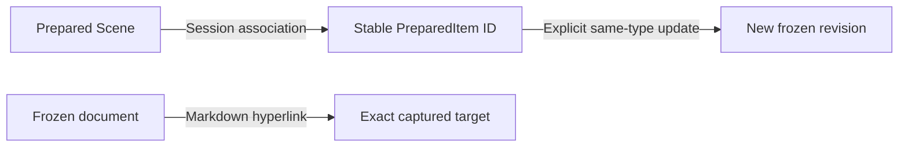

# Implementation plan reading map

For current work, read the relevant accepted architecture and increment scope below. Completed developer narratives are available through the links under their original headings in [implementation history](implementation-history.md); consult them for regression evidence, implementation details or historical rationale. Formal findings and correction assessments remain in [verification.md](verification.md).

- **Workspace ownership and identity:** [accepted reconciliation](#unified-library--write--prepare--play--accepted-architecture-reconciliation--2026-10-23), supplemented by the accepted UX-C6/C7 scopes below.
- **Delivered integration and limits:** [UW6 handover](#uw6--accepted-integration-and-final-handover) and the latest formal assessments. Delivery, verification and owner acceptance are distinct.
- **Future Play work:** [accepted tabletop architecture](#play-tabletop--accepted-architecture-reconciliation--2026-10-24) and [proposed T1/T2 and reconciled P5/P7/P6/P8 sequence](#play-tabletop--proposed-implementation-sequence--2026-10-24) supersede conflicting future focus/P4R direction in the [original Playthrough plan](playthrough-implementation-plan.md). Historical delivery evidence remains unchanged. No plan grants execution permission.
- **Other future work:** [creative co-author direction](#creative-co-author--accepted-architectural-direction-and-open-choices--2026-10-19) retains its open choices.

## Documentation cleanup — bounded increment — 2026-10-24

Scope: disclose completed developer records behind links while preserving their content and original plan headings; repair stale entry-point delivery statements; provide targeted reading guidance. Current requirements, architecture, future work and formal evidence stay in their existing documents. Check content preservation, links, anchors and whitespace; application behavior is unchanged.

Developer checks: all 50 moved records preserve their original text apart from fragment-only links redirected to the original plan. Every original plan heading remains in order. Local links and anchors in the affected documents resolve, except three pre-existing links to unavailable ignored browser screenshots retained in the historical records. Code fences remain intact and `git diff --check` passes. The plan is approximately 36% shorter by word count. No application tests or formal assessment were run for this documentation-only change.

## Play tabletop — accepted architecture reconciliation — 2026-10-24

**Status: ACCEPTED.** The owner approved the architecture following the [accepted requirements reconciliation](product-specification.md#play-tabletop--accepted-requirements-reconciliation--2026-10-24). This is future architecture, not implemented behavior. Planning is authorized in the conversation; implementation and formal verification remain separate gates.

- **Ownership and representation:** Playthroughs retains one independently revisioned PlayWorkspace per session, lazily initialized from Preparation's ordered public snapshot. Replace overlapping Active/Used/focus authority with ordered Session Cards, ordered Used, exactly two fixed runtime piles and nullable active Scene. Each pile has an optional name, ordered prepared-item IDs and nullable cover item ID. Covers use identity rather than index so unrelated movement cannot silently change the displayed card. One workspace row remains sufficient; no per-card placement repository or new module is needed.
- **Invariants:** The union of the five disjoint locations equals current prepared membership exactly. Scene slot accepts only a valid prepared Scene. Nonempty piles have a cover in their membership; empty piles have no cover. Validation is shared through Playthroughs public/domain boundaries with archive validation; the archive coordinator does not access its repositories.
- **Commands:** Replace unrestricted whole-workspace saving with explicit move, reorder, choose-cover, rename-pile and Scene-transition operations. Ordinary commands cannot move the active Scene or target its reserved slot. The server derives and validates the resulting placement; clients do not submit another independent placement authority. Exact REST names and DTO structure remain routine implementation choices.
- **Scene transition:** One locked transaction activates/deactivates the Scene and applies selected movements. Keep current piles is a transition with no optional movements, retaining the mandatory removal of the incoming Scene from its former location and return of the outgoing Scene to the front of Session Cards. Customize sends only explicit choices; no implicit relationship edits or pile population. Validate related-card choices against Preparation-owned associations. Cancel dispatches no mutation.
- **Concurrency:** Retain Campaigns' existing row lock, acquired before reading Preparation/workspace state in the transaction. Reconcile membership before expected-workspace-revision validation. Scene confirmation also checks the Preparation revision shown in its overview. A changed Preparation revision, including unrelated note changes, conservatively requires explicit refresh; retain local choices for review instead of introducing another revision counter. Invalid/stale commands commit no partial user mutation; explicit reload obtains reconciled state. Notes keep independent revisions and P5's expected-Scene creation check; no workspace revision dependency for unrelated note creation.
- **Reconciliation:** Use Preparation's immutable public snapshot only. Prepend new members in preparation order, prune removed members from their location, clear a removed active Scene and choose the next surviving cover in former pile order with wraparound. Preserve unaffected positions, names, covers and historical notes. If a still-present Scene becomes invalid, clear the slot and return the item to Session Cards, retaining complete membership. Preparation never calls Playthroughs; no events or dual writes.
- **Frontend:** PlayWorkspaceState owns serialized commands, originating campaign/session context and save recovery. Tabletop components render existing PlayingCard/reader assets and emit explicit actions. Keep pending changes on failure; avoid automatic replay/rebase after conflict or uncertain delivery. Scene overview is local until Confirm. Panel mode, selected document and overlays are presentation state. The P5 note draft and explicit association context remain independent of card covers/reader selection; preparation-note editing remains in Prepare.
- **Archives and persistence evolution:** Extend the current coordinator/strict codec with complete placement, pile-name and cover validation/remapping at the same time as persisted state. Preserve null/unopened workspace, frozen content, artwork, Scene associations and later historical notes. Use an additive Flyway migration without editing applied history. Old runtime artifacts may be discarded under the existing policy; any runtime-data disposal must be separately and precisely authorized, with prepared material and notes excluded. No full database/volume reset or compatibility adapter is implied.

**Alternatives and consequences:** Retaining the current whole-state PUT is smaller initially but cannot distinguish an ordinary move from Scene activation and leaves more invariants to clients; explicit commands are accepted instead. Per-placement rows/revisions add coordination without a demonstrated need; one aggregate/revision is accepted. Cover identity avoids index drift. The campaign lock and Preparation revision check favor simple local-app correctness over concurrent editing throughput. P1–P4/UW historical records remain valid evidence of earlier behavior; their conflicting focus-based target is superseded by this section.

## Play tabletop — proposed implementation sequence — 2026-10-24

**Status:** T1 and T2 plans accepted; their implementation, in-scope fixes and separate formal verification were authorized in the conversation. Ordering direction is accepted: T1 → T2 → P5 → revised P7 → P6 → P8. These are new increments, not renumbered historical P increments. Later P increments need their own specific approval and authorization; repository status grants none. Later P scopes below are reconciled handoffs, not detailed executable plans.

### T1 — Backend placement, commands and complete archives

**Accepted deliverable:** new authoritative workspace model, explicit commands and current-format archive support. **Non-releasable intermediate slice:** the owner explicitly approved replacing WorkspaceData/SaveWorkspace and the resulting frontend Play incompatibility until T2. Do not add compatibility endpoints or delete frontend behavior merely to make this slice green.

**Expected components:** `backend/src/main/kotlin/workbench/playthroughs/` domain, application, API, persistence and controller/configuration; `backend/src/main/kotlin/workbench/sessionarchives/` coordinator, strict reader/codec and remapping; additive `backend/src/main/resources/db/migration/` migration; backend workspace, HTTP, archive and module tests. Preparation public snapshot is reused; change it only if an essential missing field is demonstrated. No frontend implementation, PlayNotes, Library UI, card geometry or campaign-content changes.

1. Implement the replacement workspace aggregate, two fixed pile identities, validation, initialization and deterministic reconciliation. At implementation start inspect the actual schema/codec before choosing a migration number or manifest version (currently highest migration V18, session format v8). Set and validate bounded pile names using existing text-input conventions; record the actual bound.
2. Implement explicit movement/reorder/cover/name commands and atomic Scene transitions. Enforce active-Scene protection, location uniqueness, append/precise-placement and front-return rules. Moves that remove a cover use the next surviving old-order item, wrapping; reordering alone preserves cover identity. Select a deterministic first cover when entering an empty pile.
3. Apply existing campaign-lock and optimistic-revision rules. Scene overview responses must expose a coherent workspace/Preparation revision and association snapshot; confirmation validates both before applying movements. Serialize with Prepare add/remove/replace/link changes; conflicts retain no partial user mutation.
4. Extend complete archive export, strict validation, import and remapping through public contracts. Reject missing/duplicate/out-of-session placement, dangling covers, invalid Scenes and incompatible formats. Round-trip both unopened and initialized illustrated sessions. Keep existing limits, image handling and atomic rollback.
5. Keep migration evolution reproducible. No destructive data action is included: if the migration requires invalidating existing workspace rows, identify the exact runtime-only effect and obtain explicit approval before applying it to an existing database. Never clear prepared content, notes, campaign directories or unrelated state.

**Completion evidence:** domain cases for all moves and cover transitions; real HTTP validation/command rejection; database-backed stale revision and concurrent membership/Scene-association tests; restart preservation; campaign isolation; complete illustrated archive round trip with fresh IDs, unopened null, malformed/oversized/old-format rejection and late-failure rollback. Update superseded tests rather than retaining old focus semantics; preserve frozen-content/identity/image coverage. Run backend `./gradlew test bootJar` including module checks, inspect live OpenAPI and generate the client into temporary output to identify the T2 contract delta. Do not overwrite the production generated frontend client during this backend-only slice. Report expected frontend incompatibility; do not claim an integrated application pass. Record developer evidence here and stop before T2/formal verification.

#### T1 — implementation and developer handover — 2026-10-24

Implemented unique placements, exactly two runtime piles, identity-based covers, explicit movement/reorder/cover/name commands, coherent Scene overview and atomic Scene transitions. Campaign locking and separate workspace revisions remain; Scene confirmation checks Preparation revision. New members/returns enter Session Cards at the front, departing covers advance deterministically and ordinary movement cannot displace the active Scene. Pile names are nullable, nonblank when supplied, and at most 200 UTF-16 characters, matching existing title-style bounds. Null restores the default display name.

V19 creates `playthroughs.tabletop_workspace` as the sole runtime authority. It does not read, convert, delete or modify old `playthroughs.workspace` rows. Existing prepared sessions start with unopened tabletop state and initialize from prepared order; the old runtime arrangement is not restored. Tests prove dormant old rows are ignored and remain unchanged. No development database, Docker volume or campaign directory was reset. Session archive JSON/ZIP is now strict v9, including both piles, names/covers, Session Cards/Used and Scene; v1–v8 reject. Writing recovery formats remain unchanged. Validation reuses the public Playthrough invariant boundary; imports remap IDs and roll back atomically.

The unrestricted workspace PUT is retired in favor of POST `/workspace/{move,reorder,cover,rename-pile,scene}` and GET `/workspace/scene-overview?scene=...`. HTTP binding requires revision/context expectations and explicit nullable Scene/name fields. A scoped supporting correction to the existing web error adapter returns 405 for unsupported methods instead of masking retirement as 500. No dependency, event infrastructure, Preparation→Playthrough dependency or frontend change was introduced.

**Developer evidence:** `/tmp/t1-focused.log` passes domain/database/HTTP checks. Final `./gradlew test bootJar` passes **89 tests in 25 suites**, zero failures/errors, including Modulith/ArchUnit, frozen-content/artwork, Library replacement, recovery, archive limits/rollback, restart, held-lock Prepare membership mutation and Scene-association confirmation races (`/tmp/t1-developer.log`). Generated a typed client from live test-server OpenAPI into `/private/tmp/t1-generated-client` using a temporary Gradle init script; command and SceneOverview responses and required nullable fields are correct (`/tmp/t1-client.log`, `backend/build/t1-openapi.json`). Production generated frontend files remain untouched.

**Limits:** T1 remains deliberately non-releasable with the old Play client and archive consumer. No integrated frontend/build/browser success is claimed. T2 subsequently adopts the contract and restores the integrated journey below; this paragraph records T1's original delivery boundary. The separate [T1 formal assessment](verification.md#t1--backend-tabletop-placements-commands-and-archives--2026-10-24) passes a fresh 89-test/25-suite run and packaging, with no application/test edits during assessment. Owner acceptance remains separate.

### T2 — Integrated tabletop UI and runtime save lifecycle

**Status: ACCEPTED.** Following completed T1, the owner authorized T2 implementation, necessary fixes and separate formal verification. **Deliverable:** usable Play with Scene slot, two piles, Session Cards/Used and right Notes/Document panel; P5 note capture remains absent.

**Expected components:** generated Angular client; `frontend/src/app/playthroughs/` state/tabletop/related presentation; Play branches in `frontend/src/app/preparation/{workspace,card-table,session-state}*`; existing scoped styles, readers, cards and contextual UI; focused frontend/state/browser tests and handover docs. Reuse Angular CDK/native mechanisms already in the repository; no new dependency, renderer, persistence model or unrelated workspace refactor.

- Replace overlapping focus/active presentation and writes with T1 commands and five-location rendering. Provide Scene overview Keep current piles/Customize/Cancel, pile cover controls, separate Show all overlay, exact reorder, movement menus and drag equivalents. An inactive Scene in Used or a pile is activated only explicitly. Remove obsolete focus controls/state/callers after auditing shared Prepare behavior.
- Serialize commands in originating session context and retain useful pending intent on failed saves. Handle uncertain responses through explicit reload/review rather than blindly retrying with a fresh revision. Preserve existing navigation/retry/discard guards, including in-flight responses after session/campaign switches.
- Put frozen reader in the existing right panel; Notes defaults to read-only Preparation references until P5. Cover cycling does not change reader selection. Filtering applies to Session Cards/Used only; opening pile contents does not hide members. Keep Scene overview and pile overlays separate from this panel.
- Verify independent scrolling and no inaccessible controls at 1280×800, 1440×900 and narrow widths, with 30–50 prepared cards, long text, empty piles and artwork failures. Retain shared card geometry/artwork, existing Prepare notes/editing and Library/Write/recovery behavior.

**Completion evidence:** focused state/component tests; real pointer and keyboard journeys for moves, cover removal/wrap, Scene change from all locations, cancel/stale overview, invalid drops, filters, reader/panel continuity, removal and reopen. Run generated-client/version checks, frontend tests/build and existing integrated developer harness against T1/T2; adapt superseded focus journeys while retaining their underlying content/navigation/save protections. Include current illustrated archives, concurrent Prepare edits and navigation/error/recovery journeys. Present viewport screenshots for owner visual review. Record developer evidence, remaining browser/accessibility limits and stop before separate formal verification or P5.

#### T2 — implementation and developer handover — 2026-10-24

Delivered the reserved active Scene slot, two persistent runtime piles with names/counts/covers, disjoint Session Cards/Used and a single right-hand Notes/Document panel. Scene overview uses the coherent T1 snapshot, displays explicit related and current pile cards, and offers Keep current piles, customization, cancel and explicit stale-context refresh retaining choices. Read changes only the frozen reader; cover cycling does not replace its selection. Native pile dialogs support display-cover selection, exact ordering, individual movement and name changes. Drag handles and keyboard menu/select/button actions use the existing CDK and shared PlayingCard; no new dependency or renderer.

Replaced whole-state autosave with serialized explicit commands using acknowledged revisions. Failed/uncertain commands retain intent, stop queued dispatch, block departure unless explicitly discarded and require saved-state review before retry. A changed revision never causes blind replay. Async opens, overviews and commands retain originating campaign/session epochs. The UI displays acknowledged placements rather than a second optimistic placement authority. Native dialog focus/escape behavior and accessible command feedback remain local presentation concerns. A failed Scene transition can explicitly refresh its overview while retaining the dialog's placement choices for renewed confirmation.

Prepare retains independent reader/notes editing, Scene planning, Library Add/replacement/removal and existing save guards. Its narrow reader/notes height bound was restored after moving them inside the shared panel wrapper. Play entry and direct session switches start in Notes; Preparation references remain read-only and P5 capture/history remains absent. Play's obsolete focus/inspection and separate relationship-suggestion presentation was retired; Prepare retains Focus source. Session Cards and Used filter independently of unfiltered piles; selected-card horizontal reveal survives large-session filtering. Production generated client now uses T1 commands and strict session archive v9; no backend contract, migration or archive format changed in T2.

**Developer corrections/evidence:** real-browser coverage reproduced a pile drag preview escaping the native dialog (`/tmp/t2-overlay-before.log`), then passed after setting the open-pile preview container to its parent (`/tmp/t2-overlay-after.log`). The completed developer harness `WORKBENCH_CHECK_FRONTEND_PORT=4201 ./scripts/check-setup.sh` passes **118 frontend tests in 12 files**, production build, live OpenAPI/client generation/version checks, **48 Chromium journeys** and isolated PostgreSQL restart preservation (`/tmp/t2-developer.log`). Backend/module/package checks passed using unchanged Gradle outputs; the last fresh backend assessment is T1's 89-test/25-suite formal run. Do not describe reused outputs as a fresh T2 backend test run.

The 48 journeys include pointer closed-pile transfer/open-pile reorder/invalid drop, keyboard movement/cover/order controls, Scene activation/change/deactivation and cancel/conflict recovery, read/panel retention, uncertain delivery without replay, slow-open reader intent, Prepare membership removal and a 50-card session. Existing illustrated session/Writing recovery, frozen links/content, Library Add/replacement and research-return journeys pass. Screenshots cover 1280×800, 1440×900 and 390×844 (plus retained geometry checks at 320px). Developer visual inspection found no new horizontal page overflow; narrow cards/panel stack and the collections keep their horizontal scroll. Derived screenshots live under `frontend/test-results/`; aesthetic owner acceptance is separate.

Initial bundle **783.92 kB**; existing initial/style budgets and generator warnings remain nonblocking, with no raised budgets. The separate [T2 formal assessment](verification.md#t2--integrated-tabletop-ui-and-runtime-save-lifecycle--2026-10-24) passes another fresh-backend 118-test/48-journey integration run and restart preservation, with 289 source/test/configuration files unchanged. WebKit/Safari, exhaustive accessibility and maximum-size performance are unverified. Stop before P5; owner acceptance and detailed planning/implementation authorization for later P increments remain separate.

### Remaining P increments — reconciled handoff

| Order | Increment | Retained scope and changed acceptance |
| --- | --- | --- |
| 3 | P5 — PlayNotes | Existing identity, snapshot/context conflict, operation-ID retry, chronology, pins, per-note revision and archive requirements remain. Integrate editor/history in T2 Notes mode; preserve draft/association across Document, pile and Scene-overview interactions. Preparation notes stay distinct/read-only in Play. Detailed plan approval remains required. |
| 4 | Revised P7 — Library inspection/Add | Reuse unified Library and supported atomic whole-card Add, with pinned originating destination and representation expectations. Inspection never assigns or activates. New members reconcile to Session Cards; already-prepared cards retain placement. Retain exact historical-target safety; retire the obsolete unprepared-P4R-suggestion completion requirement. No revival of retired direct Source/Draft Add APIs. |
| 5 | P6 — Cross-session history | Reuse P5 records and independent campaign-scoped resource/Scene queries, indexes/pagination and stable identity. Put history in the established UI without a new permanent column or duplicated store. No technical dependency on P7; later order reflects accepted product priority. |
| 6 | P8 — Integrated developer handover | Map Q10f–Q10x through the accepted supersessions, new placements, cover/Scene transition rules, panel/draft retention, Library Add, notes/history, archives and concurrency. Formal verification is a separate phase; do not defer per-increment archive/check evidence to P8. |

**Next decision after the T2 handover:** owner acceptance of T2 and separately authorized bounded P5 planning. T2 does not authorize P5 implementation, destructive data disposal or later P work.

## Card background presentation — accepted increment — 2026-10-23

**Approved scope/design:** Use the existing shared PlayingCard and ArtworkImage components to fill the whole card with centered cover artwork, with an opaque parchment panel over the bottom approximately 35–40%. Keep existing title/type/summary/tags/full-document action, keyboard overflow, 243:420 geometry, 320px default width, selection/drag/menu behavior and image recovery. The accepted requirements supersede P2A's uncropped separate-window presentation. No new content fields, image processing, backend contract or persistence owner is needed. Library/Write/Prepare/Play/recovery inherit the shared renderer; thumbnails retain their existing presentation.

**Bounded plan:** Change only the shared card markup/styles and the shared artwork message-position token needed to keep loading/retry above the text panel. Adjust the existing artwork-fit/integrated-artwork browser assertions from contain/window geometry to full-card cover geometry and bottom-panel bounds. Retain the dense-title/summary keyboard, placeholders, full-document and existing interaction tests. Run frontend tests/build and isolated integrated browser checks; inspect laptop/narrow screenshots and verify the completed increment separately. Owner visual acceptance remains separate.

**Implementation/developer evidence:** Shared PlayingCard now layers cover-fitted artwork edge to edge and an opaque parchment panel over the lower 40%, retaining existing content and keyboard overflow. The action menu stays above both layers. ArtworkImage accepts a CSS message-bottom offset so card loading/retry stays above the panel; its default remains unchanged for thumbnails. Updated the two existing artwork browser journeys to assert cover fitting, full-card image height, opaque lower-panel bounds and continued cross-workspace artwork behavior. Existing dense-content tests cover keyboard scrolling, placeholders and document access at 1440/1280/390/320px; portrait/landscape/square checks cover 1280/390/320px. Inspected rendered portrait, landscape and dense 320px screenshots against the approved reference layout.

The integrated `WORKBENCH_CHECK_FRONTEND_PORT=4201 ./scripts/check-setup.sh` **passed**: **111 frontend tests in 16 files**, production build, **36 Chromium journeys**, generated-client/version checks and isolated PostgreSQL restart preservation. Unchanged backend test/module/package tasks were up-to-date. Log `/tmp/card-background-check.log`; derived screenshots under `frontend/test-results/artwork-fit-cards-fill-the-81408-ind-a-readable-bottom-panel/` and existing artwork/geometry result folders. Initial bundle **782.74 kB**; existing budget/generator warnings remain nonblocking and budgets were not raised. No new dependency, API, persistence or thumbnail change. The separately authorized [formal verification](verification.md#card-background-presentation--2026-10-23) passes; owner visual acceptance remains separate.

## Unified workspace handover and proposed remaining increments — 2026-10-23

**Status:** UW1 below is an existing accepted increment with implementation and verification evidence. Following review of this handover, the owner approved the documented UW2 increment for implementation, verification and necessary in-scope fixes. The owner subsequently authorized the documented UW3 scope for implementation, verification and necessary fixes, then UW4 on the same basis. UW5 implementation, developer checks and necessary in-scope fixes were authorized on resumption; formal verification remains separate. The owner subsequently authorized UW6 integration, verification and necessary in-scope fixes. These slices derive from accepted requirements, UX and architecture; no earlier numbered UW2–UW6 plan was found. Later increments require separate approval. This section does not claim to reconstruct undocumented prior agreements or confer execution permission on future sessions.

**Authority:** [Accepted requirements](product-specification.md#unified-library-writing-and-preparation--accepted-requirements--2026-10-22), [accepted UX](unified-workspace-ux-design.md), and [accepted architecture reconciliation](#unified-library--write--prepare--play--accepted-architecture-reconciliation--2026-10-23). The historical P plans remain evidence of their original scope; the reconciliation supersedes conflicting target behavior. Proposed UW increments do not silently authorize or replace P5/P6 PlayNotes/history.

### Handover state

**Historical baseline at handover creation:** The bullets below describe staged delivery. UW1–UW6 have since been implemented; the UW6 handover and formal assessment record the integrated result. UX-C6 subsequently retired the separate direct-add endpoints. Statements below about missing UI or outstanding verification are historical, not the current delivery status.

- UW1 delivers backend identity, explicit Source associations, unified catalogue/detail, associated editing and Writing recovery. See its detailed evidence below. [Corrective re-verification](verification.md#uw1-corrective-re-verification--v-uw1-01-and-v-uw1-02--2026-10-23) passes within scope; V-UW1-01 and V-UW1-02 are resolved. That assessment recommends acceptance; it does not itself record owner acceptance.
- UW1 did not deliver unified frontend selection. UW4 adds dedicated Library and shared explicit campaign/session navigation. UW5 reuses that catalogue in contextual Write/Prepare selectors; existing Source/Draft selectors remain compatible with the combined Prepare/Play workspace.
- UW2 delivers backend atomic Add, destination membership/update status and explicit same-type replacement. Its developer evidence is below; [formal verification](verification.md#uw2--atomic-library-add-and-explicit-prepared-replacement--2026-10-23) passes within scope. Owner acceptance remains separate. UW3 delivers session Scene associations. UW4 delivers the dedicated Library/Add frontend; UW5 adds Write research-return and Prepare planning/update/removal UX, with developer evidence below and formal verification outstanding.
- Current session archives are v8 after UW3; Writing recovery uses JSON v3 / ZIP v4. UW3 adds migration V18. Do not reserve speculative numbers or convert disposable historical artifacts.
- The owner requested UW2 implementation, verification and necessary fixes in this conversation. Work stopped before code changes because no bounded UW2 plan existed. The subsequent request authorizes preparing this documentation. Execution permission is transient: future sessions must obtain authorization for the approved increment and phases rather than treating this handover as permission.

### Sequence and release boundaries

| Step | Proposed deliverable | Dependencies |
| --- | --- | --- |
| UW1 (existing) | Backend identity, Source association, Library composition and recovery | Existing Writing/Sources contracts |
| UW2 | Backend atomic Library Add, session membership status and explicit prepared replacement | UW1 |
| UW3 | Preparation Scene associations, Play consumption and complete session archives | UW2; existing P1–P4 runtime ownership |
| UW4 | Dedicated Library, explicit shared session selection and unified Add journey | UW2; use UW3 contracts where exposed |
| UW5 | Write research/return and Prepare planning/update/removal UX | UW3 + UW4 |
| UW6 | Integrated journeys, laptop/accessibility validation and reconciled handover | UW2–UW5 |

Keep intermediate slices compatible with existing screens where possible. Any unavoidable frontend/backend incompatibility must be identified and explicitly approved before introducing it; do not invent temporary compatibility infrastructure by default. Each increment includes developer checks and its own separately authorized formal verification. UW6 integration is additional coverage, not permission to defer state/archive integrity or verification of earlier slices.

### UW2 — accepted backend atomic Add and prepared replacement

**Scope/components:** Preparation domain/application/public API/web/persistence, Writing public associated-edit and exact-approval contracts, Library read composition for destination membership, existing frozen content/artwork retention and focused backend/HTTP tests. No Scene association persistence, frontend redesign, PlayNotes/history or campaign-file writes.

1. Add a Preparation-owned whole-card command carrying captured destination, catalogue capture/representation expectations (including Draft ID and revision together), and expected session revision. Acquire the existing campaign lock before validating session, conflicts and membership. Compose only through public Sources/Writing contracts.
2. Return existing whole-card membership without updating it. Distinguish section captures and preserve historical/imported duplicates; return explicit matching choices for historical multiple matches rather than selecting arbitrarily. Expose destination-specific ready/already-prepared/update-available/blocked status without a persistence-owning Library module.
3. Otherwise reuse/create the associated Draft, validate required metadata, retain exact-revision approval and freeze content/artwork in one transaction. Invalid Source-only Add leaves no Draft, association, approval or item residue. Explicit editing may still create an incomplete reusable Draft. Concurrent retries produce one automatic Draft and one new whole-card item.
4. Add explicit same-type replacement with session and Draft identity/revision expectations. Replace frozen content/artwork/approval/outgoing Markdown bindings atomically, preserving item ID, order and notes. Preserve compatible Active/Used, focus and active Scene through existing public snapshot/reconciliation boundaries; Preparation must not call Playthroughs. Old incoming frozen links must not silently resolve to a newer revision.
5. Keep current archive round trips complete for delivered fields. Inspect existing provenance/whole-card representation before choosing storage/API details; add a migration or format change only if required and document its actual contract. Do not infer whole-card membership by logical UUID alone if section/origin evidence disagrees.

**Completion/checks:** Database-backed concurrent Add/retry tests; cross-session reuse; campaign isolation; stale capture, deleted/recreated Draft with equal numeric revision, stale session and Source→Draft transitions; invalid metadata/conflicts and forced late-failure rollback; section-only and historical multiple-match membership; frozen artwork independence; replacement preserving notes/order/runtime identities; type-change rejection; exact outgoing/incoming link behavior; current illustrated archive round trips. Run backend tests/packaging/module checks and generated-client/frontend compatibility checks. Record developer evidence here and formal assessment in `verification.md`; stop before UW3.

#### UW2 — implementation and developer evidence — 2026-10-23

[Completed developer record](implementation-history.md#record-01) — historical implementation details, checks and limitations.

### UW3 — accepted session Scene associations and archive integration

**Scope/components:** Preparation Session aggregate/revision/public snapshots/API/persistence; Playthrough related-card read composition; session archive coordinator/codecs/import validation; additive migration; focused backend tests. No new association owner or revision lifecycle, relationship authoring in Writing, or frontend Scene-planning implementation.

1. Persist directed prepared Scene→PreparedItem edges with the Session revision. Validate same-session endpoints, valid frozen Scene origin, unique edges and deterministic preparation-order presentation. An item may belong to several Scenes; linking never adds Library membership.
2. Preserve surviving edges through the persistence adapter's item delete/reinsert save strategy. Atomically remove incoming/outgoing edges on membership removal; expose affected Scene names for the later confirmation UI. Same-type UW2 replacement preserves edges.
3. Switch contextual Play suggestions to these exact endpoints exclusively. Retain Used indicators and existing explicit inspection/focus/replace behavior. Markdown hyperlinks keep frozen-reader semantics and no longer supply contextual associations; do not generate edges from existing Markdown.
4. Deliver a new strict current session archive format with endpoint validation/remapping, fresh imported item IDs, preserved origin identities/artwork and initialized/unopened workspace state. Snapshot and restore across public module boundaries under the existing lock; reject old/invalid formats without partial writes.

**Completion/checks:** Association persistence/restart, stale revisions, cross-session/campaign endpoints, non-Scene origins, multiple Scenes/shared targets, order changes, replacement/removal cleanup, repeated saves and concurrent membership/workspace writes. Prove no reverse dependency or suggestion-induced runtime mutation. Round-trip illustrated/null-workspace archives and reject dangling/duplicate/invalid edges, incompatible formats and resource-limit failures atomically. Run backend/module/build and existing frontend/browser regressions; update API clients as needed. Record evidence and stop before UW4.

#### UW3 — implementation and developer evidence — 2026-10-23

[Completed developer record](implementation-history.md#record-02) — historical implementation details, checks and limitations.

### UW4 — accepted Library and shared navigation/session context

**Scope/components:** Angular routes/top navigation, small navigation-context service, Library catalogue/detail/state, existing readers/cards/artwork/filter controls, generated clients and save/navigation guards. Content persistence and save queues remain with Writing, Preparation and Playthroughs.

1. Provide explicit Library/Write/Prepare/Play navigation and route-reflected campaign/session selection. Select/switch/clear the destination without implicitly using a recently visited session; invalidate cross-campaign selection. Choose/create a session before Add if none is selected.
2. Implement independently scrolling compact illustrated catalogue/full-reader columns, Document-first selection, optional Card mode and secondary Details. Reuse unified query/type/tag/purpose/status behavior, diagnostics, explicit refresh, conflict inspection and Draft precedence. Offer Edit in Write and Add only in the selected-document actions; no Create document action in Library.
3. Connect UW2 Add/status with destination and representation captured at request start. Complete pending relevant saves before mutation. Preserve reading/search on success/failure/session switches, show View in Prepare after addition and direct update-available items to Prepare. Late responses must not affect a different destination or selection.

**Completion/checks:** State/component and browser journeys for Source-only/associated/Draft-only/incomplete/conflicting entries, changed/missing Source, delete fallback, search/filter consistency, stale reader reload, Add without session, concurrent switch/late response, failed saves/retry and duplicate status. Check keyboard access, reader overflow and independent scrolling at 1280×800, 1440×900 and narrow widths; preserve shared card geometry. Run generated-client checks, frontend tests/build and isolated browser regressions. Stop before UW5.

**UW4 implementation and developer evidence — 2026-10-23**

- Delivered `/library` with unified UW1/UW2 catalogue and destination status, Draft precedence, compact illustrated rows, independent catalogue/reader scrolling, full Document by default, optional existing Card geometry, heading/section navigation and secondary Details. Details includes validation/conflicts, Source availability/capture, Draft revision, immutable original evidence and recovery provenance. Source conflicts support explicit path inspection. Existing type/tag/purpose/status/search/diagnostic controls are reused through a narrow filter-state contract. Library has selected-document Edit/Add actions and no Create document action.
- Shared header now exposes Library/Write/Prepare/Play and explicit route-owned session selection/switch/clear. Campaign changes clear the session. The small navigation context owns only destination/list presentation; content/save queues remain Writing, Preparation and Playthroughs responsibilities. Library reads existing captures; it offers explicit Source refresh and catalogue/selected-document reload.
- Add finishes owned saves, captures campaign/session/representation expectations, uses UW2 atomic addition and retains reading/search on success or failure. Current membership offers persistent View in Prepare choices, including historical multiple matches; update availability directs to Prepare. A filtered-out associated Draft can be reloaded without clearing search. Stale readers require explicit reload. Epoch/request checks suppress late selection/destination responses. Preparation invalidates its membership cache after confirmed or uncertain dispatched Add, then reloads through its existing owner without replacing unsaved content. View in Prepare selects the returned exact item.
- Developer corrections covered generated clients' JSON Accept convention, associated Drafts hidden by current filters, stale cached session revisions, uncertain Add cache invalidation, narrow search width and exact section-link targeting. No backend API, persistence, migration, archive format, dependency or card geometry change was needed. No UW5 authoring/Scene-planning/update/removal controls were added.
- Final integrated `WORKBENCH_CHECK_FRONTEND_PORT=4201 ./scripts/check-setup.sh` passed: backend test/module/package tasks (up-to-date; inspected **83 passing tests in 24 suites**, zero failures/errors), live OpenAPI/client generation and version consistency, **111 frontend tests in 16 files**, production build, **36 Chromium journeys** and isolated PostgreSQL restart preservation. Five new UW4 journeys cover explicit/no destination, Add/duplicate status, associated editing/navigation, keyboard/search/linked-section reading, conflict/incomplete inspection, refresh/stale reload, changed/missing Sources, Draft-only/deletion fallback, update direction, failed save/retry and delayed Add after session switch. Layout/independent scrolling and shared card ratio are asserted at **1280×800**, **1440×900** and **390×844**. Final log: `/tmp/uw4-final.log`; focused checks: `/tmp/uw4-focused.log`; screenshots are derived under `frontend/test-results/`. Temporary evidence is not a durable artifact guarantee.
- Initial bundle **781.73 kB**; existing initial/style budget and generator warnings remain nonblocking, with no raised budgets. Backend execution reused unchanged test outputs rather than claiming a new backend test run. Safari/WebKit, exhaustive accessibility and maximum-size catalogue performance remain unverified. The separately authorized [formal assessment](verification.md#uw4--dedicated-library-and-shared-session-navigation--2026-10-23) also passes, including an additional independent session-creation/stale-revision browser probe; owner acceptance and UW5 authorization remain separate.

### UW5 — accepted Write research and Prepare planning UX

**Scope/components:** Existing Writing editor/support panels and transient return context; contextual Library selector; Prepare reader/notes/Scene-planning components and state; UW2/UW3 APIs; existing shared guards and Play related-card presentation. No new authoring layout system, AI integration or note persistence model.

1. Make Write the creation/edit/export destination with independent Document/Card editing tabs and one optional Preview/Library supporting panel. Preview chooses Card/Document independently. Explain manual Markdown export and explicit refresh without implying repository publication/canon authority; AI support remains future work.
2. Save successfully before opening a reference's full document in Library; failure retains edits in Write. Return to Write restores Draft, editing tab, support/preview mode, reference/search and panel visibility, with cursor/scroll best effort. Reuse the contextual collection rather than introducing another Source/Draft catalogue.
3. Prepare selects frozen Read first, with Scene planning for valid prepared Scenes. Link only already-prepared endpoints, display preparation order, support temporary related-card inspection and Back to scene, and retain predictable Session/Card notes scope.
4. Show update availability and explicit Use latest version with stale/invalid/type-change feedback and retained local edits. Confirm affected Scene names before removal and use atomic UW3 cleanup. Link/unlink/inspection must not silently add cards, change focus or activate Scenes. Preserve existing Play focus/inspection/Used behavior with session associations.

**Completion/checks:** Browser journeys covering failed/delayed saves, navigation/back/reload/discard, independent editing/preview tabs, source edit reuse and incomplete correction, research return, Scene link/unlink/shared targets, notes scope during temporary inspection, replacement preserving item/runtime state, removal confirmation and archive reopening. Validate laptop/narrow reading/editor/notes scrolling and keyboard operation. Run relevant frontend tests/build and integrated backend/browser checks; stop before UW6.

**UW5 implementation — 2026-10-23**

- Write now has independent Document/Card editing and Card/Document previews, with one optional Preview/Library support panel. Contextual references reuse `UnifiedLibraryState` with a separate selection, rather than creating a second catalogue implementation. Full-reference navigation waits for successful saving and pins the selected representation; explicit Return to Write and browser Back restore the original Draft, editing/support/preview modes and reference search. Cursor and scroll restoration remain best effort. Manual export/placement/refresh wording is explicit; AI assistance remains future work.
- Prepare defaults to frozen Read, exposes Scene planning only for valid frozen Scenes, and links already-prepared endpoints in preparation order through UW3. Temporary related-card reading and Back to scene retain Session/Card notes scope. Contextual Library Add reuses UW2/UW4 save, destination and membership handling. Explicit same-type replacement uses UW2 expectations; invalid/type-changed updates remain blocked. Removal fetches current impact, names affected Scenes before confirmation and uses atomic session cleanup. No new backend contract, persistence, archive format, dependency or card geometry was introduced.
- Resumption corrections included a production TypeScript null check, resetting planning when changing session, preserving exact reference section navigation, and rejecting unavailable link targets instead of reopening an older reference selection. Existing browser journeys were adapted to the independent editing tabs.
- Final developer check `WORKBENCH_CHECK_FRONTEND_PORT=4201 ./scripts/check-setup.sh` **passed**: **117 frontend tests in 16 files**, production build, **42 Chromium journeys**, generated-client/version checks and isolated PostgreSQL restart preservation. Unchanged backend test/package tasks were up-to-date; this is not a fresh backend test execution. The six UW5 journeys cover failed/delayed saves, independent editing/preview, explicit and native-Back research return, changed-reference reload, Scene links/shared targets/temporary inspection, notes scope, replacement identity/runtime preservation, portable archive reopening, removal cancellation/Scene-name confirmation and contextual Library Add/type-change rejection. Existing regressions cover source edit reuse/incomplete correction, discard/recovery, artwork and frozen archives. Keyboard activation of Back to scene and no-page-overflow assertions at 1280×800, 1440×900 and 390×800 pass. Screenshots were generated at all three widths; 1280px and 390px Write/Prepare captures were visually inspected.
- Final log: `/tmp/uw5-final-check.log`; screenshots: `frontend/test-results/uw5-*/`. These are temporary artifacts, not durable verification records. Initial bundle **810.69 kB**. Existing bundle/style and generator warnings remain nonblocking; the expanded Write stylesheet also warns at **4.42 kB** against its 4 kB warning budget. No budgets were raised. Safari/WebKit, exhaustive accessibility, maximum-size catalogue performance and precise cursor/scroll restoration remain unverified. Formal verification and UW6 have not been started.

### UW6 — accepted integration and final handover

**Scope:** Cross-workspace regression coverage, in-scope corrections, accessibility/layout evidence and documentation of delivered behavior/limits. No new product features or implicit P5/P6 implementation. A defect that challenges accepted requirements or architecture returns to the relevant phase.

The owner approved this documented UW6 increment for implementation, verification and necessary in-scope fixes. The active implementation uses the existing Playwright and Gradle suites; no new testing framework, dependency or delegated reviewer is introduced.

**Completion/checks:** Exercise research→edit→save→Library→Add→Prepare Scene plan→Play, update with existing focus/Used/active Scene, changed/missing/conflicting Sources, deletion fallback, campaign/session switching, portable export/import and restart. Include failure/retry/discard and late-response cases. Check 1280×800 and 1440×900 independent scrolling, narrow layouts, keyboard focus and shared card geometry. Run the serialized integrated setup check and appropriate fresh backend/module/frontend/browser checks without rebuilding a running verification artifact. Record developer evidence here, separately authorized formal evidence in `verification.md`, update README current behavior, and identify remaining owner acceptance and unverified environments.

**P-plan reconciliation:** UW2–UW5 deliver the unified Add/inspection/Scene-association portions that overlap historical P7/P8 direction. They do not declare those older increments complete. At final handover, explicitly map delivered and outstanding P7/P8 criteria to evidence. P5 PlayNotes and P6 history still require their own reconciled planning/authorization using frozen origin-qualified resource identities; prepared replacement never rewrites history. Preserve P1–P4 ownership and historical P4R verification records.

#### UW6 reconciliation of historical P7/P8 criteria

The accepted unified-workspace reconciliation governs current behavior. Historical P4R verification remains evidence for its original frozen-link resolver; UW3 replaces its contextual suggestion mechanism with exact session Scene associations. Unprepared Markdown-link suggestions are therefore not a pending action in today's Related cards panel. Ordinary frozen Markdown links still require their exact captured target and never silently substitute a live revision.

| Historical criterion | Delivered behavior and evidence | Outstanding boundary |
| --- | --- | --- |
| P7 / Q10j wider-library inspection and explicit capture | Shared Library navigation retains explicit campaign/session; inspection has no membership/focus/activation side effect. UW2 atomic Add and UW4/UW5 selectors freeze saved content; `unified-workflow.spec.ts` exercises leaving Play, inspecting/adding an unprepared card and preserving focus/Used/active Scene. | No claim of an embedded wider-library Play panel or historical unprepared-link capture action. The accepted dedicated Library is the current route. |
| P7 stale expectations, failures, duplicates and guards | `SessionLibraryIntegrationTest`, `CardLibraryIntegrationTest`, `unified-library.spec.ts`, `unified-library-state.spec.ts` and UW5 journeys cover revision/capture conflicts, no partial Add, duplicate whole-card status, navigation and delayed results. | Historical section/imported duplicates remain valid; normal whole-card deduplication is not global uniqueness. |
| P7 / P4R contextual cards and Used behavior | UW3 Scene associations and exact prepared endpoints drive Related cards in preparation order. `RelationshipSuggestionsIntegrationTest`, `focused-tabletop.spec.ts`, `uw5.spec.ts` and the continuous UW6 journey cover explicit linking, inspection, focus, replacement and Used indicators. | The old requirement to derive unprepared suggestions from authored Markdown is superseded, not implemented under a new name. |
| P8 backend/frontend/module checks and illustrated flow | Fresh backend tests include Modulith/ArchUnit, storage/transfer rollback and codec tests. Existing artwork/geometry/recovery journeys cover illustrated Write→Prepare→Play and current portable formats; UW6 adds a continuous research/edit/Add/plan/Play/update/recovery flow. | Passing these checks is not acceptance of the entire historical P8 increment. |
| P8 / Q10f–i, Q10p, Q10r–x scene/focus, reader, restoration and modes | P1–P4 ownership and geometry remain; focused-tabletop/state/browser tests cover explicit scene, three focus slots, temporary inspection, expansion, Used, removal and mode continuity. UW5/UW6 add replacement and linked-card archive reopening. | Q10h's new PlayNote context remains P5. Exact transient scroll/filter persistence is not promised. |
| P8 notes/history / Q10k–o and history portion of Q10q | Existing Preparation session/item Markdown notes and previous-session navigation remain covered by preparation and recovery journeys. | P5 PlayNotes, primary-resource context, chronology/pins and P6 cross-session resource history are unimplemented and separately gated. Preparation notes do not satisfy them. |
| P8 visual/accessibility and operating environments | Existing laptop/narrow card geometry and reading tests are supplemented by UW6 independent editor/preview/reader/notes scrolling and keyboard checks. | Owner visual acceptance, Safari/WebKit, exhaustive accessibility/assistive-technology and maximum-size performance remain outside demonstrated evidence. |

No P5/P6 behavior, new persistence format, schema change, source-writing operation or data reset follows from this reconciliation.

#### UW6 implementation and developer evidence — 2026-10-23

[Completed developer record](implementation-history.md#record-03) — historical implementation details, checks and limitations.

### Next-session checkpoint

Read the workflow, this handover, relevant accepted architecture/UX and latest verification evidence. Inspect the actual working tree before relying on completion claims. Obtain authorization for the next required phase and bounded increment in that session; UW2–UW6 have implementation evidence and UW6 integrated formal verification passes after V-UW6-01 correction. Its assessment exercises UW5 paths without creating a separate historical UW5 verification/acceptance record; owner acceptance remains separate. P5/P6 and any later product work require new authorization. Resolve concrete storage/API questions within the approved boundary; escalate consequential scope/architecture changes. Do not reset development data, edit independent campaign repositories, commit, start later UW increments or treat temporary `/tmp` evidence as guaranteed durable artifacts.

## UW1 — accepted implementation plan — 2026-10-23

**Scope:** Backend identity, Writing-owned explicit Source associations, unified Library read/search/filter/detail contracts, associated Source editing/reuse, and complete Writing recovery for new association state. The owner approved this bounded increment by explicitly authorizing UW1 implementation after reviewing its proposed scope. Later increments remain separately gated.

Preparation Add/update, session Scene associations, frontend navigation/UX, session archive changes, data resets and old-data conversion are excluded. Existing Source-copy behavior remains an independent derivative operation. New Library composition uses public module contracts and owns no persistence. Sources exposes captured declared identity claims including collision diagnostics; reads never refresh files. Writing persists association evidence separately from immutable provenance, retaining identity after working-Draft deletion. Replace global live Draft card uniqueness with campaign-qualified uniqueness. Keep retained historical Draft identities independently recoverable.

Completion: associated entries use Draft precedence; concurrent associated-edit requests reuse one Draft; explicit refresh handles changes, absence, safe restoration and collisions without overwrites; unique UUID moves reconnect and untyped moves do not; incomplete/conflicting entries stay discoverable; deletion/recreation preserves identity and history; new state survives restart and strict current-format Writing recovery round trips without live rebinding from detached recovery. Existing frontend and Write/Prepare/Play behavior continue to compile and pass regressions.

Expected components: Sources public catalogue contract/service; Writing domain/API/application/persistence/web/configuration; read-only Library composition; additive Flyway migration after V16; Writing recovery enumeration/codec/validation/portable transfer; focused backend/database/HTTP tests and generated Angular API compatibility checks. Check concurrency, rollback, campaign isolation, export/refresh identity, safe rendering, deletion/recreation, malformed recovery and archive round trips; run backend tests/build/module checks, generate the Spring API client and run frontend checks/build. Formal verification remains separate. Record developer evidence here and stop at UW1.

### UW1 — implementation and developer evidence — 2026-10-23

[Completed developer record](implementation-history.md#record-04) — historical implementation details, checks and limitations.

### UW1 — V-UW1-01 corrective implementation — 2026-10-23

[Completed developer record](implementation-history.md#record-05) — historical implementation details, checks and limitations.

### UW1 — V-UW1-02 corrective implementation — 2026-10-23

[Completed developer record](implementation-history.md#record-06) — historical implementation details, checks and limitations.

## Unified Library / Write / Prepare / Play — accepted architecture reconciliation — 2026-10-23

**Status:** Architecture approved by the owner, followed by authorization to document it. This section records the accepted target design and supersedes conflicting earlier architectural direction. It does not authorize implementation planning, application changes, migrations, resets or commits. Existing increment plans and implementation/verification evidence remain historical records until separately authorized planning reconciles them.

**Requirements and UX:** [Unified requirements](product-specification.md#unified-library-writing-and-preparation--accepted-requirements--2026-10-22) and [accepted workspace UX](unified-workspace-ux-design.md). Retained Playthrough invariants and historical-note contracts are in [Playthrough architecture](playthrough-domain-architecture.md).

### Current implementation and gaps

**Historical pre-UW baseline (2026-10-23):** The following two paragraphs record the gaps that motivated the accepted design. UW1–UW6 subsequently delivered the integrated workspace; session archives are now v8, and UX-C6 retired separate direct-add endpoints. See the UW6 handover and later UX scopes for delivered behavior.

Sources implements explicit captured-library refresh, classification, search and document navigation. Writing implements revisioned Drafts, source-copy provenance, retained exact-revision approvals, artwork, manual exports and recovery. Preparation implements ordered frozen items, notes and artwork through separate Source and Draft addition paths. Playthroughs implements independently revisioned Active/Used, active Scene and ordered focus, with membership reconciliation. P4R currently derives contextual suggestions from frozen Markdown links. Session archives coordinate these owners through v7 manifests and ID remapping. PlayNotes/history remain approved future P5/P6 behavior, not implemented capabilities.

The frontend has a separate Writing route and combined Prepare/Play workspace, separate Source/Draft selectors, shared card/reader components and save guards. It does not yet implement the accepted dedicated unified Library, explicit shared session selection, Write research-return context or Prepare Scene-planning relationships. Source copying currently creates a fresh card UUID; addition appends a fresh PreparedItem without whole-card deduplication. Explicit prepared revision replacement and persisted session Scene associations are absent.

### Ownership and integration boundaries

| Owner | Accepted responsibility |
| --- | --- |
| Sources | Captured Markdown, explicit refresh, classification, declared identity claims and document navigation |
| Writing | Drafts and revisions, logical card identity, explicit Source association, immutable origin evidence, approval retention, artwork, manual export and recovery |
| Library composition | Unified discovery over public Sources/Writing contracts, Draft precedence, validation/conflict status and session-specific Add status; no persistence ownership |
| Preparation | Session membership, frozen items/artwork, order, preparation notes, Scene associations, atomic Add and explicit revision replacement |
| Playthroughs | Active/Used, active Scene, focus, PlayNotes and historical queries; consumption of Preparation snapshots |
| Session archive coordinator | Consistent cross-module snapshots, strict transfer validation and ID remapping |
| Frontend navigation context | Explicit selected campaign/session across workspaces; content and save lifecycles remain with their existing owners |



Arrows show composition/data flow, not repository access. Preparation has no dependency on Playthroughs. Existing campaign-row locking and public module contracts remain the consistency boundary; no event infrastructure, cross-module table access or new global state framework is introduced.

### Identity, association and refresh

Logical card identity, captured Source identity, Draft ID/revision and PreparedItem ID remain distinct. A Source association is explicit Writing-owned state; immutable provenance records evidence and does not by itself establish a same-card association. Library composes the current capture and Writing state, using Draft content/metadata/artwork for associated entries while exposing the Source and provenance in Details.

- Editing or adding a valid Source with a unique declared UUID preserves that logical UUID in its reusable associated Draft. Independent copying creates a new logical identity. Existing independent copies are not reassociated merely because their origin records mention a Source.
- Editing an untyped Source assigns a new Writing card UUID and records an explicit association to the selected Source separately from immutable origin evidence. Missing essential metadata blocks new preparation, while incomplete Drafts remain editable and saveable.
- Refresh recognizes a Source exported from a Draft by its logical UUID only when campaign identity claims are unambiguous. A Source and its explicitly associated Draft represent one card; competing claims are conflicts. No title/path matching silently merges independent cards or confers canon authority.
- A unique valid UUID reconnects an association across moves/renames. Untyped Sources retain their explicitly recorded campaign-relative path association; changes there are reported for manual review without overwriting the Draft. Moving an untyped Source leaves its original unavailable; title, hash and filename do not infer a new association. A conflicting identity at the associated path is reported rather than silently rebound.
- Missing, moved or excluded originals do not prevent Draft editing, preparation or export. Retain association evidence and provenance. Deleting a working Draft exposes any remaining Source without changing frozen items, retained approval/export history or historical PlayNotes.
- Duplicate/ambiguous claimed identities block affected new preparation until explicitly resolved. Existing snapshots and history retain their identities and content.



Scene links use session item identity; historical resource queries use frozen origin-qualified logical identity. Imported references retain their origin campaign/card identity rather than being rebound to a similarly identified destination card. Sections share parent logical history while retaining distinct prepared identities. Paths and image hashes are not logical resource identities.

### Atomic Library Add

Preparation orchestrates Add through Writing's public contract for associated Draft reuse/creation and exact saved-revision approval. The UI finishes pending saves successfully before Add and captures the destination campaign/session when the operation starts. Later navigation cannot redirect an in-flight mutation. Requests carry revision/capture expectations sufficient to reject stale operations instead of silently freezing different content.



The containing campaign lock covers membership checks, Draft association/reuse/creation, retained approval and independent Preparation artwork/content retention in one transaction. Failure at any stage rolls back all addition writes. Concurrent calls/retries must not create duplicate automatic Drafts or whole-card items. An already-prepared card returns its existing item rather than automatically updating it; historical multiple matches remain explicitly selectable, never arbitrarily merged.

Normal whole-card Library Add allows at most one whole-card copy of a logical card per session. This is a use-case rule, not an unconditional database uniqueness constraint: historical/imported duplicates and section-specific captures remain valid. A section capture does not automatically satisfy whole-card membership. New additions follow the Draft approval path; historical Source snapshots remain independently readable.

Incomplete Sources remain discoverable and direct the user to Write. Failed Add leaves no partial Draft. An explicit Edit-in-Write action may create the reusable incomplete Draft for correction. Add belongs in Library; creation/editing/export belong in Write, as specified by accepted UX.

### Scene associations, replacement and removal

Preparation owns directed Scene→PreparedItem associations as part of the Session aggregate and its existing revision. Both endpoints must belong to that session; the origin must be a valid prepared Scene. Linking never adds Library membership. A prepared item can belong to multiple Scenes. Related items appear in existing preparation order, with no separate Scene ordering.

Play contextual cards come exclusively from these associations, using the exact prepared endpoint and its Used indicator. Preserve explicit focus/free-slot/replacement behavior; suggestions do not reorder piles, return Used cards or activate Scenes. P4R's Markdown-derived suggestion mechanism and its unprepared-target suggestion dependency are superseded as target architecture. Markdown hyperlinks continue to use existing frozen-reader semantics.

**Use latest version** requires valid saved metadata and the same card type. Under the campaign lock and session/Draft revision expectations, replace frozen content, artwork, approval evidence and outgoing Markdown bindings atomically. Preserve PreparedItem ID, preparation order/notes, Scene associations, Active/Used position, focus and active Scene. Reject invalid metadata, type changes or stale expectations without partial mutation or loss of local edits. Never rewrite historical PlayNotes.



Existing outgoing links from other documents retain their exact captured bindings. For example, after B revision 1 is replaced with revision 2, A's frozen Markdown link to B revision 1 becomes unavailable if that exact target is absent. A Scene association to B continues to open its current prepared content. Logical UUID equality never silently substitutes a newer revision for a frozen Markdown target.

Removing a prepared card confirms the affected Scene names in the UI and removes all incoming/outgoing associations atomically with membership removal. Play reconciliation removes the item from piles/focus and clears it if active Scene, preserving remaining arrangement and notes. Preparation does not call Playthroughs in reverse.

The current persistence adapter deletes/reinserts item rows during session saves. Association storage must preserve surviving edges across that operation; item foreign keys cannot be introduced without accounting for row replacement. Physical storage is a bounded later design detail within the approved Session aggregate, not a new persistence-owning module or independently revisioned association collection.

### Frontend composition and save safety

A small shared navigation-context service owns explicit campaign/session selection, reflected in routes. It does not infer selection from the last loaded session and invalidates cross-campaign selections. Library can select a destination before loading Preparation's editor. Writing, Preparation and Play retain independent content, revisions, save queues and conflict/retry behavior.

Each workspace retains its transient presentation context. Write's Library research journey saves successfully before leaving and restores Draft, editing tab, support mode, independent preview mode, reference/search selection and panel state; cursor/scroll restoration is best effort. Failed saving stays in Write with edits intact. Prepare's temporary related-card reader restores Scene planning and predictable Session/Card notes scope on Back to scene. Routing alone is not assumed to retain unsaved text.

Reuse shared cards, readers, artwork and navigation/browser-close guards. Library remains document-first with compact illustrated catalogue rows; Write has one switchable support panel; Prepare retains ordered contents, reader and notes. Existing 243:420/320px card geometry remains. CSS inspection identifies reusable responsive/overflow patterns but is not evidence of accepted 1280×800/1440×900 usability. Browser layout, independent scrolling and accessibility checks remain necessary during authorized implementation; no UX redesign or prototype is authorized here.

### Compatibility, alternatives and remaining gates

Session archives must include Scene associations in a new explicit current-format version, validate same-session endpoints and Scene eligibility, and remap both endpoints alongside fresh session/item IDs. Continue coordinated locked snapshots, complete validation before import writes, atomic restoration, artwork safeguards and bounded staging. Preserve origin resource references and historical note snapshots. Export reconciles workspace state without initializing unopened workspaces. Existing objects/archives are disposable; conversion, old-format compatibility and automatic Markdown-to-Scene-link generation are unnecessary. Database deletion/reset remains separately scoped and authorized.

| Accepted choice | Alternative considered | Rationale / consequence |
| --- | --- | --- |
| Writing association ownership; composed Library | Persistent card-identity registry | Reuses Draft/provenance ownership; untyped Source moves are conservatively unresolved |
| Preparation orchestrates Add | Application-level Add coordinator | Extends existing Preparation→Writing contract; one transaction owns membership validation and freezing |
| Scene associations share Session revision | Separately revisioned association collection | Atomic membership cleanup with one save lifecycle; unrelated session edits may conflict |
| Shared frontend navigation context | Expand Preparation SessionState | Separates selected destination from loaded editing state without a general state framework |
| Explicit association distinct from provenance | Infer association from source-copy origin | Preserves independent derivatives and historical evidence |
| Exact frozen Markdown targets | Follow latest prepared logical identity | Preserves captured-document meaning; old links may become unavailable after replacement |

P1–P4 runtime ownership and accepted behavior remain. P4R implementation/verification records remain accurate historical evidence. Future P5/P6 notes/history must use the reconciled identity boundaries; P7 Library access and P8 integration need separately authorized planning review, particularly because Scene suggestions no longer originate from unprepared Markdown targets. This section supplies architectural constraints, not revised increments, tasks or execution authorization.

## Playthrough tabletop domain architecture — accepted 2026-10-22

**Subsequent reconciliation:** The [accepted unified-workspace architecture](#unified-library--write--prepare--play--accepted-architecture-reconciliation--2026-10-23) above supersedes Markdown-derived contextual suggestions and direct Source addition as target behavior. The dated summary below preserves the earlier decision record.

The owner approved the domain architecture following the Q10f–Q10x tabletop interview and the review of implemented Increment 6 images. The authoritative architecture record, including Mermaid domain and workflow diagrams, invariants, public use cases, trade-offs, and implementation-planning risks, is [Playthrough domain architecture](playthrough-domain-architecture.md).

Key accepted decisions: Preparation owns frozen prepared items and artwork; Playthroughs owns runtime Active/Used arrangement, explicit active scene, ordered focus (up to three) and individual historical PlayNotes. New prepared items and cards returned from Used prepend to Active. Preparation, workspace and individual notes have independent optimistic revisions; shared campaign-row locking protects membership reconciliation and consistent archives. PlayNotes retain scene/resource identity and title separately from preparation notes, with unresolved title-only context excluded from cross-session lookup. Exact captured relationships drive suggestions, without live-content substitution. Imported session/item/note IDs are fresh; origin references, titles and timestamps survive, with history scoped by containing campaign.

**Approved gap closure:** Existing saved objects and archives are disposable, including across future increments. No conversion, compatibility adapter or legacy importer is required for them. This supersedes older data-preservation/legacy-import obligations for this work. Preserve image safeguards and complete current-format round trips of each increment's new state. Card backs/flipping are excluded; a separate shared-renderer increment changes 5:7 to 243:420, retaining 320px default width and existing content fields. Actual resets still require explicit scope and execution authorization.

**Status:** Architecture and gap closures accepted. The revised [Playthrough implementation plan](playthrough-implementation-plan.md) is the current Planning deliverable for owner review; it allocates geometry, contextual suggestions and per-increment archive completeness explicitly. No implementation or reset is authorized by these documents.

# Campaign Workbench — Architecture and implementation plan

Date: 2026-10-17; subsequent decisions dated individually.

## Per-card images — architecture decisions — 2026-10-21

Status: Requirements and the complete architecture below approved by the owner on 2026-10-21. The owner approved and authorized 6A implementation, then accepted its implementation and authorized moving to 6B planning in the conversation. The owner approved the 6B plan and implementation, subsequently reported 6B verified, and authorized moving into 6C planning. This owner report is not a separately recorded agent formal-verification assessment. 6A has developer-check evidence, not a separate formal verification assessment. The owner approved the bounded 6C scope and requested continuing implementation in a new session. 6C implementation and developer checks are recorded below; formal verification and owner acceptance remain separate.

- Retain the uploaded original and generate separate display derivatives. Future card/image sizing can regenerate presentation assets without reselection, subject to the original's resolution. Rejected alternative: keeping only a permanently reduced card-sized copy, which would constrain future enlargement. Consequence: higher storage and portable-archive costs.
- PostgreSQL stores immutable image data. Writing owns draft and retained-history artwork; Preparation retains an independent frozen copy through Writing's public API. Deduplicate identical image data within each owning module. Normal draft/session responses contain references and metadata, not image bytes. Rejected alternatives: campaign-file references (not self-contained or frozen), browser storage (not durable/portable), and a shared domain asset module (no demonstrated need). No cross-module table reads or mutable-draft lookups for prepared artwork.
- Illustrated session and Writing recovery archives use ZIP containers containing a JSON manifest and deduplicated image files. Accept existing JSON archives. Cap both the archive file and the sum of actual extracted bytes at 256 MiB; retain existing text/count limits. Export fails clearly when the aggregate limit is exceeded. This is a byte budget alongside existing card counts, not a guarantee that 1,000 distinct maximum-sized images fit. The owner explicitly accepted this capacity tradeoff rather than supporting archives exceeding 10 GiB.

- Text and artwork changes save atomically against the same draft revision. Use a multipart save when replacing artwork, retaining the existing JSON path for text-only edits. Image removal is an explicit edit; text-only saves preserve the saved image. Validate/process replacement data outside the short database transaction, then reload and recheck the revision before committing image references, bytes and fields together. Failure commits neither change and preserves local working edits for retry. Frontend save serialization, originating draft/campaign identity, late-response suppression, navigation guards and approval flushing cover pending artwork as well as text. Do not introduce a separately committed staging-upload record.
- In addition to the 10 MiB input limit, reject more than 40 megapixels or either dimension above 16,384 pixels. Validate actual format, static-image status and decodability on the backend; extensions and supplied MIME types are not authoritative. Bound reads and inspect dimensions before pixel allocation. JPEG, PNG and WebP are the only accepted input formats. A narrowly scoped TwelveMonkeys ImageIO WebP decoder dependency is accepted in principle; exact version and Java 25 compatibility require implementation validation. Primary evidence: https://github.com/haraldk/TwelveMonkeys#file-formats-supported . Animated PNG/WebP detection must inspect their format structure rather than assume decoding the first frame proves a static image.
- Generate uncropped display derivatives at at most 1,600 pixels on the longest side and thumbnails at at most 320 pixels, without upscaling. Presentation performs centered cropping. Retain originals while referenced by drafts, retained history, recovery workspaces or prepared copies. Version the derivative policy so future dimensions can regenerate display assets without changing original identity. Remove bytes only when no owning record references them.

### Accepted architecture — 2026-10-21

**Ownership and identity.** Within Writing and Preparation, store original bytes in module-owned PostgreSQL bytea rows, keyed by campaign and SHA-256 of the exact original bytes (recovery images are scoped to their detached workspace). Store detected MIME, original dimensions and byte count with the immutable original. Use a separate versioned derivative record so future rendering policies do not alter original identity. Each module exposes only its public contracts. Preparation receives the approved revision's original via Writing's API and retains its own image data in the same transaction as session approval. No mutable Writing reference is needed to read a prepared image. Missing legacy fields mean no artwork; additive migrations preserve existing data. Source-only prepared items continue to use placeholders.

**Processing boundary.** Application services depend on an image-processing port; a platform technical adapter implements bounded inspection, decoding, orientation handling and derivative encoding. Both owning modules reuse that technical capability without introducing an Assets domain module or depending on one another's adapters. Domain models carry immutable image metadata/references and no ImageIO types. Normalize orientation in derivatives, preserve aspect ratio and transparency, and strip ancillary metadata from served derivatives. Retained originals remain byte-for-byte intact, including any embedded metadata, and are included in archives. Use JPEG derivatives for opaque images and PNG for transparency. Reject invalid images without altering the draft. Do not serve uploaded originals as application artwork.

**Saving and serving.** Extend the Spring-derived API with explicit keep/remove/replace image semantics; multipart replacement carries bounded JSON fields/revision plus one binary image. Keep the existing text request limit, cap the file at 10 MiB, and bound total multipart size/part counts. Processing outside the transaction may be discarded after a stale-revision rejection. Ordinary responses expose descriptors rather than binary payloads. Scoped Writing, recovery-record and Preparation endpoints resolve a referencing record before serving immutable derivatives with accurate content type, nosniff and content-based ETags. A supplied hash alone does not grant access to another campaign/workspace's image. Replacing/deleting a working draft cannot delete images used by retained approvals, exports, detached recovery or sessions. Remove unreferenced module-owned rows during relevant successful write operations; no background job or cross-module garbage collector is needed.

**Frontend presentation.** Writing owns the pending File, preview URL, replace/remove command, dirty state and retry lifecycle. Keep local edits made during a save, and revoke preview object URLs when replaced, discarded or leaving the workspace. Feature state supplies image URLs/metadata to PlayingCard and existing thumbnail components. Presentation remains independent of persistence; card/image dimensions remain at their current values. Use shared style tokens for dimensions and keep derivative policy independent of those dimensions, without introducing size controls. Approval and recovery/export actions flush pending image/text edits through the existing guard. Failed image reads show a placeholder with an unavailable indication; they do not remove the saved reference.

**Portable contracts.** Emit session ZIP archives with a version 5 JSON manifest and Writing recovery ZIP archives with a version 2 manifest. Manifests reference originals by hash and include detected MIME/dimensions/length; files use canonical `images/<sha256>` names, one original per distinct hash. Derivatives are omitted and regenerated on import, preserving future resizing. Continue strict legacy session JSON v1–v4 and Writing JSON v1 import through their existing shapes/limits; do not weaken legacy validators to accept arbitrary optional fields. Illustrated manifests retain the existing 20 MiB session / 64 MiB Writing text caps and count constraints, within the aggregate 256 MiB ZIP and actual extracted-byte caps.

**Bounded and atomic transfer.** Build downloads in bounded temporary files before sending a success response; stream archive entries and image data instead of materializing a 256 MiB archive or all decoded images in heap. Stage imports in a private temporary area, validate complete manifest membership, exact hashes/lengths, image formats/dimensions and decode/derivative generation before database writes. Accept only canonical manifest/image entry names; reject duplicates, unknown entries, traversal, missing/unreferenced images, encrypted/unsupported entries and inconsistent references. Enforce limits on actual bytes read, entry counts and per-entry sizes, regardless of declared ZIP sizes. Decode images sequentially under bounded processing concurrency. Import records, originals and derivatives together in one transaction; any error rolls back all durable state. Always clean up owned temporary files. Recovery stores its manifest and separate workspace-owned images rather than embedding binary data in its existing JSON payload. Restore/copy preserves artwork and detached provenance while remapping application identities as today.

**Alternatives and consequences.** Reusing one global mutable image reference would simplify storage but violate independently frozen ownership; retaining separate immutable module copies costs space but matches existing boundaries. Base64 in ordinary JSON would simplify transport but inflate payloads and repeat artwork throughout histories; binary endpoints and deduplicated ZIP entries avoid that cost. Disk staging adds a temporary-file lifecycle but bounds heap and permits full validation before success/import writes. Browser-only image normalization would avoid a codec dependency but would not validate imported archives authoritatively. Retaining originals increases database/archive size and retains embedded metadata; this is the explicit quality/portability tradeoff. Aggregate limits can reject otherwise valid large campaigns; export errors must explain the limit and never silently omit artwork.

**Validation needed in implementation.** Exercise actual JPEG/PNG/static WebP decoding (including transparency/orientation), animated and malformed rejection, exact file/pixel/aggregate bounds, decoder packaging on Java 25, atomic save and stale-revision races, pending-selection/navigation/retry interleavings, frozen images after draft replace/remove/delete, retained-history reachability, scoped reads, image deduplication, legacy imports, illustrated round trips and detached recovery copies, malformed ZIP/hash/membership rejection without writes, temporary-file cleanup and derivative regeneration. Browser checks must cover illustrated Write → Prepare → Play, thumbnails, active/used cards and unchanged dimensions. These are proposed validation concerns for subsequent planning, not authorization to create tests or run formal verification.

### Proposed implementation sequence — Increment 6: per-card images

Split the accepted feature into independently checked slices. Approval of any slice does not authorize its successors. Do not expose a partial artwork-editing flow before image-aware archive/recovery paths exist.

1. **6A — Image processing and storage foundation.** Implement bounded server-side image processing, versioned derivatives and module-owned immutable storage with additive migrations. No production upload/save/read route or UI yet. This technical slice establishes real format support and persistence without introducing user artwork that existing archives cannot preserve.
2. **6B — Backend artwork lifecycle and portable archives.** Add draft image references and atomic multipart save/removal, retained-history reachability, scoped reads, frozen approval copies, ZIP session v5/Writing v2 transfer and detached recovery, while preserving legacy imports. Include complete bounded staging/cleanup, aggregate limits, rollback and API-client generation checks. Detail and approve this slice separately after 6A; do not enable uploads before all image-aware backup/restore paths are complete.
3. **6C — Write → Prepare → Play presentation.** Add local-file selection/replacement/removal, pending-preview/save/guard behavior, card and thumbnail artwork, fallback/unavailable states and dimension tokens. Complete browser round trips, archive UI changes, desktop visual checks and regression validation. Detail and approve separately after the backend contracts are established.

This sequencing is a proposal for implementing the accepted architecture, not a scope reduction. The full feature remains incomplete until later slices satisfy portability and the user journey.

### Accepted bounded implementation increment 6A — 2026-10-21

**Outcome.** A backend image-processing port can validate an accepted original, produce orientation-correct display/thumbnail derivatives, and persist/retrieve the immutable original plus policy-versioned derivatives independently within Writing and Preparation. Verify this through real image fixtures and isolated PostgreSQL integration tests. Existing application behavior, archive output and frontend remain unchanged. Production records acquire no image references in this slice.

**Expected files/components.**

| Area | In-scope files/components |
| --- | --- |
| Technical image contract | New narrowly scoped value/port definitions under `backend/src/main/kotlin/workbench/platform/api/`; adapter under `platform/adapter/image/` |
| Processing | Actual-byte format recognition, static PNG/WebP checks, bounded dimension/decode checks, orientation normalization, JPEG/PNG derivative encoding, policy version and SHA-256 original identity |
| Module persistence | New image-store ports under Writing/Preparation `application/` and their respective `adapter/persistence/` implementations; separate module-owned original and derivative rows, scoped by campaign (Writing additionally supports detached recovery workspace ownership) |
| Schema | Next available additive Flyway migration(s) after V12; bytea originals/derivatives, immutable identity/deduplication constraints, derivative policy/variant uniqueness, size/dimension metadata and scope indexes; no modification of applied migrations |
| Wiring/dependency | Necessary Spring configuration only; `backend/build.gradle.kts`, existing version catalog and baseline documentation for the selected minimal TwelveMonkeys codec dependency/transitives |
| Evidence | Focused processor and PostgreSQL image-store tests/fixtures under existing backend test conventions; developer-check results in this plan |

Use existing ports/adapters and Kotest conventions. Do not introduce a new domain module, infrastructure service, background job, image-selection UI or general storage framework. Binary rows must not be loaded through ordinary draft/session list requests. Any abstractions must serve the two concrete image owners rather than speculative future media.

**Implementation tasks and completion criteria.**

1. Select/pin a compatible TwelveMonkeys WebP decoder version and required transitive artifacts through the existing version catalog. Confirm packaged runtime decoding under Java 25 using actual lossy/lossless/transparent static WebP fixtures. Stop for an architecture revisit if the accepted formats need native tooling or an additional codec family; do not silently drop WebP.
2. Enforce 10 MiB per original, at most 40,000,000 pixels and at most 16,384 per dimension before full raster allocation; exact limits are inclusive. Bound input reads, processing concurrency and output allocations. Reject unsupported/animated/malformed images with typed failures. Valid static JPEG, PNG and WebP succeed regardless of misleading filenames/MIME declarations; format detection is authoritative.
3. Preserve exact original bytes and SHA-256 identity. Generate uncropped, orientation-correct derivatives with longest side at most 1,600 / 320, preserving aspect ratio and never upscaling. Use JPEG for opaque images and PNG for transparency; served derivatives carry no ancillary source metadata. Include derivative policy/variant in their identity so a later size policy does not overwrite another variant.
4. Persist/deduplicate originals per owning scope and retrieve original/derivative data through module-owned ports. The same hash in another campaign/workspace cannot satisfy a scoped lookup. Byte buffers must be treated as owned immutable data rather than shared mutable state. Unique constraints protect concurrent deduplication; inconsistent metadata for existing immutable content fails rather than overwrites it.
5. Verify originals and derivatives survive application/context restart. A transaction returning `Either.Left` must leave neither partial original nor derivative rows. Support reading original metadata separately from binary bytes and reading one image/variant at a time, so later archives can transfer sequentially. Do not implement cross-record garbage collection until actual references are added in 6B; this slice adds no production path that creates orphan image rows.

**Developer checks.** Run focused image-processing tests first, then fresh backend `test bootJar` including existing Modulith/ArchUnit and isolated PostgreSQL integration checks. Test transparent and opaque formats, EXIF orientation, APNG/animated WebP rejection, corrupt/truncated input, signature/type mismatch, exact/over input and dimension/pixel boundaries, derivative aspect/size/no-upscale behavior, immutable bytes/hashes, module scope isolation, deduplication under concurrent requests, rollback and restart persistence. Prefer header/metadata limit fixtures or bounded synthetic streams over decoding unnecessary giant rasters; exact accepted-boundary cases must still exercise real processing where needed. Confirm WebP availability from the packaged boot jar rather than only the test classpath. Inspect upgrade from the existing V12 baseline as well as a clean database. Run `git diff --check` and report exact tests/checks and any remaining limits. No frontend/browser tests are required unless implementation unexpectedly affects their contracts; such scope changes require reassessment.

**Limits and exit.** No upload/read endpoints, multipart configuration, draft/session reference changes, archive version/format changes, frontend/client changes, garbage-collection job, original-file writes, campaign-content edits, real development-data edits, commits or formal verification. Existing migration/test fixtures remain isolated from real campaign/session data. Record completed developer evidence and stop after 6A. Formal verification, owner acceptance and authorization for 6B are separate gates. The owner approved this scope and explicitly authorized 6A implementation in the conversation.

### Increment 6A — implementation and developer-check evidence — 2026-10-21

[Completed developer record](implementation-history.md#record-07) — historical implementation details, checks and limitations.

### Accepted bounded implementation increment 6B — backend artwork lifecycle and portable archives

**Phase and outcome.** Planning authorized after owner acceptance of 6A. Implement the complete backend artwork lifecycle using the accepted architecture and the existing image foundation: atomic saved draft artwork, exact-revision approval into independently frozen session copies, scoped derivative reads, retention-aware cleanup, and portable session/Writing archives. Test through HTTP and application boundaries. The Write artwork picker and visual artwork presentation remain 6C; API callers can exercise the complete lifecycle after 6B. The owner approved this plan and explicitly authorized its implementation.

**Compatibility recommendation.** Add distinct binary ZIP download/import operations with new Spring-derived operation IDs. Retain existing session JSON v1–v4 and Writing JSON v1 operations/shapes for legacy callers, including existing browser flows. Legacy export may succeed only when every included current/historical record has no artwork; otherwise return a clear typed error directing the caller to portable ZIP export. Never discard images silently. New binary import operations detect ZIP versus legacy JSON by content, enforce the correct version/limits, and call the strict version-specific adapters. The new portable operation emits ZIP even for text-only data, using session manifest v5 / Writing manifest v2. Existing UI switches to these operations in 6C. Retaining the compatibility facade costs a few additional operations but avoids a partially broken frontend between slices.

**Expected components.**

| Area | Expected additions/edits |
| --- | --- |
| Image references and retention | Writing `Draft`, snapshot DTOs/mappers, approved/export persistence and new image reference columns; Preparation item domain/DTO/mappers/persistence; next additive Flyway migration(s) after V13; existing module image-store ports/adapters for retained-image access and unreferenced-row cleanup |
| Saved artwork | Writing service/controller plus narrowly scoped artwork service/port as needed; explicit keep/remove command and multipart replacement operation; Spring multipart bounds and error mapping |
| Exact approval and reads | `SessionDrafts` public API and implementation, `PreparationService`, new owner-scoped derivative read operations for drafts, retained records, prepared items and detached recovery records |
| Portable transfers | Preparation archive service/codec/controller; Writing recovery ports/service/validation/codec/controller and persistence; reusable bounded ZIP/temp-file mechanics under platform technical ports/adapters, while versioned manifests and semantic validation remain with the owning modules |
| Configuration and contract | Owning Spring configurations, bounded multipart settings, OpenAPI response/request/error descriptions, live-Spring Angular client regeneration; no hand-maintained client contract |
| Evidence | Existing backend approval/save/deletion/recovery/archive tests plus focused HTTP/ZIP/retention tests; existing frontend/browser regression fixtures only where needed to exercise compatibility; README usage/limits and developer evidence in this plan |

**Tasks and completion criteria.**

1. **References and migration.** Add nullable descriptors/references to current drafts and prepared items and retain artwork identity in approved/export snapshots. Use explicit module-owned relational reference columns for reachability where historical payloads are JSON; migrate existing records as image-less without rewriting historical Markdown, hashes, fingerprints or saved revisions. Public responses expose original metadata plus derivative descriptors, not image bytes. Keep legacy wire adapters separate from expanded runtime DTOs so strict v1–v4 / v1 shape validation is preserved. Metadata-only browsing never loads original blobs. Source forks begin without artwork.
2. **Atomic saved changes.** Existing JSON saves default to keep and accept explicit removal; binary replacement carries one image and bounded JSON fields/revision in a separate multipart operation, avoiding a generated-client overload that breaks existing `saveDraft` callers. Reject duplicate/extra parts, malformed/missing revisions, oversized JSON/files/requests and unknown commands before writes. Set explicit limits consistent with 10 MiB JSON plus 10 MiB image and bounded multipart overhead. Process the image before entering the write transaction; then acquire the existing campaign lock, reload/recheck the draft revision and commit fields, artwork reference and immutable image rows together. Failure, stale revision or a deleted draft leaves no durable replacement and never resurrects records. Artwork edits increment the same draft revision; text-only saves preserve it. Document retryable `image.busy` and clear Problem Details codes. Maintain existing incomplete-working-draft rules.
3. **Frozen approval.** Extend Writing's public approval API with scoped access to the retained revision's validated original/derivatives. Preparation copies these into its own image store in the existing approval transaction, alongside the prepared item/reference. Reuse already validated derivatives rather than decode inside that transaction. Failed session revision checks, invalid approval or missing image data leave neither partial approval state nor image copies. Subsequent draft edits/removal/deletion leave approved/export history and prepared artwork unchanged. Session save/reorder/remove preserves artwork on retained items; image editing remains Write-only.
4. **Scoped reads and retention.** Resolve campaign plus referencing draft/retained record/prepared item, or detached workspace plus recovery record, before returning a requested derivative. Never expose a global hash download route or uploaded originals as presentation assets. Use verified MIME, `nosniff`, derivative-content ETags and correct conditional GET behavior; a changed record must not receive an old cached image merely because its URL is stable. Invalid scopes/missing images/unsupported variants return typed failures. After relevant successful writes, delete derivatives/originals only when no live reference remains within that owner scope; include current drafts, approved revisions and retained exports. Recovery workspace images remain independently owned. Run cleanup after all reference changes in the same transaction, including Preparation's item-row replacement; no background job or cross-module collector.
5. **Illustrated archives.** Define strict session v5 and Writing v2 manifests with canonical `manifest.json` and deduplicated `images/<sha256>` entries containing exact originals. Include all referenced artwork across selected session items or current/approved/export Writing snapshots; omit derivatives. Preserve existing session table membership/identity remapping, source provenance, exact draft revision/link history and detached recovery semantics. Validate descriptor consistency when the same hash/revision occurs multiple times. Missing originals block export. Copied recovered drafts get new draft/card identities and destination-campaign image ownership without a mutable dependency on the recovery workspace.
6. **Bounded, consistent transfer.** Enforce 256 MiB both for ZIP bytes and actual extracted bytes, plus existing manifest text/count caps and the per-original 10 MiB/format/dimension limits. Bound entry counts from valid record/image counts and reject duplicate/unknown/noncanonical/traversal entries, missing/unreferenced images, bad hashes/lengths, unsupported/encrypted ZIP methods, malformed manifests and conflicting identities. Count actual bytes rather than trusting ZIP declarations. Stage to private temporary files; process originals sequentially and regenerate display variants before durable import writes. Commit records, references, originals and derivatives atomically. Use a consistent owning-record snapshot while copying originals into temporary export staging, then release its transaction/locks before ZIP construction and HTTP transfer; acknowledge that staging the bounded snapshot extends the existing export snapshot transaction. Fail before sending success if any required entry or aggregate limit fails. Cleanup temporary files on success, validation/storage failure and response-stream failure/disconnect; stream files instead of buffering whole archives in heap.
7. **Generated contracts and integration.** Obtain OpenAPI from the real Spring application and regenerate the Angular client. Confirm existing JSON/text operations retain their call shapes and existing frontend compilation/browser flows work without artwork UI changes. New operations must describe binary multipart/ZIP requests and binary responses correctly. Validate transport boundaries using real HTTP, including requests not produced by the UI. README distinguishes legacy JSON and illustrated ZIP paths and retains text-only Markdown downloads.

**Accepted temporary-storage limits.** Bound total import working files (input ZIP, extracted originals, regenerated derivatives and manifest) to **1 GiB per operation**, enforced during writes, with clear retryable/resource-limit errors and complete cleanup. Retain only a bounded number of active transfer operations, initially one import/export staging operation at a time, to prevent aggregate temporary storage from growing with requests; reject excess work as busy rather than queueing it. This introduces no persistent upload stage or infrastructure service. The additional working-storage limit is operational and separate from the portable 256 MiB cap: a highly compressible but expensive-to-process archive may fit the portable limit yet exceed this working budget and fail without writes. The owner explicitly approved this additional operational limit with the 6B plan. Derivative processing remains outside the final import transaction.

**Developer validation.** Prioritize focused codec/HTTP/application tests, then fresh backend `test bootJar checkPackagedImages`, live Spring client generation and the existing full setup check using isolated PostgreSQL and a separate frontend port when needed. Cover V13 upgrade and clean migration; exact saved revision/text+image atomicity; real multipart bounds/duplicate parts; save/delete/approval races; retained image lifetime and cleanup rollback; campaign/workspace/record isolation and ETags; session v5/Writing v2 ZIP round trips with remapped identities and retained history; image deduplication and derivative regeneration; all supported legacy versions and strict malformed shapes; corrupt/truncated/oversized ZIPs, path/entry/hash/membership failures; exact/over byte and staging limits with bounded generated streams/fixtures; import persistence failure and export snapshot races; temporary cleanup on failure/disconnect. Exercise a round trip after draft replacement/deletion and after application restart, with no live source file dependency. Run existing frontend unit/build and browser regressions through the setup check; add no artwork selection/presentation assertions until 6C. Report actual results, untested interleavings and resource measurements honestly; do not claim load benchmarking from boundary tests.

**Limits and exit.** No artwork picker, local preview, card-image rendering, dimension controls, illustrated Markdown export, campaign-file writes, image generation/remote fetching, new Assets domain module, background worker, production deployment or commit. Changes needed to generated bindings/regression tests are allowed; feature frontend code remains 6C. If preserving existing frontend contracts requires a consequential change beyond the compatibility facade, stop and revisit scope. Record developer evidence and stop after the complete 6B backend lifecycle and portable paths work together. Formal verification and 6C planning/implementation remain separately authorized. The owner approved this bounded plan, including compatibility and resource limits, and explicitly authorized 6B implementation. Stop after reporting implementation/developer evidence; formal verification requires separate authorization.

### Increment 6B — implementation and developer-check evidence — 2026-10-21

[Completed developer record](implementation-history.md#record-08) — historical implementation details, checks and limitations.

### Accepted bounded implementation increment 6C — artwork UI and portable archive integration

**Phase and outcome.** Planning authorized after the owner reported 6B verified. Complete the accepted Write → Prepare → Play journey using the existing 6B APIs: local artwork selection/replacement/removal, durable previews/thumbnails/frozen cards, portable archive controls, and pending-save/navigation protection. This is a frontend implementation increment with focused developer tests and documentation. Implementation and developer checks for the approved scope are recorded below. No new product or storage design is needed.

**User-facing scope.** Put a labelled local-file chooser and Remove artwork action with Write's existing card-details controls, retaining the body-first editor layout. Accept JPEG/PNG/WebP and explain the 10 MiB limit; server content validation remains authoritative. Preview a newly selected file locally and identify it as unsaved until acknowledged. Failure retains the previous saved reference and the pending file/edits for retry; explicit reload/discard follows existing guard semantics. Show saved artwork in Write previews/list thumbnails, Prepare's draft chooser/prepared thumbnails/card view, Play's active/used cards and detached recovery card previews. Source-only entries and cards without artwork continue using the bundled placeholder. Full-document readers remain text-only. Use centered cropping and preserve all existing card/image/thumbnail dimensions; expose shared style tokens for a future sizing increment, without controls now.

**Responsibilities and expected files.** Changes center on `frontend/src/app/writing/writing-state.ts`, Writing workspace templates/styles, `recovery-state.ts`/workspace, Preparation draft chooser/session state/workspace/session contents/card table, and shared PlayingCard plus a small reusable image presentation/loading helper if justified by these concrete consumers. Feature-owned adapters call the generated artwork clients and pass presentation values into cards; PlayingCard does not own persistence or infer API routes. Manage loaded Blob URLs and pending local-file previews with explicit lifetimes, cancellation and identity checks. Load visible image variants lazily, release URLs/subscriptions on identity/context change and component destruction, and avoid retaining every original/display image for the entire campaign. Keep thumbnail/display variants distinct. Render loading, placeholder and unavailable states without layout shifts; failed reads offer a retry rather than deleting saved artwork. No unbounded global image cache, new state framework, raw hand-maintained HTTP contract or dependency is proposed.

**Save and guard tasks.** Extend the existing serialized Writing save loop with keep/remove/replace state and a separate artwork change identity. Multipart replacement uses the generated `ArtworkControllerService`; text-only/removal uses existing save. Adopt acknowledged revision/image metadata without losing newer text edits or a newer selected file. Clear a pending command only when its own image change was acknowledged, so later text edits do not reupload an already saved file. Preserve failed/conflicting edits and suppress late responses after switching/deletion. Revoke object URLs when superseded or discarded. Approval, campaign/draft/session/mode navigation, backup/export and before-unload protection must include pending artwork through existing owners/guards; new shared presentation must not bypass them. Preview/file selection is not approval into a session. Existing prepared copies always use their own descriptors and session/item scoped reads.

**Archive UI tasks.** Switch session export/import, campaign Writing backup, detached recovery restore and recovery re-export to 6B's generated portable operations. Downloads use `.zip`; file inputs accept ZIP and supported legacy JSON. Send import files as binary rather than parsing them in the browser. Apply the 256 MiB portable file cap and explain backend text/count/working-storage/busy failures accurately. Explicitly select ZIP success media type for downloads and JSON for import responses; the generator may otherwise select documented Problem Details. Decode Blob-encoded Problem Details where needed so users see the actual retry/limit failure. Keep save flushing, originating campaign/workspace identity, duplicate-operation protection, uncertain-import recovery and existing Markdown downloads. Do not add a client-side ZIP parser or silently fall back to an image-dropping legacy export.

**Tests and completion criteria.**

- Focused Vitest cases cover file selection/removal/oversize rejection, successful save metadata adoption, text edits during upload, replacement/removal during an earlier upload, retry/conflict/deletion/navigation behavior, reload/discard and object-URL cleanup. Test image-loading identity changes, failed read/retry and release behavior with actual consumer boundaries rather than mirror implementation details.
- Add a real browser artwork journey: choose a local fixture in Write, wait for the acknowledged save, reload, check Prepare draft thumbnail/preview, approve, and inspect the same frozen image in active/used Play cards. Replace/remove in Write and confirm prepared artwork stays frozen. Check no-image and unavailable-image fallback/retry without changing layout or saved references.
- Exercise illustrated session ZIP export/import and Writing backup → detached restore → copy through UI, preserving artwork and notes/history. Continue legacy JSON import coverage. Adapt browser assertions that currently parse exported JSON to verify ZIP through the application's real import/restore paths and backend records; no ZIP parsing library is needed. Update mocked generated-client/state fixtures for the new portable operations and explicit Accept headers.
- Verify pending-image save failures/conflicts guard navigation and block approval/archive creation until resolved; late image responses must never attach to another draft/session. Inspect 1280×800 and 1440×900 Write/Prepare/Play/recovery layouts, unchanged 320px cards and current image areas, long-summary scrolling, actual drag/used/restore interactions, and the existing 50-entry flow with lazy image loading.
- Run relevant frontend tests first, then `WORKBENCH_CHECK_FRONTEND_PORT=4201 ./scripts/check-setup.sh` for live Spring contract regeneration, backend regressions, all frontend tests/build/browser flows and isolated database restart preservation. Report actual screenshots/checks, bundle changes and unverified browsers/touch/accessibility honestly. Generated bindings remain generated, and existing budgets are not relaxed.

**Limits and exit.** No backend/schema/archive format changes, new dependencies, per-source artwork assignment, URL acquisition/generation, image editing/crop controls, size controls, document-image rendering, illustrated Markdown packaging, campaign-file edits, production-data mutation, commit or deployment. If integration exposes a backend defect, report it and seek explicit scope expansion before changing backend code. README and developer evidence in this plan are in scope; formal verification evidence is separately authorized. Stop after the complete 6C implementation and developer checks; owner acceptance/formal verification remain separate gates. The owner approved this bounded scope and requested implementation in a new session. That session must receive explicit conversational implementation authorization before writing code; repository scope approval alone does not grant it.


### Increment 6C — implementation and developer-check evidence — 2026-10-21

[Completed developer record](implementation-history.md#record-09) — historical implementation details, checks and limitations.

## Status and scope

The owner revised the architectural direction during stack discussion: Angular frontend and local Kotlin/Spring backend in a separate application monorepo, hexagonal architecture and DDD, independent Markdown campaign directories, and database-owned application state. Multiple campaigns can be registered, with one selected at a time. Laptop preparation and play come first; tablet support is deferred.

**The browser-local architecture and first increment preserved below are superseded and must not be implemented.** React, Dexie, snapshot upload, a TypeScript backend, campaign-specific packaging, and service-worker offline startup are not current selections. Setup increment 0, increment 1, and the increment 2 architecture are accepted below; increment 2 implementation planning remains proposed. The historical browser-local increment 1 remains superseded.

## Current accepted direction

- Application name: **Campaign Workbench**. Repository: `campaign-workbench`, at `/Users/huibvanstraten/campaign-workbench/`, with `frontend/`, `backend/`, `docs/`, and root `compose.yaml`. Setup increment 0 establishes this repository and transfers application documents; Sea Witch content stays in its existing repository.
- Run the backend locally and use an Angular interface on the laptop. Hosted deployment is not required initially.
- During development, run the Angular dev server and Spring Boot separately, with PostgreSQL through Docker Compose. For session use, serve the built Angular assets from Spring Boot and provide one launcher to start the required application and database services. Frontend and backend remain separate source projects. Exact launcher implementation and local runtime packaging remain to be designed; no Angular dev server is required during session use.
- Keep frontend and backend in one application repository, separate from all campaign repositories. The Sea Witch repository remains campaign content. This application repository owns the transferred design records; application setup must not rewrite campaign content.
- Read the selected campaign directory through a filesystem adapter and detect Markdown changes. Preserve prepared versions until explicit acceptance of updates.
- Keep Markdown as campaign-content authority. Persist classifications, relationships, drafts, sessions, discoveries, outcomes, and immutable prepared snapshots in the database. Derived indexes can be rebuilt.
- Register independent campaigns and work with one selected campaign at a time. Use configurable campaign conventions rather than Sea Witch-specific paths, lore, or mechanics.
- Keep domain and application logic independent of Angular, Spring, filesystem APIs, database mapping, and AI providers through ports and adapters.
- Use idiomatic Kotlin with a functional style: prefer immutable values and pure domain functions returning new state; represent meaningful states and expected business failures with sealed types. Application services coordinate side effects through ports; adapters perform filesystem, database, and AI operations. Permit controlled mutation in JPA entities and infrastructure where appropriate. Arrow is selected by the owner, superseding the earlier decision to defer it. The selected Arrow conventions follow below; additional Arrow libraries are not selected, and compatible versions remain to be agreed.
- Use `arrow-core`, with `Either<Error, Value>` at application and module boundaries, the Raise DSL inside implementations, and sealed error types for expected business failures. Handle unexpected infrastructure exceptions separately. Define and test rollback behavior explicitly: returning `Either.Left` must not commit partial writes. Compatible Arrow/Kotlin versions and the concrete transaction integration remain to be designed.
- Use one modular Spring Boot backend with Spring Modulith, in one Gradle project using Kotlin DSL. Organize domain modules as packages and verify boundaries in developer checks. Separate Gradle subprojects per domain module are deferred; exact domain boundaries remain to be agreed. The Angular workspace resides separately under `frontend/`, with the backend under `backend/` in the application monorepo.
- Use one Angular application organized by feature, initially campaigns, preparation, and play. Separate API access from presentation components. Use feature-scoped services with Angular Signals for state and derived values, and RxJS for asynchronous flows. Keep the backend authoritative for saved records; frontend state owns working edits, selections, loading, and errors. Requests retain their originating campaign/session identity. Nx, separate frontend libraries, and NgRx are deferred. Exact Angular tooling remains to be discussed.
- Use REST/JSON with OpenAPI generated from Spring controllers through springdoc, and generate the Angular client from that contract. Keep transport DTOs separate from domain models and JPA entities. Feature services wrap the generated client; presentation components do not own transport concerns. Generator configuration, error conventions, and compatibility checks remain to be designed.
- Map typed application failures to HTTP Problem Details in the web adapter. Include stable error codes, safe explanations, and field errors where relevant; use `409 Conflict` for stale version updates, with `draft.version-conflict` as an example code. Keep Arrow types inside Kotlin and expose documented error DTOs to Angular. Unexpected failures return a generic message and correlation ID. Exact error catalogue and OpenAPI response schemas remain to be defined.
- Start with Angular Material and CDK for standard controls and interaction primitives, with custom reading, preparation, and play layouts. Exact theme, typography, and component layout remain design work; this selection does not establish a finished visual design.
- Edit session drafts as Markdown source with a rendered preview. Drafts remain database-backed; this editor does not grant permission to modify campaign files. CodeMirror is the recommended editor component; exact editor and renderer integration remain to be finalized. A visual rich-text editor is not selected initially.
- Run local PostgreSQL through Docker Compose with persistent database storage. Use Testcontainers with PostgreSQL for database integration tests, exercising Flyway migrations and JPA mappings against the selected PostgreSQL version. Domain unit tests do not need containers. Backend/frontend runtime packaging, exact versions, and test lifecycle configuration remain undecided.
- Use one PostgreSQL database with a schema per domain module. Each module owns its tables, JPA mappings, and migrations; other modules use its public interface rather than directly querying its tables. Campaigns share module tables with campaign-scoped records, rather than receiving a database or schema each. Exact schema names follow agreed module boundaries; migration ordering and cross-module integrity rules remain to be designed.
- Use Kotest as the primary backend test framework, including integration tests where supported. Use JUnit Jupiter as a fallback for demonstrated Kotest integration or tooling limitations, such as a Spring/Modulith test facility that cannot be supported reliably in the selected Kotest setup. Record the reason for exceptions; ordinary assertion failures or application defects are not a reason to bypass a failing test by changing frameworks. Exact versions and Spring/Testcontainers lifecycle integration remain to be validated.
- Use Vitest with Angular TestBed for frontend component and service behavior, and Playwright for key end-to-end flows through Angular, Spring, and PostgreSQL. Keep end-to-end state isolated from the DM's real database and campaign records. Exact versions, browser targets, and test orchestration remain to be designed.
- Preserve explicit draft approval, manual canon export, privacy exclusions, and controlled player output from the product specification.
- Keep AI credentials and spending controls in backend responsibilities. A separately deployed gateway is no longer prescribed. Provider and budget decisions remain unresolved.

### Ownership and domain boundaries

A campaign identifies an independent body of campaign content. A playthrough records what happened when that content was played. Prepared sessions refer to source versions and belong to the applicable campaign/playthrough context. Registering multiple campaigns does not imply support for multiple simultaneous playthroughs of each campaign.

Campaign ownership does not require a single large aggregate. Aggregate boundaries and consistency rules remain design work. Campaigns and Sources are accepted as separate modules:

- **Campaigns** owns campaign identity, registered directory, and campaign configuration.
- **Sources** owns document discovery, versions, authority classifications, references, and search. It references a campaign by identity and exposes versioned content through its public API.

- **Preparation** owns session objectives, prepared scenes, ordering, drafts, approvals, pinned source versions, and the session lifecycle.
- **Playthroughs** owns actual events: notes, encountered clues, revelations, theories, and outcomes. It references session identities without depending on Preparation's implementation. Preparation may read prior discoveries through the Playthroughs API; Playthroughs must not introduce a reverse dependency on Preparation. Exact session-reference validation and lifecycle coordination remain use-case design work.

- **Assistance** owns provider integration, generation execution, usage, and spending controls. Preparation selects permitted context and requests generation through the Assistance API; Assistance receives explicit context rather than independently querying campaign files or private notes. It returns a result without accessing Preparation tables. Preparation owns the resulting session draft and its approval, keeping this dependency one-way.

The initial accepted module split is Campaigns, Sources, Preparation, Playthroughs, and Assistance. Keep player-facing output within Preparation initially: it owns explicitly selected, versioned handouts, preview, and export approval. Rendering and file export live in adapters; selection and approval remain application/domain behavior. Player output contains only the selected content. A separate Publishing module is deferred until a player portal or distribution workflows justify it.

Use the following package layout inside each module: `api` for public module interfaces and contracts, `domain` for aggregates, values, rules, and typed errors, `application` for use cases and outbound ports, and `adapter` subpackages for web, persistence, and other integrations where needed. Explicitly expose `api` as a Modulith named interface; other module packages remain internal. Dependencies point inward and domain code has no Spring, JPA, or HTTP dependencies. Avoid creating empty adapter categories for modules that do not need them.

Run Modulith verification and complementary ArchUnit checks in the normal backend test task, using Kotest where practical and the agreed JUnit fallback policy where needed. Modulith verifies exposed module access and dependency cycles. ArchUnit enforces inward dependencies, excludes Spring/JPA/HTTP concerns from domain packages, and prevents application code from depending on concrete adapters. Exact executable rules and necessary composition-root exceptions remain to be specified against the implemented package structure.

Scope source reads, search, persistence operations, and AI context by campaign identity. Asynchronous saves and generations must retain their originating campaign/session context when the user switches campaigns. Never use a mutable UI selection as the destination for a completed operation.

Use synchronous public module interfaces when a caller needs an immediate result, and domain events for follow-up reactions that can happen afterward. Keep entities and repositories private to their owning modules. This choice does not make all events asynchronous or select a broker, durable delivery mechanism, or transaction propagation policy; those details remain to be designed where a use case requires them.

Place database transaction boundaries around application use cases, keeping domain functions independent of Spring. For example, approval loads a draft, applies its domain decision, and persists the approved version within one transaction. Perform AI calls and filesystem scans outside database transactions; persist their results in short transactions. Use version checks to reject stale updates rather than overwrite newer edits. Exact locking, event delivery, and cross-module transaction behavior must be specified for the affected use case; database transactions do not make filesystem or provider operations atomic.

### Consequences and proposals still to discuss

- Database: PostgreSQL and Spring Data JPA are accepted by the owner. Its relational model fits campaign ownership, source versions, sessions, approvals, and discoveries; variable draft content alone does not justify MongoDB while authoritative Markdown remains on disk. Keep JPA entities and Spring Data repositories in persistence adapters, with separate Kotlin domain models and explicit mapping. Cross-module references use identifiers and public module interfaces rather than shared JPA entity relationships. Use Flyway with versioned SQL migrations and Hibernate schema validation, not automatic schema updates. Schema design and exact PostgreSQL version remain undecided; local provisioning uses Docker Compose.
- Backend shape: a modular monolith using Spring Modulith and one Gradle Kotlin DSL backend project is accepted, with five domain modules and the package structure defined above. Modulith and ArchUnit checks enforce module and hexagonal dependencies; concrete rules remain implementation design work.
- Source changes: scan when a campaign opens, watch its folder while active, group rapid changes before processing, and compare content hashes to identify changed versions. Provide a manual rescan. Configure included/excluded paths per campaign, excluding hidden and tooling directories by default. Changes update the source library while prepared sessions retain pinned versions until explicitly updated. Missing or unreadable files produce a visible status and preserve existing snapshots. Symlink handling, exact exclusion defaults, watch recovery, and directory relocation remain design details.
- Offline play now means local backend/database operation without internet. Browser-only cold startup on an independent device is deferred with tablet support.
- Backup must cover database state and campaign sources. The prior browser-workspace restore proposal is not automatically applicable to database restoration. AI expenditure must not reset through an ordinary application restore.
- Start with local-only access; network exposure for a tablet, authentication, and connection security require later design and authorization.
- The accepted version baseline is recorded below and in `versions.toml`; compatibility checks, detailed API conventions, and launcher implementation remain outstanding. Development and session-use startup modes are accepted above. REST/JSON, springdoc-generated OpenAPI, and a generated Angular client are accepted. Flyway, Testcontainers, Kotest with JUnit Jupiter fallback, Vitest with Angular TestBed, and Playwright are selected; migration organization and test orchestration remain to be designed.
- The application repository name/location is agreed above. Application design documents and the version catalog are intended for the new repository; setup increment 0 defines migration scope, link updates, and the pointer retained in Sea Witch.

### Supersession rationale

The earlier plan optimized for tablet-browser access and assumed a Sea Witch-specific application. The owner prioritizes laptop operation, their Angular/Kotlin/Spring stack, direct repository access, and generic campaign support. The new direction avoids snapshot-upload administration and separates reusable application development from campaign authorship. Trade-offs include operating a local backend/database and providing an explicit backup/launch workflow.

## Increment 1 — Accepted searchable-library architecture

Status: The owner accepted the following architecture on 2026-10-17 after approving the increment 1 requirements in the product specification. The implementation plan for this increment still requires approval; this section does not authorize implementation. The historical browser-local increment 1 below remains superseded.

### Ownership and persistence

- Campaigns owns campaign identity, display name, registered directory, source inclusion/exclusion configuration, and remembered campaign selection. Sources obtains campaign configuration through Campaigns' public API; the dependency is Sources → Campaigns. No reverse module dependency or shared JPA entities are introduced.
- Sources owns discovery, captured document content, sections, and search. PostgreSQL stores one current successful capture per campaign in Sources-owned tables. Refresh replaces that capture atomically; historical captures are not retained. Markdown remains authoritative and is never rewritten.
- Persisting captured text duplicates source content as a replaceable read model, but lets consistent reading and search survive backend restart. An in-memory-only capture was considered and rejected because it would require rebuilding before that content became available again.
- Existing module package, schema ownership, inward dependency, generated-client, typed-error, and transaction conventions continue to apply. Only Campaigns and Sources receive domain behavior in this increment.

### Refresh and consistency

- Opening a campaign or explicitly refreshing starts a filesystem scan outside a database transaction. Publish the complete result in a short database transaction. Filesystem reads are not made atomic by that transaction.
- An unreadable included document or a detected change that prevents a reliable read fails the refresh. Preserve the complete previous capture and expose the failure. Before the first successful refresh, show an empty library with the failure rather than claiming success. Publishing a partially readable library was rejected because it could silently omit content.
- A file removed before discovery is absent from the new successful capture. A file disappearing during its read fails that refresh. This policy provides a consistent captured library, not a guarantee that all files describe the same filesystem-wide instant.
- Give each published capture an identifier. Document lists, reads, search results, and local link navigation retain the originating campaign and capture identity. If a referenced capture has been replaced, report that explicitly and have the UI reload; never silently open newer text for an old search result.
- Permit one refresh at a time per campaign and reject overlapping requests. Different campaigns remain independent.
- Save configuration changes independently, mark the existing capture as needing refresh, and retain it until a refresh succeeds. Completion must not mark a capture current for configuration that changed while its scan was running.

### Discovery, search, and interface

- Use campaign-relative glob patterns for included/excluded paths, with exclusions taking precedence. Default to all Markdown while excluding hidden/tooling directories and agent instructions. Show effective rules. Do not follow symlinks. Exact default names and supported glob grammar must be specified before implementation.
- Search uses the trimmed query as a literal, case-insensitive substring across captured paths, headings, and section text. No stemming, fuzzy matching, query language, or separate search engine is selected. Revisit indexing only if measured behavior warrants it.
- Feature services wrap the generated Angular client. Signals own selection and view state; asynchronous requests retain their originating campaign/capture identity, including when selection changes.
- Use a campaign selector, document navigation/search panel, and reading pane, with refresh status and errors visible alongside the library. Safely render the accepted Markdown elements and resolve links against the same campaign capture. Exact parser/renderer dependencies and browser support remain to be settled before affected implementation.

### Consequences and limits

Old references may require reloading after refresh because only one capture is retained. One unreadable included file blocks publication until corrected or excluded. Remembered selection does not replace explicit campaign identity on individual operations. Automatic watching and retained versions remain future work under the broader architecture; they are excluded from increment 1. This architecture delivers no preparation, play, assistance, assets, backup/restore, or session-use launcher.

### Approved implementation plan

The owner approved this bounded plan on 2026-10-17. Implement Campaigns registration/configuration/remembered selection; Sources discovery, atomic current captures, refresh coordination and configuration-version checks, sections, literal search, and capture-bound reading; and an Angular library with registration/configuration, campaign selection, navigation/search, reading, and visible refresh errors. Update generated-client integration, owned-schema migrations, exact dependency pins, isolated fixtures, README, and developer evidence. This is the current increment 1 plan; the historical plan below remains superseded.

Filters match normalized campaign-relative paths: `*` and `?` stay within a segment; `**` spans directories, and `**/*.md` includes root documents. Exclusions win. Reject absolute paths, traversal, and unsupported grammar. Default to case-insensitive `.md` discovery, excluding hidden segments, `node_modules`, `build`, `dist`, `target`, `coverage`, and `AGENTS.md`/`CLAUDE.md`. Show editable defaults.

Use `org.commonmark:commonmark:0.30.0` and `commonmark-ext-gfm-tables:0.30.0` in a Sources adapter, with source positions for sections and controlled HTML rendering. Escape raw HTML, suppress images, validate links, retain Angular's default HTML sanitization without trust bypasses, and require explicit clicks for external links. [Tagged documentation](https://github.com/commonmark/commonmark-java/blob/commonmark-parent-0.30.0/README.md) and [release](https://github.com/commonmark/commonmark-java/releases/tag/commonmark-parent-0.30.0) establish available features; repository compatibility must be checked during implementation. Flexmark's broader syntax support was considered unnecessary. Chromium from the pinned Playwright version is the acceptance target; Safari/WebKit support is deferred.

Expected areas: `backend/src/main/{kotlin,java}/workbench/{campaigns,sources}/`, module-owned SQL migrations, backend tests, `frontend/src/app/campaigns/`, root application integration, frontend tests and e2e fixtures, build/catalog pins, existing check scripts, README, and developer evidence here. No campaign-content, harness, deployment, commit, or remote changes are included.

Completion requires restart persistence, two-campaign isolation and late-response handling, filters and symlink checks, exact passage navigation (including repeated headings), safe rendering and links, failed-refresh preservation, stale-capture handling, overlapping refresh/configuration races, rollback including `Either.Left`, and unchanged source files. Backend tests/build, frontend tests/build/version checks, and isolated Chromium e2e flows must pass. Formal verification is separately authorized. Automatic watching, history, authority assignments, assets, preparation, play, AI, backup/restore, and session-use packaging remain excluded.

### Developer-check evidence — increment 1

[Completed developer record](implementation-history.md#record-10) — historical implementation details, checks and limitations.

## Development startup — accepted design and implementation scope

The owner accepted the development-startup requirements and design on 2026-10-17. Add a dedicated Gradle `dev` task and a small development-only JVM launcher, outside application modules and the production artifact. It loads local `.env`, starts the existing Compose database, waits for readiness, starts Spring, generates the Angular client from live OpenAPI with the existing generator/configuration, and starts Angular. It owns its child processes and cleans them up on normal stop, cancellation, or startup failure; PostgreSQL remains running. Existing `bootRun`, build, and test behavior remains unchanged. A shared IntelliJ Gradle run configuration points at `dev`.

A separate launcher process keeps lifecycle code outside the Gradle daemon and application domain modules, without adding plugins/dependencies. Reuse the selected JDK, Compose definition, frontend npm script, and OpenAPI generator. No Docker Desktop launch, automatic runtime installation, production packaging, campaign-content changes, or application feature changes are included.

Bounded scope: `backend/build.gradle.kts`, a development source set/launcher, `.run/` Gradle configuration, startup developer checks, README, and evidence here. Check successful startup/proxied connectivity, readiness ordering, occupied-port and configuration failures, process cleanup on cancellation/failure, retained PostgreSQL state, and absence of startup side effects during ordinary Gradle tasks. GUI Stop behavior must not be claimed tested solely from documentation.

### Developer-check evidence — development startup

[Completed developer record](implementation-history.md#record-11) — historical implementation details, checks and limitations.

## Increment 2 — Accepted architecture and visual direction

The owner accepted manual session preparation, session export/import, and an atmospheric campaign-desk direction across the shell, source library, and preparation workspace; the detailed requirements are in the product specification. Architecture/design and three disposable UI variants using sample data were explicitly authorized. The owner selected A (writing desk) for preparation and B (session folio) for reading the same prepared session. No production implementation plan has been accepted.

The [disposable study](../frontend/src/app/preparation/prototype/README.md) compares A (writing desk: persistent outline and reading/notes), B (session folio: source and notes on facing pages), and C (scene board: ordered material with an inspector). It is hosted on the existing root behind `?prototype=preparation&variant=A|B|C`, with one floating switcher. Shared sample state is in memory and refresh resets it. No campaign content or application API/database is used by the study. The normal root view remains available. A production file replacement supplies a no-op loader, excluding the study bundle and switcher from production output.

Design-review checks on 2026-10-17: Angular development and production builds passed; the existing 7 frontend tests passed. Chromium review captured all three variants at 1440px and the board at 1280px, with no horizontal overflow, page errors, or API requests. Sample additions, retained edits during simulated save failure, retry, variant switching, and editor arrow-key behavior were exercised. Production JavaScript inspection found no sample session/variant labels or prototype bundle. Angular still reports component-style budget warnings for the disposable variants during compilation; production budgets were not relaxed. Preview rendering supports sample headings/bullets only; autosave and export/import are simulated, not implemented product features.

Accepted visual decision: retain A's persistent outline and editing workspace for preparation, and B's facing source/notes pages for reading. Both modes share saved session identity/data and the atmospheric visual system. Reading during a session remains a view of preparation, without journals, outcomes, discoveries, or lifecycle transitions. C is not selected for production.

The owner subsequently approved the production architecture below and authorized planning. The prototypes remain disposable references; production implementation requires approval of the specific plan. No prototype commit, branch, or formal verification record was created.

### Accepted production architecture

Status: Accepted by the owner on 2026-10-17. Typed Markdown cards and their dedicated library sections are deferred to [increment 3](increment-3-typed-markdown-cards.md); they do not block this increment. The implementation plan below is accepted.

- **Preparation ownership:** introduce the accepted Preparation module and its own PostgreSQL schema. It owns sessions, ordered prepared items, preparation notes, and immutable prepared snapshots. Keep domain models independent of persistence and transport DTOs. Campaigns owns campaign identity/configuration; Sources owns source discovery and current source captures. Preparation uses their public interfaces, with no reverse dependency or cross-module repository access.
- **Source selection:** Sources supplies exact captured Markdown and provenance through a public interface. A selected heading includes descendants until the next equal/higher heading. Preparation stores the selected text with each item. Source path, capture identity, selected section identity, and content fingerprints are provenance, not a live dependency on files or mutable source content. Selecting from a replaced capture fails explicitly; nothing silently switches to newer text.
- **Preservation trade-off:** copying selected text into Preparation duplicates content but makes sessions portable and independent of the replaceable current library. Retaining all historical library captures was considered unnecessary for this slice. This prepared snapshot is distinct from a campaign domain entity or a general source-history feature.
- **Two views:** A's writing desk provides editing and organization; B's folio displays the same captured material and notes with a clear return to preparation. Both share session identity, item order, selection, and working state. Mode changes preserve working edits. Reading does not introduce journal records or lifecycle transitions.
- **Saving:** serialize autosaves per session and reject stale writes with revision checks. Keep expected failures typed and use the established Problem Details mapping. Failed saves preserve working edits; leaving a session requires retry or explicit discard. Application transactions are short and must roll back on expected failure, including `Either.Left`. Requests retain their originating campaign/session identity.
- **Portable sessions:** versioned JSON contains only selected sessions, their objective, order, captured material, notes, and provenance. Validate the whole import before atomically creating new sessions with fresh identities under the explicitly selected registered campaign. Never overwrite existing sessions, register directories, or load extra campaign files as a side effect of import.
- **Captured links:** resolve links within captured selected material. In reading mode, identify targets outside that material as unavailable rather than substituting current library content. Preserve the existing explicit-action HTTP(S) link and safe Markdown/media policies.
- **Existing stack:** continue Angular Material/CDK, feature services with Signals/RxJS, Spring-generated OpenAPI and generated client, Kotlin/Arrow, JPA/Flyway, Kotest/Testcontainers, and the established developer-check approach. No new infrastructure or domain modules beyond Preparation are selected. User content remains escaped/sanitized and external images are not fetched.

### Accepted implementation plan — increment 2

Status: Accepted by the owner on 2026-10-17. These work packages form one implementation increment.

| Work package | Expected components | Completion criteria and focused developer checks |
| --- | --- | --- |
| 1. Exact source selection | Sources public API, application selection use case/port, existing Commonmark adapter and DTOs | Return exact Markdown and provenance for whole documents or heading subtrees. Preserve current section/search locators. Check repeated/nested headings, pre-heading text, end-of-document boundaries, and stale-capture rejection. |
| 2. Durable preparation | New `workbench.preparation` API/domain/application/adapters, named API interface, Preparation-owned SQL migration and JPA mappings | Create/list/open sessions; save title/objective and both levels of notes; add/remove/reorder items with stable item identities. Frozen text is immutable through note saves. Scope every operation by campaign/session. Test real PostgreSQL persistence/restart, isolation, revision conflicts, and rollback after actual partial writes. |
| 3. Safe Markdown reading/preview | Preparation rendering adapter using the existing pinned Commonmark core/tables, rendering DTOs and link resolution | Render captured source and Markdown notes with the existing HTML/URL/media restrictions. Source provenance remains visible. Links inside captured content work; uncaptured targets are explicit. Test source removal/refresh, duplicate anchors, malicious Markdown, and no automatic remote fetches. |
| 4. Session export/import | Preparation application use cases and JSON transport/file adapters | Export the last successfully saved selected sessions. Validate archive schema/content/limits before one import transaction; create fresh session/item identities under the chosen campaign. Test round trips without original sources, repeat imports, malformed/unsupported archives, preserved order/provenance/notes, limits, and no partial imports or overwrites. |
| 5. Shared shell and working state | Angular shell/routing, required campaign-selection integration, `frontend/src/app/preparation/` feature services, generated-client wrappers | Session/campaign routes and requests retain explicit identities. Share one working session between modes; serialize saves and guard navigation. Test slow/late saves, edits during a save, failed saves and retry, stale revisions, switching campaigns/sessions, and failed-save navigation. |
| 6. Production preparation and reading UI | Production components/styles based on A/B, existing library integration, Material/CDK controls | Create/reopen sessions, add whole documents/sections from library/search, reorder/remove items, edit/preview notes, and switch Prepare/Read without losing state. Apply atmospheric tokens to shell/library/preparation. Check keyboard focus, reorder buttons, long documents, empty/error states, readable contrast, and laptop layouts at 1280×800 and 1440×900. |
| 7. Integration and handover | Backend/frontend tests, isolated Playwright fixtures, existing check script if needed, README and developer evidence here | Generate the real client; pass backend tests/build, frontend tests/version checks/build, and isolated Chromium end-to-end preparation/export/import/read flows. Preserve increment 1 library behavior and existing development startup. Record limitations and stop before formal verification. |

#### Bounded implementation details

- Use one session revision to coordinate title/objective, order, notes, and item mutations. Every mutation checks it; the frontend queue coalesces edits while preserving newer working text when an older save completes. A conflict retains local edits and offers explicit reload/discard/retry handling rather than an automatic overwrite. Source capture selection and adding its frozen text use one application transaction through public module interfaces, without filesystem reads.
- Start with a 500 ms debounce for text edits and serialized item mutations; only a completed server save advances the saved revision/status. Export waits for pending edits to save, or blocks with a visible error; unsaved local text must not be presented as a complete saved backup. Mode switches reuse working state. Campaign/session navigation offers Stay/Retry or an explicit Discard; browser close uses the available unsaved-change warning. Forced browser termination is not claimed recoverable without a successful save.
- For this slice, use a native textarea with a real Commonmark-rendered preview. CodeMirror remains a previously recommended enhancement, not an installed dependency; it adds no demonstrated need for the initial Markdown notes workflow. Retain the established source/preview contract so a richer editor can be added later. Do not introduce a custom production Markdown parser.
- Export/import schema version 1 is self-contained UTF-8 JSON. Initial limits: 20 MiB per archive, 100 sessions, 1,000 prepared items total, and 2 MiB per individual captured-text/note field. Validate required field types, identifiers/order consistency, declared provenance/content fingerprints where present, and supported schema before writes. Import maps all session/item identities to fresh values; original campaign references are descriptive provenance, never operation destinations. No binary assets, credentials, unselected campaign documents, or automatic fetching are included.
- Reuse the current session library and generated API tooling. Add only the Sources API needed for exact content selection; do not add typed-card metadata fields, required templates, type registries, filtering, authority assignment, or a generic extension framework. Independent campaign repositories remain outside edit scope.
- Rebuild A/B as production components; the existing prototype state, simulated saves, sample content, and limited preview renderer are not production logic. Keep the disposable study excluded from production. Prototype branch/commit preservation or deletion is a separate owner decision; no Git history changes are included here.

#### Expected file scope

Backend: `src/main/{kotlin,java}/workbench/preparation/`, the affected Sources API/application/Markdown adapter, one new Preparation-owned migration under `src/main/resources/db/migration/`, and focused domain/integration/architecture tests. Frontend: production files under `src/app/preparation/`, `app.*`, shared shell/styles and campaign library files needed for selection/visual integration, and component/service/e2e tests. The client remains generated and ignored. Build/manifest/catalog/lockfile changes are unnecessary unless an approved dependency need emerges. Documentation: README, accepted requirement refinements where necessary, and developer evidence in this plan. Startup scripts change only if needed for these checks; no launcher redesign, deployment, campaign migration, or commit is included.

#### Required evidence and remaining limits

A representative isolated flow creates two campaigns, prepares a session with a whole document and nested section, orders items, edits both note levels, reopens after restart, modifies/removes and refreshes the sources, reads the original prepared material in B, exports/imports as a new session, and confirms isolation and unchanged campaign files. Failure checks cover actual transaction rollback, stale revisions/captures, save queues and navigation, invalid archives, and safe rendering. Existing library and startup checks remain applicable; broaden checks only when changes/failures justify it.

Chromium is the agreed acceptance browser. Reading is a view of preparation, not the full play workflow. Session archives protect selected sessions only. General history, authority classification, metadata/tags/filtering/type sections, AI, journals, player output, lifecycle states, assets, full-system backup, tablet delivery, and session-use packaging remain deferred. [Increment 3](increment-3-typed-markdown-cards.md) records the future typed-card direction without authorizing it.

### Increment 2 developer implementation evidence — 2026-10-17

[Completed developer record](implementation-history.md#record-12) — historical implementation details, checks and limitations.

## Increment 3 — Accepted typed-card architecture

Status: Architecture accepted by the owner on 2026-10-17 after approval of the increment 3 requirements. The 3A plan, contract/parser detail, and 3B plan were subsequently accepted on 2026-10-18; other implementation increments below remain proposed. Persisted approval is not execution authorization. Campaign-file edits have a separate boundary. See [approved requirements](product-specification.md#increment-3--typed-cards-campaign-organization-and-reading) and [increment 3 overview](increment-3-typed-markdown-cards.md).

### Metadata, identity, and authority

- Store versioned YAML front matter under a `workbench` mapping in authoritative campaign Markdown. Version 1 carries `schema`, `id`, `title`, `type`, `purpose`, and `status`; `tags` and `summary` are optional. Purpose values are `session`, `guidance`, and `tooling`; revision status values are `draft`, `current`, and `superseded`. Initial types are `npc`, `location`, `faction`, `item`, `scene`, `adventure`, `handout`, and `reference`.
- A stable ID identifies one document/card within a campaign, not the in-world entity described by several documents. Rename preserves the ID; independently reusable cards created by a split receive distinct IDs. Duplicate IDs produce classification issues and never merge records silently. Existing campaign/capture/path/section provenance remains intact.
- Retain relative Markdown links as the portable relationship convention; do not introduce a custom link language. Resolve relationships against the applicable capture and preserve their source context when preparing material. A relationship is not permission to capture or publish its target.
- Purpose and current status do not establish approved AI authority. Future AI approval must identify the exact approved content version. Increment 3 displays classifications and does not implement AI execution or that approval workflow. Do not reinterpret existing self-described canon labels or filenames as owner approval.
- Recommend ordinary Markdown with one H1 title, substantive H2 topics, H3 subsections, and recognizable sections such as Quick reference, Read aloud, Background, and Design notes. Unknown sections remain visible. Legacy files need not follow these structures to remain readable.

Example convention, not a classification of an existing campaign file:

```yaml
---
workbench:
  schema: 1
  id: "87b085da-326b-4cc4-933e-c908648ee712"
  title: Arrival Hall
  type: scene
  purpose: session
  status: current
  tags: [whispering-reef, chapter-2]
  summary: First entry into the Sea Guardian sanctuary.
---
```

Use a maintained YAML parser with a restricted schema, rather than a custom parser. JSON front matter was considered: it reduces the need for a YAML dependency but is less comfortable for campaign authors. On 2026-10-18 the owner accepted SnakeYAML Engine 3.1.1 and the [version 1 validation contract](increment-3-typed-markdown-cards.md#accepted-version-1-metadata-contract--2026-10-18). Restrict metadata to data values; validate supported schema/types, duplicate keys/IDs, and resource limits. Unknown unrelated front-matter keys must not be treated as Workbench instructions.

### Module responsibilities and capture behavior

| Component | Accepted responsibility |
| --- | --- |
| Campaigns | Registered campaign identity, directory, and include/exclude rules |
| Sources | Metadata extraction/validation, classification issues, captured relationships, browsing/filtering/search, and exact source selection |
| Preparation | Immutable captured text and metadata, order, notes, and self-contained archives |
| Angular features | Navigation, compact results, filters, selected reader, and local expansion/focus state |

No new domain module, graph database, generic extension framework, or campaign writer is selected. Preserve raw source text in the current capture and derive classification from it; additional persisted source indexes need a demonstrated requirement.

Metadata extraction must preserve mapping to original character offsets, since current section IDs, subtree selection, and anchor mapping rely on them. Metadata is separate from rendered body text and ordinary body search. Titles/tags are explicit searchable metadata. Malformed metadata creates a document-level issue while readable campaign content remains available; actual scan/read failures retain the existing previous-capture and atomic-publication behavior.

For new prepared items, retain exact selected source Markdown and separate captured metadata. Rendering suppresses a recognized metadata envelope without rewriting the frozen text. Hashes continue to identify exact raw document/selection content. For section selections, retain document classification/provenance but do not import unrelated Quick reference text from outside the selected subtree. Raw legacy prepared text remains unchanged and uses legacy rendering behavior.

Session preparation excludes explicitly classified guidance/tooling documents, including direct add requests, not merely hidden navigation entries. Legacy or invalid classification remains accessible through an issues/unclassified path without guessing a purpose. Detailed validation behavior belongs in the reviewed contract before implementation.

### Reading and archive compatibility

- Use category/filter navigation, compact results, and a selected reader. Provide a heading outline, accessible collapsible background/design sections, Expand all, read-aloud/mechanics distinctions, and automatic reveal/focus for search matches. Unknown content is visible by default.
- Retain the writing desk and folio while allowing surrounding panels/notes to collapse for focused source reading. Review representative long content at 1280×800 and 1440×900 before production reader implementation. A disposable prototype is a separately authorized experiment, not production code.
- Extend prepared records with optional captured classification/relationship metadata through a new Preparation-owned migration. Existing records remain legacy material without looking up current sources or modifying old text, hashes, or provenance.
- Export archive version 2 with captured metadata. Continue to import version 1 as legacy material. Validate versions through explicit version-specific field/type/size checks before atomic import; retain existing fresh destination identities and campaign scoping. Existing applications reject version 2 rather than silently losing metadata. No version 1 downgrade export is selected.
- Captured relationships may identify unavailable material, but prepared links resolve only to material actually captured in the session. Never follow a captured relationship into newer live library content automatically.
- A replace-with-latest command is excluded from increment 3. Explicit removal/addition remains available; source refresh never updates prepared material.

### Separate Sea Witch pilot architecture

The accepted approach is a separately reviewed pilot of Thomas's two profiles, Arrival Hall, Agelus Trail, and a guidance document. Campaign Bible v0.6 is the recommended guidance example, conditional on owner resolution of its title/authority issue; acceptance of this approach does not resolve that content question.

Preserve recoverable originals and protected prose. Produce a source-to-result information mapping, link/anchor checks, and an owner review queue. Mechanical evidence establishes protected-text preservation and link integrity; it cannot establish semantic equivalence by itself. Any uncertain consolidation, edit, classification, or authority decision blocks that edit and enters [the review queue](sea-witch-manual-review.md). Broad migration, deletion of historical versions, automatic canon reconciliation, and application tooling changes are excluded.

## Increment 3 — Proposed bounded implementation increments

Status: Planning deliverable proposed on 2026-10-17; the owner accepted the 3A plan, its contract/parser review, and the 3B plan on 2026-10-18. Other increments remain proposed. Each row below is a separate approval scope, not one blanket implementation authorization. Formal verification remains separately authorized after implementation. No commits, deployment, production data changes, or Sea Witch edits are implicit.

### Prerequisites and sequencing

Before dependency/code changes in 3A, finish the contract and parser assessment described below and present any consequential unresolved choice. This prerequisite was satisfied by the separately accepted 2026-10-18 review; the plan alone did not select a library. Sources, prepared snapshots, and production reading form the sequence 3A → 3B → 3C. The disposable layout study may run before or alongside those only with separate authorization; its owner review must finish before 3C. Sea Witch pilot work has its own approval scope and is not a dependency for shipping generic application support.

| Increment | Expected scope | Completion criteria and focused developer evidence |
| --- | --- | --- |
| 3A — Typed source foundation | `backend/src/main/kotlin/workbench/sources/{api,domain,application,adapter}/`, focused Sources/architecture tests; parser dependency in `backend/build.gradle.kts` and `docs/versions.toml` only after selection; convention reference in the increment 3 document | Parse/validate metadata while preserving raw text and source offsets. Return metadata, issues, heading levels, and captured Markdown relationships through Sources APIs. Support type/tag/purpose/status filtering and full-content search with originating capture identity. Read legacy/unknown/invalid documents; identify duplicate IDs without merging. Enforce session-purpose selection restrictions. Verify metadata/body separation, whole-file/subtree hashes, repeated/nested headings, CRLF and Unicode offsets, anchors, stale captures, atomic refresh, duplicate IDs scoped by campaign, safe parsing limits, and differently structured campaigns. Existing frontend still compiles against generated contracts. |
| 3B — Frozen typed preparation and archives | `backend/src/main/kotlin/workbench/preparation/{api,domain,application,adapter}/`, Sources public selection contract, new Preparation-owned migration, focused persistence/import tests; generated-client consumers where needed | Snapshot classification, summary, relationship context, and interpretation version when adding source material. Keep existing sessions/text/hashes unchanged. Export v2 and import v1/v2 atomically with exact field/version validation. Demonstrate persistence/restart, source rename/split/deletion and label changes without snapshot changes, section-only captures without extra background, unavailable relationship handling, fresh identity remapping, cross-campaign isolation, rejected malformed imports without partial writes, and archives readable with no campaign files. Preserve save-conflict and note behavior. |
| 3C — Production browsing and reader | `frontend/src/app/campaigns/`, `frontend/src/app/preparation/`, necessary `app.*`/shared styles, generated-client wrappers, focused component/state/Chromium fixtures | Deliver the owner-selected B direction through proposed increments 3C.1–3C.3 below: real workspace/session navigation, typed browsing and explicit adventure choices, then reader presentation and integrated handover. Preserve working notes, provenance, save states and captured-link semantics. No production use of prototype state/data. |

Each increment updates relevant README/convention documentation and records developer evidence here. Regenerate the real Spring OpenAPI client whenever the contract changes. Use backend domain/integration/Modulith checks for changed backend behavior and frontend checks for affected consumers. Use the isolated full-stack check at the integrated handover; repeat broader startup checks only for relevant changes or failures. No tests against the owner's live campaign/database are required.

### Increment 3A — Implementation and developer-check evidence — 2026-10-18

[Completed developer record](implementation-history.md#record-13) — historical implementation details, checks and limitations.

### Archive-import readiness correction — 2026-10-18

The correction preserves the existing Angular Workspace/SessionState responsibilities, API contracts, persistence model, and dependency set. Scope: `frontend/src/app/preparation/workspace.ts`, its template, `session-state.ts`, focused SessionState tests, and the existing preparation Chromium flow.

The campaign selector and upload control became visible while route initialization was still awaiting source refresh, before SessionState was bound to the destination. A fast upload could successfully import on the backend while its completion was discarded by the existing epoch/campaign guard. Workspace now keeps import disabled until route initialization, campaign binding, and session listing complete; its handler checks the same readiness. A route epoch check prevents an obsolete callback from marking a newer route ready. SessionState rejects imports for an inactive campaign and rechecks identity after file reading and list reload so navigation cannot send a stale upload or display an old completion notice.

Added three state regressions for unbound destinations, navigation during file reading, and navigation during post-import listing. The Chromium flow deliberately delays the destination source refresh, asserts that import is disabled, releases initialization, and verifies the import notice, reopened content/notes, and malformed-archive rejection. This tests the actual timing condition without arbitrary sleeps or removing the original success assertion.

Developer evidence: `cd frontend && npm test` passed all 18 tests. The subsequent complete `./scripts/check-setup.sh` passed: unchanged backend suite/build retained as up-to-date (20 backend checks previously passed), real Spring OpenAPI generation, version alignment, all 18 frontend tests, production build, all 4 Chromium flows, and PostgreSQL installation-state preservation across database restart. The script stopped its isolated servers/containers. Existing prototype CSS budget warnings remain. `git diff --check` is clean. No architecture change, dependency addition, campaign-file edit, commit, deployment, or formal verification is part of this correction.

### Increment 3B — Implementation and developer-check evidence — 2026-10-18

[Completed developer record](implementation-history.md#record-14) — historical implementation details, checks and limitations.

### Pre-implementation contract review for 3A

Status: Completed and accepted on 2026-10-18; the resulting [contract and parser decision](increment-3-typed-markdown-cards.md#accepted-version-1-metadata-contract--2026-10-18) supersede the open selection prerequisite below.

Produce the field constraints and validation table, YAML parser assessment, and type-specific Markdown conventions as reviewable documentation before code/dependency changes. Resolve these implementation details against accepted behavior:

- Required fields, ID format, tag normalization, supported schema versions, and defaults for legacy versus explicitly invalid metadata. Missing labels are never inferred from folder names.
- Safe parser limits and behavior for malformed envelopes, unknown fields/types, duplicate keys, and duplicate IDs; readable body and diagnostic retention. Assess dependencies against the existing Kotlin/JDK/Boot baseline using primary documentation before selecting one.
- Offset-preserving envelope/body extraction and frozen interpretation version so adding metadata never shifts a selected range incorrectly or changes historical prepared rendering.
- Relationships use ordinary links. The explicit Adventure scene chooser must distinguish scene targets from other links and never recursively capture a graph or silently include non-session material.
- Guidance authority remains outside this contract's execution scope; invalid/unreviewed labels do not become approval evidence.

If those details expose a consequential departure from accepted architecture, return to architecture approval before implementing it.

### Proposed disposable reader study

Question: can the category/results/reader layout and source-focused folio make long content usable without concealing essential scene information?

Scope: extend the existing isolated preparation study under `frontend/src/app/preparation/prototype/` and its development-only loader as needed, with in-memory fixtures representing a short NPC, a long scene, a multi-scene adventure, a guidance document, and legacy/invalid metadata. Use sample or read-only copied excerpts; no campaign edits, application API/database writes, new framework, or production integration. Follow the prototype skill if/when this experiment is explicitly authorized.

Deliverable: a reviewable preview at 1280×800 and 1440×900 demonstrating outline/disclosure navigation, search reveal, panel collapse, and quick/full-text access. Keep fixtures and study behavior excluded from production output. Owner review of the layout is a prerequisite for 3C; prototype approval does not authorize 3C implementation.

#### Disposable A/B session-workflow extension — 2026-10-18

The owner authorized extending the standalone study to campaign/session selection, creation/reopening, repeated source additions, ordering/removal, notes, and Prepare → Read → Prepare. The question is whether A's library desk and B's focused folio can support one session compilation without losing library context or crowding long content. This is an isolated design experiment, not acceptance of a revised production design or authorization for 3C.

Scope is the existing `frontend/src/app/preparation/prototype/reader-study.*`, a static `reader-migrated-fixtures.ts`, and study documentation/evidence. The shared shell selects a fixture campaign and opens its session chooser/creation form. Session contents remain separate from the document's collapsible heading outline. Additions retain the source reader, while prepared entries contain cloned fixture text and independent item notes. Read opens B with the library hidden; Prepare returns to A with the same compilation and selected prepared entry. Campaigns and sessions retain separate in-memory contents/notes. A/B arrows compare presentation without changing mode.

Ten read-only migrated Sea Witch drafts cover the short Thomas reference, Arrival Hall, Agelus overview, and all seven extracted scenes. The chooser adds only the overview and explicitly checked scenes. Related navigation in prepared copies uses only whole-document copies already in that fixture session. The invented second campaign retains guidance, legacy/invalid metadata and long-content stress cases. No production state/services, campaign files, source-rule activation, API/database calls, registration/management flows, archive implementation or durable persistence are included. The existing production loader replacement remains unchanged.

Developer/design checks: the development build and final production build pass. Chromium walkthroughs at 1280×800 and 1440×900 exercised new/empty sessions, the seven-scene chooser with two selected scenes, opening related sources without adding, document/section additions, removal/reordering, separate item/session notes, Read/Prepare transitions, reopening sessions, campaign isolation, unavailable prepared links, panel collapse, hidden-background search reveal, table/long-token display, A/B switching, editor arrow-key behavior and refresh reset. No page overflow, runtime errors or API requests were observed. The source reader remains about 579px wide with all four A panels visible at 1280px, versus 643px in B with notes; hiding B's contents and notes expands it to about 1207px. Visual review corrected an inherited panel-background conflict. All ten copied raw files/hashes match the migrated campaign tree, and their body sections remain present in source order. Final production JavaScript inspection found no study markers/fixture text. Existing disposable component style-budget warnings remain; budgets were not relaxed. `git diff --check` passes.

Recommendation for owner review: use A for repeated library browsing and session assembly, with notes collapsed initially and the document outline available inside the reader; use B with the library hidden for session reading. Its horizontal library shelf consumes approximately 190px of height when shown, so it remains a comparison option rather than the default preparation arrangement. The experiment uses a limited offline Markdown renderer and in-memory copies, not evidence for real autosave, archive or captured-link implementation. No new formal verification, production design acceptance, 3C implementation, commits or campaign writes occurred. The review journey and preview URLs are in the prototype README.

Owner-feedback iteration: the owner found the search/filter arrangement out of place in both A/B and identified 30–50 prepared entries as a realistic session size. Within the disposable experiment, a shared library toolbar now groups search, category tabs, result count and optional tag filters above the library results/reader area; B places it above its horizontal shelf. Active tags have removable chips, and library controls remain absent during reading. Source-result styling is quieter, with clearer selected state. A's toolbar occupies approximately 105px above the source/results area; B's toolbar and 134px shelf remain a visible preparation-space tradeoff. The preceding measurements describe the earlier study stage.

A new **Long session · 40 items** fixture deliberately captures ten documents and thirty sections to expose density problems without inventing campaign facts. Session contents uses a fixed header/find field and an independently scrolling compact numbered list. Section names lead their rows, with source-document context beneath and full accessible labels/tooltips. Only the selected entry exposes preparation reorder/remove controls. Finding a prepared title preserves full-session numbering, selection, notes, and library filters; clearing it reveals the selected entry. No grouping, pagination, virtualization, new dependency or durable session feature is introduced. Navigation/control presentation is in a separate prototype stylesheet, with the existing reader/layout styles and production budgets retained.

Follow-up developer/design checks: Chromium at 1280×800 and 1440×900 repeated the earlier preparation/reading walkthrough and exercised tag-filter disclosure/removal, 40-entry navigation, finding/selecting entry 40, preserved original numbering, an empty session-filter result without changing the reader, restoring the selected entry, and ten additional captures to reach 50 before Read. No page overflow, runtime errors or API requests were observed. Development and final production builds pass with existing disposable style-budget warnings; no budgets were relaxed. Final production JavaScript inspection confirms that study controls, density fixtures and campaign text are excluded; `git diff --check` passes. All mutations remain in memory; production design acceptance, formal verification and 3C are separate.

### Increment 3C — B production implementation plan — 2026-10-18

Status: B's visual direction is accepted following the library-toolbar and 30–50-item study. The owner authorized planning and subsequently accepted 3C.1. Its implementation and developer-check evidence are recorded below; owner implementation review and formal verification remain separate. 3C.2 is also accepted and implemented, with developer evidence below. 3C.3 is also accepted and implemented, including integrated developer evidence below; owner implementation review and formal verification remain separate. This latest selection supersedes the earlier recommendation to use reader-study A for assembly. The historical increment 2 A/B selection and study evidence above remain unchanged.

#### Accepted direction and existing implementation

Use B for the campaign workspace: shared campaign/session header, grouped library toolbar, horizontal source-results shelf, compact session contents, and source/notes folio. Prepare exposes composition/editing actions; Read hides the library and composition controls. Collapsing session contents/notes recovers reading space. Preserve the atmospheric palette, Angular Material/CDK foundation and existing root route; rebuild production components rather than importing the disposable study.

Read-only planning inspection established:

- `campaigns/library-state.ts` already protects against late campaign/search/document responses, but does not yet pass the typed filters supported by the generated Sources client. Its current campaign-opening refresh and capture-replacement recovery are existing behavior, not permission to refresh the owner's data during implementation.
- `preparation/workspace.ts` owns campaign/session routing and currently navigates away from the library after every successful addition. Moving the campaign selector into the shared shell must retain its route guard, readiness checks and campaign/session identity checks.
- Sources already supplies classification, heading levels, exact section/block IDs, relationships and explicit scene-candidate flags. Preparation supplies immutable captured metadata and rendered source/notes HTML. Neither a new backend endpoint nor a database migration is required by this plan.
- Prepared HTML has an ordered anchor list rather than the prototype's structured sections. Existing `MarkdownView` and `Workspace.followCaptured` rely on heading order and returned link targets, including targets inside section-only captures; the study's whole-document-only navigation shortcut must not replace them.
- `SessionState` already serializes saves and additions. Its preview loop currently renders every item's notes after any edit: a 50-item session can request 51 previews for one edit. The large-session scope justifies a focused correction to reuse unchanged previews and request only changed note fields; it does not justify a new editor, renderer or cache infrastructure.

#### Boundaries and contracts for all three increments

- Campaigns continues to own registration and source rules; Sources owns classification, filtering, search, exact selection and capture identity; Preparation owns saved sessions, revisions, frozen values, order, notes and archives. The workspace coordinates navigation and presentation. Any shared reader helper is a small Angular presentation facility for the two existing readers, with no domain policy or custom Markdown parser.
- Preserve the real save states, working edits, revision conflicts, Retry/Reload/discard behavior, browser-close warning, export flush and guarded campaign/session transitions. Reading retains the current rendered-notes behavior; the prototype's editable reading textareas do not introduce a new editing mode. No durable UI preference/selection schema or simulated save success is introduced.
- Keep source-library selection separate from selected prepared-item identity. Browsing/filtering/related navigation does not capture content. Adds stay in the library; selecting a prepared entry shows its frozen copy. Prepare/Read share identity, order, selection and working notes. Find-in-session is local presentation, retains original numbering, and never changes the saved order or library filters.
- Use frozen title/type/source context for prepared entries, falling back to saved provenance for legacy material. Never fetch current sources to fill historical labels or summaries. Source refresh/rename/split/deletion, source-rule changes and archive import must not reinterpret old captures.
- Keep registration, refresh, source-rule editing, import, single/multiple export and connection status reachable through the real shell, including empty campaign/session states. Do not copy the prototype's omissions or expose dead controls. Retain meaningful labels and selected/save/error states for keyboard and assistive-technology use.
- No backend/domain/schema/API changes, new dependencies, source-rule activation, live campaign/database operations, campaign edits, prototype deletion, Git history changes or deployment are included. If implementation proves a backend contract change necessary, stop and present that scope change rather than silently expanding 3C.

#### Implementation increments

**3C.1 — B workspace and large-session navigation. Plan accepted.**

Expected files: production `preparation/workspace.{ts,html,css}`, `session-state.ts` and its focused tests; `campaigns/library.{ts,html,css}` for layout/control ownership; necessary `app.{ts,html,css}` and `styles.css`; local campaign/session presentation components if extraction keeps those files readable; relevant `app.spec.ts`, existing preparation/library browser fixtures, README and evidence here. Existing generated types are consumed unchanged.

Deliver B's shared campaign selector and session chooser/new-session form, explicit destination/title/objective, real save/recovery controls, collapsible library/contents/notes and facing source/notes pages. Keep existing source browsing/search working in the shelf while typed filter controls await 3C.2; no mock category/filter controls ship in this increment. Successful single document/section additions preserve the open source and reader position, expose their persisted destination and select the new prepared item without navigating away. The compact contents list handles 30–50 entries, find/clear/no-match states, original numbering, section-title/source context and selected-item reorder/remove actions. Clearing a find or changing view reveals the selected entry without scrolling unrelated panels. Keep title/objective and both note levels editable in Prepare, rendered in Read, and keep full archive/management access.

Completion evidence: create/open/save/reopen real sessions; add document and nested section repeatedly while remaining in the library; find entry 50, clear the filter, reorder/remove and reopen with the persisted order; edit/preview both note levels; switch Prepare/Read without losing working state; exercise save failure/conflict, delayed response and campaign-switch protection, plus existing import/export/library management regressions. For 50 items, editing one note field requests only that field's changed preview; title/order changes do not re-render unchanged notes. Check both laptop sizes and production study exclusion. Record any still-deferred 3C.2/3C.3 features explicitly and stop for review.

**3C.2 — Typed library and explicit adventure assembly. Plan accepted; implementation evidence below.**

Expected files: `campaigns/library-state.ts` and tests, library/control/result presentation, generated Sources-client consumers, the workspace add handler, the minimum `SessionState` addition-result/queue handling and tests, isolated typed library/adventure browser fixtures, README and evidence here. No manual edits to generated client code.

Wire all eight supported card types, tags, purpose/status and issues/unclassified access to existing Sources queries. The grouped toolbar retains full-content search, categories, optional filters, visible removable criteria and a clear Search all action. Debounce interactive search and extend current request/campaign/capture guards to filter changes; changing filters must not refresh the filesystem capture. Results show explicit title/type/tags/optional authored summary, with path/issue fallbacks. Preserve exact passage targets when grouping search hits by document; do not discard repeated-heading matches. Show guidance/tooling and legacy/invalid material through explicit access without guessing labels; add controls are absent for known non-session material and backend rejection remains authoritative for invalid declarations.

Default Play library shows explicitly current session material. Drafts/superseded material remain available through status controls; a helpful empty state offers including drafts. Sea Witch's migrated drafts are not automatically promoted or hidden without explanation. Search all retains the query and clears type/tag/purpose/status/issues restrictions. Issues/unclassified can union and deduplicate the existing unclassified/issue query results rather than adding a backend OR-filter endpoint; apply explicit additional criteria consistently. No frontend classifier is introduced.

Related-card navigation uses returned relationships without adding targets. Adventure addition offers the overview and directly linked eligible scenes, with explicit checkboxes and no recursive traversal; respect returned section targets. Use the existing single-add API sequentially with the latest revision and pinned campaign/capture. Since there is no atomic multi-add endpoint, show completed/failed/pending selections if an addition fails, stop the queue and retry only remaining work. Do not roll back saved items or duplicate completed additions on retry. Guard navigation/mutations during the queue and retain local note edits.

Completion evidence: combined filters and full-content search, Search all reset, draft visibility, all supported types, guidance/tooling rejection, legacy/invalid/duplicate metadata, stale-filter/capture responses and exact repeated-heading passage selection. Demonstrate opening related material without capture, overview-only and selected-scene additions, no unselected handout/graph capture, preserved nested ranges, and partial queue failure/retry without duplicate completed items. Existing session/save/archive checks remain green. Stop for review.

**3C.3 — Production reader controls and integrated handover. Plan accepted; implementation evidence below.**

Expected files: source reader presentation in `campaigns/`, prepared reader/`markdown-view.ts` and selection/navigation in `preparation/`, a small shared reader presentation component/helper under `frontend/src/app/shared/reader/` if needed by both consumers, focused presentation tests, long-content browser fixtures, README and evidence here. No production import of study fixtures, section-role flags or its offline renderer.

Provide the document outline separately from session contents; contextual source section-add actions; section focus; Expand all/quick access; provenance/classification issues and available/unavailable relationships. Use Sources section IDs/levels/block IDs for live material, and the already rendered prepared HTML plus returned anchors for frozen material. Preserve heading order and link keys; reveal collapsed ancestors before following either search results or captured anchors. Derive presentation from backend output, retain Angular sanitization and existing escaped HTML/image/external-link behavior, and do not bypass security or parse campaign Markdown independently in the browser.

Bounded presentation convention: use exact conventional headings (case/whitespace normalized) for Quick reference, Read aloud, Mechanics, Background and Design notes in valid typed cards. Only explicitly named Background/Design notes subtrees may start collapsed. Unknown headings, legacy/invalid cards and ambiguous grouping remain visible; no path-specific or semantic guessing. Study-only aliases such as Original Purpose, DM Notes and Future Callbacks do not silently become collapse rules. Provide direct access to an authored Quick reference without duplicating prose, changing backend heading order, or importing material outside a selected subtree. A missing summary/quick reference remains absent. Any broader section taxonomy needs a separately presented decision.

Completion evidence: real backend-rendered long content with repeated/nested headings, canonical and unfamiliar sections, hidden search matches, full expansion, outline/focus/keyboard controls, wide tables/long tokens, missing/external/section-only captured links and legacy/v1/v2 reading. Recheck at 1280×800 and 1440×900 with 30–50 items and every relevant panel combination. At integrated handover exercise source refresh/rename/deletion without changing frozen material, self-contained export/import and app/backend restart with saved state preserved; capture screenshots and remaining limits. These are developer checks; formal verification is separately authorized.

#### Check strategy and approval boundary

For each increment, run focused frontend state/component tests, affected existing browser regressions against temporary campaigns and an isolated backend/database, version checks and development/production builds. Keep tests about user behavior, race handling, content preservation and failure recovery rather than prototype markup. Adapt existing selectors/expectations to the accepted navigation while retaining their original safety assertions. Regenerate the client from real Spring OpenAPI on a fresh checkout or if its contract actually changes; no new mock contract replaces it. Use the existing isolated full-stack setup check at integrated handover, with `WORKBENCH_CHECK_FRONTEND_PORT=4201` when the owner's server occupies 4200. Do not restart the owner's stack or alter its campaigns/source rules to run checks. Inspect production output for prototype controls/private fixtures and run `git diff --check`. Backend tests/build remain part of the integrated check; no unrelated launcher checks or infrastructure changes are planned.

At the planning handover, checks were read-only: current documentation, production frontend/state/guards/generated signatures, Sources and Preparation DTOs/rendering, and existing unit/browser fixtures. The owner subsequently authorized 3C.1; its evidence follows. That approval does not authorize 3C.2, 3C.3 or formal verification.

#### 3C.1 — Implementation and developer-check evidence

[Completed developer record](implementation-history.md#record-15) — historical implementation details, checks and limitations.

#### 3C.2 — Implementation and developer-check evidence — 2026-10-18

[Completed developer record](implementation-history.md#record-16) — historical implementation details, checks and limitations.

#### 3C.3 — Implementation and integrated developer-check evidence — 2026-10-18

[Completed developer record](implementation-history.md#record-17) — historical implementation details, checks and limitations.

### Expanded Sea Witch migration — accepted architecture and proposed plan — 2026-10-18

The owner approved the repository-wide requirements in the product specification and the architecture below, then authorized planning. This supersedes the small SW-P1 scope below as the proposed execution route; historical pilot text is retained for context. Implementation authorization is still required for a specific increment. The reader study remains disposable, and 3C is separate.

#### Accepted architecture

- Keep existing paths where practical, normalize useful heading hierarchy, and edit ordinary prose without introducing new campaign facts. Keep protected dialogue/read-aloud/handout text verbatim and preserve functional instructions, fallback clues, exceptions, and knowledge limits.
- Retain an adventure overview at its existing path when extracting independently reusable scenes to a nearby `scenes/` directory. Use ordinary relative Markdown links. Consolidate profiles only where distinct information and intended ownership are clear; queue conflicting details and unresolved consolidations.
- Keep existing consistency/design folders and historical versions. Put newly separated design-only material in `guidance/`. Such documents remain available as refactor guidance; file labels, version numbers, and self-described status do not settle authority conflicts.
- Deliver explicit exclusion patterns for the existing Source rules control. There is no campaign-repository exclusion-file loader: writing a pattern file does not activate it. Guidance metadata prevents session capture but does not prevent source scanning/reading. Applying source rules and refreshing the owner's campaign are separate operational actions, outside the migration's database-change scope.
- Put campaign-owned inventory, mappings, manual-action queue, evidence, and exclusion patterns in `docs/refactor/`; exclude that directory from the source library. Keep application architecture/requirements in this repository. No new campaign agent harness or application code is included.
- Preserve originals through the recorded Git baseline, without duplicate archives in the readable library. Renames retain card identity; independently reusable split cards receive fresh UUIDs. Do not silently assign authoritative status to uncertain material.

#### Baseline and editing policy

Planning baseline: Sea Witch `main`, commit `7c94830a22218c2625e5e3472b188516e48d615d`, 85 non-hidden Markdown files. No tracked changes were present. Five untracked `.DS_Store` files were present and remain outside scope. Recheck the baseline before writing and record any intervening changes. Create `refactor/typed-campaign-content` before campaign edits; do not modify main, commit, merge, push, or delete historical versions. Filesystem permission for the independent repository remains separate from phase approval.

Owner-approved metadata policy for SW-R1: new/migrated cards use `status: draft` while awaiting owner review, with that migration status explicitly distinguished from canon authority in the inventory. Do not declare existing versions superseded. Guidance/history with unresolved status remains unchanged and is covered by explicit exclusions. Give cards UUIDs only when their boundaries/classification are clear; otherwise leave the affected content unchanged and queue it. Summaries and Quick reference sections are optional, and must not merely duplicate a short file.

Review every existing file, but do not require a rewrite for its own sake. Each inventory row records source path/hash, proposed type/purpose, action, destination(s), and unresolved concerns. Each manual-action row records filename, concern, suggested manual action, decision needed, and status. Cross-reference existing SW-01–SW-11 without silently closing them. Do not rewrite guidance to reconcile it with session prose.

#### Proposed increments — each requires separate implementation authorization

| Increment | Files/components | Completion criteria |
| --- | --- | --- |
| SW-R1 — Baseline, exclusion inventory, representative editorial conversions | All 85 files read-only for inventory; new `docs/refactor/` records and exclusion-pattern text; editable representatives: the two Thomas profiles, Arrival Hall, Agelus Trail, its seven new `chapter_3/agelus/scenes/` cards, and necessary direct inbound-link/crew-index repairs enumerated before writing | Create the requested branch; record baseline and inventory; identify guidance/tooling/history and uncertain mixed documents; provide exclusions without applying live source rules. Demonstrate actual editorial cleanup plus typed metadata on clear representative content. Keep unresolved Thomas details/consolidation and Arrival Hall TODO unchanged and queued. Retain Agelus overview with playable investigation safeguards; separate purely historical/design sections only with an explicit mapping to `guidance/`. Preserve all seven scene subtrees and protected passages. Present exact changes and evidence for owner review before expanding. |
| SW-R2 — Remaining chapter 2 material | Remaining `chapter_2_the_broken_atoll/` Markdown, `blacktide_haven/`, and `sahuagin_stronghold_fisherman_rescue.md`, excluding SW-R1 results; directly affected links and refactor records | Review/edit/classify every in-scope file, with multi-scene splits only where reusable boundaries are clear. Keep mechanics, encounter counts, DCs, clocks, rewards, transitions, and protected prose. Do not resolve duplicate sanctuary scene numbers or reorder scenes without an owner decision. Queue unresolved cases and distinguish pre-existing broken links from introduced defects. |
| SW-R3 — Remaining references and chapter 3 material | Remaining `npcs/`, `items/`, `factions/`, `the_ship/`, `chapter_3/`, root overview/roadmap; read-only consistency/history folders; necessary `guidance/` extractions, link repairs, and refactor records | Account for every original file across the inventory; consolidate only unambiguous overlap, otherwise retain and queue. Separate mixed design/reference material without promoting proposals to canon. Do not invent content for empty files. Review handout eligibility explicitly; a Handout type does not establish player knowledge. Complete the exclusion list, preservation mappings, and owner manual-action queue. |

SW-R2 and SW-R3 are roadmap scopes; their exact file mappings and splits must be presented at their own planning/implementation boundary after the preceding owner review. Approval of SW-R1 never authorizes those increments. Uncertainty affects only the relevant edit; it does not require abandoning the rest of an authorized increment.

#### SW-R1 execution and developer checks

[Completed developer record](implementation-history.md#record-18) — historical implementation details, checks and limitations.

#### SW-R1 implementation and developer-check evidence — 2026-10-18

[Completed developer record](implementation-history.md#record-19) — historical implementation details, checks and limitations.

#### SW-R2 — Bounded continuation — 2026-10-18

The owner accepted SW-R1 and requested proceeding with the other files. The next implementation scope is the previously presented SW-R2 row: exactly 25 existing files, comprising the 20 remaining Markdown files under `chapter_2_the_broken_atoll/` (all except Arrival Hall), the four files under `blacktide_haven/`, and `sahuagin_stronghold_fisherman_rescue.md`. Current document boundaries and paths are retained; no new scene splits, canon reconciliation, sanctuary renumbering/reordering, or SW-R1 source edits are included. All existing direct Markdown links outside these files are unchanged. Necessary source links and campaign-local inventory/mapping/manual-review/evidence updates remain within scope.

Use the accepted metadata contract with distinct UUIDs and draft migration-review status. Preserve the entire Captain's House handout, bounty-board text and Tordeck meeting script; preserve shop table rows/properties/prices and all quoted/read-aloud text. Tighten only selected, individually reviewed ordinary-prose passages. Keep encounter numbers, DCs, quantities, spell effects, traps, rewards and knowledge gates unchanged. Normalize heading hierarchy where it does not alter protected material. Keep unresolved textual discrepancies intact and record file-specific manual actions. Existing scene-order disagreements remain visible and uncorrected.

Before campaign writes, snapshot the actual SW-R1 tree and existing untracked files, prepare the exact outputs in scratch space, record each source/topic mapping, and run protected-text/mechanics comparisons plus the real Workbench metadata/parser/link/glob checks. After applying, repeat checks against the written tree and confirm all out-of-scope sources and main are unchanged. Source exclusions remain supplied but inactive; no live database/application changes, commits, or formal verification are included. Stop after SW-R2 for owner review before SW-R3 execution.

#### SW-R2 implementation and developer-check evidence — 2026-10-18

[Completed developer record](implementation-history.md#record-20) — historical implementation details, checks and limitations.

#### SW-R3 — Bounded continuation — 2026-10-18

The owner accepted SW-R2 and authorized the remaining SW-R3 scope. The exact residual inventory is 31 original session/uncertain files: `00_Campaign_Overview.md`; the notebook, seed-chest table and empty worktable file under `chapter_3/agelus/`; three non-design faction references; two item files; seven non-design NPC/player-knowledge files (Corin, Aldren, Eldrik, Kraken, Watcher, Tordeck and Lucius's Robbert reference) plus the Agelus handout; and 14 remaining ship/crew files. The two Thomas profiles and all SW-R1/SW-R2 content are outside this write set. The 25 original excluded guidance/tooling documents remain unchanged and available as refactor guidance.

Retain current document boundaries and paths in this pass. Add metadata/draft migration-review status to the 30 nonempty files where file-level reference/NPC/item/faction/handout identity is clear. Keep the worktable source empty and unclassified; do not invent or delete a missing handout. Preserve the full notebook, Agelus and Lucius player-belief sources, command articles, seed-chest table and mixed campaign introduction; normalize only safe headings and selected ordinary prose elsewhere. Do not resolve mixed-content split decisions, faction-redesign disagreements, actor/knowledge limits, harbormaster naming, role appointments or equipment/pricing inconsistencies.

Repair the crew index's malformed separator and add links with original display-cell content retained. Normalize inventory/stat headings without changing quantities, table cells, mechanics or planning assumptions. Link only to available session sources; do not expose excluded design documents as a substitute for missing playable references. Use the same real parser/resolver/glob and protected-text checks on scratch copies before applying and on the actual written tree afterward. Update the four campaign-owned review records, complete coverage of all 85 original files, and report manual actions/remaining limitations. No new application or campaign harness, source-rule activation, database operation, commits, or formal verification is included.

#### SW-R3 implementation and developer-check evidence — 2026-10-18

[Completed developer record](implementation-history.md#record-21) — historical implementation details, checks and limitations.

### Historical proposed separate Sea Witch pilot — SW-P1

Files/content in scope:

- `npcs/thomas_haggerty.md` and `the_ship/crew/thomas_haggerty.md`; related crew index/inbound links only where necessary to preserve navigation.
- `chapter_2_the_broken_atoll/Whispering_Reef_Sanctuary_v1/03 - arrival_hall.md`.
- `chapter_3/agelus/agelus_trail_playable_scenes.md` and new sibling scene files created from it.
- `campaign_bible/The_Sea_Witch_Campaign_Bible_v0.6.md` only after the owner confirms this guidance example and its status/title.
- Necessary direct Markdown link/anchor repairs caused by those changes; enumerate affected paths in a pre-edit inventory before writing. Broader prose edits remain excluded.
- Application-owned convention/preservation evidence in `docs/increment-3-typed-markdown-cards.md` and the manual review queue. No new campaign workflow/instruction files are included.

Entry conditions: owner authorizes SW-P1 implementation independently; the metadata/convention contract is approved; initial Git status and recoverable baseline are recorded without altering existing work. Resolve or defer SW-01, SW-04, SW-08, and SW-10 as relevant before their affected edits. Resolve the guidance selection/status explicitly. Edits outside workspace writable roots also require the environment's filesystem approval, independently of development-phase approval.

Tasks: inventory distinct source information and protected passages; propose target file/link mapping; add metadata only where owner decisions support it; consolidate Thomas without dropping detail; normalize Arrival Hall without rewriting protected prose; extract Agelus scenes with an overview retaining investigation safety nets/timeline/design context; label the selected guidance document without recasting authority. Queue uncertainties and continue unaffected work only.

Completion: show exact changed/new files and word/heading counts, source-to-result information mapping, verbatim checks for read-aloud/dialogue/handouts, and relative-link/anchor checks. Explicitly report uncertain/unmapped passages; do not claim automated proof of semantic preservation. Owner reviews editorial preservation and usability before any broader migration. Historical versions, unrelated campaign files, assets, tooling, Git history, and application code remain outside SW-P1.

### Planning exit

The original recommendation was the 3A contract/parser assessment and a separately authorized disposable layout study. The 3A review and 3B plan were subsequently accepted, and their implementation evidence is recorded above; the layout study, 3C, and SW-P1 remain separately selectable. Do not infer permission for every row from approval of one increment. Open owner content questions remain in the review queue and do not block generic application work.

## Manual writing and playing cards — accepted architecture and proposed increments — 2026-10-19

Status: The owner approved the manual-writing architecture and MW-1 plan. The module/renderer design, structured drafts, session-only editor purpose, ordinary relative-link approach, suggested export paths, and versioned text-only recovery archive direction below are accepted. Later increments are sequencing only, requiring their own plans and approvals. Manual writing/cards supersede the earlier subscription-feasibility-first priority. Reuse the accepted Writing boundary while deferring conversations, AI, decisions, guidance approvals, and provider integration until their own increments. No empty future modules or AI dependencies are required for this slice.

### Evidence and ownership

`Sources` already parses the schema-1 Workbench YAML envelope, normalizes tags, classifies eight types, and captures links. `WorkbenchFrontMatter` is internal to its Markdown adapter; other modules must not depend on it directly. `PreparationService.add` currently accepts only a captured source selection; `PreparedItem` and persistence/archives require source campaign/capture/path/hash provenance. `CommonmarkPreparation` safely renders Markdown and captured links, and Angular's `MarkdownView` plus shared reader controls handle full reading. `LibraryFiltersControl` already offers type filters, though its multi-select buttons are not the newly requested single-type tabs. None of these implements a manual campaign draft editor or playing-card face.

Writing owns manual drafts and revisions, optional template application, editing/save conflicts, and draft export. Sources owns interpretation of source metadata and source references. Preparation owns session approval, frozen copies, ordering, notes, and session archives. Angular owns card layout and presentation state. Keep the accepted dependencies Writing → Campaigns/Sources and Preparation → Writing/Sources; do not create reverse dependencies for editor preview. Assistance is not needed for manual writing.

### Draft model, metadata, and export

Recommend storing structured metadata plus the exact Markdown body in Writing's PostgreSQL schema. A stable draft identity, campaign, revision, title, primary type, normalized tags, optional summary, metadata purpose/status, and source-origin snapshot are separate from prepared-item identity. Retain immutable revisions that have been approved, exported, or captured; use optimistic revision checks for working saves. Optional templates apply explicitly when creating a draft, never rewrite an existing body when changing type, and use the already recommended type-specific headings. Unknown headings remain valid.

Extend the Sources public API with a bounded metadata/document interpretation operation usable on in-memory text, without refreshing or registering filesystem content. Writing serializes its envelope and asks Sources to interpret/validate it through that API; it never accesses the adapter's parser. Keep Writing-specific errors/domain values independent of transport/JPA/adapter types. Sources remains the canonical metadata interpretation; do not independently reimplement its enum/normalization rules in Writing. Typed API values and generated frontend controls can expose the existing contract without making Sources depend on Writing.

Use safe YAML serialization for export, not interpolated strings. Preserve Markdown body bytes as supplied apart from deliberate user edits; generate only the owned Workbench envelope. Validate required fields, summary/tag limits, whole-document limits, and conflicts such as a second owned envelope before claiming export compatibility. Save incomplete working drafts with validation issues, but require a valid typed revision for export and approval; preserve existing empty-title/body work rather than losing it to validation. Distinguish draft persistence from the metadata `status` and session approval.

Accepted status policy: default newly authored content to `status: draft` and expose status as an explicit metadata choice. Session approval must not silently set `status: current`. This means exported draft-status cards need Include drafts in the existing default Play library. Explain that behavior rather than changing the library's current-status default. Recommend limiting the first editor to `purpose: session`; guidance/tooling remain readable but ineligible for session approval, consistently with Sources restrictions. Offering guidance/tooling authoring is a separate future scope choice, not needed for this slice's eight content groups.

Accepted source-copy policy: 'Create draft from source' is a fork with a new stable card UUID, retaining the original card identity, captured text, path, section/base directory, capture and hashes as provenance. Retain that new identity across edits and repeated exports. It can safely coexist with its source; export is not a replacement command. Replacing a source while retaining its original card identity is a different future workflow. Preserve the captured body and show unknown/unrelated front-matter fields for explicit preservation/resolution; do not silently discard them when copying a source. Capture original supporting evidence because source refresh replaces captures.

Accepted export-base convention: each draft retains a suggested campaign-relative export path, used to check relative Markdown links and show placement-dependent warnings before export. For source forks, retain the original link base separately from the suggested new file path; choose a distinct suggested filename to avoid presenting the original as a replacement target. If the proposed directory changes, report affected links rather than silently rewriting authored text. Export remains a browser download; the user chooses where to incorporate it. In-app references to other drafts cannot be assumed portable. Never claim that arbitrary download placement preserves links. Recommend ordinary relative Markdown links checked against the intended path and explicitly available campaign/draft targets; do not introduce proprietary draft-link syntax for this slice. Prepared links still require frozen captured targets and cannot resolve against mutable current drafts.

### Rendering and playing-card presentation

Keep HTML derived, never the editable authority. Use existing CommonMark safety policy and reader behavior; do not add a separately deployed service or arbitrary user-authored HTML/CSS templates. Backend rendering returns safe document HTML, anchors, and explicit link targets/availability. A shared Angular playing-card component consumes title/type/tags/summary and a bundled default image; the component owns portrait layout, accessible activation, and selected state. Writing preview and Preparation map their own saved/working records into this presentation contract without importing one feature's state service into the other.

Use authored summary as plain text on the face and show a missing-summary state when absent. Full Markdown reading remains independently available. Existing summaries can be 1,000 UTF-16 units and tags can total 32; fixed-size faces cannot guarantee that all valid metadata fits. The owner accepted a portrait-proportioned frame with an explicit expandable/scrollable summary-and-tags area and access to full reading, without silent clipping or changing export limits. Exact visual treatment needs owner review. Placeholder imagery is a bundled application asset, not a source-image pipeline or a new required metadata field. Raw Markdown images continue following existing omission behavior.

Recommend keeping pure Markdown rendering behind consumer-owned ports and reusing its existing implementation where sensible. Do not route Writing through Preparation's application service merely to obtain a preview, and do not move all source parsing/captured-link logic into a generic shared domain module. Share only the concrete rendering mechanics justified by the implemented use cases; module-specific source and draft link policies remain explicit.

### Session integration, navigation, and compatibility

Preparation accepts a campaign-scoped immutable draft revision through Writing's public API. The session-approval action targets that exact revision; capture approval and frozen copy atomically where possible in the existing local database transaction. Reject stale revisions and cross-campaign identities. Source-derived origin is evidence, not a reason to impersonate a source capture. Introduce an authored-draft provenance variant with exact text/hash, card metadata, anchors, draft/revision identity, known source base, and captured link availability. Reuse the earlier accepted provenance direction, but detail the concrete wire/storage contracts before implementation.

Prepared authored cards retain metadata and body independently of later Writing edits or deletion. Readers and links use only explicitly captured available material; do not fetch mutable drafts behind frozen references. Session notes/order remain unchanged. Persist authored origins in a migration that preserves existing source rows, and introduce a new strict session archive version while retaining v1/v2 import behavior. Authored imports must remain readable without original draft/source records. No downgrade export is required; document older-app rejection. Validate the whole archive before any write.

Writing's All/type tabs browse its drafts. In the planner, provide explicitly identified Sources/Drafts entry points with type tabs for available material, preserving existing source filters/diagnostics and source-versus-draft origin. The saved mixed contents/order remains one collection. Do not merge a draft fork with its source based on title, path, or originating card ID. Card view must not remove compact 30–50-item session navigation or full reading; show the selected entry's playing card with its full-reader action. Exact layout remains proposed, not a UI implementation authorization.

Use existing Angular feature services, generated OpenAPI clients, and safe-reader components. Working edit state includes campaign/draft/revision identity; server responses cannot overwrite newer local edits. Autosave completion controls Saved status, failed edits stay local with retry/discard choices, and navigation waits or explicitly resolves unsaved changes. Campaign switching must guard draft edits as well as session edits.

Accepted manual recovery scope: include a small draft archive with tested restore covering saved drafts, retained approved/exported revisions, and source provenance/evidence. Validate before writing and restore to a separate recovered workspace without overwriting existing work, using the already accepted isolation/explicit-selection principles. Keep internal revision/approval references consistent, retain original provenance, and exclude credentials and spending records. Ordinary Markdown export preserves authored content/metadata but is not this recovery archive. The broader conversation/decision/guidance archive remains future scope; do not build those records as prerequisites for the manual editor. Recommend a versioned bounded JSON archive for the text-only manual slice, with explicit size/count limits, identity remapping and atomic validation/import specified before recovery implementation; format details remain proposed.

### Alternatives, risks, and exit

Editing campaign files directly would reuse the existing source-to-session path but violates this slice's approved draft/export boundary and adds external-edit conflict/recovery work. Sending every draft through manual export/refresh would avoid authored provenance changes but fails direct preparation. Generating standalone HTML files would add asset/style/link portability work while not supplying in-app card behavior. The proposed design keeps authored Markdown durable and HTML replaceable.

Relevant checks: type/tab/tag consistency, incomplete draft persistence, safe metadata round-trip, escaping/links, copied-source identity and front-matter preservation, stale saves, campaign isolation, long summary/body reading, revision-specific approval, frozen metadata/notes/order, new archive integrity and v1/v2 regression, and isolated export→manual fixture incorporation→refresh classification. Card usefulness and visual readability require owner review, not only DOM assertions. Documentation checks are not application implementation evidence.

The owner accepted independent fork identity, explicit metadata status defaulting to draft, session approval independence, expandable/scrollable card-face content, suggested campaign-relative export paths with link warnings, bounded manual-draft recovery, and the complete architecture handover. Exact template copy, visual dimensions, archive bounds, database/DTO field layouts, and concrete renderer extraction follow the accepted design and bounded increment planning. AI subscription feasibility remains deferred; no new provider work is required for this manual slice.

### Proposed increment sequence

Each increment needs its own bounded plan, owner approval, and implementation authorization. These divisions do not remove release requirements or imply that MW-1 alone completes manual writing.

| Increment | Reviewable outcome | Dependency and boundary |
| --- | --- | --- |
| MW-1 | Create/reopen/edit durable manual drafts; All/type tabs, tag filtering/suggestions, optional templates, card and full Markdown previews | New Writing module, metadata interpretation API reuse, safe rendering, scoped routing/save guards; no session/provenance/archive changes |
| MW-2 | Export valid Markdown at an intended path, inspect links, and fork existing captured sources with preserved evidence | Builds on MW-1; specify serialization, unknown front-matter preservation, link checks, immutable exported revisions, and isolated source-refresh round-trip |
| MW-3 | Approve a draft revision and freeze it into mixed session contents; reuse card presentation in preparation | Requires concrete authored provenance/migration/API contract and new session archive format with v1/v2 compatibility before implementation |
| MW-4 | Portable draft recovery and release acceptance walkthrough | Specify archive format/bounds, retained revision/evidence records, isolated recovery destination and atomic restore; include full writing→export→planner checks |

Source export, direct preparation, and recovery are incomplete until their increments are implemented and reviewed. MW-1's editor is suitable for evaluating writing/card usability with disposable content, not yet the sole home of irreplaceable campaign work. No live campaign edits, source-rule changes, or real data migration follow from this plan.

### MW-4 — detached manual recovery — accepted architecture — 2026-10-20

Status: The owner approved these concrete recovery decisions after authorizing a bounded architecture revisit, then authorized detailed MW-4 planning. This resolves the manual slice's previously open container/bounds/identity/detached-representation choices. It does not settle future conversation/decision recovery or authorize implementation.

Writing owns a detached, read-only recovery workspace in its existing schema. It has a fresh workspace UUID and no campaign foreign key or filesystem attachment. A versioned UTF-8 JSON archive contains saved drafts, retained approved revisions, immutable export artifacts and their source evidence. Sessions, campaign folders, source captures beyond retained evidence, credentials, spending and unimplemented AI records are excluded. Validate the entire archive before atomically creating the workspace. Repeat imports create independent destinations without merging or overwriting anything.

Preserve original campaign/draft/card/artifact identities, revision numbers, hashes, exact text and internal references inside that workspace's namespace. They are historical evidence, not live table identities or restored session approvals. Retained export downloads return their original bytes; a workspace can be exported again without losing history. Source references remain historical and unavailable when external material is absent; never reattach a folder or retarget a reference from current sources.

Resuming work requires explicit selection of one recovered current draft and a registered destination campaign. Create fresh draft/card IDs at revision zero, retain recovery provenance, and leave the workspace unchanged. Historical exports and approvals remain in recovery; they are not transferred as new live approvals/artifacts. New session use requires fresh approval. This avoids changing Campaigns/Sources into a folderless-workspace subsystem. The tradeoff is an inspect-and-copy recovery flow rather than an editable second campaign.

Accepted limits: 64 MiB encoded archive, 1,000 current drafts, and 10,000 retained approved-revision/export-artifact records combined, with existing working-field, front-matter, source-evidence and encoded-Markdown limits retained. Reject oversized archives explicitly without truncating history. Very large campaigns may require a later partitioned-backup design; MW-4 does not silently provide partial backups. Strict validation rejects unsupported versions, duplicate keys/identities, invalid hashes, inconsistent revision snapshots and malformed references while allowing incomplete saved working drafts.

### MW-4 — portable draft recovery and release walkthrough — accepted plan — 2026-10-20

Status: The owner approved this bounded increment and explicitly authorized MW-4 implementation in the current conversation. Execution authorization remains conversational rather than inferred from this record. Requirements remain MW11 plus the manual-writing acceptance walkthrough; no AI or broader recovery subsystem is implied.

**Outcome:** Download a consistent campaign Writing archive; restore it without its original campaign/folder into a durable detached workspace; inspect saved work, retained revisions and original evidence; download exact historical exports; explicitly copy a selected recovered current draft into another registered campaign and resume ordinary editing/export/session approval. Demonstrate preservation of existing work and the full manual-writing workflow using isolated fixtures.

#### Archive and validation contract

1. Define an explicit public recovery wire model, independent of JPA entities and session archive versions: discriminator `workbench-writing-recovery`, integer version `1`, originating campaign UUID/display name, snapshot timestamp, current drafts, retained approved revisions and export artifacts. Do not include the originating directory or rendered HTML. Each retained record includes its full saved snapshot and evidence sufficient for independent inspection. Include all records belonging to the selected campaign, including retained approved snapshots whose mutable draft is absent. A zero-record campaign archive is valid. Do not invent intermediate/unsaved revisions or imply general undo history.
2. Preserve exact working fields, origin raw text/hash/retained envelope, approved Markdown/hash/link bindings, export Markdown/hash/placement/time/fingerprint/warnings/acknowledgement/target revisions, and existing recovery provenance. Existing `ApprovedDraft` records retain revisions and link context, not Preparation's session-specific approval UUID/time; session approval evidence remains in session archives. Explain this distinction in recovery UI and documentation.
3. Use explicit required/nullable fields and strict bounded input reading, duplicate-key detection, trailing-token rejection, canonical UUIDs, nonnegative integral revisions and supported interpretation versions. Validate UTF-8 decoding, field shapes, existing field-specific bounds and aggregate record/byte caps on both export and import. Enforce consistent card identity per historical draft and consistent snapshots for identical campaign/draft/revision keys. Treat distinct exports of the same revision as legitimate artifacts. Historical snapshots can exist without a current draft; historical/external source and draft-link targets need not be present. Reject contradictory included targets, not legitimate unavailable references. Unknown fields/versions fail visibly without writes.
4. Verify hashes against exact UTF-8 text, link/identity variants and retained evidence consistency. Validate immutable approved/exported records to their corresponding readiness contracts, but accept incomplete current drafts using existing working-field limits rather than export-ready metadata requirements. Never execute stored content or trust archived preview HTML; derive safe rendering through Sources' public Authoring API. Preserve retained export bytes rather than re-encoding them under new card IDs. Hash validation establishes integrity, not authenticity of user-supplied history.
5. Export one transactionally consistent snapshot under the existing campaign lock, using campaign-scoped enumeration through Writing-owned ports. Bound enumeration/serialization and reject excessive counts/bytes before producing a download; never silently omit records. Do not call Sources to refresh or read campaign files as part of backup. Import validates first and then writes one complete immutable workspace transactionally, retaining the validated archive payload plus compact identity/name/time/count metadata. Re-export preserves all archived records/evidence; byte-identical JSON whitespace is not required, but historical Markdown bytes/hashes are.

#### Backend and persistence tasks

6. Add Writing recovery service/ports, explicit wire validation adapter, HTTP controller and persistence adapter. Provide campaign archive download; detached workspace import/list/detail; bounded current-draft/revision/artifact listing and selected record inspection; exact historical Markdown download; workspace archive re-export; and copy-selected-current-draft into a chosen registered campaign. Keep recovered records out of live draft/approval/export tables. Use summary responses for browsing rather than returning the entire archive on every list/detail request. Errors identify unsupported/corrupt/oversized input without creating a workspace or claiming recovery succeeded.
7. Add the next unused migration (expected V10; confirm at implementation): Writing recovery workspace storage and nullable recovery-origin data for live drafts. Preserve existing V7–V9 rows and existing source-origin evidence. Extend draft snapshots/API mapping so an explicitly recovered copy can retain workspace/original campaign/draft/card/revision provenance independently of optional source-fork provenance. Do not add a campaign registration, dummy source path, new module, dependency or Preparation migration. Historical record IDs remain payload-local; only the workspace UUID and copied live IDs are fresh database identities.
8. Extend Writing-owned export/approved-revision ports with bounded campaign enumeration, including orphan retained approvals. Existing export-history summary queries must remain compact. The copy command resolves only the selected workspace/current-draft identity, locks and validates the destination campaign, enforces its 1,000-draft cap, and writes one new revision-zero draft in a transaction. Preserve working fields and source evidence; generating a fresh card ID does not rewrite the authored body. Show existing placement/link warnings through ordinary preview/inspection; do not overwrite a source or an existing draft sharing a path. Recovery history never bypasses current export inspection or exact-revision session approval.

#### Frontend tasks

9. Add a lazily loaded recovery view within Writing, reachable without a selected/available original campaign. Reuse existing safe card/full-reader presentation and generated OpenAPI clients. Provide campaign backup download, archive upload, workspace list, grouped current drafts, retained revision/export browsing, provenance/evidence inspection, historical Markdown download and archive re-export. Clearly label read-only historical records and unavailable historical links. Do not open mutable live targets based only on matching old IDs/paths. No session-approval or editor controls operate directly on recovery records.
10. Provide an explicit destination-campaign selector and Copy to campaign action for one selected current draft; show success and a separate Open copied draft action. Do not switch campaign or import material into an existing draft automatically. Repeated deliberate copies have independent identities. Disable duplicate submissions while a request is pending and guard late list/detail/copy/download responses by originating workspace/campaign/selection. A failed request retains selection and offers retry; never report a workspace or copy before the backend transaction completes.
11. Flush pending Writing/session edits before taking the user away through existing guards. Campaign backup saves pending edits in the originating Writing context first; save failure blocks that backup and preserves the edits. Other-browser changes are captured at the backend's snapshot transaction, not at frontend selection time. Browser termination still cannot archive unsaved edits. Distinguish backup download failure from completed backend import/copy; reload the workspace list or destination drafts before suggesting a retry that might create another independent result.

#### Completion criteria and developer checks

12. Backend tests: mixed incomplete/valid drafts, copied-source evidence, multiple exports and approved revisions; exact historical bytes/hashes; approved snapshots without mutable drafts; source/campaign independence; repeated imports; re-export round trip; fresh copy identity/revision and retained provenance; destination isolation/cap; fresh approval after copy; persistence across restart; existing draft/session/archive regressions and module boundaries. Verify consistent snapshot behavior under a competing save using controlled synchronization rather than an unbounded load test.
13. Validation/atomicity checks: unsupported format/version, missing/extra fields, duplicate keys/IDs, invalid revisions/hashes/evidence/variants, inconsistent same-revision snapshots, malformed versus legitimately unavailable links, incomplete working metadata, excessive field sizes/counts, exact and over-limit byte cases. Inject a persistence failure to prove no partial workspace/copy remains. Exercise import with the original campaign/folder absent and verify that real registrations/drafts remain unchanged. Test aggregate caps with small-record fixtures where possible; document resource limits of maximum-payload tests honestly.
14. Frontend checks: save-before-backup and failed-save retention, routing guards, read-only history, explicit destination/copy, failed upload/download, repeat operations, stale response isolation and unavailable-link handling. Use real Spring OpenAPI generation, version checks, frontend tests/build, backend tests/bootJar and Modulith/ArchUnit checks; run the complete setup/browser script with an alternate frontend port if the development server occupies 4200, then `git diff --check`. No new test framework or dependency is required.
15. Add an isolated Chromium release walkthrough: create an NPC and long Scene, fork captured source material, save/edit/preview, inspect/download Markdown, manually incorporate only into a disposable campaign fixture and refresh, approve exact revisions into a mixed ordered session with notes, edit originals and verify frozen reading, download Writing recovery, restore to a detached workspace, inspect old/new retained records and original evidence, download identical historical Markdown, re-export/re-import recovery, and copy one current draft into another campaign for editing and fresh approval. Compare destination/existing draft state and retained hashes; demonstrate session v1/v2/v3 compatibility through existing backend/browser coverage. Inspect screenshots for card/full-reader usefulness and leave owner visual acceptance explicit.
16. Update README recovery instructions and limits, the implementation-plan developer evidence and relevant approved-requirement cross-references after implementation. Keep formal verification results in `docs/verification.md` only when separately authorized. The historical MW-2 finding is not automatically closed by this increment's regression run; release acceptance must distinguish its pending formal re-verification from MW-3's scoped pass and MW-4 developer results.

**Expected components:** `backend/src/main/kotlin/workbench/writing/{api,application,domain,adapter/web,adapter/persistence}`, Writing configuration, next Flyway migration, Writing integration/recovery validation tests, `frontend/src/app/writing/` recovery view/state/tests and existing writing entry points, `frontend/src/app/app.routes.ts`, isolated e2e recovery/release walkthrough, README and this plan. Generated client output follows the existing ignored live-contract workflow. Campaigns/Sources public behavior and Preparation/session archive formats remain unchanged; any demonstrated need to change those boundaries requires owner review.

**Exclusions and exit:** No campaign-file writes, folder attachment, full database backup, source-library backup, automatic recovery merge, batch copying, recovery editing/deletion lifecycle, AI records, credentials, spending reset, new session archive version or retroactive live approvals. UI details follow existing components; no prototype is required. Completion requires durable isolated recovery, exact historical artifact retrieval, explicit safe copy/resume, the checks above and an evidence handover with deviations/unverified areas. Stop after the authorized increment. Owner acceptance and formal verification are separate; do not describe all manual writing as release-accepted solely because developer checks pass.

### MW-5 — delete a Writing draft — accepted architecture — 2026-10-20

Status: The owner approved MW12 and the concrete deletion architecture below, then authorized bounded planning. Implementation and formal verification remain separately authorized phases.

Writing permanently deletes only the campaign-scoped working draft. The DELETE operation carries the expected saved revision, obtains the existing campaign lock, checks draft ownership/revision and removes it in one transaction. Existing saves, exports and approvals use the same lock; a later save must fail its live-draft lookup rather than recreate a deleted row. Retained approved revisions are already independent. A new migration removes only the export-artifact foreign key to the mutable draft; preserve artifact identities, campaign ownership, payloads and summaries without cascading deletion. Recovery already enumerates campaign exports independently of current drafts, so orphan export/approved snapshots remain inspectable/downloadable after backup and detached restore. Existing draft-scoped history endpoints need not become a new deleted-history browser. Preparation owns independent frozen copies and is unchanged.

After named confirmation, the frontend suspends scheduled autosaves and prevents a running save loop from issuing another save. Let any already-issued save settle, retaining local fields and using its last acknowledged saved revision for deletion. Deletion must not require saving otherwise unsaved or invalid working edits. On success clear the selected editor/list entry and invalidate pending preview/history/export responses; on failure preserve local content and show retry/reload. Revision conflict requires explicit reload. Guard navigation, editing and competing draft/export mutations while deletion is pending. No trash, soft-delete flags, tombstone subsystem or automatic working-draft restoration is introduced. The tradeoff is deliberate permanent removal of the working copy, with retained history available through recovery rather than a new trash UI.

### MW-5 — delete a Writing draft — accepted bounded plan — 2026-10-20

Status: The owner approved this plan and explicitly authorized MW-5 implementation in the current conversation. It implements accepted MW12 and the architecture above; execution authorization remains conversational. Repository incorporation remains manual. This increment does not reopen MW-1–MW-4 or their verification assessments.

**Outcome:** Delete an unexported or exported working draft from Writing after explicit confirmation, without modifying campaign files, retained history, recovery workspaces or frozen session entries. Protect unsaved edits on failure, reject stale/cross-campaign requests, and prevent autosave/late-response resurrection.

1. Extend Writing's application-owned `DraftStore` with campaign/id-scoped deletion and implement it in the existing persistence adapter. Add a `WritingService` operation using the existing transaction/campaign lock, live-draft lookup and expected-revision check. Use existing failure conventions: 404 for missing/foreign draft, 409 for a changed revision, validation failure for malformed/negative revisions. Do not use persistence upsert as a deletion retry or bypass live-draft checks in save. Failure rolls back without deleting retained records.
2. Add `DELETE /api/campaigns/{campaign}/drafts/{id}?revision={revision}` to `WritingController`, with documented no-content success and standard Problem Details failures; generate the Angular client from live Spring OpenAPI. A repeat request for an already missing draft reports missing rather than silently claiming it deleted another revision. No filesystem, Sources refresh or Preparation operation belongs in this endpoint.
3. Add the next unused Flyway migration (expected V11; confirm before implementation) removing only the `writing.export_artifact.draft` foreign-key constraint. Keep its draft UUID, campaign foreign key, indexes, payloads and summary queries intact. Do not edit applied V8. Preserve V7–V10 data. Exercise an exported-draft deletion and verify retained exports remain in campaign backup after the live row is absent; recovery's existing version-1 format already represents orphan history, so no archive-format change is planned.
4. Add a selected-draft Delete draft control and named confirmation in the existing Writing workspace. Explain permanent working-copy/unsaved-edit removal and preserved prepared copies/history. Cancelling has no side effects. Capture the initiating campaign/draft identity before asynchronous work, disable conflicting actions and protect route/campaign navigation while deletion is pending. Preserve the originating UI context on failure. Use existing confirmation/UI conventions; no new dialog library or general mutation framework.
5. Introduce explicit deletion state in `WritingState`. Once confirmed, pause timers and further iterations of the save loop, wait only for an already-issued save, and delete using the last acknowledged revision. Retain edits made before confirmation rather than forcing another save. A successful in-flight save may advance the acknowledged revision without replacing local fields. A failed/uncertain save must not justify guessing a newer revision or silently reloading. On delete failure retain local fields and honest saved/dirty/failed/conflict state; expose explicit retry/reload and require reload after 409. Suppress automatic save retries while the result is unresolved. A transport failure can follow a committed deletion: state must not claim success or recreate content, and an eventual missing-draft response must preserve local text until explicit discard/navigation.
6. On confirmed server success, remove the originating draft from the local list, clear editor/persisted snapshot/preview/inspection/history, reset unsaved state and display a separate deletion notice. Advance existing generation/preview/report tokens so late callbacks cannot repopulate the editor or export report. Preserve the campaign and group/filter selection; an empty group is a valid result, and no other draft is selected automatically. Fresh planner draft lists exclude deleted material; a chooser with stale data must receive an explicit missing/stale failure on attempted approval. Keep existing explicit reload behavior rather than adding polling or cross-browser broadcasts. Existing frozen session links continue using their captured copies, not the removed live draft.
7. Backend checks cover unexported/exported deletion, stale and negative revisions, foreign/missing/repeated requests, transaction rollback, save-after-delete failure, and delete/save ordering under the campaign lock. Verify campaign files are byte-identical, other drafts remain, approved/exported snapshots survive, frozen session text/metadata/order/notes and reading remain unchanged, backup/restore of orphan export/approval history succeeds, old recovery workspaces remain readable, and restart does not restore the deleted working row. Check migrated data and existing module boundaries; no new deletion permission to campaign files or recovery workspaces is implied.
8. Frontend tests cover cancellation, named confirmation, dirty/invalid/failed-save drafts, deletion during an in-flight save with newer local edits, no follow-up save-loop iteration, duplicate deletion, transfer/navigation guards, stale/network/missing failures, campaign/selection isolation and late preview/history/export/save callbacks. Add an isolated Chromium flow that creates a draft, exports and prepares it with notes, cancels then confirms deletion, verifies Writing/planner absence after reload, reads the unchanged prepared copy, and backs up/restores its retained history. Include a failed/stale-delete path retaining local edits, using the existing browser testing conventions rather than production-only test hooks.
9. Run backend tests/Modulith/ArchUnit and `bootJar`, live-contract client generation, frontend version/tests/build, the complete isolated setup/Chromium suite and `git diff --check`. Use the alternate frontend port when needed. Inspect the selected-draft confirmation/success/failure UI. Record developer results, deviations and limitations here and update README deletion/recovery guidance. Formal verification evidence belongs in `docs/verification.md` only after separate authorization. Do not claim prior finding closure or formal acceptance from developer checks.

**Expected components:** Writing ports/service/persistence/controller and API documentation, next Flyway migration, `frontend/src/app/writing/writing-state.ts`, workspace/export controls as needed for deletion guards, existing route/campaign navigation guards only where needed to wait/block deletion, Writing state/integration tests and isolated browser coverage, README and developer handover in this plan. Recovery tests may extend existing coverage; its production schema/format and Preparation's storage/behavior remain unchanged.

**Completion and boundary:** A working draft disappears durably only after successful exact-revision deletion; failures retain local content; existing retained exports/approvals and session/recovery copies survive; no source files change and no late callback/save resurrects the draft. No trash/undo, bulk deletion, deletion of sessions/recovery/history, source replacement, live history browser, notifications across browsers or unrelated refactoring. Stop after implementation handover; owner acceptance and formal verification remain separate.

### MW-1 — durable manual drafts and playing-card preview — accepted plan

**Outcome:** In a selected campaign, create an NPC or long Scene, edit it using metadata controls and Markdown, inspect a portrait card and full reader, find it under the relevant group/tags, restart, and reopen the saved work. Preserve existing preparation/library behavior. This increment delivers MW1–MW3 and the writing-side MW5–MW6; it does not complete MW4 or MW7–MW11.

#### Backend and contracts

1. Introduce `workbench.writing` with the existing `api/domain/application/adapter` convention and named public API. Use immutable draft values, application-owned persistence/rendering ports, typed `Either` failures, and the existing transaction abstraction. Add a Writing schema migration after the existing V6 baseline (use the next unused version at implementation time); do not modify applied migrations or existing preparation tables.
2. Persist a campaign-owned draft UUID, stable card UUID, optimistic revision, title, type, optional summary, tags, exact body, metadata status, and suggested relative export path. Editor purpose is fixed to session. Initial type is chosen explicitly; initial status is draft. Independent draft/card identities avoid conflating future prepared-item identities with exported document identities. No full revision-history UI, approvals, exported-version records, or speculative future AI tables are needed yet.
3. Support list/create/open/save and preview/validation through campaign-scoped REST endpoints with generated OpenAPI DTOs and standard Problem Details. Save carries the expected revision; stale updates return a stable Writing conflict code without replacing working edits. Reuse campaign identity validation through its public API; persistence queries must include campaign identity.
4. Preserve incomplete drafts with field validation issues. Hard resource limits follow existing 2 MiB text-field conventions and bounded request payloads; exact count/request limits are finalized with the transport contract before the first implementation write. Normal metadata limits remain the accepted schema-1 contract: title 200, summary 1,000 UTF-16 units, at most 32 tags of 64 authored units, trim/lowercase/deduplicate consistently. Do not silently truncate values; rejected oversized edits remain local. Save validation and future export readiness must be distinguishable.
5. Add only the Sources public interpretation/authoring-validation operations needed to validate a generated schema-1 envelope using the existing internal parser. Safe envelope construction belongs behind the Sources metadata adapter contract, respecting the existing ArchUnit rule restricting SnakeYAML to that adapter. Writing must not import `WorkbenchFrontMatter`, source application internals, or SnakeYAML. Do not add a second metadata parser or relax architecture rules merely to bypass this boundary. No filesystem writes, library refresh, or download endpoint is included.
6. Render the exact working Markdown body through a Writing-owned port, reusing existing CommonMark mechanisms and safety rules. Full document HTML, anchors and explicit link availability are derived. Resolve local anchors and clicked HTTP(S) links; for campaign-relative links not resolved in this increment, show explicit unavailability rather than invent working targets. MW-2 supplies the intended-path/source-link checks. Do not delegate preview to Preparation's service or alter its public API. Any shared rendering extraction must be confined to concrete adapter mechanics and preserve existing source/prepared reader output; do not introduce a shared domain module.

#### Frontend and card presentation

7. Add a `/writing` feature route and clear Writing/Prepare navigation that preserves the selected campaign and existing session route context. Use the existing campaign selector/registration state. Scope `beforeSelect` callbacks to the active feature and release them on teardown so writing/session navigation cannot leave stale guards. Protect pending session edits when entering Writing, pending draft edits when leaving it, and campaign switches; no silent save discard. Preserve the production root workspace and isolated prototype route behavior.
8. Provide All and eight single-type tabs, with counts and empty states; typed groups browse drafts only in MW-1. Support optional tag filtering and campaign-local tag suggestions from existing saved drafts and the captured source metadata where available. Suggestions are read-only evidence, not an obligatory vocabulary or a hidden refresh. Keep source selection/filtering and saved session order unchanged.
9. Provide dedicated title/type/tags/summary/status/path controls and a Markdown textarea/editor with rendered preview, using existing Angular/Material/forms tooling without a new editor dependency. Optional type templates apply at explicit creation only and reuse approved recommended headings. Changing type never rewrites existing body text. Path is a suggestion, not permission to write; do not show export/link-validation success before MW-2 supplies it.
10. Implement a presentation-only shared playing-card component under `frontend/src/app/shared/`, with bundled placeholder artwork, portrait proportions, escaped title/type/tags/summary, missing-summary state, and accessible full-reader activation. A simple repo-native SVG placeholder is sufficient; no image-generation service or image dependency is required. Use explicit expansion/scrolling for overflowing metadata; retain all authored text. The component accepts values/events, never a Writing or Preparation state service. In MW-1 it is used for writing previews; integration into Preparation is reserved for MW-3.
11. Add a Writing feature service wrapping the generated client with Signals/RxJS, serialized/debounced autosave, and per-campaign/draft/revision response identity. Saving/Saved/Failed reflect completed requests. If edits arrive during a save, acknowledge only the submitted version and schedule remaining edits; a stale preview cannot replace a newer one. Failure retains local edits with Retry save and explicit Reload/discard. Browser close/reload warns while unsaved work exists; forced termination can still lose unsaved edits. Hide nonexistent export, approval, and Add to session actions rather than expose nonfunctional controls.

#### Expected file scope

- New `backend/src/main/kotlin/workbench/writing/**`, Writing schema migration, and focused Writing domain/integration tests.
- Bounded extensions in `backend/src/main/kotlin/workbench/sources/api/**`, source application/Markdown adapter and configuration for canonical authoring validation; related source/architecture regression tests. A small concrete Markdown adapter extraction is permitted only where required by preview reuse, preserving existing behavior.
- New `frontend/src/app/writing/**`, shared card component and bundled placeholder under `frontend/public/` or repo-native component assets; scoped route/navigation/guard changes in `app.routes.ts`, the production workspace and campaign-state integration where necessary. Generated client files are regenerated, not manually edited.
- Focused frontend service/component tests, a Writing browser flow under `frontend/e2e/`, and relevant README/implementation-plan developer evidence.
- No preparation domain/persistence/archive changes, source-file edits, AI modules/configuration, new dependencies, prototype modifications, Git history operations, deployments, or live campaign/database content operations are included. Existing shell/config changes require a demonstrated in-scope need; otherwise stop and report scope expansion.

#### Developer checks and completion criteria

- Backend: campaign-scoped create/save/open, restart/reopen persistence on isolated PostgreSQL, stale-revision rejection, transaction failure behavior, metadata normalization/validation including incomplete drafts and limits, and unsafe Markdown/link handling. Run normal backend tests including Modulith/ArchUnit and affected Sources/Preparation regressions; no weakening existing dependency checks.
- Frontend: late save/preview isolation, edits arriving during save, failure/retry/conflict preservation, navigation/campaign guards, group/tag behavior, template non-destruction, long summary/tags, missing summary, and keyboard access. Test meaningful behavior rather than snapshots duplicating implementation.
- Integration: generate the client from the real Spring OpenAPI contract; run frontend version checks/tests/build and an isolated Chromium flow creating NPC/Scene drafts, switching groups/campaigns, recovering after reload, and checking card/full reader. Existing library/preparation browser flows remain passing. Use the repository setup-check isolation and port conventions; avoid real campaign records.
- Run `git diff --check`. Record actual commands/results and limits in this implementation plan. Developer checks do not constitute formal verification or owner acceptance of visuals.
- MW-1 is complete when the end-to-end outcome above works, old library/preparation flows remain intact, save failure/conflicts retain local work, and the card appearance is presented for owner review. Report explicitly that source-copy, export, preparation capture, and recovery archives are still pending. Do not broaden into those features to claim release completion.

#### Planning exit

The owner approved this MW-1 plan. Later increments need separate plans and authorization; plan approval alone is not execution permission. Concrete in-scope bounds are recorded in the developer handover below. Consequential deviations return to owner review. Live account operations, prototypes, and formal verification are outside MW-1.

### MW-2 — source forks, Markdown export, and link checks — accepted plan — 2026-10-19

Status: The owner approved this plan after accepting MW-1. Execution authorization remains conversational rather than inferred from this record. MW-1 remains accepted without claiming formal verification. MW-3 session capture/archive changes and MW-4 portable recovery remain separately planned work.

Concrete in-scope contracts before implementation: retain extra metadata as adapter-validated YAML text and original raw source as immutable provenance; no YAML engine objects cross the Sources API. Extend the current draft with nullable origin evidence, leaving existing drafts unchanged. Export inspection uses expected draft revision and nullable expected capture; its SHA-256 fingerprint includes encoded content, intended path, captured context, and checked draft revisions. Export creation rechecks that fingerprint, requires explicit warning acknowledgment, stores an immutable artifact, and returns its identity; a separate GET downloads those exact bytes. Requests retain the 10 MiB bound, origin raw text is bounded to 2 MiB, retained envelopes to 64 KiB, encoded artifacts to 3 MiB, and artifacts to 1,000 per draft. Immutable artifact history is campaign/draft-scoped and includes the saved fields, origin, report, and hash; no general working-revision history is introduced. Existing strict metadata interpretation and safe source-link semantics remain authoritative.

**Outcome:** Copy one eligible captured document into an independent editable draft, inspect the retained origin and extra front matter, review the Markdown and path-dependent link report for a saved revision, and download exactly that revision. In an isolated test fixture, manually incorporate the file at the suggested path, refresh the source library, and recover matching classification/body/link behavior. No campaign directory is written by the application.

#### Existing constraints and design refinements

- MW-1 stores only the current working draft. `MarkdownAuthoring.inspect` generates and parses an envelope but returns no exported text or preserved front-matter fields. `Sources.select` returns exact captured text/hash/body offset and rejects explicit guidance/tooling. `SourceService.resolveLink` is currently private and capture-local; Writing must not copy its implementation or query Sources tables.
- Keep Writing responsible for draft provenance and immutable exported artifacts, Sources responsible for decoding/encoding and source-link interpretation, and the browser responsible for downloading. Use the existing public module boundary; do not expose raw YAML engine objects or private parser classes across it.
- The plan supports whole-document source forks, ordinary relative Markdown links, and one-file downloads. Section-to-draft extraction, replacement/merge of source files, batch export, proprietary draft links, automatic link rewriting, images/assets, and source watching are excluded.

#### Source-copy contract

1. Add a campaign-scoped fork request identifying capture UUID and exact document path. The backend obtains the whole document through Sources; never trust browser-supplied source text, ownership, metadata, or hash. Reject replaced captures, unavailable paths, explicit guidance/tooling, and source documents exceeding existing working limits before creating any draft. Preserve existing 1,000-draft and 10 MiB request limits.
2. Create fresh draft and card identities, default metadata status to draft, and retain source title/type/tags/summary when interpretable. For a legacy document without a primary type, require an explicit type choice; do not guess from its path. Set purpose to session only for eligible input. Retain provenance as exact original campaign/capture/path/card identity when available, original raw document, content hash, decoding/interpretation version, and original link base. Do not copy the old ID into the new owned envelope or silently adopt the original's current/superseded status.
3. Expose a bounded Sources authoring decode/encode contract that retains a safely parsed mapping of unrelated top-level metadata and unknown Workbench fields. Preserve these fields through draft saves and export. The editor shows the original envelope and retained extra fields read-only; this increment does not add a general YAML editor. Update only the owned schema/id/title/type/purpose/status/tags/summary fields. Retain the original raw source as evidence even when the new envelope's key order, scalar style, or comments differ; preserve non-owned data values, not a claim of byte-identical YAML formatting.
4. Handle input limits, duplicate keys, aliases, explicit tags, unsupported schema, and ambiguous/malformed envelope structures consistently with the existing parser. Proposed bounded policy: block automatic fork when metadata cannot be safely decoded/preserved or an explicitly unsupported Workbench schema is present; show the concrete issue and keep the source readable/unchanged. For safely decoded schema-1 mappings with incomplete owned values, keep the new draft incomplete and show validation issues until the DM corrects them. Never silently discard unknown metadata or promote invalid values into trusted labels. Source copies with ambiguous/non-string mapping keys in retained data also require explicit resolution outside this increment.
5. Suggest a distinct filename in the original directory using the new identity, keeping original link base separate from intended export path. Preserve the decoded body exactly, including its existing line endings and trailing whitespace, and never apply a creation template over copied material. Moving the suggested path reports changed resolution instead of rewriting links. Subsequent source refresh/edit/deletion does not alter the copied draft or retained evidence.

#### Export inspection and immutable artifacts

6. Extend Sources authoring to return the encoded Markdown plus canonical classification/validation. Safe serialization and parser validation must share the existing schema-1 semantics; avoid a second parser, JSON-style hand-escaping, or access to YAML outside its adapter. Retained extras must satisfy the same 64 KiB/depth/event constraints. In-memory interpretation must identify a genuine conflicting owned envelope in the body without rejecting an ordinary opening Markdown thematic break. Cover BOM/CRLF, quotes, multiline values, Unicode tag normalization/expansion, unknown fields, and exact body preservation.
7. Add an export-inspection endpoint for an exact saved draft revision and an identified current library capture when available. It returns the suggested path, encoded Markdown preview/hash, metadata errors, per-link outcomes, and a stable warning fingerprint covering the content/path and inspected context. No export is created or reported as downloaded by inspection alone. Flush working edits before inspection; editing the draft or changing the checked capture/target revision invalidates the report.
8. Block export for invalid typed metadata, unsafe/invalid path, conflicting owned envelopes, or failed extra-field preservation. Validate intended paths as campaign-relative slash paths of at most 4,096 UTF-16 units ending in `.md`: no root, drive/URI prefix, backslash, control character, query/fragment, empty/dot/parent segment. No filesystem existence or path normalization operation may write to the registered folder. A suggested path colliding with an existing source or another draft is a visible warning, not permission to replace it.
9. Add an explicit export action carrying expected draft revision and inspected context/warning fingerprint. With no warnings, download after successful validation. With warnings, require a deliberate user acknowledgment of that exact report. If draft/capture/checked draft-target revisions changed, return a conflict and require inspection again; never automatically acknowledge a fresh warning list. No mandatory missing-summary warning beyond the existing optional-summary state is introduced.
10. Persist a Writing-owned immutable export record containing draft/card identity, exact revision/fields, retained source/extras reference, intended path, exact encoded UTF-8 text and SHA-256, warning report/acknowledgment and the checked capture/target revisions. Atomically validate/store the record, then serve a download of those stored bytes. A response failure does not mean incorporation or successful receipt; permit downloading the same artifact again without manufacturing another revision. Editing the working draft never mutates previous exports. Model an artifact as prepared for download, not proof that the browser saved a file or the DM incorporated it into a repository.
11. Use one UTF-8 Markdown attachment, with a safe basename in Content-Disposition derived from the intended path; browser downloads do not create its directory structure. Present the full suggested placement separately. Proposed file limit is 3 MiB for encoded Markdown (a 2 MiB body plus bounded metadata fits); enforce it before creating the artifact. Preserve the current schema-1 UUID across repeated exports of one draft. Metadata status, export, session approval and canon remain independent.

#### Link report and reading behavior

12. Interpret links using the existing Sources URI/path/anchor policy, extended behind its public API for an in-memory authored origin and explicitly identified source capture. Reading/link inspection may refer to guidance material without making it eligible for session preparation; do not relax `Sources.select`'s preparation restriction. No backend HTTP fetches, symlink traversal, arbitrary filesystem probes, or automatic refresh are part of link checking.
13. Report each authored Markdown link as local anchor, captured campaign document/anchor, draft target at a unique suggested path, external HTTP(S), missing document/anchor, ambiguous path, unsupported destination, or unavailable context. A source target is checked against a named capture, not inferred from the current mutable UI selection. Local anchors refer to the authored body and retain existing duplicate-heading slug behavior. Encoded spaces, parent-relative links within the campaign root, query strings, external schemes, and attempted root escapes need explicit tests.
14. Keep current sources and draft targets distinguishable. A unique draft target can be checked at an exact revision, but the report must say that target also needs export/incorporation; one-file export does not include it. If source and draft share a target path, or multiple drafts share it, report ambiguity rather than choose one. Missing targets, proposed-path collisions, draft-only dependencies, or unavailable captures are acknowledgeable warnings; unsafe links remain non-clickable regardless of acknowledgment. Canonical source classification warnings remain visible.
15. For exported portability, an authored self-link containing the old source filename still refers to that old source, not automatically to the fork. Fragment-only links target the fork. Compare the original base and intended base when diagnosing copied links; the actual exported-link result always uses the intended path. Changing placement never silently rewrites body text.
16. Extend the full-reader preview to open valid local anchors and explicitly resolved current source references through the existing guarded source UI. Display which capture was checked; replaced captures require recheck instead of silent retargeting. Draft-only references may navigate to the identified draft after unsaved-edit protection, without claiming that reference will exist in the exported repository. Keep report-only/unavailable outcomes explicit. These live authoring links do not establish frozen session-link semantics; MW-3 remains responsible for that.

#### UI, persistence, and scope

17. Add a writing-side source chooser using existing campaign-scoped source browse/search controls and an explicit whole-document Copy to draft action, separate from Add to session. Reuse the selected capture; do not make opening the chooser refresh sources automatically. Preserve the preparation library's existing controls/guards; if an entry action is added there, make it a narrowly scoped navigation into the writing flow rather than putting Writing persistence in a presentation component.
18. Add source-provenance/retained-metadata disclosure, export inspection/Markdown preview, report acknowledgment, and download/re-download controls in Writing. State retains originating campaign/draft/revision for every operation, clears stale reports immediately on edit, and protects existing working edits when entering/exiting the chooser or following links. Failed copy/export/download leaves saved drafts and source files unchanged; expose actionable retry/recheck state. Existing card preview is reused without changing its appearance or introducing an export-ready status that implies canon/session approval.
19. Add the next unused Flyway migration after V7 for nullable source-origin/extra-field data on current drafts and immutable export artifacts/revision references in Writing's schema. Existing MW-1 drafts retain their identities/body/fields and start with no source provenance or export history. Store only revisions actually exported in this increment; a general history/undo system is not required. Preserve exact referenced source evidence and immutable artifact data across restart. Clarify in docs that exported Markdown is portable content, not a full draft/revision backup; MW-4 still owns portable recovery.
20. Existing Working text/request/count limits remain. Validate bounded retained front matter/evidence and export requests before persistence, and retain failed oversized local edits. Proposed export-artifact count limit: 1,000 per draft; at the limit, existing artifacts remain downloadable and new export reports explain why creation is blocked. No automatic pruning or source cleanup is included. Final DTO/table/index/error-code details must fit these contracts and be recorded before the implementation's first write.

Expected files/components:

- `backend/src/main/kotlin/workbench/writing/**`: draft origin/retained metadata and immutable export values, public DTOs, copy/inspect/export/download use cases, persistence ports/adapters, REST endpoints and configuration; new Writing-only migration under `backend/src/main/resources/db/migration/`.
- `backend/src/main/kotlin/workbench/sources/api/**`, relevant Sources application/Markdown adapters/configuration: safe retained-envelope codec and public captured/in-memory link interpretation. Preserve existing source selection, security limits, classification, and repeated-anchor behavior. No direct cross-module table reads or weakened architecture checks.
- `frontend/src/app/writing/**`: source chooser, provenance/extras view, export report/acknowledgment, exact-artifact download and history/re-download, link navigation, and feature-state tests. Bounded source-library component/navigation changes are allowed only to reuse the existing browse/search flow safely; no broad preparation UI refactor or card redesign.
- Generated frontend API client regenerated from Spring OpenAPI; focused backend tests, frontend tests and browser flow(s); README and developer-check evidence in this plan. No new dependency is selected.

#### Verification and completion criteria

- Backend tests demonstrate fresh fork/card identity, source preservation, campaign isolation, capture-replaced failure without partial creation, source evidence retained across refresh/deletion/restart, safe extra-field preservation/unsupported rejection, incomplete owned metadata, and unchanged copied body bytes. Guidance/tooling remain excluded from forks without becoming unviewable as references.
- Export tests exercise safe YAML round-trip and metadata/body interpretation, invalid-field/path blocking, warning acknowledgment tied to revision/content/context, stale draft/capture/target conflicts, immutable artifact bytes/hash/history after edits and restart, request/artifact bounds, and rollback on invalid results. An export/read failure cannot report canon adoption or repository incorporation.
- Link fixtures cover encoded spaces, repeated/absent anchors, same-document and original-source links, moved export directories, root escapes, ambiguous draft/source paths, draft-only dependencies, absent captures, unsafe schemes and external HTTP(S). No real network fetch or filesystem mutation is allowed.
- Frontend tests exercise pending-save flush, report invalidation on edits/campaign changes, source chooser transitions, late-operation isolation, explicit acknowledgment/recheck, byte-identical artifact retry, and retained edits on failures. Preserve MW-1 draft/conflict/card behavior and existing session navigation.
- An isolated Chromium flow forks a typed source carrying extra front matter, edits it, inspects and downloads one artifact, then manually places that downloaded file at the suggested path inside the test fixture and refreshes Sources. Confirm matching card UUID/type/status/tags/summary, retained extra values, exact decoded body, safe rendering and supported link targets. Repeat with legacy material requiring an explicit type; verify unsafe/ambiguous input remains readable and copying fails safely. Test fixture writes are test orchestration, never a production application capability or edits to Sea Witch.
- Run normal backend tests/bootJar including Modulith/ArchUnit, generate the client from the live Spring contract, and run version checks/frontend tests/build/affected browser checks through the existing isolated setup conventions. Run `git diff --check`. Preserve existing v1/v2 prepared archives and preparation flows unchanged; no authored session migration/API is delivered by MW-2.
- Present copy/edit/export UI and resulting Markdown/report to the owner. Completion means source fork→reviewed immutable download→manual fixture incorporation→source refresh works without source rewriting, identity duplication, silent metadata loss, or stale-report acceptance. Formal verification and MW-3 remain separately authorized.

#### Planning exit

Approve this bounded MW-2 plan and explicitly authorize implementation before application/test/schema writes. The proposed limits, malformed-source fork policy, and source/draft ambiguity handling above are reviewable refinements within the accepted design, not claims of existing behavior. If implementation needs broader metadata editing, source replacement, a new dependency, preparation storage changes, or recovery import, stop and return to the relevant decision rather than expand scope.

### MW-3 — exact-revision session approval — accepted plan — 2026-10-19

Status: The owner approved this MW-3 plan. Execution authorization remains conversational; plan approval alone does not authorize implementation. Writing retains immutable approved revisions through a public API; Preparation atomically approves/captures an exact campaign-scoped revision alongside the session revision check. Metadata status remains independent. Frozen authored provenance includes draft/card/revision, approval identity/time, intended link base, exact text/hash and source-origin evidence. Existing source provenance remains intact, with database constraints distinguishing source and authored variants.

Resolve authored links using Sources' existing interpretation and freeze source capture/path or draft/revision bindings. Readers use only matching frozen session material, never mutable drafts. Add strict session archive v3 with authored evidence and v1/v2 import compatibility, complete pre-write validation, independent imported reading, and existing 20 MiB/100-session/1,000-item/2 MiB text bounds. Session archives do not restore Writing drafts.

Preparation gains labelled Sources/Drafts entry points, All/eight draft type tabs, exact-revision readiness and approval, shared selected-item playing cards and full reading. Preserve compact mixed ordering, notes, existing source filters and save/navigation guards. No new dependency, campaign-file writes, AI, or MW-4 recovery work.

Expected components: Writing API/application/persistence; Preparation domain/API/persistence/rendering/archive reader and module wiring; next unused Flyway migration (V9 at planning); Angular preparation state/components; relevant backend/frontend/browser tests; README and developer handover. Checks cover stale/cross-campaign rejection, atomic rollback, immutable persistence, frozen links/text/metadata, ordering/notes, strict v3 and v1/v2 regression, navigation/race protection and isolated Chromium walkthrough. Run backend/module checks, live-contract client generation, frontend version/tests/build, affected browser checks and diff whitespace checks. Formal verification remains separately authorized.

### MW-1 — implementation and developer-check evidence — 2026-10-19

[Completed developer record](implementation-history.md#record-22) — historical implementation details, checks and limitations.

### MW-2 — implementation and developer-check evidence — 2026-10-19

[Completed developer record](implementation-history.md#record-23) — historical implementation details, checks and limitations.

### MW-2 — V-MW2-01 corrective implementation — 2026-10-19

[Completed developer record](implementation-history.md#record-24) — historical implementation details, checks and limitations.

### MW-3 — implementation and developer-check evidence — 2026-10-19

[Completed developer record](implementation-history.md#record-25) — historical implementation details, checks and limitations.

### MW-4 — implementation and developer-check evidence — 2026-10-20

[Completed developer record](implementation-history.md#record-26) — historical implementation details, checks and limitations.

### MW-5 — implementation and developer-check evidence — 2026-10-20

[Completed developer record](implementation-history.md#record-27) — historical implementation details, checks and limitations.

### MW-5 — V-MW5-01 corrective implementation — 2026-10-20

[Completed developer record](implementation-history.md#record-28) — historical implementation details, checks and limitations.

## Creative co-author — accepted architectural direction and open choices — 2026-10-19

Status: The owner accepted the Writing module boundary, preserved request-context snapshots, versioned decisions/source overrides, and distinct authored-draft provenance with archive evolution. Subsequent accepted choices add subscription-first OpenAI access through the local Kotlin backend, operating-system credential storage, separate-workspace Writing recovery, and single-draft Markdown export. The owner accepted verifying subscription eligibility, model availability, and additional-credit controls before building the full workflow. Concrete integration feasibility and explicitly open choices remain to be validated. Acceptance does not authorize planning or implementation. Earlier increment scopes and evidence remain unchanged.

### Evidence and consequential boundary change

The implemented backend has Campaigns, Sources, and Preparation behavior. The accepted future Assistance boundary owns provider execution and accounting; it does not select campaign context or own creative approvals. Current `PreparationService.add` selects source material through `Sources.select`. `PreparedItem`, its API DTO, archive validation, and rendering assume source provenance with campaign/capture/path/hash information. Existing JSON archives are version 2, accepting versions 1 and 2. There is no implemented campaign-conversation or decision model to reuse.

Introduce **Writing**, a campaign-scoped module owning conversations, accepted decisions, approved topic guidance, draft revisions, creative context assembly, and Markdown draft export. This owner-approved decision changes the accepted five-module target to six and moves campaign-wide draft/context ownership from the previously Preparation-only target to Writing. Session approval and frozen prepared copies remain Preparation responsibilities. Sources continues owning filesystem captures and source references. Assistance continues owning provider calls, credentials, usage, and spending controls. Playthroughs remains outside the co-author implementation scope.

Alternative: extend Preparation with campaign-wide writing. This preserves the original module count but gives a session-oriented component ownership of independent world-building conversations, decisions, and guidance. Alternative: place the workflow in Assistance. This conflates campaign authority and draft ownership with provider execution. A separate Writing module is recommended because the accepted requirements establish a concrete campaign-wide lifecycle independent of sessions and providers; no separate service/process is needed.

Accepted dependencies through public APIs: Writing → Campaigns, Sources, Assistance; Preparation → Writing for approved draft snapshots, alongside existing Campaigns/Sources dependencies. Writing must not depend on Preparation. Preparation receives an explicit immutable draft revision, validates session approval, and freezes it. Session-aware writing context can be explicitly attached by the caller as a versioned snapshot; Writing must not query Preparation tables or accept caller assertions of campaign ownership. Define the public attachment/validation contract before that optional context is enabled.

### Records, authority, and changes

- Persist campaign-scoped conversations/messages, decision revisions, guidance revisions/approvals, draft revisions, and request-context records in Writing's owned PostgreSQL schema. Use ordinary current-state records plus immutable approved/used revisions; event sourcing is unnecessary. Independently editable records use revision checks, avoiding one campaign-wide mutable aggregate.
- A decision has proposed/accepted/superseded meaning, an origin, and explicit links to superseded decisions and any source passages it overrides. Source targets identify the exact captured text, not just a mutable filename. Editing an accepted decision creates a replacement revision requiring acceptance; editing does not silently change authority. Apply the same principle to approved guidance.
- Record approved source-authority selections for co-author requests through the Sources public API. Extend Sources where necessary rather than assigning authority from `status: current`. The co-author scope needs explicit selection/resolution for supplied passages, not a comprehensive automated authority/conflict engine.
- Preserve supplied source text in Writing request snapshots because the source library replaces captures on refresh. Store campaign/capture/path/section/hash and available card identity alongside exact supplied text. Old evidence remains inspectable after refresh or deletion; it need not remain a live navigable source.
- Explicit source overrides apply to identified captured passages. When a refreshed source differs, show that the resolution refers to an older version and require review before applying it to new text. Export does not resolve this automatically or mark an exported decision incorporated into repository sources.
- Link draft revisions to their originating messages, request context, and known decision/source dependencies. A superseded decision flags drafts with recorded dependencies. Missing dependency coverage is visible; semantic AI suggestions are optional explicit requests and cannot establish a complete impact graph. Do not infer that every draft is unaffected merely because no link exists.

### Request context and provider execution

Writing builds an inspectable request bundle from selected source snapshots, approved applicable guidance, accepted decisions, selected drafts/notes, and permitted conversation history. Apply exclusions before retrieval, summarization, or provider execution; derived material retains its input provenance. If already-written conversation or draft text contains private information, excluding the original input cannot remove that text retrospectively: identify known derivatives, exclude them by default, and make limitations visible rather than promise semantic erasure.

Start with explicit source attachments, topic selection, and inspectable decision/guidance selection; reuse existing literal source search for discovery. Do not introduce vector storage, embeddings, autonomous tools, a generic agent framework, or automatic repository ingestion as prerequisites. The first version can require narrowing a request when relevant accepted context cannot fit. It must not silently drop authoritative context. Saved conversation history provides continuity but does not confer authority on speculative messages.

Freeze the complete permitted bundle and relevant revisions at explicit submission. Persist its manifest and application-supplied reference identifiers. Validate returned references against that bundle; a valid identifier establishes traceability, not factual correctness. Source and draft text are evidence, not permission to invoke tools or change instructions. Provider output can propose decisions, guidance, or draft revisions, but only explicit user actions can approve them.

Assistance receives the bounded bundle through its public API and returns execution/output/accounting information. It does not read Writing, Sources, Preparation, or private-note tables. The owner selected OpenAI ChatGPT plan access first, using existing Plus allowance where supported. This supersedes the earlier API-credentials-first choice. Paid API fallback and app-initiated credit purchases remain disabled; a separately billed route requires explicit enablement and a configured budget. Keep authentication credentials backend-owned and outside creative archives. Exact model, SDK, token storage, and account eligibility remain to be verified.

Official documentation checked on 2026-10-19: [plan usage overview](https://developers.openai.com/siwc/token-sharing-open-source) describes consent-based access for local apps without access to existing ChatGPT conversations. [Preview limitations](https://developers.openai.com/siwc/token-sharing-open-source/preview-limitations) require streaming, `store: false`, and supplied request history; HTTP continuation via `previous_response_id`, provider background/conversation fields, and `max_output_tokens` are unsupported. These constraints favor the already accepted local context snapshots. Provider streaming is required even if the first UI waits for the completed answer. Documentation establishes a supported route, not proof that this installation/account can complete it.

Accepted adapter direction: direct local Kotlin backend OAuth/Responses integration. Use loopback authorization, state/nonce/PKCE checks, token refresh, protected local credential storage, and a stable host identity. The owner selected the operating system's credential store for tokens, with no silent plaintext fallback. Keep this integration behind an Assistance-owned credential-storage port; validate the concrete Kotlin/OS adapter before implementation. If secure storage is unavailable, report that condition and leave AI disconnected. Angular receives connection status and user-facing controls, never raw tokens. Direct access avoids adding a Codex runtime with tools and a second conversation store for a text co-author. Verify discovery/consent/model availability before selecting the concrete adapter implementation; no live login, request, purchase, or dependency installation is authorized by this design investigation.

Further official evidence checked on 2026-10-19: [accounts and sessions](https://developers.openai.com/siwc/token-sharing-open-source/profiles-and-sessions) requires protected runtime credentials, serialized token renewal, and a usage-settings link; Plus allowance is shared across participating apps. [UI guidance](https://developers.openai.com/siwc/ui-ux-guidelines) distinguishes plan usage from credits and directs limit handling to ChatGPT usage settings. Thus subscription sign-in alone does not establish that purchased credits cannot be consumed. Verify provider-side app credit limits before representing this as included-allowance-only operation. Do not purchase credits, change provider settings, or enable paid fallback automatically.

Persist generation identity and request state before dispatch. Execute provider work outside database transactions and save final results in short transactions. Use an asynchronous generation resource with status reads so navigation or reconnect does not require holding a browser request open. Durable state permits marking interrupted work as uncertain after restart; it does not guarantee exactly-once external execution. Never automatically resend an uncertain provider call. Preserve previous complete messages and drafts on failure; an incomplete result must not become an approved artifact. Streaming presentation can be deferred.

For subscription access, expose plan/limit information only where available and distinguish unavailable information from estimates. On exhaustion, denial, or lost access, preserve manual work and show the cause; never switch to a paid route automatically. Do not translate API token prices into purported Plus allowance or promise that the app controls all account spending. Output-limit controls must follow supported provider capabilities; cancelling a stream cannot guarantee zero further provider work or usage.

The earlier monetary reservation proposal is retained only for a separately authorized paid API route: reserve conservative request cost before dispatch, account for outstanding reservations, and reconcile known usage. Retain reservations for uncertain calls until explicitly reconciled. Exact accounting rules and a paid budget remain unresolved and are not prerequisites for subscription-only access; implementing the paid route is outside the first access scope.

### Drafts, preparation, exports, and UI

Drafts are campaign-owned, revisioned Markdown; generation never overwrites working edits automatically. Preparation approves and captures an exact draft revision through Writing's API without granting whole-draft canon authority. Keep approval tied to the exact captured revision. Decision and guidance approvals remain independent.

Extend prepared-item provenance with explicit source and authored-draft variants. Draft provenance carries campaign, draft/revision identity, content hash, and retained traceability; never invent a filesystem capture/path to fit the current model. Source captures retain their existing interpretation. Readers and rendering dispatch on origin while preserving safe Markdown behavior. Draft links resolve only to explicitly available captured targets; app-internal references must remain identified as unavailable when their targets are absent.

Update archive serialization/import validation for authored items with a new archive version. Continue reading v1/v2 without backfilling from current sources; older applications reject the new format. Frozen authored items must remain readable after transfer without the originating Writing records. Prepared-session archives preserve selected artifacts and provenance, not whole conversations, decisions, or guidance. The owner separately accepted a portable Writing archive with tested restoration covering conversations, decisions, guidance, drafts, and retained source evidence, excluding credentials and any reset of spending records. A Writing archive is not a full database/campaign-files backup.

Accepted restore semantics: validate the archive before importing and create a separate recovered workspace, without merging or overwriting existing work. Preserve internal relationships and historical approvals, but require explicit selection before recovered material influences new conversations. Source-folder attachment and AI sign-in remain separate actions; do not restore active credentials, external execution, or spending resets. A recovered workspace is an isolated Writing recovery destination, not authorization to broaden campaign registration or silently reattach an original filesystem path. Concrete container format, identifier remapping, bounds, and detached-workspace representation remain to be designed before the recovery increment is planned.

Recommend a Writing feature in the existing Angular app: campaign/topic conversations, draft editing and preview, a context inspector, and decision/guidance approval views. Reuse the shared campaign selector, feature-scoped Signals/RxJS services, generated OpenAPI client, safe Markdown rendering, and save/navigation protections. Backend records remain authoritative; UI state retains campaign/conversation/draft identities for every outstanding operation. Exact layout needs owner review; this proposal does not prescribe a new visual design or authorize a prototype.

The owner accepted exporting one selected finished draft revision as a UTF-8 Markdown download, preserving authored text and warning about nonportable links. Do not write into the registered directory or equate download with repository incorporation. Conversation/decision history belongs in the separate Writing archive. Multi-file packages and separate provenance sidecars are not required for ordinary first-version draft export.

### Risks, validation, and decisions before planning

Most significant risks: semantic context quality, incomplete impact detection, stale overrides after source refresh, private information in derived text, draft provenance/archive compatibility, uncertain provider execution/cost, and recovery of database-owned creative work. AI remains optional; no creative correctness guarantee is made.

Implementation checks should cover revision-specific approvals, authority conflicts/overrides, context exclusion and limits, campaign isolation with late results, request failure/uncertainty, spending reservations, frozen draft copies, archive v1/v2 compatibility/new-version transfer, export fidelity, and restart persistence. Evaluate creative quality manually with the owner using one chosen Sea Witch task and a second campaign fixture for independence. These are design-level verification concerns, not an authorized increment plan or formal verification.

The owner accepted the new Writing boundary, explicit provenance/archive evolution, source override versioning, inspectable bounded context, subscription-first access without automatic paid fallback, direct Kotlin backend integration, OS credential storage without plaintext fallback, separate-workspace Writing recovery, and single-file draft export.

Accepted sequencing decision, subsequently refined: verify subscription sign-in eligibility, available models, and controls against additional credit consumption before building the full AI co-author workflow. Manual writing/cards now take priority; subscription feasibility is no longer the first increment to plan. If subscription access cannot meet the owner's minimal-spending constraint, present evidence and alternatives before changing access or cost policy. A future bounded feasibility increment should use synthetic material; its credential handling, real account actions, possible usage, and checks require a separately approved plan and implementation authorization.

Open technical evidence: concrete credential-store adapter compatibility, successful consent/refresh/model discovery, applicable data handling and allowance/credit behavior. Defer exact creative model choice until available models can be assessed. Archive container/bounds/remapping and detached recovery representation must be resolved before affected recovery planning; the exact Sea Witch task and detailed UI remain deferred until the pilot/workspace work. These unresolved details do not authorize implementation or expand the first feasibility increment. Architecture direction is ready for handover; planning requires separate authorization.

## Version baseline proposal — 2026-10-17

Status: The owner accepted the proposed baseline, compatibility exceptions, and Boot-managed dependency policy, and requested TOML version storage. [versions.toml](versions.toml) is the machine-readable version reference, using Gradle version-catalog syntax. The table below records the dated rationale and sources. Flyway remains a candidate override pending validation, not an established compatible selection.

At baseline selection, these were release and documentation checks only; no dependencies had been installed. Setup developer evidence below now records the tested subset. The catalog accompanies these design records in the application repository. Gradle now imports the catalog, frontend versions are explicit in the npm manifest and lockfile, and scripts/check-versions.mjs checks drift; npm does not read Gradle catalogs directly. Runtime details and image digests are recorded in runtime-baseline.md and build configuration. Later additions must use exact versions rather than floating latest tags.

| Component | Proposed baseline | Evidence and qualification |
| --- | --- | --- |
| JDK | 25 LTS, current maintained vendor patch at implementation | [Java roadmap](https://www.oracle.com/java/technologies/java-se-support-roadmap.html); explicit exception to latest non-LTS Java 27, since [Boot 4.1.1 documents support only through Java 26](https://docs.spring.io/spring-boot/system-requirements.html) |
| Spring Boot | 4.1.1 | [Stable system requirements](https://docs.spring.io/spring-boot/system-requirements.html) |
| Spring Modulith | 2.1.1 | [Release notes](https://github.com/spring-projects/spring-modulith/releases/tag/2.1.1) explicitly upgrade to Boot 4.1.1 |
| Kotlin and compiler plugins | 2.4.21 | [Latest stable release](https://kotlinlang.org/docs/releases.html); align compiler, stdlib, reflect, and compiler plugins explicitly rather than accidentally mixing with Boot's managed Kotlin 2.3.21 |
| Gradle wrapper | 9.7.0 | Conservative documented compatibility choice: [Kotlin's table](https://kotlinlang.org/docs/gradle-configure-project.html) lists support through 9.7.0 for 2.4.20; confirm for 2.4.21. [Latest Gradle is 9.8.1](https://gradle.org/releases/), so this exception requires owner acceptance rather than being called latest |
| PostgreSQL | 18.6 | [Current stable version table](https://www.postgresql.org/support/versioning/); PostgreSQL 19 is still a release candidate. Match Compose and Testcontainers versions |
| Arrow Core | 2.2.3 | [Latest stable release](https://github.com/arrow-kt/arrow/releases/tag/2.2.3) |
| Kotest | 6.2.5 | [Latest stable release](https://github.com/kotest/kotest/releases/tag/v6.2.5); Spring extension, JUnit Platform, and container lifecycle compatibility still require validation |
| ArchUnit | 1.5.1 | [Latest stable release](https://github.com/TNG/ArchUnit/releases/tag/v1.5.1) |
| springdoc | 3.1.1 | [Latest release](https://github.com/springdoc/springdoc-openapi/releases/tag/v3.1.1); dependency alignment needs investigation because of the [reported Jackson version conflict](https://github.com/springdoc/springdoc-openapi/issues/3373) |
| OpenAPI Generator | 7.26.0 | [Latest stable release](https://github.com/OpenAPITools/openapi-generator/releases/tag/v7.26.0); validate generated Angular code against the selected Angular/TypeScript versions |
| Angular framework and CLI | 22.2.3 | [Framework release](https://github.com/angular/angular/releases/tag/v22.2.3), [CLI release](https://github.com/angular/angular-cli/releases/tag/v22.2.3) |
| Angular Material and CDK | 22.2.2 | [Latest components release](https://github.com/angular/components/releases/tag/v22.2.2); these packages need not match the framework patch number; verify published peer dependencies |
| TypeScript | 6.0.3 | [Angular 22.2.3 compiler manifest](https://raw.githubusercontent.com/angular/angular/v22.2.3/packages/compiler-cli/package.json) requires >=6.0 <6.1 and uses 6.0.3. [TypeScript 7.0.2 is latest](https://github.com/microsoft/TypeScript/releases/tag/v7.0.2) but outside that range |
| Node.js | 26.12.0 | [Latest Current stable release](https://nodejs.org/en/about/previous-releases), also previously observed locally; latest LTS is 24.22.0. Node 26 satisfies Angular's declared range |
| Vitest | 5.0.5 | [Latest stable release](https://github.com/vitest-dev/vitest/releases/tag/v5.0.5); [Angular build 22.2.3](https://raw.githubusercontent.com/angular/angular-cli/v22.2.3/packages/angular/build/package.json) permits Vitest 5. Match optional coverage package versions if used |
| Playwright | 1.64.1 | [Latest stable release](https://github.com/microsoft/playwright/releases/tag/v1.64.1); use its matching browser binaries |
| Testcontainers | 2.0.5 | [Latest stable release](https://github.com/testcontainers/testcontainers-java/releases/tag/2.0.5), also Boot-managed |
| Flyway | 13.10.3 candidate | [Latest stable release](https://github.com/flyway/flyway/releases/tag/flyway-13.10.3); Boot manages 12.4.0. Latest requires an explicit aligned override of core and PostgreSQL support and validation of Boot startup/migrations; do not assert compatibility before that check |

Prefer Boot-managed versions for Spring Data JPA, Hibernate, JDBC driver, Jackson, and the JUnit fallback rather than independently upgrading each. The [Boot dependency table](https://docs.spring.io/spring-boot/appendix/dependency-versions/coordinates.html) currently lists Hibernate 7.4.5.Final, JUnit Jupiter 6.0.3, Testcontainers 2.0.5, Flyway 12.4.0, and Kotlin 2.3.21. The proposed latest Kotlin/Flyway versions are deliberate overrides requiring validation, not Boot defaults. This managed-dependency policy is a proposed qualification of the latest-stable request.

The vendor-specific JDK patch/build, npm version, Compose runtime version, RxJS pin, editor/parser artifacts, and remaining transitive packages are not fully enumerated here. Resolve and record them before their affected implementation work; do not claim this proposal is a complete lockfile.

Before relying on this baseline, validate Gradle/Kotlin/JDK compilation, Modulith verification, Kotest plus JUnit Platform, PostgreSQL migrations and JPA, OpenAPI generation, generated-client compilation, frontend tests, and build packaging. Resolve the springdoc/Jackson alignment issue without arbitrary transitive upgrades. Report conflicts to the owner instead of silently downgrading or enabling previews.


## Setup increment 0 — accepted plan

Establish the separate Campaign Workbench repository with `frontend/`, `backend/`, `docs/`, root Compose configuration, README, and ignore rules. Initialize local Git without commits, remotes, or publishing. Copy `.agents/skills/` and both workflow Markdown files unchanged, and adapt AGENTS.md for application ownership.

Transfer the product specification, this implementation plan (including superseded history), and versions.toml from Sea Witch after checking copies. Keep the historical assessment and all campaign content there. Update relative links and retain a Sea Witch pointer plus a narrowly scoped AGENTS.md correction. Preserve existing Sea Witch index entries.

Scaffold one Angular/Material application and one Kotlin/Spring Boot Gradle project using the accepted catalog. Pin npm dependencies and lockfile, Gradle wrapper, remaining runtime builds and PostgreSQL image. Use one operational connectivity API to validate springdoc OpenAPI generation and an Angular generated client. Establish Kotest, Modulith, ArchUnit, Testcontainers, Vitest/TestBed and a Playwright smoke flow. Use only an operational setup schema; implement no campaign or session behavior. Gradle imports docs/versions.toml; a script checks frontend and infrastructure version drift.

Completion requires builds and focused tests, PostgreSQL migration/JPA integration with isolated Testcontainers state, generated-client compilation, browser connectivity, Compose persistence across restart, document/link checks and unchanged Sea Witch campaign hashes/index. Report blocked checks explicitly. Compatibility conflicts require owner resolution rather than silent baseline changes. Formal verification is separate.

Excluded: campaign registration/scanning/search, preparation/play/AI, backup/restore, tablet delivery, session-use launcher/runtime packaging, hosted deployment, real campaign database records, commits and remotes. No subsequent increment is authorized by this plan.

The operational `platform` package is temporary setup infrastructure, not a sixth domain module. The five accepted domain modules will be introduced with real use cases; their unimplemented boundaries cannot yet be verified. No empty domain/adapters or speculative aggregates are created.

### Developer-check evidence

[Completed developer record](implementation-history.md#record-29) — historical implementation details, checks and limitations.

## Historical architecture and plan — superseded

Everything below this heading is retained solely as decision history. Proposed dependencies, file paths, completion criteria, and execution assumptions below do not define current scope or authorization. Useful invariant ideas such as pinned versions and explicit approval survive only as specified in the current requirements and direction above.

The recommendation supports two activities: preparing sessions with assisted creation and playing sessions with offline reference and manual recording. It preserves Markdown authority and separates campaign sources from playthrough records.

## Recommended shape

Use a browser application that stores campaign snapshots, prepared sessions, and playthrough records on the DM's chosen device. Cache the application itself for offline use. Use a small authenticated online gateway for explicit AI requests, provider credentials, and generation-budget accounting.

Propose TypeScript for browser and gateway code, keeping domain logic independent of UI and storage libraries. Framework, bundler, persistence wrapper, hosting service, and AI provider remain to be selected; selecting them should not change the ownership boundaries below. No library installation is authorized here.

### Alternatives and trade-offs

| Design | Advantages | Consequences | Recommendation |
| --- | --- | --- | --- |
| Browser with local records and an AI gateway | Laptop/tablet access; offline play; no campaign synchronization service | Browser storage needs backup; AI gateway needs authentication and persistent budget records | Recommended |
| Server owns campaign and session data | Central backup and easier later synchronization | Offline editing requires synchronization and conflict resolution; exceeds agreed initial scope | Defer |
| Desktop application with local filesystem access | Strong filesystem integration and local storage options | Does not meet tablet browser access without another client | Do not select initially |
| Browser calls AI provider directly | Fewer deployed components | Exposes credential handling to the client and makes independent spending enforcement difficult | Do not select for this design |

## Responsibilities and boundaries

| Component | Owns | Does not own |
| --- | --- | --- |
| Source library | Snapshot import, immutable document versions, sections, authority assignments, source conflicts, local search | Canon decisions or session outcomes |
| Session workspace | Prepared scene versions, ordering, drafts, approvals, lifecycle, selected references | Rewriting repository files |
| Playthrough journal | Notes, encountered clues, confirmed revelations, theories, outcomes, unresolved threads | Inferring knowledge from missing records |
| Assistance coordinator | Context selection, private-note filtering, source identifiers, draft validation and generation provenance | Applying outcomes, approving drafts, publishing, or changing canon |
| Player output | Explicit selection, preview, sanitized display and export | Loading the full DM workspace into player output |
| Device persistence | Transactions, schema versions, save failures, backup/restore | Cross-device synchronization |
| AI gateway | Authentication, provider credentials, model allowlist, bounded requests, budget reservation and reconciliation | Long-term storage of campaign or journal content |

Domain operations should not depend on UI components. Storage and provider integrations sit behind the boundaries that need them; avoid a generic plugin system or support for many providers before there is a concrete need.

## Source import and retrieval

Import an explicitly selected snapshot package through a browser file upload. Proposed format: an archive containing Markdown, selected local assets, and a manifest with relative paths, content hashes, and an optional Git revision. The archive format and limits need selection before importer implementation.

Exclude harness files, Git metadata, secrets, and editor artifacts from campaign imports. Validate paths, sizes, formats, and local references before committing an import. Do not require a live GitHub connection or browser directory access.

Store each snapshot immutably. Identify a source by snapshot, relative document path, section locator, and content hash. Preserve source text alongside derived sections. Authority assignments refer to explicit versions; newly imported versions do not inherit accepted authority silently.

Refresh reports added, changed, and removed documents. Prepared sessions retain their source versions. Updating a prepared item is an explicit operation; removed sources remain available where a session pins their version. Renames may be suggested but must not silently merge identities.

Start with local lexical search over headings and section text, with links back to exact source versions. At the observed repository size, a vector service is not justified without evidence of inadequate retrieval. Search implementation and performance targets remain subject to planning and validation.

Entity identities may connect multiple documents without merging their text. Known conflicts can be recorded by the DM and flagged by assistance; comprehensive automatic conflict discovery is outside initial scope.

## State and version boundaries

Keep these concepts distinct:

- **Campaign snapshot:** immutable imported sources and their identities.
- **Authority assignment:** DM-designated current canon, supporting material, proposal, or superseded status for a source version.
- **Prepared item:** versioned session material, including pinned sources, selected references, and local edits.
- **Assisted draft:** generated content plus source references, declared inventions, review flags, request metadata, and approval status.
- **Session:** objective, item order, lifecycle, and current navigation position.
- **Journal record:** editable note, clue encounter, revelation, theory, outcome, or unresolved thread, associated with a session where applicable.
- **Player artifact:** a frozen selection approved for display/export, separate from its DM source.

Approval applies to a specific draft version. Editing an approved draft makes the changed version require review again. Session approval never adopts canon. Canon incorporation remains manual Markdown export followed by an owner-controlled repository edit and later source refresh.

Unknown discovery state stays unknown. Clue encounters do not imply comprehension. Historical records can be entered without pretending they occurred in the current session.

## Offline persistence and recovery

Propose IndexedDB for structured device records and a service worker for the application shell. Cache required UI assets locally; do not depend on remote fonts or scripts for play. Preserve the complete imported text library locally and explicitly package prepared local assets and references for offline sessions.

Show save state based on completed storage transactions. Storage failure must produce a visible unsaved state and preserve the editor contents for recovery/export; never claim a failed save succeeded. Prevent concurrent tabs from silently overwriting records using revision checks or a single-writer policy selected during planning.

Mark a session offline-ready only after its required material has been verified locally. Initial load and provisioning require connectivity. A prepared session must reopen after the browser is closed while offline. App updates should not replace the running session's code unexpectedly; stage activation until the DM leaves active play.

Browser storage can be evicted or cleared. Request persistent storage where supported, expose storage errors, and provide backup reminders and portable exports. Persistence permission is not a substitute for backups. See [MDN storage quotas and eviction](https://developer.mozilla.org/en-US/docs/Web/API/Storage_API/Storage_quotas_and_eviction_criteria).

Propose a versioned backup containing source snapshots, authority assignments, sessions, drafts, journal records, and player artifacts. Exclude credentials. Validate the full backup before restoration. Initial restore should replace a workspace only after explicit confirmation and a recovery export; avoid merging two divergent playthroughs in version one. This restore behavior needs owner approval.

The gateway budget ledger is not restored from a device backup. Restoring older device data must not reset AI expenditure.

## Assisted creation and context handling

An explicit action captures the objective, task type, permitted scene/session context, selected references, applicable designated canon and revelation rules, recorded discoveries, and known conflicts. Filter excluded notes before constructing summaries, retrieval inputs, or outgoing requests. Derived content must retain provenance; content derived from excluded notes cannot bypass their exclusion through an automatically selected summary.

Use source identifiers supplied by the app. Ask for separate content, citations, invented additions, and review flags. Validate citation identifiers against the actual supplied context; invalid or missing references are review problems, not evidence. Valid references still do not prove that generated claims are correct.

Imported prose is evidence, not instructions authorizing tools or actions. The model receives no write, publication, or canon-change tools. Generated text is rendered as untrusted content, with raw HTML and executable links disabled or sanitized. Do not automatically fetch external images or URLs embedded in imported/generated prose.

Present unresolved conflicts and the context limits of each request. Do not silently omit applicable authority or revelation rules to fit a model context window; reduce scope or ask the DM to narrow the request. Larger context is not a reason to transmit all private notes.

Results are private drafts. Journal-update suggestions are proposals with individually confirmable effects. Interrupted generations must not apply partial outcomes. Do not automatically retry provider requests whose execution status is uncertain.

## AI gateway and spending

Deploy the gateway separately from offline storage. Authenticate the DM before generation; having no player accounts does not justify an unauthenticated endpoint spending provider credit. Keep provider credentials server-side. Provider requests receive only the permitted request context; application logs should omit campaign text, private notes, credentials, and raw model outputs.

Propose a persistent, atomic gateway ledger for the configured budget period. Before a call, reserve an upper bound using the permitted model's pricing, input accounting, maximum output, and any billable options. Block when the reservation would exceed the remaining limit. Enforce allowed models and output limits at the gateway, rather than trusting browser settings.

Reconcile reservations with returned usage. Concurrent requests use the same ledger. Unknown outcomes retain a conservative reservation until resolved; retries must not quietly duplicate a charge. Browser backups or reinstallations cannot reduce the ledger's spent amount.

A strict monetary ceiling is conditional on provider accounting and bounded billing behavior. If a chosen provider cannot support conservative reservation for the selected features, return to the owner to revise provider choice or budget semantics before implementing generation. An estimated client-side counter does not satisfy a hard ceiling.

The owner must select provider, model, data handling terms, currency, budget period, actual limit, and who can change that limit. This proposal does not claim to cap unrelated provider usage outside this gateway.

## Player output

Build display/export from an allowlisted artifact containing only selected player content. Preview and export use the same frozen artifact version and rendering rules. Never generate player output by hiding DM fields with CSS. Existing approvals become stale when the artifact content changes.

Separate-screen presentation or downloadable handouts do not create a player account or portal. The exact initial handout formats remain to be selected. Both imported and generated content require review because neither sanitization nor visibility filtering can detect every narrative spoiler inside the selected prose.

## Compatibility evidence and proposed targets

Do not depend on `showDirectoryPicker`: it has limited availability according to [MDN](https://developer.mozilla.org/en-US/docs/Web/API/Window/showDirectoryPicker). Explicit file import is the baseline; directory integration could be an optional future enhancement.

Propose a stable HTTPS application origin, desktop Safari/Chrome and iPad Safari as initial targets, with actual versions and devices agreed before formal compatibility verification. Service-worker offline behavior, save/reopen, upload/download, and restore must be checked on those targets. These are proposed targets, not a tested support claim.

## Requirement coverage and evidence needed

| Requirements | Architectural owner | Evidence needed in later authorized work |
| --- | --- | --- |
| R1, R5 | Source library and immutable versions | Search opens exact sections; refresh preserves prepared sessions and explicit authority |
| R2, R4, R10 | Session workspace | Save/reopen, version-specific approval, export, lifecycle and reopening |
| R3, R9, R13 | Assistance coordinator and gateway | Context exclusion including derived records; valid references; drafts; failures leave play usable |
| R6, R7, R11 | Workspace and journal | Flexible navigation; durable editable records; no inferred knowledge |
| R8 | Player output | Preview/export equivalence; no DM fields in output |
| R12 | Device persistence and offline shell | Offline cold reopen; manual recording; backup round trip; save failure and schema upgrade recovery |
| R14 | Gateway ledger | Atomic reservations, concurrent calls, unknown outcomes, blocked overspend and no background requests |

No prototype, tests, provider calls, or browser checks have been run for this proposal. Documentation checks establish consistency of the written proposal only.

## Decisions required before planning affected work

1. Approve or revise the browser/device-storage plus authenticated AI gateway design.
2. Approve explicit snapshot uploads, pinned versions, and manual repository export.
3. Approve replacement-style backup restore and the proposed browser targets.
4. Choose gateway access/hosting and AI provider/accounting details, or explicitly defer AI implementation increments until those choices are resolved.
5. Confirm the representative evaluation scenario and relevant initial source authorities.

Framework and dependency choices remain open and need a short, evidence-based comparison before implementation planning that relies on them. No infrastructure accounts, deployments, or paid services are authorized by this proposal.

## Planning: first increment

Status: Proposed. Planning is authorized; implementation awaits explicit approval of this increment and its detailed choices.

### Increment 1 — Import and use the campaign source library

Deliver a usable browser source library: package this repository's campaign Markdown, import the package explicitly, retain immutable source versions locally, search and read their sections, and designate authority. This establishes part of R1 and R5 and the local storage foundation. It does not complete the session preparation or play features.

### Detailed technology proposals

| Choice | Recommendation and rationale | Alternative considered |
| --- | --- | --- |
| UI/build | React with TypeScript and Vite, isolated under `app/`; component state suits the later editor, draft review, and play workspace | Vanilla TypeScript has fewer dependencies, but requires manual coordination of those interactive states; server rendering adds no demonstrated value for a private offline workspace |
| Device records | Dexie over IndexedDB, confined to persistence code; atomic imports and versioned schemas are concrete needs | Raw IndexedDB avoids a dependency but adds transaction and migration plumbing; localStorage does not fit structured transactional imports |
| Markdown | markdown-it with HTML explicitly disabled, controlled renderer rules, and section locators derived from parsed tokens | Rendering plain text loses tables and headings; arbitrary HTML introduces an unnecessary trust surface |
| Package format | A versioned UTF-8 JSON snapshot file containing a manifest and Markdown text; no compression or binary assets initially | ZIP requires archive parsing and expanded-size controls before assets are needed |
| Developer checks | TypeScript check, production build, focused Vitest tests and a Playwright browser flow | Mock-only storage tests cannot establish durable browser import/reopen behavior |

These choices require owner approval with the increment. [Vite documents both vanilla and React TypeScript templates](https://vite.dev/guide/). [Dexie documents transaction behavior](https://dexie.org/docs/Dexie/Dexie.transaction%28%29) and [TypeScript support](https://dexie.org/docs/Typescript). [markdown-it exposes parsing and rendering options](https://markdown-it.github.io/markdown-it/interfaces/MarkdownItOptions.html); disabling HTML alone is not the complete output policy.

Environment inspection found Node v26.12.0 and npm 11.20.0, with no existing application package or lockfile. Pin compatible dependency versions in the new lockfile during authorized implementation. Do not upgrade the system runtime or introduce a monorepo tool.

### Scope and behavior

1. Add a packaging command that reads explicit campaign root files and campaign directories, writes a snapshot to a caller-selected output path, and never edits inputs. Include `00_Campaign_Overview.md`, `09_Future_Chapter_Summaries.md`, `knowledge_architecture_v0.1.md`, `prompt.md`, and Markdown under `campaign_bible/`, `foundation/`, `blacktide_haven/`, `items/`, `the_ship/`, `factions/`, `chapter_2_the_broken_atoll/`, `chapter_3/`, `chapter_3_design/`, and `npcs/`, plus `sahuagin_stronghold_fisherman_rescue.md`. Future campaign roots require explicit addition. Exclude symlinks, hidden files, agent instructions, harness directories, application code, and generated documentation.
2. Define snapshot schema version 1 with normalized relative paths, text, UTF-8 byte sizes, SHA-256 hashes, optional Git revision, and a deterministic snapshot identity derived from canonical sorted content. Hashes check integrity, not authorship. Identical content imports are idempotent.
3. Validate the entire package before an atomic import: supported schema, unique paths, hashes, declared sizes, and content-derived identity. Reject absolute paths, traversal, backslashes, control characters, forbidden roots, malformed UTF-8 input, and invalid fields. Initial limits: 20 MiB package, 1,000 documents, 2 MiB per document. Report a useful error and leave the prior library unchanged on failure.
4. Store immutable snapshots and documents. Show added, changed, and removed paths when importing a new snapshot. Retain older snapshots for inspection; no automatic deletion or rename merging. No existing session records exist in this increment.
5. Offer title/path browsing and case-insensitive section-text search. Search excludes superseded documents by default with an explicit option to include them. Results identify document path, snapshot, section, excerpt, and authority status, and open the exact matching section. Duplicate heading text must still produce distinct stable locators within a source version.
6. Render headings, lists, tables, and text. Disable executable/raw HTML, embedded remote media, and automatic external fetching. Resolve supported local Markdown links inside the selected snapshot, including encoded spaces and section anchors; show unresolved references explicitly. External links are inert or require an explicit user action. Assets are placeholders in this increment.
7. Let the DM designate a source version as current canon, supporting material, proposal, superseded, or unclassified. Default to unclassified; do not choose the active Bible automatically. New changed versions require explicit classification. Preserve existing classifications across identical-content reimports. Surface multiple documents classified as canon without implying the app has checked semantic consistency.
8. Show import/save progress and errors based on completed transactions. Reopening the browser at the same origin restores the library and classifications. Imported campaign content stays on-device; this increment has no AI calls or campaign upload endpoint.

### Expected files and ownership

| Area | Expected additions or edits |
| --- | --- |
| Application tooling | `app/package.json`, lockfile, TypeScript/Vite configuration, HTML entry, scripts and generated-output ignore rules |
| Source behavior | `app/src/library/` for snapshot validation, section extraction, search, refresh comparison, and authority operations |
| Persistence | `app/src/storage/` for Dexie schema, atomic imports, and authority writes |
| UI | `app/src/main.tsx`, source-library components, controlled Markdown rendering, responsive styles |
| Packaging | `app/scripts/package-campaign.mjs` and a documented command accepting repository root and output path |
| Tests | `app/tests/` for validator/search/version behavior; a browser test for import, classification, search and reopen |
| Usage documentation | `README.md` for setup, packaging, import, commands, and current limitations; implementation notes in this document |

Names within these directories may vary as implementation clarifies cohesion. Campaign Markdown and harness files are outside the edit scope. Generated packages, browser artifacts, and dependencies must not be committed as source. Do not initialize another Git repository, deploy, or commit changes as part of this increment.

### Completion criteria and developer checks

- The packaging command creates a snapshot of the allowlisted campaign sources, excluding harness/editor artifacts, without changing the inputs.
- A valid package imports, is searchable and readable, and retains data and authority classifications after browser reopen.
- Search opens exact sections including duplicate headings; queries match section text as well as headings.
- A second snapshot reports additions, edits, and removals while the original remains readable. Reimporting identical content does not create duplicates.
- Invalid hashes, duplicate/traversal paths, forbidden roots, oversized inputs, and unsupported schemas leave the existing library intact.
- Malicious Markdown cannot execute HTML or initiate remote media fetches. Local links with spaces and supported anchors resolve to the correct version; missing targets are visibly unresolved.
- Simulated storage failures produce an error rather than a success state or partial import.
- Type checking, focused tests, production build, and the browser import/search/reopen flow pass. Inspect laptop and tablet-sized layouts for usable navigation, keyboard access, and overflow.

Use the existing Agelus material as a representative search/link example without treating it as the owner-approved full-session evaluation scenario. Avoid tests that merely restate implementation; prioritize import atomicity, version retention, safe rendering, search navigation, and persistence failure behavior.

Browser developer checks should cover available Chromium and WebKit automation. Report unavailable tools, browser-download blockers, and lack of real iPad testing explicitly. These checks are implementation validation, not separately authorized formal verification or a complete browser-support claim.

### Explicit limits and deferrals

- No session builder, session journal, generated drafts, player output, AI gateway, provider credentials, or billing logic yet.
- No service worker or offline cold-start claim yet. Local records persist, but the application still needs to load. Offline shell behavior belongs to a later increment.
- No backup/restore yet. Only reproducible imported sources and classifications are stored; classification loss remains a risk until backup is added. Do not enter irreplaceable playthrough data in this slice.
- No binary assets, ZIP import, PDF export, semantic contradiction detection, entity extraction, vector retrieval, or filesystem integration.
- No production hosting or user authentication setup. Local development/preview serves the first increment; production origin and access remain unresolved.

### Later work — sequencing only

After accepting this increment, plan a session preparation slice with pinned references and durable manual drafts; then offline startup and workspace backup before relying on it for live play. Add live journal and handout workflows in reviewable slices. Assisted creation follows only after provider, access, privacy terms, and spending controls are resolved. This outline authorizes no later increment and is not a replacement for their individual plans.

## Increment 5 — Read-session card table

### Accepted architecture and bounded plan — 2026-10-20

Preparation owns a nullable table value: ordered active/used prepared-entry IDs. Null means never opened; first Read initializes from preparation order. Once initialized, every entry occurs exactly once across both lists. Additions prepend, removals prune, and preparation reordering leaves the table unchanged. Store alongside the session through an additive migration; extend existing autosave/revision checks rather than a separate play subsystem. Preserve frozen content, notes, captured links and safe rendering. Conflicts require explicit reload.

A presentation-only Read table component reuses PlayingCard unchanged and emits selection/order/used/return events. Existing Angular CDK supplies handle-based drag; left/right buttons provide a keyboard alternative. Existing workspace owns reader/notes. Preserve portrait size with page scrolling on short screens.

Archive v4 includes nullable table state; accept v1–v4, validate complete unique membership and remap imported IDs. Older archives initialize on first Read. Preserve archive limits/atomic validation. Rejected alternatives: shared Prepare order (contradicts table behavior), browser storage (not durable/portable), new play module (unnecessary for presentation state).

Approved scope: domain/API/persistence/reconciliation; existing autosave and Spring-derived client regeneration; Read row/Used tray/reader layout; archive codec/remapping; documentation and focused tests. Developer checks cover initialization, independent ordering, add/remove, used/return, conflicts/retry, reopening, archive compatibility/malformed membership, drag/buttons and 1280×800/1440×900 layouts. Formal verification remains separately authorized.

### Implementation and developer-check evidence — 2026-10-20

[Completed developer record](implementation-history.md#record-30) — historical implementation details, checks and limitations.

### Accepted interaction and Read-header adjustment — 2026-10-20

The owner approved implementation of all discussed adjustments; separate architecture/planning phases were explicitly proposed for skipping because existing module ownership, table state and persistence remain sufficient. Scope is frontend presentation/events, relevant tests and documentation. Shared PlayingCard gains opt-in selection/selected/disabled presentation and projected on-card actions, with Writing/Prepare defaults retained. The table owns connected CDK drop targets, card menus and click-versus-drag handling; the workspace owns compact Read navigation/toolbar, menus and errors; the app shell derives its compact presentation from the Read route. No backend, schema, archive or dependency changes are required. Validate direct selection, whole-card reorder/used/restore drag, keyboard menu alternatives, scrolling long card text, persisted state, menu/navigation/error behavior and reduced header height at both target sizes, plus existing frontend/browser regression flows.

### Interaction/header adjustment — implementation and developer checks — 2026-10-20

[Completed developer record](implementation-history.md#record-31) — historical implementation details, checks and limitations.

### Follow-up sequencing — Play lookup and deferred per-card images — 2026-10-20

Owner direction: the next UI requirements discussion includes the user-facing Read → Play rename and a Play card-group filter for fast DM lookup. Product goals and proposed filter semantics are recorded in `docs/product-specification.md`; they do not authorize architecture, planning or implementation. Reuse the existing meaning of group (primary card type) rather than introducing another taxonomy. Shared-header/theme mockups remain design proposals unless separately accepted.

Per-card images are a separate later increment, with number and execution scope unassigned. Record the cross-mode image/placeholder goal now; defer asset selection/storage, frozen-copy retention and session/Writing recovery archive design until that increment is authorized. The current UI cleanup must not silently add image upload/storage, generated artwork or new archive formats. No image architecture or implementation plan has been accepted.

### Shared Write / Prepare / Play UI — accepted design and bounded increment — 2026-10-20

Owner approved the concrete frontend plan and authorized implementation: shared presentation header with campaign/mode/status/overflow slots, dark global Material theme, startup/resume availability checks with failure-only notice, compact mode toolbars; Write editor/details/search/create/export disclosures; Prepare compact material filters, full-document-first reader and bundled placeholder thumbnails for source/search/draft cards; Play naming and local primary-type filter combined with text find across active/used cards. Keep feature state/saves/navigation guards owned by Writing and Preparation. Retain the legacy `mode=read` URL as an alias; new navigation uses Play. Filtered views disable reordering and never mutate saved order. Preserve card dimensions, source/approval/export validation, immutable content and archive behavior. No backend/schema/archive/dependency changes or per-card image selection. Tests cover frontend states, all browser flows, mode/save guards, availability failure/retry, menu contrast, thumbnail coverage, group/text filtering and both desktop viewports. Formal verification remains separate.


### Shared mode UI — implementation and developer checks — 2026-10-20

[Completed developer record](implementation-history.md#record-32) — historical implementation details, checks and limitations.

## P1 — Playthrough workspace and current-format archives — developer evidence — 2026-10-22

[Completed developer record](implementation-history.md#record-33) — historical implementation details, checks and limitations.

### Changes and ownership

[Completed developer record](implementation-history.md#record-33) — historical implementation details, checks and limitations.

### Developer checks

[Completed developer record](implementation-history.md#record-33) — historical implementation details, checks and limitations.

### Limits and handover

[Completed developer record](implementation-history.md#record-33) — historical implementation details, checks and limitations.

## P2 — Frontend workspace integration — developer evidence — 2026-10-22

[Completed developer record](implementation-history.md#record-34) — historical implementation details, checks and limitations.

### Changes and ownership

[Completed developer record](implementation-history.md#record-34) — historical implementation details, checks and limitations.

### Developer checks and handover limits

[Completed developer record](implementation-history.md#record-34) — historical implementation details, checks and limitations.

## P2 corrections — V-P2-01 and V-P2-02 — developer evidence — 2026-10-22

[Completed developer record](implementation-history.md#record-35) — historical implementation details, checks and limitations.

## P2 correction — V-P2-03 — developer evidence — 2026-10-22

[Completed developer record](implementation-history.md#record-36) — historical implementation details, checks and limitations.

## P2G — Shared card geometry — developer evidence — 2026-10-22

[Completed developer record](implementation-history.md#record-37) — historical implementation details, checks and limitations.

### Changes and ownership

[Completed developer record](implementation-history.md#record-37) — historical implementation details, checks and limitations.

### Developer checks and limits

[Completed developer record](implementation-history.md#record-37) — historical implementation details, checks and limitations.

## P2A — Full-image card artwork — developer evidence — 2026-10-22

[Completed developer record](implementation-history.md#record-38) — historical implementation details, checks and limitations.

### Design and changes

[Completed developer record](implementation-history.md#record-38) — historical implementation details, checks and limitations.

### Developer evidence

[Completed developer record](implementation-history.md#record-38) — historical implementation details, checks and limitations.

## P3 — Scene and ordered focus state, including archives — developer evidence — 2026-10-22

[Completed developer record](implementation-history.md#record-39) — historical implementation details, checks and limitations.

### Changes and ownership

[Completed developer record](implementation-history.md#record-39) — historical implementation details, checks and limitations.

### Developer checks and limits

[Completed developer record](implementation-history.md#record-39) — historical implementation details, checks and limitations.

## P3 correction — V-P3-01 — developer evidence — 2026-10-22

[Completed developer record](implementation-history.md#record-40) — historical implementation details, checks and limitations.

## P3 acceptance and P4 implementation scope — 2026-10-22

The owner accepted P3 after V-P3-01 corrective re-verification and authorized starting the accepted P4 increment. P4 uses the existing Play workspace/CardTable, shared PlayingCard and single full-document reader. Focused cards become the primary Play area with independently accessible notes; the existing ordered/searchable Active/Used shelf stays available. Explicit focus, removal, scene activation and slot replacement controls compose the P3 state commands. Expansion uses the existing reader with quick access to focused identities and one-action return. Temporary inspection leaves scene, focus and table unchanged. Expanded/inspection state remains transient in the existing frontend Play state: same-session mode switches retain expansion, reopen closes inspection, and identity changes/removal clear invalid transient references. No new persisted state, backend contract, archive format, dependencies or later-increment suggestions/PlayNotes are in scope.

## P4 — Focused tabletop presentation — developer evidence — 2026-10-22

[Completed developer record](implementation-history.md#record-41) — historical implementation details, checks and limitations.

### Changes and ownership

[Completed developer record](implementation-history.md#record-41) — historical implementation details, checks and limitations.

### Developer checks and visual evidence

[Completed developer record](implementation-history.md#record-41) — historical implementation details, checks and limitations.

### Corrections during implementation and limits

[Completed developer record](implementation-history.md#record-41) — historical implementation details, checks and limitations.

## P4 correction — V-P4-01 — developer evidence — 2026-10-22

[Completed developer record](implementation-history.md#record-42) — historical implementation details, checks and limitations.

## P4 acceptance and P4R implementation scope — 2026-10-23

The owner accepted P4 following the passing V-P4-01 corrective re-verification and explicitly authorized the accepted [P4R increment](playthrough-implementation-plan.md#p4r--contextual-relationship-suggestions). Preparation owns exact frozen target resolution shared with its reader; Playthroughs composes a read-only suggestion response; frontend controls reuse existing focus and temporary-inspection/replacement commands. Source capture, authored revision, sections, preparation-order copies, deduplication, Used indicators and unavailable states are in scope. No new persisted state, archive version, relationship authoring, AI ranking or live-source substitution is introduced. Unprepared-target inspection/capture remains an explicit P7 dependency; P4R does not claim that deferred behavior complete. Formal verification, P5 and later increments require separate authorization.

## P4R — Contextual relationship suggestions — developer evidence — 2026-10-23

[Completed developer record](implementation-history.md#record-43) — historical implementation details, checks and limitations.

### Changes and ownership

[Completed developer record](implementation-history.md#record-43) — historical implementation details, checks and limitations.

### Developer checks and limits

[Completed developer record](implementation-history.md#record-43) — historical implementation details, checks and limitations.

## P4R acceptance — 2026-10-23

The owner accepted P4R after its passing [formal verification](verification.md#p4r--contextual-relationship-suggestions--2026-10-23). Acceptance covers the bounded P4R increment; unprepared-target inspection/capture and full end-to-end suggestion acceptance remain gated on P7. P5 and later increments remain unstarted and require separate implementation authorization.


## Subsequent unified-workspace UX design — scope notice (2026-10-23)

The accepted [unified Library / Write / Prepare / Play UX](unified-workspace-ux-design.md) adds requirements not covered by this implementation plan, particularly unified Library actions and session-scoped Scene associations instead of P4R authored-link suggestions. **Do not treat these UX decisions as authorized increments.** Reconcile and approve the affected architecture, then explicitly revise implementation planning under the harness gates. Existing P4R implementation/verification records remain historical evidence; this note neither invalidates recorded work nor authorizes new code.

## Library / Write / Prepare UX cleanup — proposed incremental handoff — 2026-10-23

**Status: PROPOSED sequence, with UX-C1 subsequently approved as recorded below; other increments remain candidates.** Requirements accepted in [product specification](product-specification.md#library--write--prepare-visual-simplification--accepted-requirements--2026-10-23). Owner requested durable, individually pick-up-able tasks in the repository. Follow `AGENTS.md` and the six-phase workflow; investigate unresolved architectural dependencies, obtain owner approval for design/planning and authorize **one bounded increment at a time** before modifying application code. No authorization carries over into another conversation.

**Workstream:** Development / feature-change with UX and legacy cleanup. **Skills:** none required for documentation synthesis. **Scope:** Library, Write, Prepare. No Play changes, P5+, PlayNotes, new backend features, migrations, card redesign or changes to independent campaign repositories. Reuse existing Angular components and public contracts.

### Candidate UX-C1 — Prepare Add material consolidation (UX-04)

**Goal:** One Add material action opens the existing unified session Library picker; remove competing legacy Sources/Drafts navigation.

**Investigation completed — 2026-10-23:** `workspace.html` routes toolbar Add material through a legacy Sources/Drafts menu, while Session contents already opens `PreparationLibrary`. The legacy Source reader uniquely exposes section capture and Adventure assembly; `DraftChooser` has one production caller in Prepare. `CampaignLibrary` also serves Write's Copy source expansion. The existing Adventure queue in `SessionState` invokes direct Source capture, so it cannot be reused unchanged for unified whole-card additions. See the accepted clarification and architecture below; section capture is now explicitly discontinued for new preparation.

**Candidate work:** Rewire Add material; retire redundant menu/tabs/chooser surface and now-unused UI state without disturbing reader, session contents, notes or Scene planning. Preserve underlying public operations unless proven unused.

**Done when:** Unified Add works for new/existing sessions; inspect/close does not mutate; already-prepared/duplicate and update-available behavior is preserved; error/stale/session-switch behavior is safe; no old Sources/Drafts chooser reachable from the intended Prepare journey. Add targeted component/browser regressions and run frontend/build/integrated checks as appropriate.

#### UX-C1 — accepted architecture — 2026-10-23

**Status: ACCEPTED design, followed by the approved bounded implementation plan below.** The owner approved the design after accepting the [UX-C1 product clarification](product-specification.md#ux-c1--accepted-product-clarification--2026-10-23). Architecture acceptance does not approve the other candidate increments in this handoff.

- Route all intended Prepare material-selection entry points into one contextual unified Library picker. Without a session, use existing explicit session selection/creation and continue only for that selected destination. No secondary legacy Source reader remains in Prepare.
- Offer explicit Adventure overview/linked-Scene checkboxes within unified Library. Discover direct links from the effective saved Adventure, respecting Source/Draft association and Draft precedence. Heading links select the complete target Scene; deduplicate by unified card identity. No recursive assembly. Unavailable, conflicting or invalid targets remain visibly blocked.
- Add selected complete cards sequentially using the existing atomic Library Add operation and its exact-representation/session-revision checks. Preserve completed additions on failure; retry unfinished selections. Reconcile uncertain results before retry. Already-prepared matches do not replace frozen revisions. Assembly does not create Scene-planning associations implicitly.
- Pin destination and reviewed representations for an interaction. Validate campaign/session and interaction lifetime across saves, additions and refreshes. Close/destroy/navigation invalidates pending UI callbacks; dispatched mutations stay bound to the original destination. Refresh/reselect only in the matching active Prepare context, preserving notes scope and Scene planning.
- Keep discovery/composition with existing Library/Writing and Sources public boundaries; Preparation continues to own frozen membership, revision checks and Scene associations. Existing Draft checked-link resolution can treat associated Source/Draft entries as ambiguous even though Library composes one card. Adventure discovery must use unified identity rules. A narrow read-contract extension may be required; its exact shape belongs in the bounded implementation plan. No new persistence owner, database migration or archive-format change is expected.

**Rationale and alternatives:** Reusing Library Add preserves atomic Source-to-Draft creation, approval, identity safety and whole-card deduplication. Reusing the old direct-Source queue unchanged would bypass those contracts. Keeping a secondary Source browser was rejected by the owner. Sequential saves reuse existing transactions and expose partial progress; a new all-or-nothing batch endpoint adds unnecessary backend coordination for this scope.

**Required UX-C1 cleanup:** Remove Prepare Sources/Drafts menus/tabs, legacy chooser/Source-reader mounting, section-add controls, obsolete empty-state/navigation copy and orphaned Prepare handlers/styles after checking callers. Replace the old Adventure UI/queue path with unified selection/addition. Update affected developer/browser regressions rather than retaining obsolete journeys for test compatibility. These are part of delivering UX-C1, not optional future cleanup. Preserve historical section data/read/archive support and shared code with remaining consumers.

**Investigation evidence:** Initial findings were source inspection only. Subsequent implementation/developer evidence and formal assessment are recorded separately; the original investigation did not establish runtime behavior.

#### UX-C1 — approved implementation scope — 2026-10-23

The owner approved the bounded plan and explicitly authorized implementation, in-scope fixes and subsequent formal verification in the current conversation. Deliver one unified Prepare selection journey with explicit session selection/creation; Adventure overview/direct-Scene checkboxes and sequential atomic Library additions with progress/retry; destination/lifetime guards; removal of obsolete Prepare menus, choosers, Source reader and orphaned local state. Scope includes Prepare components/state, shared Library composition and the smallest required Adventure-discovery read-contract addition. Preserve historical sections, shared Write dependencies, frozen revisions/duplicates/Scene links and archives; no migrations or general authored-link resolver changes. Update affected frontend/backend/browser regressions, run frontend tests/build and integrated checks, then assess the accepted criteria separately in `docs/verification.md`. Future cleanup below remains separately gated.

#### UX-C1 — implementation and developer handover — 2026-10-23

[Completed developer record](implementation-history.md#record-44) — historical implementation details, checks and limitations.

#### Future increments identified during UX-C1 investigation

**Status: PROPOSED backlog only.** The owner requested that discovered cleanup and other follow-up work be documented. Each item requires its own investigation, scope/plan approval and execution authorization; none is implicitly included in UX-C1.

| Increment | Bounded outcome and dependencies | Completion evidence |
| --- | --- | --- |
| UX-C2 — shared legacy Source-browser retirement | Subsequently included in the accepted bounded UX-C2 increment below after the responsibility/caller audit. Preserve shared source-index and supported source-copy/domain operations. | Caller audit, build and Write create/edit/research/export regression checks. |
| UX-C6 — obsolete direct-add contract audit | After UX-C1 migrates all intended Prepare additions, audit direct Source/Draft add endpoints, old `SessionState` queue/helpers, generated clients and test-only callers. Propose deleting obsolete operations only where no supported consumer remains. Historical section reading/import/export is a separate retained responsibility. | Explicit consumer inventory, scoped API/deletion decision, generated-client/build checks and historical-session/archive regressions. |
| UX-C7 — general authored-link identity reconciliation | Investigate the broader mismatch between Draft checked links and unified Source/Draft association outside Adventure discovery, including Write preview/export warnings and Library navigation. UX-C1 must solve Adventure target discovery within its scope; a general resolver change is separate and may require approved contract decisions. | Associated Source/Draft, true identity/path collisions, Draft-only targets, heading navigation and export-warning regressions. |

Existing UX-C3/C4/C5 already capture search-default simplification, supporting-panel height/modes and cross-workspace visual acceptance. They remain separately gated; UX-C1 does not absorb them. Record newly discovered out-of-scope work here rather than silently expanding an authorized implementation increment.

#### UX-C6 — accepted architecture — 2026-10-24

**Status: ACCEPTED.** Following the consumer investigation and requirements approval, the owner approved this architecture. Specific increment-plan approval remains separate; execution authorization is conversational.

Remove the legacy Source/Draft session-add HTTP operations and their generated client operations. Remove unused frontend direct-add methods, queue state and queue-specific guards while retaining active mutation/save/navigation protections. Preparation retains internal exact-revision Draft freezing for `SessionLibraryService`; unified Library Add continues owning catalogue checks, duplicate prevention and atomic destination membership through the existing transaction boundaries.

Remove the obsolete production Source-capture operation and its exclusively used request/conversion code and dependency wiring, after checking callers. Keep frozen-content representations, validation, readers and current archive contracts. Historical Source/section and duplicate-card construction belongs in test support, not replacement production endpoints. Browser historical fixtures use existing validated session import contracts; ordinary new-addition fixtures use unified Library Add. Backend fixtures can construct historical contents in test support and import through existing Preparation operations. Retain provenance, anchors, classifications, relationships and exact revision/link evidence required by each regression; do not replace historical cases with deduplicated whole-card additions.

Alternative considered: retain legacy operations only to make fixture setup convenient. Rejected because tests would preserve unsupported production mutation paths. Test-only fixture construction costs more migration work but keeps the supported application contract aligned with complete-card Library additions. No persistence migration, archive-format change, new dependency, campaign-content edit or UX-C7 resolver work.

#### UX-C6 — accepted bounded implementation plan — 2026-10-24

**Status: ACCEPTED.** The owner approved this single increment after architecture review. Remove legacy add HTTP/client operations, obsolete Source-capture application code/dependency wiring, frontend direct-add methods, queue state and queue-specific guards. Retain internal exact-revision Draft freezing and active save/navigation/mutation protection. Migrate ordinary fixtures to Library Add and historical fixtures to test-only construction/import, preserving sections, duplicates, provenance and frozen-link assertions. Backend historical fixtures may seed the existing SessionStore transactionally to preserve the session identities/revisions needed by existing tests; this is test support, not a production API.

Scope: Preparation controller/service/configuration/request/conversion code, SessionState and affected route/workspace guards, generated API client, affected backend/browser/state tests and handover documentation. Check retired endpoint/OpenAPI absence, fresh backend suite and module checks, generated client, frontend tests/build and integrated Chromium regressions including historical reading, archives/recovery, save/navigation and normal Library Add/replacement. Report developer results before a separate formal assessment. No persistence migration, archive-format change, dependency, campaign-content edit or UX-C7 work. Implementation, in-scope fixes and formal verification are authorized in the current conversation; no later increment is authorized.

#### UX-C6 — implementation and developer handover — 2026-10-24

[Completed developer record](implementation-history.md#record-45) — historical implementation details, checks and limitations.

#### UX-C7 — accepted architecture — 2026-10-24

**Status: ACCEPTED.** The owner approved the resolver architecture after requirements approval. All-stage execution authorization remains conversational; approval of the specific bounded implementation plan remains separate.

Writing supplies unified identity and supported Source-path/Draft-placement aliases from its existing Library composition. Sources retains pure URI safety and heading interpretation, consuming composed target information rather than inferring Writing associations. Preview, Library reading, export inspection and new approval retention share this identity resolution. Reuse the existing composition and transaction owners; introduce no independent identity store or reverse Sources-to-Writing dependency.

Resolve each associated pair as one effective Draft target, preserving real competing identity/path claims as conflicts. Export inspection additionally checks captured campaign files and headings for portability and tracks resolved Draft revisions across aliases. In-app resolution does not prove manual incorporation. Frontend navigation checks stale target revisions and resolves headings against the actual opened representation, retaining existing save, research-return and capture guards.

Keep current archive shapes and retained records immutable. A checked link's normalized URI path remains its locator; an exact Draft ID/revision identifies a frozen Draft target even when its placement differs from the locator. Adapt Writing recovery validation accordingly, retaining URI safety, identity/revision and heading checks rather than equating the locator with target placement. Existing retained approvals and export artifacts are returned unchanged. Preparation's existing exact-Draft binding remains authoritative; do not reinterpret historical sessions against the current catalogue.

Alternative rejected: deduplicate matching path strings in the old checker. This misses moved placements and cannot distinguish an explicit association from competing independent cards. Sharing Writing's established identity composition preserves its authority and keeps interpretation in Sources. No database migration, archive-format change, dependency, source-file rewrite or unrelated workspace redesign is proposed.

#### UX-C7 — accepted bounded implementation plan — 2026-10-24

**Status: ACCEPTED.** The owner approved the single UX-C7 increment after architecture review. Share identity-aware targets across preview, Library reading, export inspection and new approvals; correct export portability warnings and revision tracking across aliases; update heading navigation and stale-target checks; adapt recovery validation while preserving archive formats and frozen history. Scope Sources interpretation, Writing composition/services/configuration, affected frontend navigation, regression tests and documentation. Test associated typed/untyped pairs, moved paths, genuine conflicts, Draft-only/self links, headings, stale export reports, exact-revision freezing and recovery. Run integrated developer checks followed by separately reported formal verification. No migration, dependency, campaign-file edits or unrelated workspace redesign. Current conversational authorization includes implementation, in-scope fixes and formal verification; no later increment is authorized.

#### UX-C7 — implementation and developer handover — 2026-10-24

[Completed developer record](implementation-history.md#record-46) — historical implementation details, checks and limitations.

#### UX-C7 — V-UXC7-01 late locator conflict correction — 2026-10-24

The first separately authorized formal run (`/tmp/ux-c7-formal.log`) passed live reproductions and 34 browser journeys. Additional review found that a Draft could claim a linked path after the origin preview was loaded, without changing the selected target's Draft revision or capture. Strengthened the existing UX-C7 browser journey to introduce that conflict after loading the origin; `/tmp/ux-c7-late-conflict-before.log` reproduces failure before the correction. Returned to authorized in-scope corrective implementation rather than accepting the earlier green run as complete.

Added optional `linkPath` to the existing Library document read contract. Following a checked link sends its normalized locator; Writing checks all current Source/Draft alias claims under the same campaign transaction as the exact target read. A new conflicting claim yields `writing.link-target-changed` (409), and the frontend's target-open failure handling restores the originating reader. Explicit catalogue inspection omits the locator and remains available. This keeps association/claim ownership in Writing and closes the gap between frontend catalogue lookup and backend reading without a separate resolver endpoint or identity store. Locator validation preserves decoded filename punctuation and rejects traversal/control/rooted paths; it deliberately does not impose stricter finished-export placement rules on reading. Regenerated the client and updated affected call assertions. Backend regressions cover the atomic conflict rejection, ordinary explicit reading, encoded punctuation and unsafe locator rejection; the browser now tests both stale pre-conflict links and freshly interpreted conflicts.

`/tmp/ux-c7-correction.log` passes fresh 88-test backend execution, 127 frontend tests/build, all 53 browser journeys and database restart preservation for the locator correction. After preserving encoded-filename reading semantics and adding that regression, `/tmp/ux-c7-correction-final.log` is the final unchanged-source developer run: fresh **88 backend tests in 25 suites, zero failures/errors/skips**, live API generation/version checks, **127 frontend tests in 15 files**, production build and **53/53 Chromium journeys**. Existing bundle warning is now **777.89 kB**; Write/Prepare/prototype stylesheet warnings and budgets are unchanged. Formatting and `git diff --check` pass. The separately repeated formal assessment records final evidence; no later increment is authorized.

**UX-C7 final formal handover:** The separate [assessment](verification.md#ux-c7--authored-link-identity-reconciliation--2026-10-24) passes live reproductions (including late locator conflicts) and 34 Chromium journeys against a fresh backend launch after V-UXC7-01 correction. No application/test edits occurred during final verification. Owner acceptance remains separate.

### Candidate UX-C2 — Remove Write Copy source expansion (UX-03)

**Goal:** Remove the legacy expanding Source chooser and its toolbar entry from Write.

**Investigate first:** `frontend/src/app/writing/writing-workspace.html`, TypeScript state/callers, `campaign-library` authoring mode, Copy Source/fork API, current Write associated-edit and export flows. Establish whether copy is uniquely required elsewhere; do not automatically delete its service or backend operation.

**Candidate work:** Remove the UI entry, expansion and dead state; retain Create/Edit/Library research/Export. If a replacement copy action is warranted, record it as a separate decision, not an unapproved part of this increment.

**Done when:** No chaotic extra source column, no dead entry point, Draft and associated editing, save guards, return-to-Write and export regressions pass.

#### UX-C2 — accepted bounded increment — 2026-10-23

The owner approved the UX-C2 requirements clarification, implementation, in-scope fixes and subsequent formal verification, with explicit skips of separate architecture and planning phases because existing accepted ownership and components satisfy their deliverables. See the product specification for scope and acceptance criteria; conversational execution approval is not reusable in another session.

Remove Write's Copy source toolbar action/expansion, chooser-only state and the now-unreferenced `CampaignLibrary` component/template/styles. Caller/responsibility audit establishes unified Library owns catalogue/search, reading, provenance, document links, associated editing, whole-card Add and Adventure selection. New section capture is already retired by UX-C1; historical section readers remain independent. Retire the old authored Related cards list per accepted session-specific Scene ownership; do not migrate or recreate it. Preserve visible broken Markdown-link feedback in the existing unified reader. Remove obsolete legacy DOM-navigation callbacks, retaining shared source-index/data behavior, export reload, preview checks, tag suggestions, recovery and research/save guards. Retain fork/domain/API behavior and meaningful export/provenance regression coverage. No new dependency, backend contract, persistence, archive or ownership change is required. UX-C3/C4/C6/C7 remain outside scope.

Developer validation: frontend unit suite/build and integrated browser suite, including Write create/edit/export, Library links, research return/save failures, recovery and associated editing; caller/import/navigation audit and diff checks. Formal assessment follows the implementation handover separately.

#### UX-C2 — implementation and developer handover — 2026-10-23

[Completed developer record](implementation-history.md#record-47) — historical implementation details, checks and limitations.

### Candidate UX-C3 — Simplify Library search (UX-01)

**Goal:** Compact, aligned search with comprehensive default scope and no Search all/advanced Filters interface.

**Investigate first:** `frontend/src/app/campaigns/library-filters.ts`, `library-state.ts`, `library-references-state.ts`, `unified-library.html`, `unified-library.css`, Library and contextual reference consumers, current query/status defaults. Check exactly what Search all changes and how Draft/incomplete/conflicting entries are safely exposed.

**UX-C1 follow-up evidence:** Adding a current Source can create an associated Draft with metadata status `draft`; reopening the contextual picker under its existing `current` default can therefore hide that effective card. Search all exposes it. Cover this Source-to-Draft transition explicitly when delivering inclusive UX-C3 defaults; UX-C1 does not silently change this separately scoped search behavior.

**Candidate work:** Set appropriate inclusive defaults for both dedicated Library and contextual references; remove redundant Search all/Filters presentation, keep compact type control if useful, align input/actions, preserve search/empty/status/readiness feedback and backend filter APIs.

**Done when:** Drafts and incomplete entries are findable by default; existing Source/Draft precedence and conflict diagnostics remain safe; input/button alignment is visually reviewed at laptop and narrow widths; keyboard, search reset, scrolling and targeted tests pass.

#### UX-C3 — accepted bounded increment — 2026-10-23

The accepted UX-C3 requirements clarify inclusive discovery in dedicated Library, Write references and Prepare's unified picker. Separate architecture/planning deliverables were explicitly skipped because the existing shared collection/control and backend contracts satisfy the bounded frontend change. Current conversational authorization covers implementation, in-scope fixes and subsequent formal verification; this record does not grant later execution permission.

Use inclusive `UnifiedLibraryState` defaults, replace the shared advanced filter presentation with compact search/type controls, remove alternate-scope shortcuts and obsolete guidance, and expose saved status/readiness/classification/conflict feedback in results. Keep All types as the default; query clearing retains explicit type, type reset retains query. Existing backend criteria, effective Draft precedence, blocked actions, current-session pinning, reader/research guards and unrelated shared source-index behavior stay with their current owners. No persistence, backend contract, dependency or Play change. UX-C4's panel height/modes remain separate.

Expected changes: shared Library controls/state, dedicated catalogue/toolbar styles, contextual result presentation, relevant unit/browser regressions and documentation. Validate inclusive Draft/incomplete/conflict/guidance/tooling/superseded discovery and Source-to-associated-Draft after Add, explicit type/reset/query semantics, safety, failures/campaign switching, research return and independent scroll. Inspect actual 1280×800, 1440×900 and narrow screenshots for dedicated/contextual controls; run frontend suite/build and integrated browser checks, then assess formal verification separately.

#### UX-C3 — implementation and developer handover — 2026-10-23

[Completed developer record](implementation-history.md#record-48) — historical implementation details, checks and limitations.

### Candidate UX-C4 — Write support panel refinement (UX-02)

**Goal:** Replace dropdown-based supporting-panel selection with Preview/Library tabs and use the available panel height.

**Investigate first:** `writing-workspace.html`/`.css`, `library-references.ts` (current `max-height: 220px`), panel mode and return-context state, Preview Card/Document controls, keyboard and save guards. Check responsive grid and independently scrolling regions.

**Candidate work:** Put compact tabs in the panel; retain one collapse action, remove duplicated View/hide commands, allow references to flex/scroll through available height, preserve editor width and support state. No new reading/editor subsystem.

**Done when:** One-click mode switch, predictable full-height references, stable editor/save/return context, no overflow at 1280×800, 1440×900 and narrow viewport; keyboard and relevant browser journeys pass.

#### UX-C4 — accepted architecture and bounded implementation plan — 2026-10-23

**Status: ACCEPTED.** In the current conversation the owner authorized requirements, implementation, fixes and verification, then approved the concrete design and bounded plan before code changes. UX-02 remains the accepted product contract; authorization does not extend to UX-C5 or later increments.

Use one supporting-panel shell in Write with compact Preview/Library mode buttons and one toolbar collapse/expand action. Remove the mode dropdown and redundant View menu; Card details remains reachable through the editing tabs. Keep `ResearchContext` ownership of mode, visibility, Preview Card/Document choice and research return. Keep existing save/navigation guards and contextual reference composition. The shell owns available-height scrolling below its mode controls, independently of the editor. At narrow widths the shell stacks below the editor with a viewport-relative reading area. Remove the 220px reference cap in Write through a scoped CSS property; retain the shared component's existing Prepare default. A shared component default change would unnecessarily expand scope.

Scope: `writing-workspace.html`/`.css`, contextual `library-references.ts` layout, affected browser regressions and handover documentation. No backend, dependency, persistence, archive, Play or campaign-content changes. Verify mode switching by keyboard, collapse/restore, independent panel/editor scroll, full-reference/save-failure return and no horizontal overflow at 1280×800, 1440×900 and 390×844. Run frontend tests/build and integrated browser checks, then separately assess the accepted criteria under the already-authorized formal verification phase. Owner visual acceptance remains separate.

#### UX-C4 — implementation and developer handover — 2026-10-23

[Completed developer record](implementation-history.md#record-49) — historical implementation details, checks and limitations.

### Candidate UX-C5 — Cross-workspace visual polish and acceptance (UX-05)

**Goal:** Validate a consistent, usable Library/Write/Prepare interface after C1–C4.

**Investigate first:** Shared styles, toolbar components, current browser screenshots and layout tests; owner-supplied screenshots and accepted `unified-workspace-ux-design.md`.

**Candidate work:** Align control sizes/spacing, simplify redundant actions, preserve clear primary actions, improve focus/error/saved/disabled feedback within existing styling. Avoid unrelated redesign and any shared Play behavior change.

**Done when:** Compare actual rendered views at 1280×800, 1440×900 and narrow widths; verify scrolling, focus, accessibility and no horizontal overflow; shared PlayingCard geometry and frozen revision/recovery flows remain intact. Present screenshots for **owner visual acceptance** rather than treating green tests as aesthetic approval.

#### UX-C5 — accepted architecture and bounded implementation plan — 2026-10-23

**Status: ACCEPTED.** The owner authorized requirements, implementation, fixes and verification, then approved the concrete design and bounded plan before writes. The accepted UX-C5 product refinement records scope; execution authorization remains conversational.

Keep presentation with existing Angular components. Write's editor receives the existing dark-green Material text-button palette used on Prepare's parchment and a local focus-color variable. The global focus rule consumes that variable with the unchanged gold fallback; only Write's editor and non-Play Prepare light panels supply the override. Prepare and Play share a component, so selectors must exclude `.reading-desk`. This scoped CSS variable avoids duplicated global focus selectors and does not introduce a new design system. Library's existing Add branches use filled Material buttons; Edit/destination remain secondary. Existing role-based feedback gains padding, border and distinct dark-surface status/error treatment without changing messages or operation state.

Affected scope: `styles.css`, Write/Prepare component styles, dedicated Library template/styles, one browser visual-regression journey and repository requirements/plan/assessment documentation. No component/state ownership, API, dependency, persistence, archive, PlayingCard geometry or campaign-content change. Add real-browser contrast/focus checks, invalid Add and injected refresh-error/success states; capture Library/Write/Prepare at 1280×800, 1440×900 and 390×844. Retain existing independent-scroll, research/save-guard, shared card/artwork and frozen/recovery regressions. Run integrated developer checks, then a separately reported formal browser assessment and present screenshots for owner visual acceptance. No approval extends to UX-C6/C7.

#### UX-C5 — implementation and developer handover — 2026-10-23

[Completed developer record](implementation-history.md#record-50) — historical implementation details, checks and limitations.

### Dependency and phase handoff

Recommended order: **C1 → C2 → C3 → C4 → C5**. C1/C2 retire old entry points; C3/C4 clarify the remaining surfaces; C5 validates integration. C3/C4 may be independently designed, but do not run concurrent edits to shared filter/reference components without explicit coordination. Each increment needs its own bounded plan, developer checks, separately authorized formal verification and owner acceptance; do not bundle automatic permission to implement C2 after C1.

**Design risks to resolve before approving code changes:**
1. C1: Resolved at product/design level above: discontinue new section capture; migrate Adventure assembly into unified Library. Planning must specify the minimal identity-aware discovery contract and interaction/destination guards.
2. C2: Is independent Source copying an active user journey? Removing a visible entry does not imply deleting backend fork semantics.
3. C3: What are the current Search all default scope and search filter interactions? Ensure incomplete/conflicting Draft visibility without regression in safety, identity or campaign isolation.
4. C4: Does panel height follow the parent workspace grid correctly on laptop/narrow screens? Avoid fixed heights that create nested scroll traps.
5. C5: Test evidence establishes functionality, not owner-approved visual quality.

**Phase handoff:** UX-C1 investigation, design and bounded planning were subsequently approved as recorded above. Follow the implementation and verification handover for delivered evidence. A fresh session must establish its own authorization; repository status grants none. Later increments remain separately gated.
