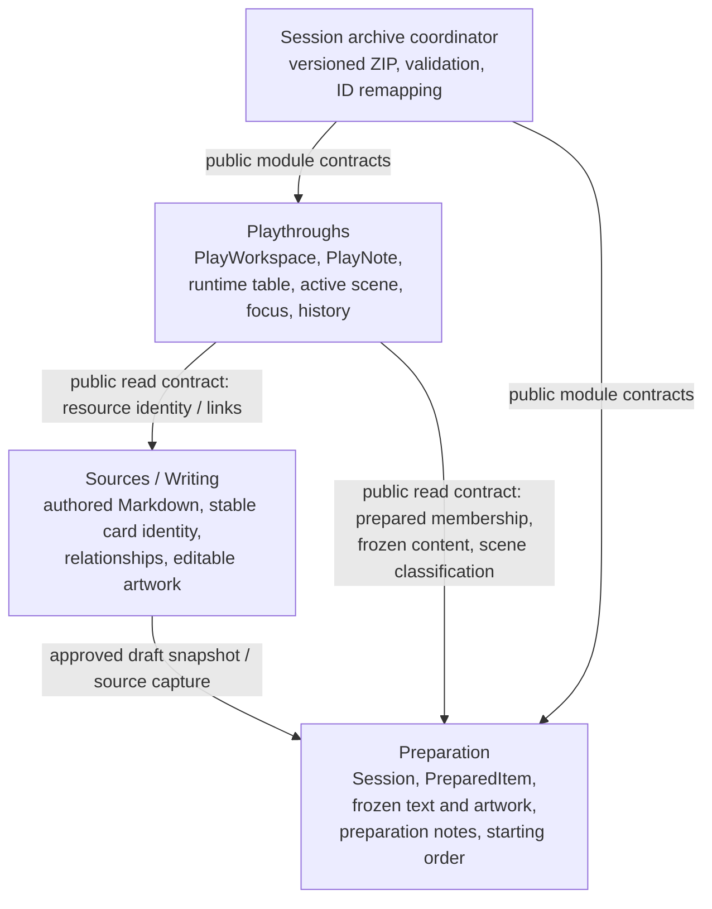
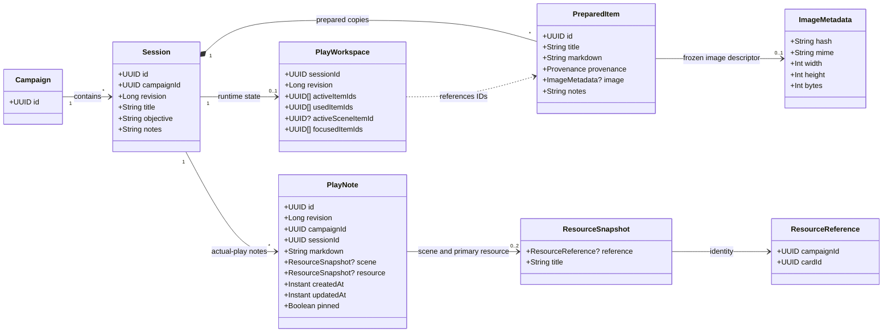
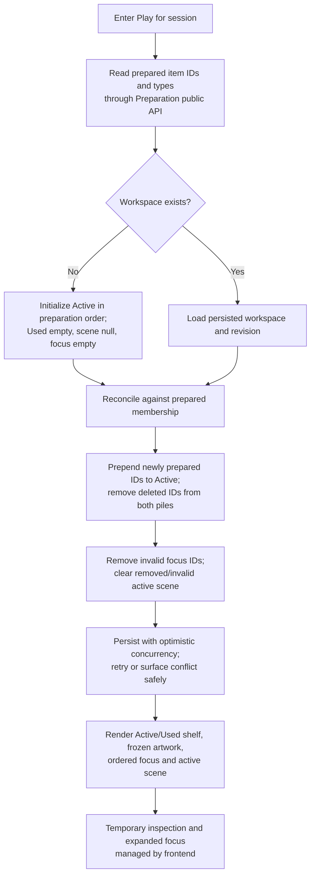
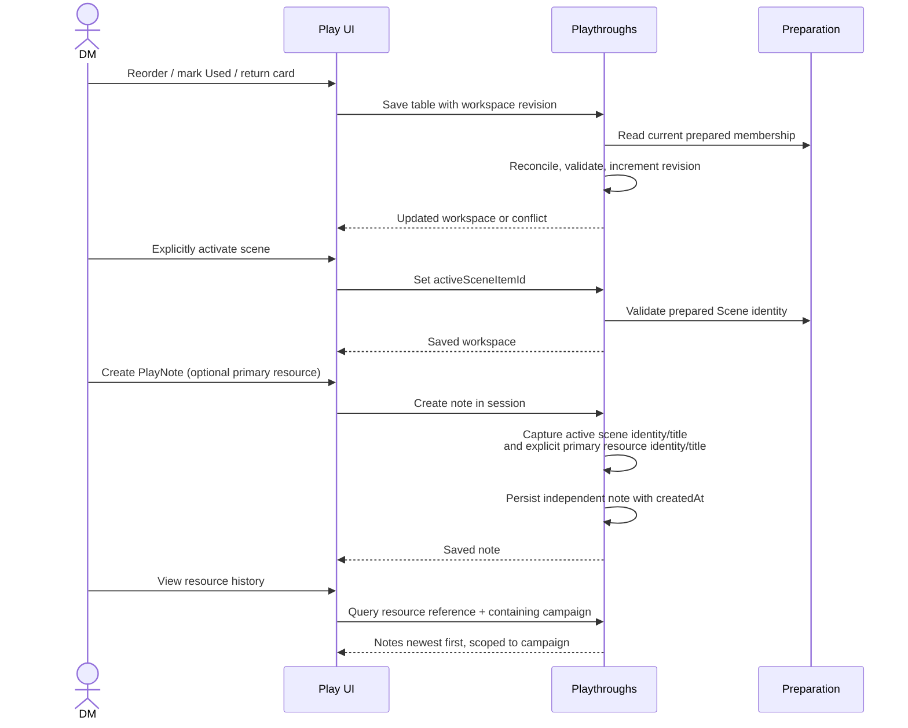
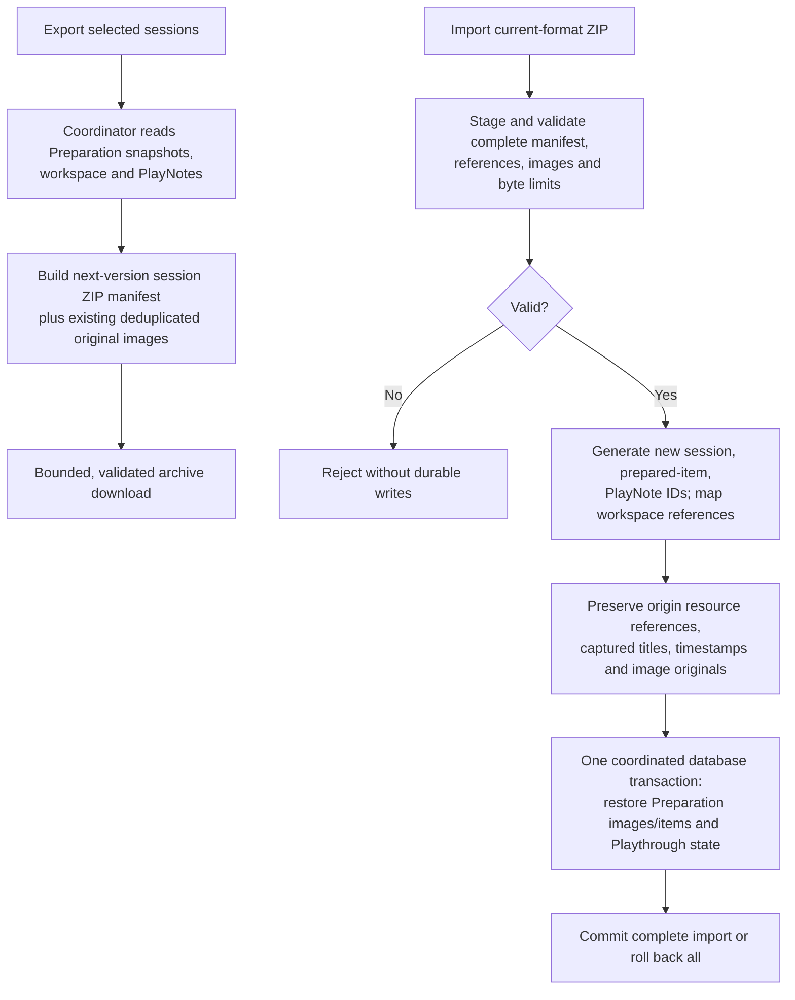

# Playthrough domain architecture

**Status:** Accepted architecture, 2026-10-22. Documentation only; implementation planning and code changes require separate approval. Derived from the accepted tabletop requirements in [product-specification.md](product-specification.md) (Q10f–Q10x), Increment 5 card-table behavior, and Increment 6A–6C image implementation in [implementation-plan.md](implementation-plan.md).

**Approved gap closure, 2026-10-22:** The identity, suggestion, contract, concurrency, note-context and archive rules below incorporate the owner's subsequent approval. Existing saved objects and archives are disposable, including in future increments: no conversion, compatibility adapter or older-format importer is required to preserve them. Keep Flyway evolution reproducible; actual resets require explicit, scoped execution authorization. Complete round trips of each increment's newly created state remain required. Card backs/flipping are excluded; 243:420 geometry is a separate presentation change using existing fields and the shared renderer.

## Domain ownership

Arrows indicate requests/data access, **not** cross-module repository access. Preparation does not own actual-play history. Playthroughs does not own artwork bytes, prepared text or source documents. The application-level coordinator handles cross-module archive transfers. No new Assets module or image store is introduced. Existing Preparation `CardTable` persistence is the current authority until a coordinated migration to Playthroughs; do not create two competing tables.

## Conceptual domain model

This is a **conceptual model**, not a JPA schema. `ResourceReference(campaignId, cardId)` identifies the original logical card across revisions/sessions. `PreparedItem.id` identifies a session-specific frozen copy. Image SHA-256 identifies immutable binary content, **not** a card. `ResourceSnapshot` captures the identity and title, not artwork or full Markdown. `PlayNote.campaignId` is the containing campaign; its resource's origin campaign may differ after import.

Resource snapshots may retain a title without a logical reference when captured metadata is invalid or untyped. Such context remains readable in session history but cannot participate in cross-session resource/scene lookup. Trust only frozen valid classification or authored card identity; Sources already invalidates duplicate declared IDs within a capture. Sections share their parent card identity, while prepared copies retain distinct item IDs. Revisions/renames preserve history only when the declared identity is preserved; splits with new identities do not inherit history automatically. Never invent identity from a path, title or image hash, nor consult current sources to repair frozen identity. A currently missing source does not invalidate a previously valid captured reference.

## Invariants and decisions

- **Preparation:** owns session lifecycle, prepared membership, preparation notes, prepared ordering, and independently frozen authored text and image. Existing session/per-item Markdown notes remain separate from PlayNotes; no implicit conversion.
- **Workspace:** at most one per session; lazily initialize on first Play entry from prepared order; restore on re-entry. Independent optimistic revision from Preparation. Active and Used are disjoint, ordered, and jointly contain every currently prepared item exactly once.
- **Card transitions:** new prepared items are **prepended** to Active (Increment 5); returning a Used card also prepends it. Removed items disappear from either pile and focus; if active scene, clear it. Preserve remaining order, focus and notes. Reconcile on workspace access/mutation against authoritative prepared membership, without event infrastructure initially.
- **Focus and scene:** up to three unique ordered prepared-item IDs; positions persist. Active scene is one explicitly selected prepared Scene or null. Inspecting or focusing a card does not activate a scene. Used cards can remain focused or be suggested with a Used indicator. Expanding one focused card survives Play → Prepare → Play in frontend state; not required to persist to DB. Temporary inspection, search/filter/scroll state are transient.
- **Inspection:** unprepared library cards can be inspected without adding or focusing them. Explicit addition uses existing capture/approval boundaries and produces a frozen prepared copy. Source-only cards retain placeholder artwork; no new source-image assignment.
- **PlayNotes:** independent timestamped Markdown records, no mandatory category or structured discovery state; optional one explicit primary resource, plus scene snapshot automatically captured at creation. Inspection/focus alone never assigns the primary resource. Scene changes affect future notes only. Editing content changes `updatedAt`, never `createdAt`; an explicit association correction captures the new title. Pinning does not alter chronology; pinned notes remain in full history. Deleting/renaming a source or removing a prepared item does not rewrite historical notes.
- **History:** session notes newest-first by immutable `createdAt`, with stable ID tie-break; separately query primary-resource history and captured-scene history by campaign-qualified `ResourceReference`. No duplicate note storage or implicit merging of these queries. Query visibility is restricted to sessions belonging to the requested/authorized containing campaign; origin identity may point to a different campaign after import. Never merge by title, path or image hash.
- **Relationships:** derive suggestions from the explicitly active scene's frozen relationships, reusing existing capture/revision-aware link resolution. Logical UUID equality alone does not satisfy an exact captured target. Show prepared matches in preparation order, retaining section targets and Used indicators; collapse repeated links to the same exact target. Multiple eligible prepared copies require explicit selection. Unprepared targets offer inspection and deliberate capture; absent, unsafe or incompatible targets remain labelled unavailable. A current library version may be inspected explicitly but never silently substitutes for an unavailable captured version. One-click focus uses a free slot; full slots use temporary inspection and explicit replacement. Suggestions never rearrange the table, return Used cards or activate scenes. No inferred relationships or new relationship store.
- **Artwork:** Play renders frozen Preparation image derivatives through existing scoped APIs; Playthroughs does not retain bytes or image references. No artwork in PlayNotes. Historical notes remain readable even if a removed prepared item's artwork is pruned.
- **Concurrency:** workspace, Preparation and individual notes have independent optimistic revisions. All Playthrough writes and archive snapshots participate in the existing campaign-row lock through the Campaigns public contract, inside one transaction. Acquire the containing campaign lock before reading session/workspace/note rows; do not lock origin campaigns when importing historical references. This serializes same-campaign writes, an accepted local-app tradeoff. Reconcile membership before validating workspace commands; reject stale user mutations without overwriting them. Persist reconciliation only when state changes; conflict responses must not discard local edits. Notes persist independently from workspace changes. Preserve originating campaign/session context on asynchronous UI operations.

### Public contracts and note capture

Preparation exposes a campaign-scoped immutable session snapshot: session identity/revision, ordered prepared membership, frozen titles/types, origin identity/provenance, anchors and frozen relationships. Its public resolver returns exact prepared candidates and explicit unresolved outcomes, sharing semantics with the existing frozen reader. Sources remains the live-library inspection boundary, Writing the exact-revision approval boundary. Preparation has no dependency on Playthroughs; reconciliation occurs on Playthrough access/mutation and archive snapshotting, not through reverse calls or events.

Note creation carries an operation ID and expected active-scene item ID, including explicit null. Under the campaign lock, reconcile membership, compare scene context, validate the optional selected resource against an authorized public snapshot, and capture titles/references on the server. A changed or removed scene returns a context conflict; retain text and require explicit confirmation/retry rather than silently changing its association. Unrelated workspace reorders do not invalidate creation. An operation ID is unique within the containing campaign/session: an identical retry returns the original note, a different payload using that ID conflicts. Edits/pins use the note's own revision; creation time never changes. Transport retry identity is not resource identity and must not prevent an imported session from accepting new notes.

## Workflow: open, reconcile, and restore

The first initialization and subsequent reconciliation must be concurrency-safe. A mode switch must not steal focus or change the active scene when new prepared items arrive.

## Workflow: tabletop actions and notes

The capture operation must not depend on the currently inspected card. Note editing and pinning are independent writes; source documents and prepared copies are never modified by PlayNotes.

## Workflow: illustrated archive export/import

Reuse existing ZIP/image infrastructure with a new explicitly versioned manifest. Reject unsupported old formats clearly; existing saved artifacts require no conversion or compatibility support. Every releasable increment must round-trip all persisted state it introduces, including null/uninitialized workspace versus initialized order, later scene/focus and later notes. Unknown or unsupported state must fail instead of being silently dropped. Export obtains Preparation and Playthrough snapshots and stages required originals under the same containing-campaign transaction/lock; release the lock before streaming the staged ZIP. Import validates the complete manifest/images before one coordinated database transaction. Preserve image integrity validation, canonical ZIP paths, byte/count limits, staging, derivative regeneration and rollback. Import does not rebind `ResourceReference` to the destination campaign; remap session, prepared-item and note IDs, including workspace references. Preserve captured titles/timestamps and historical origin references. Imported note history is visible only within the destination containing campaign, even if the source cannot resolve locally. Reconciliation before export must not omit stale workspace state or prune required artwork.

## Proposed public use cases

- `openWorkspace(sessionId)`: lazy initialization and reconciliation.
- `updateCardTable(sessionId, expectedRevision, ...)`: reorder, mark Used, return.
- `activateScene(sessionId, expectedRevision, itemId?)`: explicit scene selection.
- `updateFocus(sessionId, expectedRevision, orderedItemIds)`: maximum three.
- `createNote(sessionId, operationId, expectedSceneItemId?, markdown, primaryResource?)`: validate shown scene context and capture it at creation.
- `editNote(noteId, expectedRevision, ...)`, `pinNote(noteId, expectedRevision, ...)`: independent note mutations.
- `sessionHistory(sessionId)`, `resourceHistory(containingCampaignId, reference)`, `sceneHistory(containingCampaignId, reference)`: separate chronological queries.

These are conceptual operations, not final REST endpoints or module interfaces. Use narrow public APIs, not cross-module JPA access. Image presentation remains Preparation-owned.

## Implementation consequences and unresolved planning risks

1. **Ownership transfer:** replace Preparation's persisted CardTable authority with Playthroughs; no data conversion or dual writes. Separate frontend revisions and save guards.
2. **Consistency evidence:** test simultaneous Prepare membership changes, Play writes, note capture and archive snapshots using the common campaign lock; independent revisions are not sufficient evidence.
3. **Identity evidence:** test invalid/duplicate metadata, sections, multiple copies, missing originals and imported foreign origins without history leakage.
4. **Suggestion evidence:** give exact resolution, deterministic ordering, ambiguity, Used and unavailable targets an explicit delivery increment.
5. **Archive completeness:** implement round trips alongside each new persisted capability; no later archive-cleanup gate and no legacy compatibility work.
6. **Presentation:** retain the shared renderer, artwork fallback, full-document reader, preparation notes, navigation protection and save status. Deliver 243:420 geometry separately with 320px default width, accessible overflow for long text, no backs and no new content fields or image service.

The revised [implementation plan](playthrough-implementation-plan.md) assigns bounded increments and per-increment archive checks. It replaces the earlier suggestion to defer archive integration. No application code, tests, resets or campaign-file edits are authorized by this architecture document.
