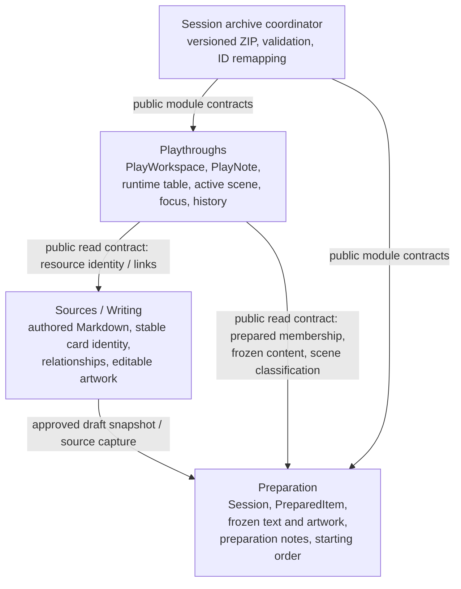
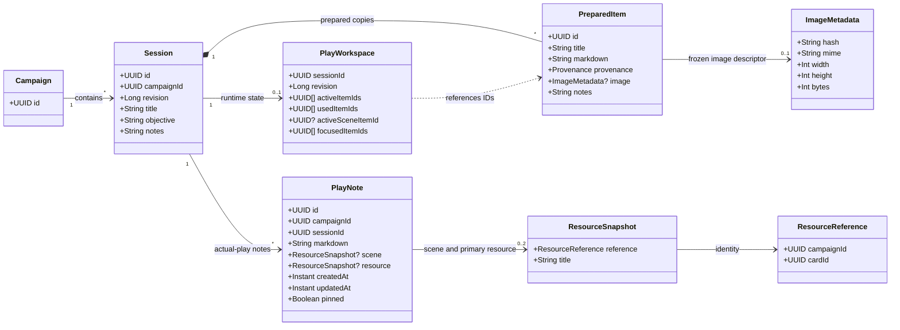
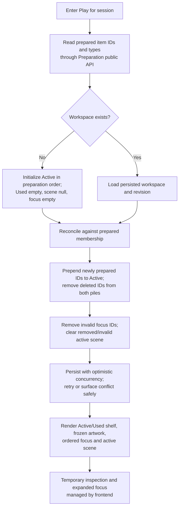
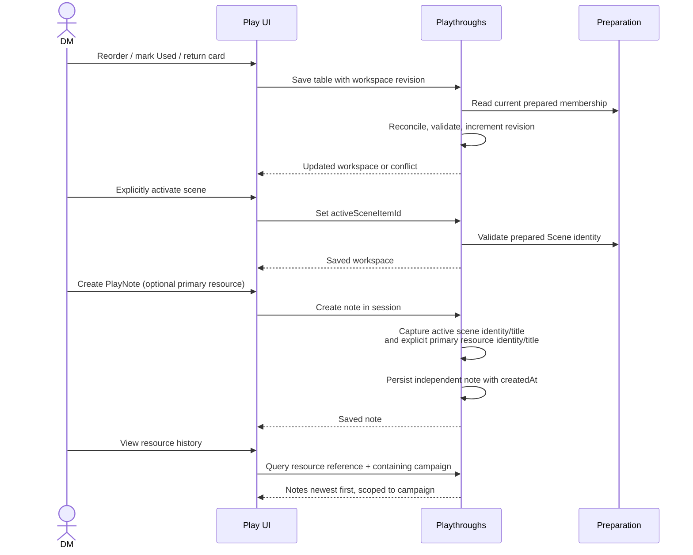
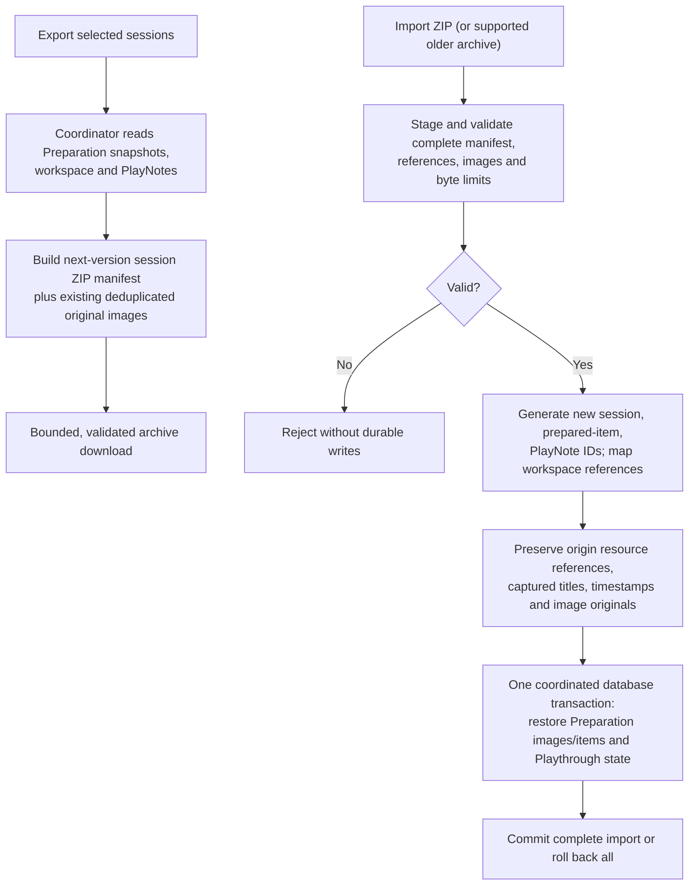

# Playthrough domain architecture

**Status:** Accepted architecture, 2026-10-22. Documentation only; implementation planning and code changes require separate approval. Derived from the accepted tabletop requirements in [product-specification.md](product-specification.md) (Q10f–Q10x), Increment 5 card-table behavior, and Increment 6A–6C image implementation in [implementation-plan.md](implementation-plan.md).

## Domain ownership

Arrows indicate requests/data access, **not** cross-module repository access. Preparation does not own actual-play history. Playthroughs does not own artwork bytes, prepared text or source documents. The application-level coordinator handles cross-module archive transfers. No new Assets module or image store is introduced. Existing Preparation `CardTable` persistence is the current authority until a coordinated migration to Playthroughs; do not create two competing tables.

## Conceptual domain model

This is a **conceptual model**, not a JPA schema. `ResourceReference(campaignId, cardId)` identifies the original logical card across revisions/sessions. `PreparedItem.id` identifies a session-specific frozen copy. Image SHA-256 identifies immutable binary content, **not** a card. `ResourceSnapshot` captures the identity and title, not artwork or full Markdown. `PlayNote.campaignId` is the containing campaign; its resource's origin campaign may differ after import.

## Invariants and decisions

- **Preparation:** owns session lifecycle, prepared membership, preparation notes, prepared ordering, and independently frozen authored text and image. Existing session/per-item Markdown notes remain separate from PlayNotes; no implicit conversion.
- **Workspace:** at most one per session; lazily initialize on first Play entry from prepared order; restore on re-entry. Independent optimistic revision from Preparation. Active and Used are disjoint, ordered, and jointly contain every currently prepared item exactly once.
- **Card transitions:** new prepared items are **prepended** to Active (Increment 5); returning a Used card also prepends it. Removed items disappear from either pile and focus; if active scene, clear it. Preserve remaining order, focus and notes. Reconcile on workspace access/mutation against authoritative prepared membership, without event infrastructure initially.
- **Focus and scene:** up to three unique ordered prepared-item IDs; positions persist. Active scene is one explicitly selected prepared Scene or null. Inspecting or focusing a card does not activate a scene. Used cards can remain focused or be suggested with a Used indicator. Expanding one focused card survives Play → Prepare → Play in frontend state; not required to persist to DB. Temporary inspection, search/filter/scroll state are transient.
- **Inspection:** unprepared library cards can be inspected without adding or focusing them. Explicit addition uses existing capture/approval boundaries and produces a frozen prepared copy. Source-only cards retain placeholder artwork; no new source-image assignment.
- **PlayNotes:** independent timestamped Markdown records, no mandatory category or structured discovery state; optional one explicit primary resource, plus scene snapshot automatically captured at creation. Inspection/focus alone never assigns the primary resource. Scene changes affect future notes only. Editing content changes `updatedAt`, never `createdAt`; an explicit association correction captures the new title. Pinning does not alter chronology; pinned notes remain in full history. Deleting/renaming a source or removing a prepared item does not rewrite historical notes.
- **History:** session notes newest-first by immutable `createdAt`, with stable ID tie-break; separately query primary-resource history and captured-scene history by campaign-qualified `ResourceReference`. No duplicate note storage or implicit merging of these queries. Query visibility is restricted to sessions belonging to the requested/authorized containing campaign; origin identity may point to a different campaign after import. Never merge by title, path or image hash.
- **Relationships:** use existing typed/captured links for contextual suggestions; never invent or automatically approve relationships. Used suggestions carry a Used indicator. Unresolved/missing/unprepared targets require deliberate presentation; exact matching/ranking remains planning work.
- **Artwork:** Play renders frozen Preparation image derivatives through existing scoped APIs; Playthroughs does not retain bytes or image references. No artwork in PlayNotes. Historical notes remain readable even if a removed prepared item's artwork is pruned.
- **Concurrency:** workspace and Preparation have independent revisions. A workspace save must verify current prepared membership under an explicit transaction/locking strategy; independent revisions alone do not prevent races. Notes persist independently from workspace changes. Preserve originating campaign/session context on asynchronous UI operations.

## Workflow: open, reconcile, and restore

The first initialization and subsequent reconciliation must be concurrency-safe. A mode switch must not steal focus or change the active scene when new prepared items arrive.

## Workflow: tabletop actions and notes

The capture operation must not depend on the currently inspected card. Note editing and pinning are independent writes; source documents and prepared copies are never modified by PlayNotes.

## Workflow: illustrated archive export/import

Build on existing session **ZIP v5** and image archive rules, introducing a new manifest version for Playthrough state. Continue accepting supported older archives, which import with an uninitialized workspace and no PlayNotes where absent. Preserve image integrity validation, canonical ZIP paths, byte/count limits, staging, derivative regeneration and transactionality. Import does not rebind `ResourceReference` to the destination campaign; it remaps session, prepared-item and note IDs. A resource reference can remain historically meaningful even when the source card cannot be resolved locally. Imported note history is visible only within the destination containing campaign.

## Proposed public use cases

- `openWorkspace(sessionId)`: lazy initialization and reconciliation.
- `updateCardTable(sessionId, expectedRevision, ...)`: reorder, mark Used, return.
- `activateScene(sessionId, expectedRevision, itemId?)`: explicit scene selection.
- `updateFocus(sessionId, expectedRevision, orderedItemIds)`: maximum three.
- `createNote(sessionId, markdown, primaryResource?)`: capture active scene at creation.
- `editNote(noteId, ...)`, `pinNote(noteId, ...)`: independent note mutations.
- `sessionHistory(sessionId)`, `resourceHistory(containingCampaignId, reference)`, `sceneHistory(containingCampaignId, reference)`: separate chronological queries.

These are conceptual operations, not final REST endpoints or module interfaces. Use narrow public APIs, not cross-module JPA access. Image presentation remains Preparation-owned.

## Implementation consequences and unresolved planning risks

1. **Workspace ownership migration:** existing `CardTable` is persisted on Preparation's `Session` and used by Angular session autosave. Plan one authoritative transfer with data preservation, revision separation, frontend state/API updates and regression tests; avoid duplicate tables.
2. **Cross-module consistency:** define locking/transaction ordering for concurrent Prepare changes and Play saves, plus conflict/reconciliation retries.
3. **Resource identity resolution:** distinguish authored card UUID, source classification, frozen prepared provenance and imported foreign origin; no title/path fallback and no accidental cross-campaign history leakage.
4. **Contextual relationships:** decide mapping/ranking of existing typed/captured links to prepared/Used/unprepared cards, with explicit missing-target behavior.
5. **Archive evolution:** preserve current illustrated ZIP v5 and JSON legacy imports, complete image retention, strict validation, identity remapping and atomic restore; archive preservation must hold at each released increment, not only after a later cleanup.
6. **Frontend integration:** retain 320px playing cards, frozen artwork/thumbnail fetch and placeholder behavior, full-document reader, existing session and item notes, navigation protection and save status. No duplicate reader or new image-storage service.

Possible bounded implementation sequence (requires **separate planning approval**): (A) PlayWorkspace and CardTable ownership; (B) PlayNotes/history; (C) archive integration. Planning must ensure that exported sessions remain complete at each boundary; move archive work earlier or explicitly gate releases if necessary. No application code, tests or campaign files are authorized by this architecture document.
