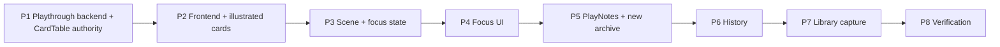

# Playthroughs — implementation planning (2026-10-22)

**Status:** Planning recorded; no implementation increment is authorized. Based on accepted [domain architecture](playthrough-domain-architecture.md), subsequently clarified by the owner. This plan supersedes that architecture document's *migration and backwards-compatibility assumptions only*, not its domain ownership or behavior. Do not implement multiple increments without separate approval.

## Owner clarifications and decisions

- Existing development database records and all exported session archives are disposable. A clean development DB reset is acceptable. **Do not implement data conversion or legacy archive import compatibility** solely to preserve those artifacts.
- Continue using Flyway for reproducible schema evolution; do not rewrite applied migrations casually. Prefer new schema migrations and a documented reset procedure.
- Preparation owns frozen prepared-item identity, content, and image originals/derivatives. Playthroughs owns runtime CardTable ordering/Active/Used, scene, focus, PlayNotes, and history. Use narrow public contracts, not cross-module JPA access.
- Preserve user-visible functionality (not historical records): artwork, card fronts/backs, Active/Used order, autosave feedback, navigation guards, image fallback, portable export/import for the **new** format, and existing full-document readers.
- The supplied `statblock_cards.html` is a **design reference**, not a commitment to import its entire standalone app or its example content. Its cards span characters, enemies, items, and other types. The complete illustrated card format, not just artwork, must remain usable across Playthrough surfaces.

## Card rendering and geometry contract

Reference HTML declares `--card-w: 300px` (screen default), screen slider 200–620 px, `aspect-ratio: 243 / 420`, print width 70 mm, and `font-size: calc(var(--card-w) / 24)`. At 300px width the card is ~519px high. The front panel is bottom-aligned with `max-height: 64%`; the back panel fills the inset area. Artwork uses cover cropping and an optional per-card focal position (`artPos`). Cards flip front/back. Text, padding, border geometry, and panel layout scale from card width; dense text is fitted within a **fixed outer ratio**, not allowed to stretch the card. The reference's print sizing is informational, not authorization to implement printing.

The existing app currently uses 320px PlayingCards; preserve that default unless a separately approved UX change adjusts it. **Do not silently replace the existing 320px sizing with the reference HTML's 300px default.** Preserve the 243:420 aspect ratio and use container-driven sizing for table, focused and inspection views. Test multiple card types and content densities, both sides, artwork and placeholder cases, small screens and desktop, with no clipping or distortion. Reuse one presentation component; no pixel sizes in the Playthrough domain or database. Confirm compatibility of reference HTML's content-fit behavior with the existing Angular renderer during P2 rather than assuming direct CSS copy is safe.

## Proposed implementation increments

### P1 — Backend PlayWorkspace and CardTable ownership

**Scope:** Establish `workbench.playthroughs` module with domain/application/API/persistence, independent optimistic revision, campaign-scoped authorization, prepared membership contract exposed by Preparation, lazy workspace initialization, Active/Used ordering and mutations, and reconciliation on Preparation changes. Remove Preparation as the authoritative CardTable owner; do not retain dual writes. Use Flyway schema additions with development DB reset. Maintain cross-module transaction/lock ordering and reject stale writes. Keep archived image ownership in Preparation.

**Expected areas:** backend Playthroughs module; Preparation public API/service and session persistence; REST adapters and client contracts; Flyway migration; architecture/module tests and PlayWorkspace integration tests. Exact filenames/migration number to be established from repository state at implementation time.

**Acceptance:** one CardTable authority; deterministic initial prepared order, prepends for newly prepared/returned items; no duplicate/missing membership; Used/Active ordering; campaign isolation; revision conflicts; prepared-item removal reconciliation; image references remain resolvable. Backend tests pass.

**Integration caveat:** existing frontend Preparation CardTable contract may be temporarily incompatible until P2. P1 is a *non-releasable intermediate increment*. Do not introduce a temporary compatibility adapter just for this slice unless evidence shows it is necessary. Owner must explicitly approve this caveat when authorizing P1.

### P2 — Angular Playthrough integration and illustrated cards

Separate Playthrough state, API, revision and save/guard lifecycle from Preparation. Reconnect existing CardTable, Active/Used drag/reorder, Used/return actions, filters and navigation. Reuse Preparation's frozen image endpoints and shared PlayingCard renderer, including front/back and formatted content. Follow the geometry contract above across table/focus/inspection-capable card presentation; do not invent a second card format. Preserve artwork crop/focal position where available, placeholder/unavailable states, and responsiveness.

**Acceptance:** illustrated Write → Prepare → Play journey; correct 243:420 scaling, 320px existing default, front/back and dense content; Active/Used/filter/reorder/autosave/conflict/navigation behavior; no broken end-to-end workflow after P2. Use Gus the Bull and at least one dense enemy and one item-like example for visual regression (test fixtures, not campaign content).

### P3 — Active scene and ordered focus slots

Persist explicit scene selection and up to three ordered focused prepared-item identities, with membership validation and reconciliation; separate persisted focus from transient inspection/expanded state. New prepared items and Used returns follow accepted ordering rules. Tests for removals, reorder, revisions and reload.

### P4 — Focused tabletop presentation

Show two to three focused cards with shared illustrated renderer; temporary inspection and expansion remain transient; accessible keyboard and smaller-viewport handling. No separate card persistence or artwork storage.

### P5 — PlayNotes and current-session chronology

Individual Markdown notes, captured context and immutable resource/scene identity and display title, chronological position, optional association and pinning. Editing/pinning must not rewrite capture chronology. Keep Preparation notes distinct. Extend the new portable session archive to include workspace and notes in the same bounded, validated, atomic export/import.

### P6 — Cross-session resource and scene history

Separate resource history from scene history; preserve chronological PlayNotes and captured titles; campaign-scoped lookup and Used-card contextual indicators. Test missing original resources and cross-campaign isolation.

### P7 — Library inspection and explicit capture

Read-only temporary library inspection; only explicit addition to the current session changes prepared membership. Keep initial experience small; optional richer capture flow remains deferred.

### P8 — Integrated verification

Backend/frontend/browser and module-boundary checks, responsive visual review for multiple illustrated card types, image round trips, new-format archive export/import, invalid archive rejection and atomic rollback, concurrency/revision/reconciliation, navigation and autosave. Formal verification is a separate authorized phase, not automatic permission to change code.

## Sequence and release gates

P1/P2 form a release gate: P1 alone may leave frontend broken. P5 forms an archive-completeness gate: no new-format archive should silently omit persisted PlayNotes. Each increment needs its own implementation authorization and test report; formal verification needs separate authorization. Do not treat this document as execution permission.

## Risks and checks before P1 authorization

1. Verify current migration numbering and Flyway reset strategy; reset must be explicit and limited to disposable development data.
2. Trace concurrent Preparation and Playthrough writes; agree on lock order and atomic reconciliation.
3. Determine exact public Preparation read/membership contract and module dependency direction.
4. Confirm current card renderer can represent both sides and the reference HTML's content-fit/cropping; where it cannot, plan a bounded P2 adaptation rather than silently reducing fidelity.
5. Decide the supported **new** session archive contract and tests without carrying legacy formats; preserve existing image byte/validation safeguards.
6. Existing architecture document still describes legacy imports and data migration; those passages are **superseded by this planning decision** and should be updated when architecture documentation is next consolidated.

**Next gate:** owner reviews and explicitly approves P1 scope, including the non-releasable frontend interval, before implementation.
