# Playthroughs — implementation planning (2026-10-22)

**Status:** Revised increment plan accepted by the owner, 2026-10-22. Requirements and architecture gap closures are accepted. No implementation, database reset or formal verification is authorized by this document. Accepted domain decisions live in [Playthrough architecture](playthrough-domain-architecture.md); requirements live in [product specification](product-specification.md#play-workspace-discovery--accepted-owner-decisions--2026-10-22).

## Decisions and exclusions

- Existing saved objects and archives are disposable, including across future increments. Do not build conversion, compatibility adapters or old-format importers to preserve them. Reset only explicitly identified development data after execution approval; never touch campaign directories or unrelated Docker volumes.
- Keep Flyway and add migrations rather than editing applied history. Current highest migration is V14; reserve no number until implementation starts. Document the actual reset procedure against the development Compose project/volume before executing it.
- Preparation owns frozen content, provenance, images, membership and preparation notes. Playthroughs owns workspace and PlayNotes. Use public module contracts and the existing containing-campaign transaction lock; no reverse Preparation dependency, cross-module repositories, events or dual table authority.
- Preserve existing user-visible functionality: artwork, Active/Used behavior, full-document access, filtering, autosave/conflict feedback, navigation guards and portable transfer of the current supported format.
- Card backs/flipping are excluded. Geometry is a separate increment using current fields; no new card-content authoring model, stat-block extraction, focal-position field, printing or reference-app import. The external HTML reference is inspiration; its complete app/content and fitting behavior are not dependencies.
- Each increment introducing persisted state includes complete current-format archive round trips. Existing artifacts may become unsupported between increments; newly exported current-format archives must restore all currently supported state. Clearly reject incompatible versions; never silently drop unknown fields that represent unsupported state.

## Card geometry contract

The shared PlayingCard used 5:7 before P2G. P2G changes its outer ratio to **243:420**, retaining 320px default width (approximately 553px high at that width) and container-driven sizing for smaller screens and focus/inspection. Scale typography, spacing and artwork proportionally while keeping controls/text accessible. Long content retains an accessible overflow/full-document path instead of shrinking without a readability limit. Reuse existing artwork and placeholder/unavailable states. No geometry belongs in domain storage. Test scene, enemy/NPC and item-like synthetic fixtures, long titles, summaries/tags, artwork/no artwork, laptop and narrow layouts. Card backs are not part of acceptance.

## P1 — Backend workspace ownership and complete archive foundation

**Deliverable:** one Playthrough CardTable authority, independently revisioned workspace and a complete current-format session archive. Intermediate backend slice; existing frontend may remain incompatible until P2. This non-releasable interval requires explicit approval with P1 authorization.

**Expected scope:** new `backend/src/main/kotlin/workbench/playthroughs/{domain,application,api,adapter}` and module wiring; Preparation public contracts, Session/domain/API/persistence; application-level session archive coordinator outside both modules; existing portable/image adapters; new Flyway migration after current V14; focused backend/module tests. No frontend implementation except contract generation/check evidence; no temporary compatibility layer.

**Tasks and contracts:**

1. Expose a Preparation-owned immutable session snapshot containing session/campaign/revision and ordered item IDs, frozen title/type, provenance/resource identity, anchors and relationships. Keep bytes and repositories private. Define the exact candidate-resolution contract using existing frozen-reader semantics, with its implementation completed in P4R.
2. Add workspace persistence keyed by session with independent revision, nullable/uninitialized state distinct from an initialized table. Remove CardTable from Preparation's save authority and persistence contract; use an additive Flyway change to remove obsolete authority, without converting saved rows. Do not seed from old CardTable data.
3. On workspace open/mutation, start a transaction, acquire Campaigns' existing row lock, validate containing session/campaign, load authoritative membership, initialize or reconcile, then validate the expected workspace revision. Preserve initial prepared order, prepend additions/returns and remove missing items. Reconciliation writes only if changed. Stale client commands cannot overwrite newer state; persist no partial mutation on failure.
4. Keep Preparation free of Playthrough calls. Membership changes reconcile on next workspace access/mutation and export, under the shared campaign lock. Establish lock-first ordering for all new writes and archive snapshots; retain separate session revision.
5. Move cross-module archive orchestration into the application composition boundary. Reuse ZIP staging, image stores/processors and strict validation. Current-format manifests include workspace null/order and independent state; reject unsupported versions. Snapshot both modules and stage originals in one locked transaction, then stream outside it. Import validates first, remaps IDs and commits items/images/workspace atomically. Do not carry legacy JSON/ZIP parsers solely for saved artifacts.
6. Retain existing 256 MiB portable/extracted, 20 MiB session-manifest, 100-session, 1,000-item, 2 MiB text-field and transfer-staging limits. Derive a new explicit manifest version from the implemented codec at start; do not accept versions by coercion. Reserve no speculative format version for later increments.

**Acceptance and developer checks:** backend integration tests prove one authority, lazy initialization, no duplicate/missing membership, deterministic order/prepends, reconciliation, stale revisions, campaign isolation and continued scoped image resolution. Concurrent Prepare removal/addition versus workspace writes must serialize safely; invalid writes roll back. Round-trip initialized/uninitialized workspaces and illustrated sessions, fresh IDs with preserved origin references, invalid/oversized archives and unsupported versions, image integrity and atomic rollback on failure. Run backend `test bootJar`, including Modulith/ArchUnit checks; generate/inspect OpenAPI and record expected temporary frontend contract failures. Write scoped reset instructions without executing an unapproved reset.

**Completion boundary:** backend and archive evidence recorded; stop before P2. A backend pass does not establish a usable frontend release.

## P2 — Frontend workspace integration

**Scope:** generated Angular client, dedicated Playthrough state/API/revision/save lifecycle, existing Preparation workspace/CardTable integration, image sources and navigation guards; targeted state/component/browser tests. Reconnect existing shared card presentation without changing geometry yet. Wire portable transfer controls to P1's current-format coordinator.

**Acceptance:** Write → Prepare → Play remains usable with frozen artwork, preparation notes/full reader, Active/Used reorder/return and filters. Workspace edits do not overwrite Preparation revision/notes. Test slow/error/conflict saves, campaign/session switches and late responses, retry/discard guards, reopening and portable round trip. Run client generation, frontend checks/build and an isolated browser journey. P1+P2 are the first potentially releasable slice, only with complete archives and passing integration checks.

## P2G — Shared card geometry

**Scope:** shared PlayingCard renderer and necessary table/Write/Prepare/recovery sizing consumers; existing artwork component only if proportional layout requires it. No schema, API or authoring-field changes.

**Acceptance:** satisfy the geometry contract above across existing card surfaces, keyboard controls, focus outlines, dense content and narrow screens. Use synthetic fixtures, not independent campaign files. Run focused component checks, frontend build and browser/visual inspection. Frozen image selection, fallback and full-document access remain functional. Record visual evidence and any remaining owner visual acceptance.

## P2A — Full-image card artwork

**Status:** Approved follow-up to P2G, 2026-10-22. Preserve its outer geometry and default width.

**Scope/design:** Shared PlayingCard allocates approximately 55% of its content height to artwork. ArtworkImage exposes a CSS fit property, retaining cover by default for thumbnails; PlayingCard opts into contain. This keeps fitting with the presentation owner and avoids a global thumbnail change, image processing or metadata fields. Letterboxing is an accepted consequence of displaying the full image. Existing summary overflow absorbs the reduced text area.

**Acceptance/checks:** Portrait, landscape and square artwork remains complete and undistorted across shared card surfaces. Retain 243:420/320px geometry, keyboard access to long titles/summaries and the document action, frozen artwork, placeholders/failure/retry and Active/Used navigation. Add real-browser image-aspect fixtures and check laptop/narrow rendering; run frontend checks/build and integrated browser journeys. No backend/API/dependency/archive change. Record developer evidence in the main implementation plan; stop before separate formal verification and later increments.

## P3 — Scene and ordered focus state, including archives

**Status:** Accepted by the owner on 2026-10-22 after bounded V-P3-01 re-verification; see [P3 developer evidence](implementation-plan.md#p3--scene-and-ordered-focus-state-including-archives--developer-evidence--2026-10-22). The re-verification assessment is recorded in `verification.md`.

**Scope:** Playthrough domain/API/persistence and generated client, explicit scene activation, up to three unique ordered prepared IDs and frontend state integration. Preparation remains read-only to these operations.

**Acceptance:** inspection never activates a scene; Used cards may stay focused; removals clear invalid focus/scene only; new items never steal focus. Persist/reopen scene/focus independently of Preparation revision. Test concurrent membership changes and stale writes. Extend current archive format/validation in this increment to remap and round-trip scene/focus and reject invalid references. Existing saved artifacts may be discarded; no upgrade converter.

## P4 — Focused tabletop presentation

**Status:** Implementation and developer checks completed on 2026-10-22; see [P4 developer evidence](implementation-plan.md#p4--focused-tabletop-presentation--developer-evidence--2026-10-22). Formal verification and owner visual review remain separate.

**Scope:** existing Play workspace/CardTable plus reusable focus/temporary-inspection presentation using the shared card and full-document reader. No duplicate card/document system.

**Acceptance:** two or three focused cards, explicit slot replacement, temporary fourth-card inspection, one-action expansion/return; keyboard and laptop/narrow layouts. Same-session Play → Prepare → Play retains expanded focus; reopen restores persisted identities but closes temporary inspection. Notes remain independently accessible. Test removals, asynchronous navigation and retained selection. No new persisted state requiring another archive extension.

## P4R — Contextual relationship suggestions

**Scope:** Preparation public exact-target resolver sharing existing frozen-reader semantics, Playthrough read composition and focused-tabletop suggestions. No new relationship authoring/storage or AI ranking.

**Acceptance:** derive from active scene's frozen links; exact source capture/authored revision and section constraints, not UUID-only matching. Deterministic preparation-order matches; deduplicate repeated exact targets, retain Used indicators, require explicit choice between multiple copies. One-click focus only with room; otherwise temporary inspection/replacement. Label missing/unsafe/incompatible targets unavailable and unprepared targets for inspection/capture. Suggestions never reorder, return or activate cards. Test refreshed live sources, old revisions, sections, duplicates and ambiguity. P7 supplies the wider-library inspection/capture action; until P7, unprepared suggestions remain labelled with the action unavailable, so full suggestion acceptance is gated on P7. This is an explicit dependency, not a claim that all behavior ships in P4R.

## P5 — PlayNotes, context safety and archives

**Scope:** Playthrough note persistence/API/state/editor using existing Markdown editing/rendering patterns; current-session chronology and pinned presentation; public snapshot-based associations; portable coordinator/codec validation. Keep Preparation session/item notes unchanged.

**Acceptance:** freeform notes, immutable creation chronology with stable ID tie-break, optional primary resource and captured scene/title, pinning without removing chronological entries. Own note revision prevents lost edits/pins. Create requests carry operation ID and expected active-scene item (including null); changed scene returns a context conflict retaining text, unrelated reorder does not block creation. Identical retries return one note; changed payload with same operation ID conflicts. Preserve originating UI campaign/session.

Test valid identity, untyped/duplicate metadata (title context without fabricated cross-session identity), sections, multiple copies and removed resources. Server captures snapshot evidence, not arbitrary client-supplied titles. Extend archives now for all note fields, revisions as restored-state policy requires, captured identities/titles/timestamps and fresh note/session/item IDs. Prevent imported retry IDs colliding with new creates. Test malformed references, rollback and existing byte limits; limit notes to 10,000 per session and 10,000 total per archive, in addition to the existing 2 MiB Markdown-field and 20 MiB total session-manifest limits. Validate counts before allocating records; reject excess without truncation. These are proposed operational bounds for owner review with this plan, not guarantees that maximum-sized records fit one archive.

## P6 — Cross-session resource and scene history

**Scope:** separate Playthrough primary-resource/scene query APIs, bounded pagination/indexes and card-history UI, reusing note records and current session navigation.

**Acceptance:** newest-first immutable creation chronology plus stable ID tie-break, pinned notes remain in full history, no title/path/image merges. Sections share logical parent history; prepared copies remain independently selectable. Restrict results by containing campaign even for imported foreign origins. Missing originals remain readable; unresolved references provide session context only. Test deletion/rename, imported copies, pagination ties, campaign isolation and no automatic merges/deduplication of independent imports. No duplicate history storage or campaign-history workspace.

## P7 — Wider-library inspection and explicit capture

**Scope:** reuse Sources library/search/reader and existing capture/approval boundaries in Play; connect P4R's unprepared-target actions. No new source-image assignment.

**Acceptance:** inspect without preparing/focusing/activating; explicit add captures the requested source or approved saved draft into the originating session, then reconciles workspace without stealing focus. Exact unavailable historical targets never silently become current content; current-library inspection/addition is clearly deliberate. Test stale captures/approvals, failures, duplicates, navigation context and Used behavior. Complete P4R's end-to-end acceptance here. Capture/session mutations retain existing revision/guard protections.

## P8 — Integrated developer handover

**Scope:** integrated checks and evidence for the completed authorized increments; in-scope corrections only under their implementation authorization. Formal Verification remains a separately authorized phase, not an implementation increment automatically authorized by this roadmap.

**Acceptance:** backend/frontend/module checks; responsive visual review; illustrated Write → Prepare → Play; scene/focus/mode-switch restoration; suggestions and library capture; notes/history; current-format portable round trips and invalid import rollback; concurrency, retries, navigation and autosave. Map Q10f–Q10x to evidence and identify manual/untested areas. No deferred requirement becomes implicitly implemented or accepted.

## Sequence and release rules

```mermaid
flowchart LR
  P1["P1 Backend + archive foundation"] --> P2["P2 Frontend integration"]
  P2 --> P2G["P2G Card geometry"]
  P2G --> P2A["P2A Full-image artwork"]
  P2A --> P3["P3 Scene/focus + archives"]
  P3 --> P4["P4 Focus UI"]
  P4 --> P4R["P4R Contextual suggestions"]
  P4R --> P5["P5 Notes + archives"]
  P5 --> P6["P6 History"]
  P6 --> P7["P7 Library inspection/capture"]
  P7 --> P8["P8 Integrated handover"]
```

Each increment needs explicit implementation authorization and its own developer report. P1 alone is non-releasable; P2 restores the full existing application journey. No release may omit current persisted state from its archive. P3 and P5 extend archives alongside state, rather than deferring completeness. P4R's unprepared actions complete in P7 and must be reported as partial until then. Releasing a subset is not acceptance of the entire tabletop feature. Older saved objects/archives need no compatibility support at any boundary. Formal verification and owner acceptance are separate gates.

## Requirement coverage and next gate

| Requirement | Delivery/evidence owner |
| --- | --- |
| Existing table/artwork/reader/notes/save protections | P1/P2; final regression P8 |
| Single-sided 243:420 cards, 320px default | P2G; reuse P4/P7 |
| Q10f–Q10i scene, focus, temporary inspection | P3/P4/P4R |
| Q10j wider library and explicit capture | P7 |
| Q10k–Q10l notes-only improvisation/world changes | P5, no source writes |
| Q10m–Q10o resource history, one association, pins | P5/P6 |
| Q10p–Q10q reader and existing session review | P2/P4/P6 |
| Q10r–Q10s restoration and expansion | P3/P4 |
| Q10t–Q10v Used semantics, related Used, no scene history UI | P2/P4R; exclusions throughout |
| Q10w–Q10x mode continuity and simple removal | P3/P4/P7 |
| Complete illustrated archives of all supported state | P1/P2, P3, P5; P8 regression |

**Next gate:** P2 passed bounded corrective re-verification in [verification evidence](verification.md) and was accepted by the owner on 2026-10-22. P2G passed bounded formal verification; owner visual acceptance remains separate. P2A full-image artwork has developer evidence in the main implementation record; formal verification and owner visual acceptance remain separate gates. P3 passed bounded V-P3-01 re-verification and was accepted by the owner on 2026-10-22. P4 implementation/developer checks are recorded in the main implementation record; its formal verification and owner visual review remain separate. P4R and later increments require separate owner authorization. Approval of this document alone is not code/reset authorization. Exact REST names and migration filename are routine implementation choices within the approved contracts; changed behavior or broader architecture must return to the relevant phase.
