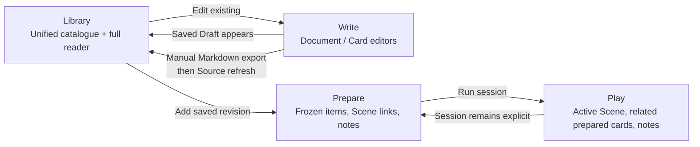

# Unified Library / Write / Prepare / Play — Accepted UX design

**Status:** UX design accepted through Decision 27 (2026-10-23). Subsequent [architecture reconciliation](implementation-plan.md#unified-library--write--prepare--play--accepted-architecture-reconciliation--2026-10-23) is approved and documented. UW1–UW6 subsequently implemented the integrated workspace; see the [UW6 handover](implementation-plan.md#uw6--accepted-integration-and-final-handover) and [formal assessment](verification.md#uw6--unified-workspace-integration-and-final-handover--2026-10-23) for delivered scope and limits. Later UX-C increments refine that behavior. This remains the accepted design record; verification and owner acceptance are distinct.

**Authority:** [Product specification](product-specification.md), [Playthrough architecture](playthrough-domain-architecture.md), and the project development workflow. This refinement supersedes conflicting *future UX direction*, not implemented features or previous historical records. No code or migration authorization follows from this document.

## Design intent and composition

Four top-navigation workspaces: **Library** discovers/reads; **Write** creates/edits/exports; **Prepare** assembles frozen session material and plans Scenes; **Play** runs the prepared tabletop and records events. Keep 1280×800 laptops usable; no permanent extra navigation sidebar. Keep existing 243:420 playing-card geometry (default 320px), Markdown heading-aware reader, notes facilities, and filtering mechanisms. Verify actual screen dimensions and independent scroll regions before implementation decisions.

### Library

- One logical entry for Source-only, Draft-only, or associated Source+Draft; Draft takes precedence for content/metadata/artwork. Never merge by title alone. Source provenance, revision, missing/changed Source, validation and identity collision appear in secondary **Details** disclosure; blocking problems also appear beside disabled actions.
- Two-column master/detail at laptop width: independently scrolling **compact illustrated catalogue rows** (thumbnail or placeholder, title, type, short summary) and a spacious selected-document reader. Reuse existing type filter, search and heading navigation; do not invent an additional All/Scenes shortcut.
- Selecting a catalogue entry defaults to the **full Document reader**. Switch to **Card** presentation on demand. Document and Card are reading modes; **Details** is a collapsible secondary section, not a third reading tab.
- **Edit in Write** and **Add to session** live exclusively in the selected document's header/action area, not in individual catalogue rows. **Create document** is *not* offered in Library: navigate to Write to create. Existing Draft opens in Write; Source-only editing creates an associated Draft.
- **Add to session exists in Library**, not in Write. For a Source-only valid card, automatically create/reuse associated Draft then approve and freeze its successfully saved revision; invalid required metadata blocks addition and directs to Write. This does not publish to the campaign repository.
- Show clear status for the selected current session: ready, **Already in session**, **Prepared · Update available** (open Prepare for explicit update), blocked, or failed. Successful addition retains catalogue selection and reader position, briefly confirms success, and persistently replaces Add with **View in Prepare**. Never silently add a duplicate whole-card copy.
- Explicit current session in top navigation across all four workspaces. User may select, switch or clear it; no implicit selection from a recently visited session. If selected, Add acts directly with the destination clearly displayed; offer **Choose another session**. Without selection, choose/create a session before addition. Switching session re-evaluates the current card status, without resetting search/reading. Cross-campaign selections are invalidated.
- Use destination identity captured when Add starts; a concurrent switch cannot redirect an in-flight addition. Failures leave selected document and reading state unchanged, do not leave partial automatic Drafts or PreparedItems, and offer retry/correction with clear messages. Identity conflicts block new preparation until resolved.

### Write

- Write is the sole new-document entry point. Actions labelled **Create document**, **Edit document**, **Export to campaign**. Last is *manual Markdown export*, not direct campaign repository write or canon adoption; explain placement and explicit Library refresh needed.
- Main editor has independent **Document / Card editing tabs**. Document edits Markdown. Card edits concise authored presentation including card title, type/metadata, summary and optional artwork. No extra visual card layout designer; respect actual fixed card geometry.
- One optional/collapsible supporting right panel, selectable **Preview / Library / AI assistance (future)**; only one mode at a time, with primary editing width protected. Preview independently selects **Card / Document** regardless of editing tab. Compact Library reference search shows previews; long-document reading remains in dedicated Library.
- **Open full document** from Write reference panel navigates to Library and exposes **Return to Write**. Restore Draft, editing tab, support mode, preview mode, selected reference/search, and panel expanded/collapsed state. Cursor and scroll restoration best effort. Respect existing autosave/navigation guards: finish pending saves before navigation; on failure remain in Write with intact edits; on return reopen original Draft and safely restore transient context. Never assume Angular component routing itself preserves unsaved text.

### Prepare

- Preserve compact session ordered-card list, group/type filtering, central full Markdown heading-aware reader and right-hand existing **Notes** panel. Selecting any prepared item opens **Read** first; Scenes additionally expose **Scene planning** tab.
- Scene planning creates **session-only links from a prepared Scene to other already-prepared cards**, by PreparedItem identity. Membership and linking are separate: do not add unprepared Library cards as a side effect of linking. Prepared card may belong to several Scenes.
- Scene-linked cards display in the session's existing preparation order; no separate order per Scene. Selecting a related prepared card temporarily opens its reader; **Back to scene** restores Scene planning and its context without disrupting notes selection. Notes remain existing Session/Card scope: Session stays fixed while switching cards; Card follows actual selected prepared card, with predictable temporary inspection restoration.
- **Do not author dedicated Scene-card relationships in Write.** Ordinary Markdown document hyperlinks still work for reading/navigation, but they do not drive contextual Scene associations in Play.
- For a newer valid saved Draft revision of the same type, Prepare offers **Update available → Use latest version**, without a diff workflow. Update is explicit, preserving PreparedItem identity, order, preparation notes, Scene relationships and compatible Play state; invalid metadata/type change blocks in-place update. Never silently mutate frozen material or historical PlayNotes.
- Removing a prepared card linked to Scenes confirms affected Scene names and removes session links *atomically* with card removal. Do not delete any Library card or PlayNotes.

### Play

**Reviewed tabletop UX extension (2026-10-23):** [Play tabletop — reviewed UX design](play-tabletop-ux-design.md) records the owner-confirmed reserved Scene slot, two unique-location runtime piles, Scene activation/transition overview, drag-and-drop, pile overlay, and switchable Notes/Document panel using the existing Notes space. This supersedes the former three-individual-focus-card *future presentation* and requires separate architecture reconciliation and browser verification. It does not claim the redesign is implemented.

- Retain approved Play UI/ownership: explicit active Scene, Active/Used, up to three focus slots, existing full reader, notes and historical identities.
- Contextual **Related cards** for the active Scene come **only from session-specific Preparation Scene→PreparedItem associations**, in Preparation order. Do not derive from authored Markdown links. P4R existing implemented resolver is superseded *as future behavior* and requires architecture/plan review; do not assume it was already replaced.
- Prepared card identity and resource history remain distinct. Inspection alone never adds a card, assigns focus, or changes the active Scene; temporary previews are reversible.

## Whole-card duplicate scope, sections and history

- Through the **normal whole-card Library Add action**, allow at most one prepared copy of each logical card in a given session; a repeated Add opens the existing copy or points to Prepare's explicit revision update.
- Preserve existing historical and section-specific captures; a section capture of a document is not automatically the whole-card copy. This is a UX rule for the new workflow, **not** an unconditional global database uniqueness invariant. Imported multiple PreparedItems and PlayNotes must retain identity and historical accessibility.
- A Scene link points to the exact prepared item, not a Source path or loosely matching logical card ID. Existing historical resource note queries must not be merged by item identity.

## Interaction journeys and feedback

1. **Research + author:** Read document in Library → Edit in Write (or navigate to Write to Create) → Document/Card edit with optional support → full Library research with safe Return to Write → save → explicit manual Markdown export → file placed by DM → Source refresh. No implied publication.
2. **Discover + prepare:** Search unified Library → full document → explicit session destination → Add saved valid revision → remain in Library with confirmation and persistent prepared state → optional View in Prepare → explicit update if later Draft changes.
3. **Scene + tabletop:** Select Scene in Prepare → Read → Scene planning → link existing prepared cards → inspect related card and Back to scene → Session/Card notes → Play active Scene presents precisely those linked prepared cards → real-play notes remain separate from preparation notes.
4. **Failure flows:** Missing metadata → Fix in Write; identity conflicts → explicit resolution; save/capture/approval errors → no partial additions and safe retry; changing campaign/session never silently changes in-flight destination; already-prepared → View in Prepare; linked card removal → show impacted Scenes then atomic cleanup.

## Decision record / supersessions

- UX 2: session-specific links; 3: temporary read + Back to scene; 4: reuse per-card notes; 5: Read first, Scene planning tab; 6: retain Session/Card note scope; 7: link only prepared items.
- UX 8 (mixed authored/session relationships) and 9 (only session links removable) **superseded** by later decision: only session-specific Scene links drive contextual cards; Markdown hyperlinks remain ordinary reader links.
- UX 10: reuse existing filters; 11: no selected policy, simplified later by UX 13; 12: Preparation order; 13: simple same-type Use latest version.
- UX 14: switchable one supporting panel; 15: Document/Card editor tabs; 16: independent preview choice; 17: Library full reading with Return to Write; 18: restore complete transient writing context, with save safety.
- UX 19: Library document first; 20: compact illustrated rows; 21: actions on selected document only; 22: current-session direct Add; 23: one whole-card copy per session via normal Add; 24: explicit shared session selection; 25: persistent prepared state + brief feedback; 26: confirm and atomically remove Scene links with removed prepared card; 27: **no Create action in Library**.
- UX 1 had no formal binary choice: final accepted direction is dedicated Library + contextual limited reference access, no permanent sidebar.

## Architecture and acceptance handoff — not implementation authorization

1. Reconcile the unified Source/Draft logical card identity, approval/freeze, current session context and transactional Add with current modules/API; preserve existing section captures and historical multiple items.
2. Change P4R's authored frozen-link contextual suggestion mechanism to Preparation-owned session Scene links used by Play. Define archived persistence, import/export, membership cleanup, concurrency and revision implications. Preserve Markdown hyperlinks for document reading.
3. Reconcile prepared revision replacement with Scene associations, active Scene, focus, Active/Used piles, archive snapshots and immutable PlayNotes. Define exact conflict behavior for deleted/missing/changed cards.
4. Verify 1280×800 and 1440×900 layouts against actual CSS and card sizes, reader/notes overflow, keyboard focus/accessibility, navigation guards, and saving behavior.
5. Update implementation plans *only in a separately authorized planning phase*. The existing accepted Playthrough increments and P4R implementation history are not retroactively rewritten by these UX requirements.

**Status:** UX requirements refinement and subsequent architecture reconciliation are accepted. The architecture record resolves ownership, identity, atomic Add, Scene associations, replacement and navigation boundaries. Physical persistence details and browser layout validation remain later work within those boundaries. No code implementation, database changes, migrations, or planning authorized.
